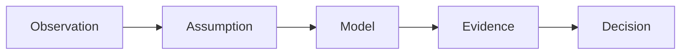

# Index  -  Philosophical Foundations of Data Analysis

Before opening a notebook or dashboard, analysts carry implicit ideas about evidence, causality, measurement, uncertainty, and responsibility. If these ideas remain unspoken, they still guide the work but without critical control, increasing the risk of flawed decisions.

The **Index  -  Philosophical Foundations of Data Analysis** serves as a mental toolbox to navigate the discipline of making decisions under uncertainty, helping to recognize when data truly supports a choice and when it hides fragile assumptions or biases.

## Real-world Problem

In everyday data work, the challenge is not just collecting numbers but understanding when those numbers genuinely help make better decisions. Often, seemingly solid data conceals unverified assumptions, uncertain causality, or misinterpretations. This lesson transforms philosophy into an operational tool to connect concept, data, and concrete choice, preventing knowledge from remaining decorative.

## Conceptual Model

The mental process is sequential: start with a well-formulated question, translate it into observable units, assess data quality, and only then decide. Skipping steps leads to fragile and risky analyses.

| Step | Guiding Question | Expected Output |
|---|---|---|
| Framing | Which decision needs to change? | A concrete choice, not mere curiosity |
| Measurement | Which signal represents the phenomenon? | Metric, source, and granularity |
| Comparison | Against which baseline do I interpret the result? | Benchmark or plausible counterfactual |
| Action | What do I do if the signal exceeds the threshold? | Decision, owner, and next check |

## Rigorous Formalization

We formalize the index as a relation among four key elements:

| Element | Operational Definition |
|---|---|
| Unit | Observation, hypothesis, variable, causal mechanism, or evidence criterion |
| Signal | Strength of evidence, causal coherence, robustness of assumptions, cost of decision error |
| Baseline | Alternative explanation, counterfactual, comparable group, or no-intervention scenario |
| Decision | Accept, reject, or reformulate an explanation before applying it in business |

The practical rule is simple: a measure is useful only if it reduces uncertainty about a specific decision. If it does not change a choice, it is documentation; if it changes a choice without checks, it is risk.

## Example or Case Study

A committee interprets retention growth as proof that a new initiative succeeded. Applying the index, the team clearly separates observation, assumption, and decision:

| Evidence | Cautious Interpretation | Resulting Decision |
|---|---|---|
| Positive but isolated signal | The phenomenon exists, but the cause is uncertain | Seek baseline or control group |
| Segment with different response | The average effect hides heterogeneity | Analyze cohorts or subgroups |
| Rising operational cost | Evaluate result on economic margin | Apply cost-benefit thresholds |

This format prevents presenting a number as a definitive conclusion, fostering a critical and responsible approach.

## Lab / Exercise

### Basic Level

Write in five lines a real decision linked to the index: objective, primary metric, baseline, main risk, and planned action. Use only one primary metric.

### Intermediate Level

Build a table with at least three segments or scenarios. For each, indicate signal, possible alternative explanation, and necessary check before deciding.

### Research-grade Level

Design a validation plan: hypothesis, required data, exclusion criteria, decision threshold, and post-decision check. Specify what would make you change your mind.

### Recommended Datasets and Materials

Use decision case studies, product metrics, experiment results, simple DAGs, analytical reports, and simulated time series. If no real data is available, create a synthetic dataset with at least 200 rows, including a time column, a segment column, an outcome metric, and an exposure variable.

## Common Pitfall to Avoid

The most frequent mistake is treating the index as a definition to memorize rather than a decision protocol. This happens when presenting a metric without baseline, a chart without hypothesis, or a recommendation without considering the cost of error.

A useful check is to ask: "If this result were false or unstable, what wrong decision would I make?" If the answer is unclear, the lesson has not truly been applied.

## Quiz or Checkpoint

1. What concrete decision should this lesson improve?
2. Which baseline makes the result interpretable?
3. Which assumption, if wrong, would change the conclusion?
4. What minimum check would you use before presenting the recommendation?

## Operational Summary

The index is a fundamental skill for anyone wanting to rigorously and responsibly connect concept, data, and decision. Study it starting from a real problem, formalize the signal, find a credible baseline, build an example, and close with a practical check. Only then does philosophy become a tool for better decisions under uncertainty.

Category: Index. Difficulty: advanced. Estimated time: 5 minutes.
