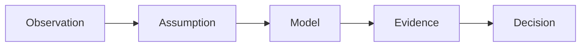
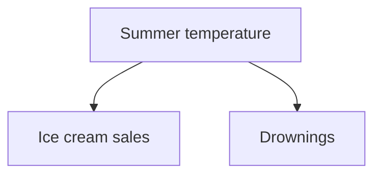
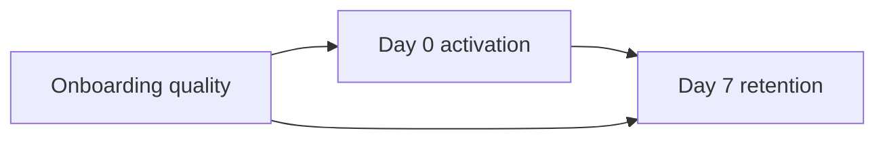
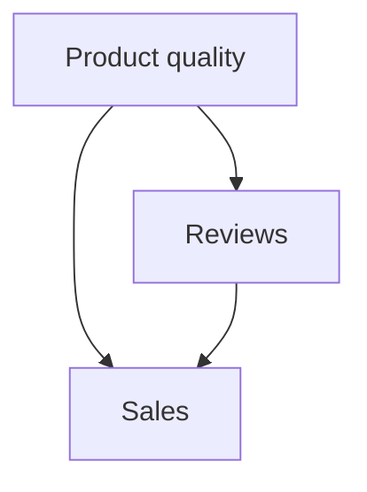

# Judea Pearl, DAGs, and the Causal Revolution

Making decisions under uncertainty requires more than spotting correlations. **Judea Pearl, DAGs, and the causal revolution** provide a framework to make assumptions explicit, identify confounders, and evaluate interventions rigorously.

## Real-world problem

Suppose you want to know if a discount increases customer retention. Loyal customers receive different offers and already buy more, so a simple data table is insufficient. You need a causal map to avoid misleading conclusions. This lesson helps you understand when data truly support a decision and when they hide biases or poorly framed questions.

## Conceptual model

The correct process starts with a concrete question, defines observable variables and assumptions, assesses data quality, and leads to a decision. Skipping steps yields elegant but fragile analyses.

| Step | Guiding question | Expected output |
|---|---|---|
| Framing | Which decision needs to change? | A concrete choice, not curiosity |
| Measurement | Which signal represents the phenomenon? | Metric, source, granularity |
| Comparison | Against which baseline do I interpret results? | Benchmark or plausible counterfactual |
| Action | What do I do if the signal passes the threshold? | Decision, owner, next check |

## Rigorous formalization

Causality formalizes relations among unit of analysis, signal, baseline, and decision:

| Element | Operational definition |
|---|---|
| Unit | observation, hypothesis, variable, causal mechanism, or evidence criterion |
| Signal | strength of evidence, causal coherence, assumption robustness, cost of decision error |
| Baseline | alternative explanation, counterfactual, comparable group, or no-intervention scenario |
| Decision | accept, reject, or reformulate explanation before use |
| Risk | confusing correlation, data quality, and causal decision-making |

A measure is useful only if it reduces uncertainty about a specific decision. If it does not change the choice, it is decorative; if it changes the choice without controls, it is risky.

## Pearl's three levels of causality

| Level | Name | Question | Tool |
|---------|------|---------|-----------|
| **L1** | Association | *What do I see?* | Conditional probability, correlation, regression |
| **L2** | Intervention | *What happens if I do X?* | DAG + do-calculus, randomized experiments |
| **L3** | Counterfactual | *What would have happened if I had done Y instead of X?* | Structural causal models (SCM) |

You cannot answer L2 or L3 questions using only L1 tools. Regression models reveal associations only. To ask "what happens if I do X?" you need an explicit causal model.

## DAGs: Directed Acyclic Graphs

A DAG is a directed acyclic graph representing causal relations between variables. An arrow indicates direct causation; the absence of an arrow is an equally important assumption of no direct causation.

**Example: ice cream sales and drownings**

Summer temperature causes both ice cream sales and drownings. There is no arrow between ice cream sales and drownings, assuming no direct causation. Controlling for temperature removes the correlation.

**Example: app onboarding**

Two causal paths from onboarding to retention: one mediated by activation, one direct. The DAG shows which variables to control to isolate the effect.

## The do-operator: distinguishing "seeing" from "doing"

P(Y | X) is the probability of Y *given I observed* X (L1).
P(Y | do(X)) is the probability of Y *if I force* X (L2).

Example: users who use feature search have higher retention. P(retention | search) is high, but P(retention | do(search))  -  if you force a user to use search  -  might differ. Forcing is what an A/B test implements. Without experiments, you can approximate do(X) with Pearl's backdoor adjustment formula, but you must know the DAG.

## Real case: Amazon and reviews

Amazon observes products with more reviews sell more. The question: if you force a product to have more reviews, do sales increase?

The DAG reveals a confounder:

Product quality causes both reviews and sales. Controlling for quality, the effect of reviews on sales is much smaller than raw correlation suggests. Amazon ran experiments and calibrated campaign budgets on this real effect.

## Applying Pearl today

1. Draw the DAG before modeling. Pen and paper suffice. Ask: which variables cause which? What confounds what?
2. Identify your analysis level: L1, L2, or L3? If the question is L2 but you use L1, you answer incorrectly.
3. Apply the backdoor criterion: to estimate the causal effect of X on Y, control for all variables causing both X and Y.

## Lab / exercise

### Basic level

Write five lines: objective, primary metric, baseline, main risk, and planned action for a real decision related to this lesson.

### Intermediate level

Build a table with at least three segments or scenarios. For each, indicate signal, possible alternative explanation, and necessary control before deciding.

### Research-grade level

Design a validation plan: hypothesis, required data, exclusion criteria, decision threshold, and post-decision check. Specify what would make you change your mind.

### Recommended datasets and materials

Use decision case studies, product metrics, experiment results, simple DAGs, analytic reports, and simulated time series. If no real data, create a synthetic dataset with at least 200 rows, one time column, one segment column, one outcome metric, and one exposure variable.

## Common pitfall to avoid

Do not treat this lesson as a definition to memorize but as a decision protocol. Avoid presenting metrics without baseline, charts without hypotheses, or recommendations without error cost. Always ask: "If this result were false, which decision would I get wrong?" If you cannot answer, deepen your understanding.

## Quiz or checkpoint

1. What concrete decision should this lesson improve?
2. Which baseline makes the result interpretable?
3. Which assumption, if wrong, would change the conclusion?
4. What minimal control would you use before presenting the recommendation?

## Operational summary

**Judea Pearl, DAGs, and the causal revolution** are essential skills to connect concept, data, and decision. Study starting from a real problem, formalize the signal, find a credible baseline, build an example, and finish with a practical check. Applying this transforms data into reliable decisions under uncertainty.

---

*References:* 
- Pearl, J. (2000). *Causality: Models, Reasoning, and Inference.* Cambridge University Press.
- Pearl, J. & Mackenzie, D. (2018). *The Book of Why: The New Science of Cause and Effect.* Basic Books.
- Pearl, J., Glymour, M. & Jewell, N.P. (2016). *Causal Inference in Statistics: A Primer.* Wiley.
