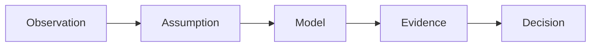

# Karl Popper: Falsifiability and Experimentation

## Real-world problem

In data analysis, we often encounter results that seem to confirm a hypothesis without truly testing it. This leads to decisions based on fragile assumptions, biases, and weak causal links. Karl Popper teaches us how to distinguish when data genuinely supports a decision and when we're merely seeking confirmation without risking anything. The key question is: how to turn a hypothesis into an operational tool for decision-making under uncertainty?

## Conceptual model

This diagram illustrates the logical flow: formulate a question, translate it into observable data, assess evidence quality, then decide. Skipping any step yields analyses that look solid but are fragile and unreliable.

| Step | Guiding question | Expected output |
|---|---|---|
| Framing | Which decision should change? | A concrete choice, not mere curiosity |
| Measurement | Which signal represents the phenomenon? | Metric, source, and granularity |
| Comparison | Against which baseline do I interpret results? | Benchmark or plausible counterfactual |
| Action | What do I do if the signal crosses the threshold? | Decision, owner, and next check |

## Rigorous formalization

To apply Popper in business, we formalize four key elements:

| Element | Operational definition |
|---|---|
| Unit | observation, hypothesis, variable, causal mechanism, or evidence criterion |
| Signal | strength of evidence, causal coherence, assumption robustness, cost of decision error |
| Baseline | alternative explanation, counterfactual, comparable group, or no-intervention scenario |
| Decision | accept, reject, or reformulate an explanation before acting |

A measure is useful only if it reduces uncertainty about a specific decision. If it doesn't change a choice, it's just documentation; if it changes a choice without controls, it's risk.

## Example or case study

A team interprets increased retention as proof their new initiative worked. Applying Popper, they clearly distinguish:

| Evidence | Cautious interpretation | Resulting decision |
|---|---|---|
| Positive but isolated signal | Phenomenon exists, cause uncertain | Seek baseline or control group |
| Segment with different response | Average effect hides heterogeneity | Analyze cohorts or subgroups |
| Increasing operational cost | Evaluate result on margin | Apply economic thresholds |

This format prevents presenting a number as a definitive conclusion, fostering informed decisions.

## Lab / exercise

### Basic level

Write a five-line summary of a real decision linked to Popper: objective, primary metric, baseline, main risk, and planned action. Use only one primary metric.

### Intermediate level

Create a table with at least three segments or scenarios. For each, indicate signal, possible alternative explanation, and necessary control before deciding.

### Research-grade level

Design a validation plan: hypothesis, required data, exclusion criteria, decision threshold, and post-decision check. Specify what would make you change your mind.

### Recommended datasets and materials

Use decision case studies, product metrics, experiment results, simple DAGs, analytical reports, and simulated time series. If you lack real data, create a synthetic dataset with 200-500 rows including at least one time column, one segment column, one outcome metric, and one exposure variable.

## Common mistake to avoid

The most frequent error is treating Popper as a definition to memorize rather than a decision-making protocol. This happens when metrics lack baselines, charts lack hypotheses, or recommendations ignore error costs. A useful check is asking: "If this result were false or unstable, what wrong decision would I make?" If the answer is unclear, the lesson hasn't been truly applied.

## Quiz or checkpoint

1. What concrete decision should this lesson improve?
2. Which baseline makes the result interpretable?
3. Which assumption, if wrong, would change the conclusion?
4. What minimal control would you use before presenting the recommendation?

## Operational summary

Karl Popper teaches us that science - and thus data analysis - is a discipline of decision-making under uncertainty requiring falsifiable hypotheses and rigorous testing. Applying this philosophy means formulating hypotheses that risk being disproved, defining falsification criteria before data collection, avoiding confirmation bias, and always linking results to concrete decisions. Only then does data analysis become a reliable tool to guide strategic and operational choices.

---

## Deep dive: Falsification vs Verification

Before Popper, science relied on induction: collecting data, spotting patterns, and generalizing. Popper revolutionized this by arguing induction lacks logical foundation. The true scientific method is:

1. Formulate a falsifiable hypothesis that can be disproved by data
2. Actively seek data that contradicts it
3. Provisionally accept the hypothesis only if it withstands falsification attempts

This changes how we interpret experiments, such as A/B tests: we don't seek confirmation but try to falsify the null hypothesis with pre-established criteria and timing.

## Real case: Einstein and the 1919 eclipse

Einstein's general relativity predicted that starlight would bend around the sun during an eclipse. Eddington organized an expedition to measure this effect. If the deviation differed from the prediction, the theory would be falsified. The measurement confirmed the prediction, but crucially, the theory was falsifiable and thus scientific. This contrasts with pseudosciences like astrology, which do not allow data that could disprove them.

## Practical implications for data analysis

- Never peek at test results before the predetermined time
- Formulate hypotheses that risk being disproved
- Always link results to concrete decisions and possible actions
- Segment data to avoid misleading averages

This discipline turns data analysis into a true science of decision-making, reducing risks and biases.
