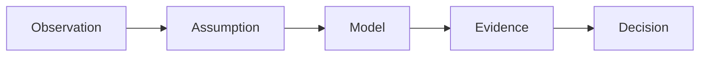

# What Counts as Evidence

An experiment, an interview, a product log, and a financial metric each tell different parts of the same story. Before deciding which to trust, you must define what counts as evidence for that decision. This threshold is the foundation of every analysis: separating relevant data from noise.

## Real-world Problem

When working with data, the challenge is to know when a data point truly supports a decision and when it hides assumptions, biases, or fragile causality. Numbers alone are not enough; you must understand whether those numbers mean something for the choice at hand. The question is not whether the concept is interesting in theory, but which decision improves when applied with reliable data and an explicit error threshold.

## Conceptual Model

The mental process is sequential: first formulate the question, then translate it into observable units, evaluate data quality, and only then decide. Skipping steps leads to elegant but fragile analyses.

| Step | Guiding Question | Expected Output |
|---|---|---|
| Framing | What decision needs to change? | A concrete choice, not a curiosity |
| Measurement | What signal represents the phenomenon? | Metric, source, and granularity |
| Comparison | Against what baseline do I interpret the result? | Benchmark or plausible counterfactual |
| Action | What do I do if the signal crosses the threshold? | Decision, owner, and next check |

## Rigorous Formalization

We formalize **what counts as evidence** as a relationship among four key elements:

| Element | Operational Definition |
|---|---|
| Unit | observation, hypothesis, variable, causal mechanism, or evidence criterion |
| Signal | strength of evidence, causal coherence, robustness of assumptions, and cost of decision error |
| Baseline | alternative explanation, counterfactual, comparable group, or no-intervention scenario |
| Decision | accept, reject, or reformulate an explanation before applying it in a business context |

The practical rule is simple: a measure is useful only if it reduces uncertainty about a specific decision. If it does not change a choice, it is documentation; if it changes a choice without checks, it is risk.

## Example or Case Study

In 2008, Google launched Flu Trends, a system predicting flu spread in real time based on search queries. It worked well for a couple of years but in 2013 overestimated the epidemic because it confused association with causation: searches increased not only due to actual illness but also due to media-driven anxiety. Flu Trends measured perception, not reality. This case illustrates why data do not speak for themselves and why a philosophical framework is needed to distinguish real evidence from noise.

## Lab / Exercise

### Basic Level

Write in five lines a real decision linked to **what counts as evidence**: objective, primary metric, baseline, main risk, and planned action.

### Intermediate Level

Build a table with at least three segments or scenarios. For each, indicate signal, possible alternative explanation, and control needed before deciding.

### Research-grade Level

Design a validation plan: hypothesis, required data, exclusion criteria, decision threshold, and post-decision control. Also specify what would make you change your mind.

### Recommended Datasets and Materials

Use decision case studies, product metrics, experiment results, simple DAGs, analytic reports, and simulated time series. If you lack real data, create a synthetic dataset with 200-500 rows and at least one time column, one segment column, one outcome metric, and one exposure variable.

## Common Mistake to Avoid

The most frequent error is treating **what counts as evidence** as a definition to memorize rather than a decision protocol. This happens when presenting a metric without baseline, a chart without hypothesis, or a recommendation without considering error cost. A useful check is to ask: "If this result were false or unstable, what wrong decision would I make?" If the answer is unclear, the lesson has not been truly applied.

## Quiz or Checkpoint

1. What concrete decision should this lesson improve?
2. What baseline makes the result interpretable?
3. What assumption, if wrong, would change the conclusion?
4. What minimum control would you use before presenting the recommendation?

## Operational Summary

**What counts as evidence** is a fundamental skill linking concept, data, and decision. Study it starting from a real problem, formalize the signal, find a credible baseline, build an example, and close with a practical check. Only then does knowledge become operational skill.
