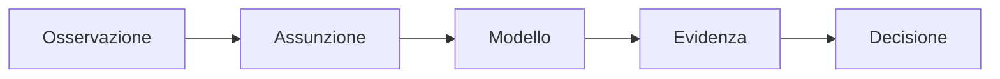

# Che cosa conta come evidenza

Un esperimento, un'intervista, un log di prodotto e una metrica finanziaria raccontano pezzi diversi dello stesso problema. Prima di scegliere quale ascoltare, devi decidere che cosa conta come evidenza per quella decisione. Questo è il punto di partenza di ogni analisi: definire la soglia che separa i dati rilevanti dal rumore.

## Problema reale

Nel lavoro con i dati, la sfida è capire quando un dato sostiene davvero una decisione e quando invece nasconde assunzioni, bias o causalità fragile. Non basta avere numeri: bisogna sapere se quei numeri significano qualcosa per la scelta che devi fare. La domanda non è se il concetto sia interessante in astratto, ma quale decisione migliora applicandolo con dati affidabili e con una soglia di errore esplicita.

## Modello concettuale

Il processo mentale è sequenziale: prima si formula la domanda, poi si traduce in unità osservabili, si valuta la qualità del dato e solo alla fine si decide. Saltare un passaggio produce analisi eleganti ma fragili.

| Passaggio | Domanda guida | Output atteso |
|---|---|---|
| Framing | Quale decisione deve cambiare? | Una scelta concreta, non una curiosità |
| Misura | Quale segnale rappresenta il fenomeno? | Metrica, fonte e granularità |
| Confronto | Rispetto a quale baseline interpreto il risultato? | Benchmark o controfattuale plausibile |
| Azione | Che cosa faccio se il segnale supera la soglia? | Decisione, owner e prossimo controllo |

## Formalizzazione rigorosa

Formalizziamo **che cosa conta come evidenza** come una relazione tra quattro elementi chiave:

| Elemento | Definizione operativa |
|---|---|
| Unità | osservazione, ipotesi, variabile, meccanismo causale o criterio di evidenza |
| Segnale | forza dell'evidenza, coerenza causale, robustezza delle assunzioni e costo dell'errore decisionale |
| Baseline | spiegazione alternativa, controfattuale, gruppo comparabile o scenario senza intervento |
| Decisione | accettare, rifiutare o riformulare una spiegazione prima di usarla in un contesto aziendale |

La regola pratica è semplice: una misura è utile solo se riduce l'incertezza su una decisione specifica. Se non cambia una scelta, è solo documentazione; se cambia una scelta senza controlli, è rischio.

## Esempio o caso studio

Nel 2008 Google lanciò Flu Trends, un sistema che prevedeva la diffusione dell'influenza in tempo reale basandosi sulle query di ricerca. Funzionò bene per un paio d'anni, ma nel 2013 sovrastimò l'epidemia perché confondeva associazione con causalità: le ricerche aumentavano non solo per malattia reale, ma per ansia alimentata dai media. Flu Trends misurava la percezione, non la realtà. Questo caso illustra perché i dati non parlano da soli e perché serve un framework filosofico per distinguere evidenza reale da rumore.

## Lab / esercizio

### Livello base

Scrivi in cinque righe una decisione reale collegata a **che cosa conta come evidenza**: obiettivo, metrica primaria, baseline, rischio principale e azione prevista.

### Livello intermedio

Costruisci una tabella con almeno tre segmenti o scenari. Per ciascuno indica segnale, possibile spiegazione alternativa e controllo necessario prima di decidere.

### Livello research-grade

Disegna un piano di validazione: ipotesi, dati necessari, criterio di esclusione, soglia decisionale e controllo post-decisione. Specifica anche cosa ti farebbe cambiare idea.

### Dataset e materiali consigliati

Usa case study decisionali, metriche prodotto, risultati di esperimenti, DAG semplici, report analitici e serie storiche simulate. Se non hai dati reali, crea un dataset sintetico con 200-500 righe e almeno una colonna temporale, una colonna segmento, una metrica di outcome e una variabile di esposizione.

## Errore tipico da evitare

Il più comune è trattare **che cosa conta come evidenza** come una definizione da ricordare invece che come un protocollo decisionale. Succede quando si presenta una metrica senza baseline, un grafico senza ipotesi o una raccomandazione senza considerare il costo dell'errore. Un controllo utile è chiedersi: "Se questo risultato fosse falso o instabile, quale decisione sbaglierei?". Se la risposta non è chiara, la lezione non è stata applicata davvero.

## Quiz o checkpoint

1. Qual è la decisione concreta che questa lezione dovrebbe migliorare?
2. Quale baseline rende interpretabile il risultato?
3. Quale assunzione, se sbagliata, cambierebbe la conclusione?
4. Quale controllo minimo useresti prima di presentare la raccomandazione?

## Riepilogo operativo

**Che cosa conta come evidenza** è una competenza fondamentale che collega concetto, dato e decisione. Studiala partendo da un problema reale, formalizza il segnale, cerca una baseline credibile, costruisci un esempio e chiudi con un controllo pratico. Solo così la conoscenza diventa competenza operativa.
