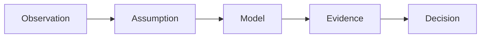

# Simpson's Paradox and Confounding: Mastering Decision-Making Under Uncertainty

Simpson's paradox and confounding warn us against trusting aggregated data without examining the underlying population composition. When an overall conversion rate improves but every key segment declines, this is not a statistical fluke but a clear signal that composition and confounders are distorting the true phenomenon.

## Real-World Problem

In data analysis, the challenge is to determine when data genuinely supports a decision and when it hides flawed assumptions, biases, or fragile causality. The critical question is not just "Did the number go up or down?" but rather "What decision changes because of this data?" Simpson's paradox and confounding help prevent premature conclusions that could lead to wrong choices.

## Conceptual Model

This sequential model emphasizes that analysis must start with a clear question, translate it into observable data, assess data quality, and finally guide a decision. Skipping any step results in fragile and unreliable outcomes.

| Step | Guiding Question | Expected Output |
|---|---|---|
| Framing | What decision needs to change? | A concrete choice, not curiosity |
| Measurement | What signal represents the phenomenon? | Metric, source, and granularity |
| Comparison | Against what baseline do I interpret the result? | Benchmark or plausible counterfactual |
| Action | What do I do if the signal crosses the threshold? | Decision, owner, and next check |

## Rigorous Formalization

Simpson's paradox and confounding can be formalized as a relationship among four key elements:

| Element | Operational Definition |
|---|---|
| Unit | Observation, hypothesis, variable, causal mechanism, or evidence criterion |
| Signal | Strength of evidence, causal coherence, robustness of assumptions, cost of decision error |
| Baseline | Alternative explanation, counterfactual, comparable group, or no-intervention scenario |
| Decision | Accept, reject, or reformulate an explanation before applying it in business |

The practical rule is simple: a measure is useful only if it reduces uncertainty about a specific decision. If it does not change a choice, it is documentation; if it changes a choice without controls, it is risky.

## Example or Case Study

Imagine a committee interpreting retention growth as proof that a new initiative worked. Applying Simpson's paradox and confounding, the team distinguishes evidence, cautious interpretation, and decision:

| Evidence | Cautious Interpretation | Decision |
|---|---|---|
| Positive but isolated signal | The phenomenon exists, but the cause is uncertain | Seek baseline or holdout |
| Segment with different response | The average effect hides heterogeneity | Analyze cohorts or subgroups |
| Rising operational cost | Evaluate the result on the margin | Apply economic thresholds |

This approach avoids presenting a number as a definitive conclusion, promoting critical and decision-oriented reading.

## Lab / Exercise

### Basic Level

Write in five lines a real decision linked to Simpson's paradox and confounding: objective, primary metric, baseline, main risk, and planned action.

### Intermediate Level

Build a table with at least three segments or scenarios. For each, indicate the signal, possible alternative explanation, and necessary control before deciding.

### Research-Grade Level

Design a validation plan: hypothesis, required data, exclusion criteria, decision threshold, and post-decision control. Specify what would make you change your mind.

### Recommended Datasets and Materials

Use decision case studies, product metrics, experiment results, simple DAGs, analytical reports, and simulated time series. If you lack real data, create a synthetic dataset with at least 200 rows including temporal columns, segments, outcome metrics, and exposure variables.

## Common Mistakes to Avoid

The most frequent mistake is treating Simpson's paradox and confounding as a memorized definition rather than a decision protocol. Presenting metrics without baseline, charts without hypotheses, or recommendations without considering error costs leads to fragile conclusions. A useful check is to ask: "If this result were false, what decision would I get wrong?" If the answer is unclear, the analysis is incomplete.

## Quiz or Checkpoint

1. What concrete decision should this lesson improve?
2. What baseline makes the result interpretable?
3. Which assumption, if wrong, would change the conclusion?
4. What minimum control would you use before presenting the recommendation?

## Operational Summary

Simpson's paradox and confounding are essential skills to link concept, data, and decision. Study the phenomenon starting from a real problem, formalize the signal, find a credible baseline, build examples, and close with practical checks. Only then does data analysis become a discipline of decision-making under uncertainty.
