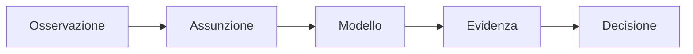

# Simpson's paradox e confounding: La disciplina di decidere nell'incertezza

Il paradosso di Simpson e il confounding sono fenomeni che mettono in guardia dall'interpretare dati aggregati senza considerare la composizione delle popolazioni coinvolte. Un tasso di conversione che migliora a livello complessivo, mentre peggiora in ogni segmento chiave, non è un errore o una magia statistica, ma un segnale che la composizione e i fattori confondenti stanno distorcendo la lettura del fenomeno reale.

## Problema reale

Nel contesto dell'analisi dati, il problema è capire quando un dato supporta davvero una decisione e quando invece nasconde assunzioni errate, bias o causalità fragile. La domanda cruciale non è solo "il numero è salito o sceso?", ma "quale decisione cambia grazie a questo dato?". Simpson's paradox e confounding aiutano a evitare conclusioni affrettate che possono portare a scelte sbagliate.

## Modello concettuale

Questo modello sequenziale sottolinea che l'analisi deve partire da una domanda chiara, tradursi in dati osservabili, valutare la qualità delle informazioni e infine guidare una decisione. Saltare uno di questi passaggi produce risultati fragili e poco affidabili.

| Passaggio | Domanda guida | Output atteso |
|---|---|---|
| Framing | Quale decisione deve cambiare? | Una scelta concreta, non una curiosità |
| Misura | Quale segnale rappresenta il fenomeno? | Metrica, fonte e granularità |
| Confronto | Rispetto a quale baseline interpreto il risultato? | Benchmark o controfattuale plausibile |
| Azione | Che cosa faccio se il segnale supera la soglia? | Decisione, responsabile e prossimo controllo |

## Formalizzazione rigorosa

Simpson's paradox e confounding si formalizzano come una relazione tra quattro elementi chiave:

| Elemento | Definizione operativa |
|---|---|
| Unità | Osservazione, ipotesi, variabile, meccanismo causale o criterio di evidenza |
| Segnale | Forza dell'evidenza, coerenza causale, robustezza delle assunzioni, costo dell'errore decisionale |
| Baseline | Spiegazione alternativa, controfattuale, gruppo comparabile o scenario senza intervento |
| Decisione | Accettare, rifiutare o riformulare una spiegazione prima di usarla in azienda |

La regola pratica è semplice: una misura è utile solo se riduce l'incertezza su una decisione specifica. Se non cambia una scelta, è solo documentazione; se cambia una scelta senza controlli, è un rischio.

## Esempio o caso studio

Immaginiamo un comitato che interpreta una crescita della retention come prova che una nuova iniziativa ha funzionato. Applicando Simpson's paradox e confounding, il team distingue tra evidenza, interpretazione prudente e decisione:

| Evidenza | Interpretazione prudente | Decisione |
|---|---|---|
| Segnale positivo ma non isolato | Il fenomeno esiste, ma la causa è incerta | Cercare baseline o holdout |
| Segmento con risposta diversa | L'effetto medio nasconde eterogeneità | Analizzare coorti o sottogruppi |
| Costo operativo crescente | Valutare il risultato sul margine | Applicare soglie economiche |

Questo approccio evita di presentare un numero come conclusione definitiva, promuovendo una lettura critica e decisionale.

## Lab / esercizio

### Livello base

Scrivi in cinque righe una decisione reale collegata a Simpson's paradox e confounding: obiettivo, metrica primaria, baseline, rischio principale e azione prevista.

### Livello intermedio

Costruisci una tabella con almeno tre segmenti o scenari. Per ciascuno indica segnale, possibile spiegazione alternativa e controllo necessario prima di decidere.

### Livello research-grade

Disegna un piano di validazione: ipotesi, dati necessari, criterio di esclusione, soglia decisionale e controllo post-decisione. Specifica cosa ti farebbe cambiare idea.

### Dataset e materiali consigliati

Usa case study decisionali, metriche prodotto, risultati di esperimenti, DAG semplici, report analitici e serie storiche simulate. Se non hai dati reali, crea un dataset sintetico con almeno 200 righe e colonne temporali, segmenti, metriche di outcome e variabili di esposizione.

## Errore tipico da evitare

Il più comune è trattare Simpson's paradox e confounding come una definizione da memorizzare, anziché come un protocollo decisionale. Presentare metriche senza baseline, grafici senza ipotesi o raccomandazioni senza considerare il costo dell'errore porta a conclusioni fragili. Un controllo utile è chiedersi: "Se questo risultato fosse falso, quale decisione sbaglierei?" Se la risposta non è chiara, l'analisi non è completa.

## Quiz o checkpoint

1. Qual è la decisione concreta che questa lezione dovrebbe migliorare?
2. Quale baseline rende interpretabile il risultato?
3. Quale assunzione, se sbagliata, cambierebbe la conclusione?
4. Quale controllo minimo useresti prima di presentare la raccomandazione?

## Riepilogo operativo

Simpson's paradox e confounding sono competenze essenziali per collegare concetto, dato e decisione. Studia il fenomeno partendo da un problema reale, formalizza il segnale, cerca una baseline credibile, costruisci esempi e chiudi con controlli pratici. Solo così l'analisi dati diventa disciplina di decisione sotto incertezza.
