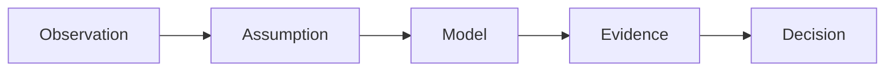

# Thomas Kuhn: Scientific Paradigms and Data Culture

In business environments, even the most data-driven organizations operate within implicit paradigms that deeply shape how data is interpreted and which decisions are made. Thomas Kuhn's theory of scientific paradigms offers a valuable lens to understand this dynamic and to enhance the discipline of making decisions under uncertainty.

## Real-world problem

Analytical teams often face data that seem to contradict established metrics or usual practices. The challenge is not merely technical: it is about discerning when data truly signal the need for a paradigm shift versus when they reflect noise or measurement errors. Turning this awareness into more robust, less biased decisions is critical.

## Conceptual model

Effective decision-making starts with a well-defined question, translates it into observable units, assesses data quality and robustness, and finally leads to an informed decision. Skipping any step risks producing analyses that look sophisticated but are fragile.

| Step | Guiding question | Expected output |
|---|---|---|
| Framing | What decision needs to change? | A concrete choice, not a curiosity |
| Measurement | What signal represents the phenomenon? | Metric, source, and granularity |
| Comparison | Against which baseline do I interpret the result? | Benchmark or plausible counterfactual |
| Action | What do I do if the signal crosses the threshold? | Decision, owner, and next check |

## Rigorous formalization

Operationalizing Kuhn's insight involves four key elements in the data-decision relationship:

| Element | Operational definition |
|---|---|
| Unit | Observation, hypothesis, variable, causal mechanism, or evidence criterion |
| Signal | Strength of evidence, causal coherence, assumption robustness, cost of decision error |
| Baseline | Alternative explanation, counterfactual, comparable group, or no-intervention scenario |
| Decision | Accept, reject, or reformulate an explanation before business application |

The practical rule: a measure is useful only if it reduces uncertainty about a specific decision. If it does not change a choice, it is documentation; if it changes a choice without checks, it is risky.

## Example or case study

Consider a committee interpreting increased retention as proof of a new initiative's success. Applying Kuhn's model, distinctions emerge:

| Evidence | Cautious interpretation | Resulting decision |
|---|---|---|
| Positive but isolated signal | The phenomenon exists, but cause is uncertain | Seek baseline or holdout group |
| Segment with differing response | Average effect hides heterogeneity | Analyze cohorts or subgroups |
| Rising operational cost | Evaluate result on margin | Apply economic thresholds |

This approach prevents turning a number into a conclusion without proper context.

## Lab / exercise

### Basic level

Write in five lines a real decision linked to Kuhn: objective, primary metric, baseline, main risk, and planned action. Use only one primary metric.

### Intermediate level

Build a table with at least three segments or scenarios, indicating for each the signal, possible alternative explanation, and necessary control before deciding.

### Research-grade level

Design a validation plan: hypothesis, required data, exclusion criteria, decision threshold, and post-decision control. Specify what would make you change your mind.

### Recommended datasets and materials

Use decision case studies, product metrics, experiment results, simple DAGs, analytical reports, and simulated time series. If no real data are available, create a synthetic dataset with at least 200 rows, including a time column, a segment column, an outcome metric, and an exposure variable.

## Common mistake to avoid

The most frequent error is treating Kuhn as an abstract definition rather than an operational protocol. Presenting metrics without baselines, charts without hypotheses, or recommendations without error cost evaluation leads to fragile decisions. Always ask: "If this result were false or unstable, what wrong decision would I make?" If you cannot answer clearly, the lesson has not been truly applied.

## Quiz or checkpoint

1. What concrete decision should this lesson improve?
2. What baseline makes the result interpretable?
3. Which assumption, if wrong, would change the conclusion?
4. What minimum control would you use before presenting the recommendation?

## Operational summary

Thomas Kuhn teaches us that every data culture operates within paradigms that define what counts as evidence and what is ignored. To make better decisions under uncertainty, it is essential to recognize these paradigms, formalize signals and baselines, accumulate anomalies, and translate insights into the existing context's language. Only then can data be transformed into real competitive advantage.

---

*References:* Kuhn, T.S. (1962). *The Structure of Scientific Revolutions.* University of Chicago Press.
Bird, A. (2018). "Thomas Kuhn." *Stanford Encyclopedia of Philosophy.*
