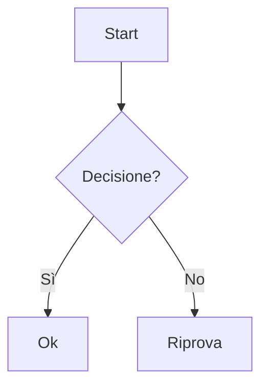

# Style Guide & Componenti Interattivi

Questa guida definisce lo standard per la creazione di nuovi contenuti (Corso e Blog) su **GynniTech**. L'obiettivo è garantire consistenza, leggibilità e un'esperienza utente moderna e coinvolgente.

---

## 1. Principi Generali

*   **Tono di Voce:** Professionale ma accessibile. Diretto ("Fai questo"), non passivo ("Si consiglia di fare questo").
*   **Struttura:** Usa paragrafi brevi (max 3-4 righe). Spezza i muri di testo.
*   **Formattazione:** Usa **grassetto** per i concetti chiave, *corsivo* per enfasi leggera o termini stranieri.
*   **Titoli:** Usa H2 (`##`) per le sezioni principali e H3 (`###`) per le sottosezioni. Mai H1 (riservato al titolo della pagina).

---

## 2. Componenti Interattivi (Starlight)

Per usare questi componenti, devi **sempre** importarli all'inizio del file `.mdx` (dopo il frontmatter `---`):

```javascript
import { Tabs, TabItem, Steps, Aside, Card, CardGrid, FileTree } from '@astrojs/starlight/components';
```

### 🔹 Tabs (Confronti e Codice)

Usa `<Tabs>` per mostrare alternative (es. Mac vs Windows, Python vs SQL) o per raggruppare contenuti correlati salvando spazio verticale.

**Quando usare:**
*   Mostrare lo stesso concetto in due linguaggi diversi.
*   Confrontare Pro e Contro.
*   Mostrare Output vs Codice Sorgente.

**Sintassi:**
```jsx
<Tabs>
  <TabItem label="Python" icon="seti:python">
    Codice o testo per Python.
  </TabItem>
  <TabItem label="SQL" icon="seti:db">
    Codice o testo per SQL.
  </TabItem>
</Tabs>
```

---

### 🔹 Steps (Tutorial e Processi)

Usa `<Steps>` per guide passo-passo che hanno un ordine cronologico definito.

**Quando usare:**
*   Tutorial di installazione.
*   Procedure di analisi (Fase 1, Fase 2...).
*   Workflow operativi.

**Sintassi:**
```jsx
<Steps>

1.  **Primo Passo**: Descrizione.
2.  **Secondo Passo**: Descrizione.
    
    Puoi inserire anche blocchi di codice qui dentro.

3.  **Terzo Passo**: Conclusione.

</Steps>
```

---

### 🔹 Aside (Note, Attenzione, Consigli)

Usa `<Aside>` per evidenziare informazioni che esulano dal flusso principale del testo. Sostituisce i vecchi blockquote (`>`).

**Tipi disponibili:** `note` (default), `tip`, `caution`, `danger`.

**Sintassi:**
```jsx
<Aside type="tip" title="Lo sapevi?">
Questo è un consiglio utile che appare in un box verde.
</Aside>

<Aside type="danger">
Attenzione: questa azione cancellerà il database.
</Aside>
```

---

### 🔹 Card & CardGrid (Raggruppamento Concetti)

Usa `<CardGrid>` per presentare concetti non sequenziali in una griglia visiva.

**Quando usare:**
*   Elenchi di funzionalità.
*   Risorse o strumenti consigliati.
*   Concetti chiave (es. "I 4 pilastri del marketing").

**Sintassi:**
```jsx
<CardGrid>
  <Card title="Concetto A" icon="rocket">
    Descrizione breve.
  </Card>
  <Card title="Concetto B" icon="pencil">
    Descrizione breve.
  </Card>
</CardGrid>
```

*(Trovi la lista delle icone supportate nella documentazione ufficiale di Starlight).*

---

### 🔹 FileTree (Struttura Cartelle)

Usa `<FileTree>` per mostrare la struttura di un progetto o di una directory.

**Sintassi:**
```jsx
<FileTree>
- src
  - content
    - **index.mdx**
  - components
    - Header.astro
- package.json
</FileTree>
```

---

## 3. Diagrammi e Matematica (Plugin Esterni)

Queste funzionalità sono abilitate tramite plugin (`astro-mermaid`, `remark-math`). Non serve importare nulla di specifico nel file MDX.

### 🔹 Mermaid (Diagrammi di Flusso)

Usa i blocchi di codice con linguaggio `mermaid` per creare diagrammi.

**Sintassi:**
````markdown

````

### 🔹 Math (Formule Scientifiche)

Usa la sintassi LaTeX.
*   `$ ... $` per formule in linea col testo.
*   `$$ ... $$` per blocchi di formule centrati.

**Sintassi:**
```latex
La formula della relatività è $E=mc^2$.

Mentre l'integrale è:
$$
\int_0^\infty e^{-x^2} dx = \frac{\sqrt{\pi}}{2}
$$
```

---

## 4. Checklist Pubblicazione

Prima di fare commit, verifica:

1.  [ ] Il **Frontmatter** è corretto (titolo, descrizione, ordine)?
2.  [ ] I componenti Starlight sono **importati** correttamente in cima al file?
3.  [ ] Non ci sono blocchi di codice `mermaid` o `$$` non chiusi correttamente?
4.  [ ] Le immagini sono nella cartella `public` e i percorsi iniziano con `/`?
