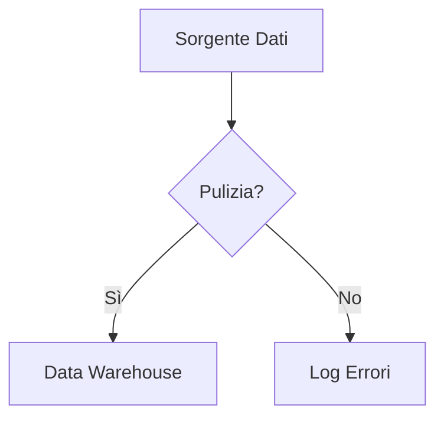

# Template per Creazione Contenuti

Usa questi template per aggiungere nuove lezioni o articoli al blog. Copia il contenuto del template, incollalo in un nuovo file `.mdx`, e compila i campi.

## Nuovo: Template Lezione con Header Immagine

Per le nuove lezioni del corso con immagine sopra il titolo usa:

- `templates/course-lesson-with-header-template.mdx`
- `docs/guide/GUIDA_TEMPLATE_LEZIONI_CON_IMMAGINI.md`

Questo template e compatibile con:

- `headerImage`
- `headerImageAlt`
- meta description SEO della lezione
- script automatico `tools/python/assign_lesson_header_images.py`
- pipeline comando unico `tools/python/process_new_lesson_header_images.py`

## Novità: Componenti Interattivi

Ora supportiamo nativamente i seguenti componenti per rendere i contenuti più ricchi:
- **Tabs**: Per mostrare alternative (es. Codice Python vs SQL, o Mac vs Windows).
- **Steps**: Per guide passo-passo visive.
- **Aside**: Per note, warning, e tip in evidenza (sostituisce i blockquote standard).
- **CardGrid**: Per layout a griglia di concetti.
- **FileTree**: Per mostrare strutture di cartelle.
- **Mermaid**: Per diagrammi di flusso e grafici (wrap con ` ```mermaid `).
- **Math**: Formule matematiche LaTeX (usando `$$ ... $$` o `$ ... $`).

---

## 1. 🎓 Template Corso (Lezione Avanzata)

Questo template è ottimizzato per le lezioni del corso e include esempi di tutti i nuovi componenti interattivi.

**Dove salvare il file:** `src/content/corso/[nome-modulo]/[nome-lezione].mdx`
*Esempio: `src/content/corso/marketing-data-science/intro-python.mdx`*

Se la lezione deve avere immagine header, preferisci il file:

`templates/course-lesson-with-header-template.mdx`

### Contenuto da Copiare:

```markdown
---
title: "Titolo della Lezione"
description: "Descrizione breve e accattivante di cosa imparerà lo studente in questa lezione."
order: 10
category: "Concetti Fondamentali"
---

import { Tabs, TabItem, Steps, Aside, Card, CardGrid, FileTree } from '@astrojs/starlight/components';

# Titolo della Lezione

Scrivi qui l'introduzione della lezione. Spiega brevemente gli obiettivi e cosa verrà trattato.

<Aside type="tip" title="Obiettivo">
In questa lezione imparerai a costruire una pipeline di dati da zero.
</Aside>

## Concetti Chiave

Usa le card per raggruppare concetti visivamente:

<CardGrid>
  <Card title="Concetto 1" icon="rocket">
    Spiegazione breve del primo concetto.
  </Card>
  <Card title="Concetto 2" icon="puzzle">
    Spiegazione breve del secondo concetto, magari con un link.
  </Card>
</CardGrid>

## Guida Passo-Passo

Usa il componente Steps per tutorial numerati. **Importante:** all'interno usa una normale lista numerata Markdown (`1.`, `2.`). Non aggiungere numeri manualmente nel testo.

<Steps>

1.  **Primo Passo**: Installa la libreria necessaria.
    
    ```bash
    npm install pandas
    ```

2.  **Secondo Passo**: Configura il file.

    <FileTree>
    - src
      - data
        - **dataset.csv**
      - scripts
        - analysis.py
    </FileTree>

3.  **Terzo Passo**: Esegui lo script e analizza i risultati.

</Steps>

## Confronto Tecnologie

Usa i Tabs per confrontare opzioni o mostrare codice in linguaggi diversi:

<Tabs>
  <TabItem label="Python" icon="seti:python">
    ```python
    import pandas as pd
    df = pd.read_csv('data.csv')
    print(df.head())
    ```
  </TabItem>
  <TabItem label="SQL" icon="seti:db">
    ```sql
    SELECT * FROM dataset LIMIT 5;
    ```
  </TabItem>
</Tabs>

## Diagrammi e Formule

Puoi inserire diagrammi Mermaid e formule matematiche complesse:



La formula per il calcolo del **Lifetime Value** è:

$$
LTV = \frac{ARPU \times Margin}{Churn Rate}
$$

## Conclusione

Riassunto veloce di quanto appreso. 

**Nota:** NON aggiungere link manuali alla "Prossima Lezione". Il sito li genera automaticamente.
```

---

## 2. 📝 Template Blog Post

Questo template è per gli articoli del blog. Include campi per data, autore, categoria e immagine di copertina.

**Dove salvare il file:** `src/content/blog/[nome-articolo].mdx`
*Esempio: `src/content/blog/nuove-tendenze-analytics.mdx`*

### Contenuto da Copiare:

```markdown
---
title: "Titolo dell'Articolo Accattivante"
description: "Un sottotitolo o riassunto breve che invogli alla lettura e sia utile per la SEO."
date: 2026-02-10
category: "Data Strategy"
author: "GynniTech Team"
image: "/images/blog/default-cover.jpg"
---

import { Aside } from '@astrojs/starlight/components';

# Titolo Principale dell'Articolo

Introduzione coinvolgente che spiega il "perché" di questo articolo. Qual è il problema che stiamo risolvendo o l'opportunità da cogliere?

## Primo Paragrafo Importante

Approfondimento del tema.
1. Primo dettaglio
2. Secondo dettaglio


*Didascalia dell'immagine*

<Aside type="note">
Ricorda che le immagini devono essere salvate in `public/images/blog/`.
</Aside>

## Secondo Paragrafo

Altre informazioni utili. Ricordati di strutturare il testo con paragrafi brevi per facilitare la lettura.

### Sottosezione di dettaglio

Dettagli tecnici o specifici.

## Conclusione

Cosa abbiamo imparato? Qual è la "Call to Action" o il prossimo passo per il lettore?
```

## 3. ⚠️ Errori Comuni da Evitare

### 1. Link "Prossima Lezione" Manuali
**Errore**: Aggiungere una card o un link `Prossima Lezione: ...` alla fine del file.
**Corretto**: Non aggiungere nulla. Il layout `[slug].astro` genera automaticamente i pulsanti di navigazione Previous/Next basandosi sull'ordine delle lezioni.

### 2. Doppia Numerazione negli Steps
**Errore**: Scrivere `1. 1. Titolo Step` dentro il componente `<Steps>`.
**Corretto**: Scrivere semplicemente `1. Titolo Step`. Il CSS del sito si occupa dello stile.

### 3. Tabelle non responsive
**Errore**: Usare HTML complesso per le tabelle.
**Corretto**: Usare la sintassi standard Markdown `| Col1 | Col2 |`. Il tema gestisce lo scroll orizzontale su mobile.

---

## 🚀 Istruzioni Veloci per Astro

1. **Creare il file**: Crea un nuovo file con estensione `.mdx` nella cartella corretta (`src/content/corso/...` o `src/content/blog/...`).
2. **Import**: Ricorda di importare i componenti all'inizio del file (sotto al frontmatter) se intendi usarli:
   ```javascript
   import { Tabs, TabItem, Steps, Aside, Card, CardGrid, FileTree } from '@astrojs/starlight/components';
   ```
3. **Frontmatter**: La parte tra i tre trattini `---` all'inizio del file è fondamentale.
   - `order`: Usa numeri interi (1, 2, 10, 20) per ordinare le lezioni.
   - `category`: Raggruppa le lezioni visivamente nella pagina del modulo.
4. **Immagini**: Salva le tue immagini nella cartella `public/images/` e collegale usando il percorso assoluto (es. `/images/mia-foto.jpg`).
5. **Header immagine per lezioni**: Per nuove lezioni del corso usa `headerImage` e `headerImageAlt`. Il flusso consigliato e mettere solo le nuove immagini in `images/inbox/` e lanciare `python tools/python/process_new_lesson_header_images.py`, poi `python tools/python/process_new_lesson_header_images.py --apply --build`. Se vuoi controllare il passaggio manuale separato, restano disponibili `python tools/python/assign_lesson_header_images.py` e `python tools/python/assign_lesson_header_images.py --apply`.
