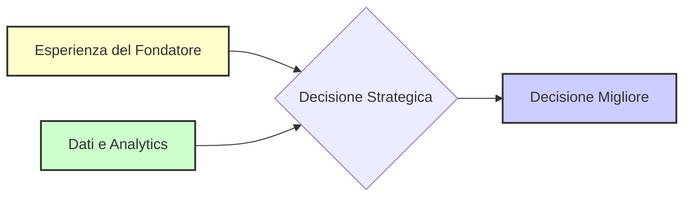

In 2012, JCPenney hired Ron Johnson, the man who built the Apple Store, as CEO. Johnson had experience and insight, but decided to eliminate promotions without testing the hypothesis or analysing the data. In 16 months, JCPenney lost nearly a billion dollars and turnover dropped by 25%. American mid-range customers loved coupons, and without them they did not buy. This story is repeated daily in many Italian SMEs, where the founder's intuition prevails over data, often obsolete or non-existent.

## The italian gap: data vs instinct

Italy boasts an entrepreneurial fabric of excellent family SMEs, but the deep experience of the founders becomes a brake on the adoption of a data-driven culture. In many companies with less than 10 employees, the founder is the only depositary of knowledge, without CRM or structured decision-making historian. According to the DESIGNI 2025 index, Italy is the last in Europe to adopt advanced cloud services, and ISTAT reports that 72% of SMEs do not have a dedicated IT manager.

| Characteristic | Traditional Force | Data-Driven Limit |
|---|---|---|
| Experience of the founder | Deep knowledge of the product | Resistance to numbers that contradict intuition |
| Personal relations with customers | Loyalty and Trust | Lack of CRM and structured data |
| Decision-making Agility | Running speed | Undocumented, non-replicable decisions |
| Oral culture | Flexibility | No historian on which to build analysis |

### The paradox of competence

Daniel Kahneman showed that experience generates confidence more quickly than competence. When context changes quickly, as in digital, intuition becomes noise. Philip Tetlock has shown that more experienced experts are less inclined to review their opinions, reducing the accuracy of long-term predictions. Jeff Bezos has built Amazon on continuous data and testing, knowing that intuition does not scale with millions of customers.

## The 5 signals your company decides "by nose"

1. Strategic meetings without data or reports. 2. Repetitive discussions without decision-making history. 3. Budget marketing decided to sentiment without analysis. 4. No or bad use of CRM. 5. Fixed prices with fixed reload without market analysis.

## The 5 stages of the data maturity model: where your company is

1. Ad-Hoc: no structured data, decisions instinct (35% SMEs). 2. Reporting: data collection without analysis (40% SMEs). 3. Analytical: descriptive analysis, no predictive (20% SMEs). 4. Predictive: forecasting models and machine learning (4% SMEs). 5. Prescriptive: AI taking autonomous decisions (less than 1% of SMEs).

The most significant jump takes place in the first two stages. No need to switch to AI immediately.

## How to get started: the framework "Life minimum data"

Netflix started with a key metric: the rate of return of DVDs. You too have to start with a few essential metrics, related to recurring decisions:

| Decision | Metrica | Source Data |
|---|---|---|
| Products to invest in | Contribution margin for SKU | ERP |
| Effective marketing channel | CAC and ROAS per channel | Google Analytics + CRM |
| Customers to be treated | LTV and frequency of purchase | CRM / e-commerce |
| Prices to be fixed | Elasticity of demand | Sales history + A/B test |
| Costs to be cut | Cost per unit produced | ERP |

Build a simple weekly dashboard (also with Google Sheets and Looker Studio) and gather your team every Monday to discuss numbers, not opinions.

## Cultural resistance: how to manage it

The founder can perceive data as a threat. Tetlock shows that changing opinions is difficult, but possible if you change the context from "defending opinion" to "updating strategy."

### Strategy: "Data as a copilot, not as a pilot"

The data does not replace the experience, it enhances it. Experience indicates direction, data shows the way.

### 3 tattiche per vincere la resistenza

1. Parti da un problema concreto, non da una visione astratta.
2. Mostra subito i risultati economici tangibili.
3. Trova un alleato interno che lavori con i numeri.

## Caso pratico: l'azienda alimentare del veneto

Un'azienda con 15 milioni di fatturato usava un ricarico fisso del 35% da 20 anni senza analisi di mercato. Dopo un'indagine sulla willingness-to-pay e l'elasticità della domanda, ha scoperto opportunità di aumento prezzi e tagli di costi nascosti, ottenendo +420.000 euro di margine annuo senza nuovi investimenti.

## Il mito della "Complessità dei dati"

Aspettare dati perfetti è un modo sicuro per non agire mai. Jeff Immelt di GE diceva: "Perfect data is the enemy of good data." Inizia con i dati che hai e migliorali nel tempo.

## Quanto vale decidere meglio?

McKinsey ha dimostrato che aziende data-driven ottengono un rendimento superiore del 5-6%. Su 15 milioni di fatturato, sono 750.000 euro in più allocati meglio e meno errori.

## Il punto
Decidere "a naso" è naturale, ma non basta più. Il System 1 veloce e intuitivo va integrato con il System 2 analitico e data-driven. Nel 2026, con mercati globali e margini compressi, i dati sono la domanda giusta per prendere decisioni migliori. Inizia con una metrica, una dashboard e una decisione alla settimana basata sui fatti. Non serve un Nobel, serve solo la volontà di guardare i numeri ogni lunedì.

Approfondisci la gestione della cultura data-driven nel nostro modulo [gestione data-driven](/course/gestione-data-driven/).
