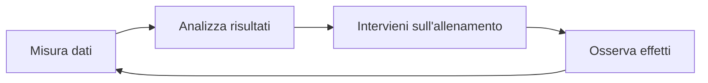

In 2002, Billy Beane, general manager of the Oakland Athletics baseball, faced a serious problem: a limited budget of $40 million against the $120 million of the Yankees in New York. He could not compete by buying the most popular players. He had to find a different approach.

With the help of analyst Paul DePodesta, Beane revolutionized the way players were valued: he abandoned the traditional metrics and focused on those that really competed with the victory. So he bought players underrated by the market but with winning features.

The result? The Athletics won 103 games out of 162, a record for the franchise, with a budget much lower than the competitors.

This story, told by Michael Lewis in "Moneyball," is not only a case of sporting success, but a model for making effective decisions in contexts of limited resources and uncertainty, such as business.

Sport is an ideal laboratory for data analysis: clear rules, objective metrics and immediate feedback. Cycling, in particular, has become one of the most quantitative sports thanks to the power meters, which measure every product watt. Professional teams like Sky/INEOS work with sophisticated datasets that many tech companies would envy.

This article uses a simulated dataset of 250 amateur cyclists to show how sports data analysis techniques are transferred directly to business analytics. We will see how performance is measured, talents are identified and training optimized, with lessons applicable to team management, products and customers.

## Cycling metrics: from physics to date

A 160 km long grenade generates a dataset full of information: physical characteristics, training volume and performance.

| Cycling Metric | Type | Description | Business equivalent |
|---|---|---|---|
| FTP (Functional Threshold Power, watt) | Absolute performance | Maximum sustainable power for one hour | Revenue or absolute productivity |
| Power/Weight (W/kg) | Efficiency | Watt per kg body weight | Margin or ROI |
| Weekly Km | Input volume | Average distance trained | Budget invested |
| Weekly training hours | Resources committed | Training time | Operational cost |
| VO2max (ml/kg/min) | Maximum capacity | Maximum oxygen consumption | Growth potential |
| VAM (Medium Ascension Speed, m/h) | Uphill performance | Speed in dealing with differences in levels | Performance in difficult environments |
| Cadency (rpm) | Motor efficiency | Pedals per minute | Running speed |
| Final time in the race | Output measured | Time to complete the race | Business result |
| Age | Contextual variable | Years of the cyclist | Customer segment |
| Body weight | Structural factor | Weight of cyclist | Basic cost |

These metrics and their analyses, distribution, correlation, segmentation, outlier detection, law of decreasing returns, apply to both sport and business. Learning to interpret them in the sport context, more immediate, helps to transfer them effectively into the company.

## Lesson 1: distribution counts more than average

The average race time is 4 hours and 12 minutes, but this value is misleading because the 250 cyclists are not a homogeneous group:, 180 in the "main group": 3h40-4h40, 50 slower cyclists: 4h30-5h30, 20 elite cyclists: 2h50-3h30

The average does not represent any of the groups. A training "for the average participant" would be ineffective for almost everyone.

**Application:** Even in business the average can hide very different segments. Deciding on average values can lead to wrong strategies for all groups.

## Lesson 2: natural segmentation with clustering

Applying K-Means to FTP and training volume emerge four segments:

| Cluster | Segment | Characteristics | Percentage |
|---|---|---|---|
| 1 | Warriors Weekend | Low power, | 35% |
| 2 | Constants | Average power, 8-12 hours/week, stable performance | 30% |
| 3 | Ambitious | Good power, 12-18 hours/week, rapid improvement | 25% |
| 4 | Elite | High power, structured training, top 10% | 10% |

Warriors Weekends need simple facilities and community, while ambitiouss are ideal candidates for custom programs and upsells.

**Application:** Customers also segment themselves in a similar way. Occasional and potential require different approaches to optimize resources and results.

## Lesson 3: input doesn't predict output as you think

The correlation between training volume and performance is less strong than that between efficiency (watt/kg) and race time.

| Variable | Co-related with race time | Interpretation |
|---|---|---|
| Power/Weight (W/kg) | -0.89 | Efficiency is the key factor |
| Absolute FTP | -0.72 | Important power but less efficiency |
| Weekly Km | -0.45 | Volume helps but is not decisive |
| Hours of training | -0.38 | Less predictive hours of volume |
| Body weight | +0.52 | More weight slows down |
| Age | +0.31 | Age slows down slightly |

A more efficient cyclist beats a more useful but less efficient one. This principle applies in any system where efficiency exceeds brute power.

**Business application:** Spending more doesn't guarantee turnover anymore. ROAS and resource unit productivity are the real success metrics.

## Lesson 4: outlier detection, samples and problems

Among the cyclists, eight outliers tell unique stories:

### Positive outliers

- A 52-year-old veteran with FTP 340 watts, trained with coach and specific diet, exceeds age-related expectations., A cyclist who trains only 6 hours per week but uses HIIT and ends up in the top 20.

### Negative outliers

- An athlete with 15 hours/week but performances in decline, victim of overraining., A cyclist with a sudden drop of 15% in FTP, possible burnout or injury.

**Application:** Positive outliers indicate best practice to replicate, negative ones report problems to solve before they get worse.

## Lesson 5: feedback loop, measure, analyze, interject, repeat

The rapid improvement depends on a continuous cycle of measurement, analysis and intervention.

Chi si allena "a sensazione" senza dati resta bloccato. Il Team Sky ha applicato questo principio con il concetto di "marginal gains", ottimizzando ogni dettaglio per ottenere vantaggi cumulativi.

**Applicazione:** Il ciclo HADI o Deming è di base per decisioni efficaci e crescita continua.

## Lezione 6: la legge dei rendimenti decrescenti

L'aumento del volume di allenamento produce miglioramenti sempre più piccoli e rischi crescenti di infortunio.

| Ore/settimana | Miglioramento FTP | Rischio infortunio | ROI |
|---|---|---|---|
| 0-5 | +15% | Basso | Altissimo |
| 5-10 | +8% | Basso | Alto |
| 10-15 | +3% | Medio-basso | Medio |
| 15-20 | +1% | Medio-alto | Basso |
| 20+ | +0,5% o negativo | Alto | Negativo |

Questo modello si applica anche a budget marketing, sviluppo prodotto e risorse umane.

## Caso studio: il team sky e i dati

Il Team Sky ha trasformato il ciclismo professionistico con un approccio sistematico:

1. Misurazione completa (power meter, frequenza cardiaca, sleep tracking)
2. Segmentazione delle fasi di gara
3. Identificazione precoce di overtraining
4. Feedback quotidiano per adattare l'allenamento

Dal 2010 al 2020 hanno dominato il Tour de France con 69 tappe vinte e 13 maglie gialle.

## Il punto
La storia di Beane dimostra che i dati, usati con metodo, permettono di competere efficacemente anche con risorse limitate. Lo sport insegna che il feedback immediato e misurabile è la chiave per migliorare.

Nel business, i dati non sostituiscono talento o esperienza, ma li amplificano. Un sistema di feedback continuo e l'attenzione alle metriche di efficienza sono essenziali per decisioni migliori e crescita sostenibile.

Inizia a misurare, segmentare, studiare gli outlier e costruire un feedback loop sistematico. I risultati seguiranno.

Per approfondire, consulta il modulo [metriche fondamentali](/course/metriche-fondamenti/).
