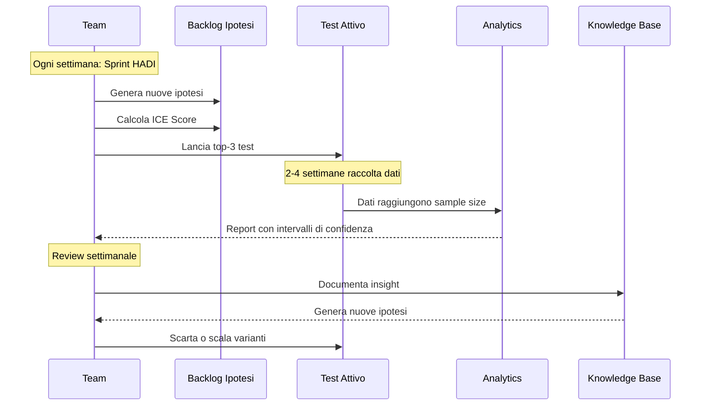

In 2012, Airbnb's growth team faced a concrete problem: the housing photographs were of poor quality, dark photos, poorly framed, unattractive. The hypothesis was that improving photos would increase bookings. The most obvious solution would be to build a system to guide hosts towards better photos, but it would take months.

Instead, the team acted differently: they hired professional photographers in New York and offered hosts to photograph their apartments free of charge. The total cost of the test was a few thousand dollars, and in three weeks they collected real data. The result showed that the professionally photographed accommodations had double bookings compared to the average. The hypothesis was validated with concrete data, not simulations.

The program of professional photographers became one of Airbnb's most important strategic initiatives. But the point is not strategy, it's method. The team didn't expect a perfect system, but built the minimum necessary to test the hypothesis, collected real data, learned and then scaled.

This is the HADI cycle in action: Hypothesis, Action, Data, Insight.

## Because learning speed is the real competitive advantage

Jeff Bezos distinguished two types of decisions in his letter to the 2016 shareholders: "Type 1" decisions, irreversible and high impact, which require in-depth analysis and long-term analysis, and "Type 2" decisions, reversible and testable, which need to be taken quickly to learn.

The problem with slow growing companies is not the lack of ideas or budgets, but to treat Type 2 decisions like Type 1, dedicating months to planning initiatives that could be tested in weeks with a fraction of the effort.

The HADI cycle is an operational structure to accelerate Type 2: hypothesis formula, head with minimal effort, collects real data and converts data into systemic learning. The advantage is not a single experiment, but the ability to complete many more of the competitors.

Amazon tested thousands of variants of its site in 2023. Booking.com performs over 1,000 simultaneous A/B tests every day. Spotify constantly tests variants of the home page and recommendations. It is not a matter of unlimited resources, but of a systematic test culture where every intuition becomes a verifiable hypothesis before becoming a strategy.

## The 4 phases of the HADI cycle

### Step 1: hypothesis, formulate verifiable assumptions

The most common mistake is vagueness. "I want to improve conversion" is a desire, not a hypothesis. A hypothesis must be specific, falsifiable and based on a plausible causal mechanism.

An effective structure is:

> "We believe that [specific action] for [segment or context] will produce [measurable result], because [causal mechanism] we will consider confirmed the hypothesis if [metric] changes by [image] within [period]."

Examples:

| Unformed Hypothesis | Well-formed hypothesis |
|---|---|
| "Improving the product page" | "Add 3 video reviews over the fold will increase CR by 8%+ because social test reduces pre-purchase uncertainty" |
| "Testing a different price" | "The 97 euro price will convert better than 99 euros in the new desktop visitors segment, with impact on CR > 5%" |
| "Improving email" | "Change the subject from open demand to specific number will increase the open rate by at least 3 percentage points in the inactive user segment (>30 days) " |

The "why" part is serious. Without an explicit causal mechanism, the test is blind. With it, if the test fails you can understand if the problem is the hypothesis or understanding of the mechanism.

### Step 2: action, the minimum you need to learn

The trap is to wait for a perfect solution before testing. The purpose of the test is not to launch a finished product, but to collect information. The right question is: what is the fastest and cheapest way to get enough data to validate or invalidate the hypothesis?

Common tools:

- **A/B Test:** Standard for testing page variations, emails, copy, prices. It requires an adequate volume, calculated before the test.

- **Fake Door Test:** launch a button or page announcing an unexistent function to measure real interest.

- **Concierge MVP:** Do what you would automate manually to validate the value before investing.

- **Landing Page Test:** creates a page that describes the product and measures how many users sign up to be notified at launch.

### Step 3: date, collect useful data, not just so many data

The risk is not to collect a few data, but to misread or misread data.

- **Statistical significance:**with few visitors, differences can be noise. Calculate the sample size needed before starting.

- **OMTM (One Metric That Matters):** Each experiment must have a primary metric defined before launch to avoid bias.

- **Novelty Effect:** Tests often show an initial increase due to novelty, which can fade. Wait at least two weeks for high traffic tests.

### Step 4: insight, transforming data into systemic learning

Real value is not the single experiment, but the accumulation of knowledge over time. A failed experiment is valuable information.

The documentation is serious: without it, every team risks rediscovering the same truths, wasting time and resources.

A minimum template to document each experiment:

EXPERIMENT: [Name] DATE: [beginning], [end] IPOTESI: [Complete format] VARIANT: [What has been changed] IMMEDIATE METRIC: [Name and definition] SAMES: [By group and calculation] RESULTS: [Numbers with confidence intervals] DECISION: [Scale / Discard / Replica] INSIGHT: [What we have learned] SUCCESSIVE IPOTESI: [What to test after]

## HADI Vs PDCA vs OKR vs OODA: when to use which

Several iterative improvement frameworks are optimized for different contexts.

| Framework | Optimized for | Come on. | Limit |
|---|---|---|---|
| PDCA | Continuous improvement of known processes | Systematic, reduces variability | Presumption of process knowledge |
| OKR | Alignment on long-term objectives | Direction Clarity | Less suitable for rapid experimentation |
| OODA | Rapid reaction in chaotic environments | Decision-making speed | Less rigorous on measurement |
| HADI | Discovery of new growth drivers | Rigorous, accumulate learning | Requires sufficient data |

## Prioritization of experiments: ICE score and RICE score

A mature team manages a portfolio of parallel experiments, and the key is prioritization.

### ICE Score (Impact, confidence, ease)

- Impact: how big would the impact be?, Confidence: how sure are you of the hypothesis?, Ease: how easy is it to perform the test?

ICE Score = (Impact + Confidence + Ease) / 3

### RICE Score (Reach, impact, confidence, effort)

- Reach: how many people will touch the feature?, Impact: how much will change the behavior?, Confidence: how sure are you?, Effort: how much work does it require?

RICE Score = (Reach × Impact × Confidence) / Effort

Both help avoid bias towards unvalidated ideas.

## Caso studio: tre cicli HADI per ottimizzare il checkout

**Ciclo 1: Ridurre i campi del form**

Ipotesi: ridurre i campi obbligatori da 15 a 8 aumenterà il tasso di completamento del 12% perché riduce il carico cognitivo.

Azione: A/B test con form completo vs form snellito.

Dati: 8.000 utenti per variante, 4 settimane.
- Completamento A: 62.4%
- Completamento B: 69.8%
- Differenza: +7.4 punti, p=0.002

Insight: ipotesi confermata, effetto minore del previsto. Mobile mostra effetto più marcato.

Decisione: scalare variante B, genera ~$45k/mese.

**Ciclo 2: Aggiungere garanzia "Soddisfatti o rimborsati"**

Ipotesi: garanzia visibile ridurrà ansia pre-acquisto su mobile, aumentando conversioni e riducendo resi.

Azione: A/B test con e senza banner garanzia.

Dati: 12.000 utenti per variante, 4 settimane.
- Completamento A: 69.8%
- Completamento B: 72.1%
- Differenza: +2.3 punti, p=0.08
- Rimborsi simili (17% vs 18%)

Insight: incremento conversioni, ma nessuna riduzione rimborsi. Problema post-acquisto.

Decisione: scalare variante B, genera $30k/mese. Nuova ipotesi per ciclo 3.

**Ciclo 3: Migliorare tono email di conferma**

Ipotesi: email rassicurante post-acquisto ridurrà rimborsi aumentando fiducia.

Azione: A/B test su email standard vs email personalizzata.

Dati: 15.000 ordini per variante, 2 settimane.
- Rimborsi A: 17.8%
- Rimborsi B: 14.2%
- Differenza: -3.6 punti, p=0.001
- CTR "track order": 31%

Insight: ipotesi confermata, tono email impatta buyer's remorse.

Decisione: scalare variante B. Impatto netto dopo 3 cicli: incremento conversioni e riduzione rimborsi, valore stimato $100k/mese.

## Gestire più cicli HADI contemporaneamente

Un team maturo gestisce un portfolio di esperimenti in diversi stadi, da pianificazione ad analisi, per massimizzare la velocità di apprendimento.

## Conclusione: la velocità di apprendimento come asset strategico

Le aziende vincenti non hanno sempre l'idea migliore all'inizio, ma imparano più velocemente. Ogni ciclo HADI aggiunge conoscenza sul mercato, sugli utenti e sui driver di crescita, creando un vantaggio competitivo difficile da replicare.

Amazon Web Services è leader perché ha eseguito più esperimenti e iterato più velocemente per quasi vent'anni.

La differenza tra un team che completa 2 cicli HADI al mese e uno che ne completa 8 si traduce in centinaia di esperimenti e conoscenze accumulate. A parità di risorse, il secondo team sa cose che il primo ignora.

Smetti di pianificare per anni. Formula un'ipotesi, costruisci il minimo per testarla, misura con rigore, impara e ripeti. La velocità di apprendimento è l'unico vantaggio competitivo che non si può copiare, perché dipende da ciò che sai, frutto di tutti i test precedenti.

Approfondisci il framework nel nostro [modulo su Growth e significatività statistica](/course/significativita-statistica/).
