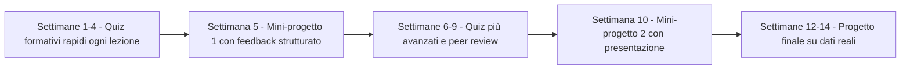

In 2011 Sebastian Thrun, a computer professor at Stanford, published his course of Artificial Intelligence for free, expecting a few thousand subscribers. Instead, 160,000 people from 190 countries enrolled. Surprisingly, the best students were not American university students, but self-taught people from countries without access to high-level universities. Thrun left Stanford to found Udacity, stating that in fifty years there will be only ten truly relevant higher education institutions. This history highlights a structural problem: the traditional university is built on constraints surpassed by technology, such as the need for physical presence and the shortage of experts.

The Italian university, with its long history and bureaucracy, is not immune from this tension. Recent data show a structural delay: first year abandonment rates between 15 and 20%, graduates between 25-34 years to 29% against an EU average of 42%, satisfaction for the lower didactics, limited use of learning analytics, lower postgraduate employment, longer graduation times and spending on lower students. These numbers do not indicate a sudden emergency, but a root and persistent problem.

## The 5 pillars of the innovative professor

### 1. filpped classroom: reverse traditional dynamics

In the traditional model, the teacher transmits knowledge in the classroom and the student applies at home, often without support. The filed classroom moves the transmission at home via video or reading and devotes time in the classroom to practical application and comparison. This allows immediate feedback and targeted support. To work, the videos must be short and integrated with questions of understanding, and the lesson in the classroom must assume their vision.

### 2. learning analytics: measure what counts

Modern platforms collect detailed data on student interactions: frequency, visualization, quiz results, completion times and engagement. These data help identify students at risk and improve materials and methods. A concrete example shows that multiple video review is a sign of commitment, not of difficulty.

### 3. project-based learning: starting from real problems

Replacing abstract exercises with concrete problems forces students to make real decisions, choose metrics, data and communication methods. This approach develops skills required by the labour market, making the theory immediately relevant and memorable.

### 4. gameification: motivate with real incentives

Effective gameification changes the structure of incentives, not just the surface. Effective examples include anonymous short quiz leaders, peer-reviewed team challenges and business simulations with measurable consequences. These tools increase social involvement and responsibility.

### 5. continuous feedback: evaluate before final exam

The final exam comes too late to correct deep misunderstandings. Weekly training quiz, mid-projects and structured peer review allow you to identify and correct problems in real time, reducing anxiety and improving results.

## Casi di successo

All'Università di Bologna, il professor Carlo Moretti ha introdotto learning analytics in corsi di Gestione dei Processi, ottenendo una riduzione dell'abbandono dal 18% al 7% e un aumento del voto medio da 22.1 a 24.8. Al Politecnico di Milano, il programma Executive MBA ha sviluppato un modello predittivo per identificare studenti a rischio occupazionale, offrendo interventi mirati che hanno migliorato il placement al 92% entro sei mesi dalla laurea.

## Gestire la resistenza

L'innovazione incontra spesso resistenze: colleghi tradizionalisti, burocrazia accademica e studenti abituati a metodi passivi. La strategia è portare dati concreti, distinguere tra contenuti e metodi didattici e rinegoziare esplicitamente il patto formativo con gli studenti, spiegando il valore dell'apprendimento attivo.

## Contesto nazionale e risorse

Il PNRR ha stanziato oltre 3 miliardi di euro per innovazione universitaria, inclusi infrastrutture digitali, formazione docenti e sviluppo di corsi online. I fondi Erasmus+ offrono ulteriori risorse per scambi e innovazioni didattiche. Il principale ostacolo non è il denaro, ma la conoscenza e accesso a queste risorse.

## Strumenti gratuiti per iniziare

Non serve investire subito: strumenti come Google Colab, Moodle, Mentimeter, Kaggle, Slido e Notion sono gratuiti o open source e integrabili con gli LMS esistenti. La scelta degli strumenti deve partire dalla domanda pedagogica, non dal tool.

## Framework per la digital transformation

Un percorso strutturato prevede:

- Diagnosi iniziale (audit dati, identificazione docenti pionieri, setup strumenti)
- Pilot localizzato con 5-10 docenti e misurazione rigorosa
- Scaling selettivo a 30-50 docenti e formazione sistematica
- Culturalizzazione con integrazione di metodi innovativi come standard e creazione di centri di eccellenza

## Il punto
Essere un professore innovativo significa usare dati e metodi moderni per un obiettivo antico: far imparare davvero gli studenti. L'università ha un vantaggio unico nel contatto umano e nella comunità, che nessuna piattaforma online può replicare. La sfida è riconoscere che il cambiamento è possibile, strategico e conveniente, e agire con consapevolezza e metodo.
