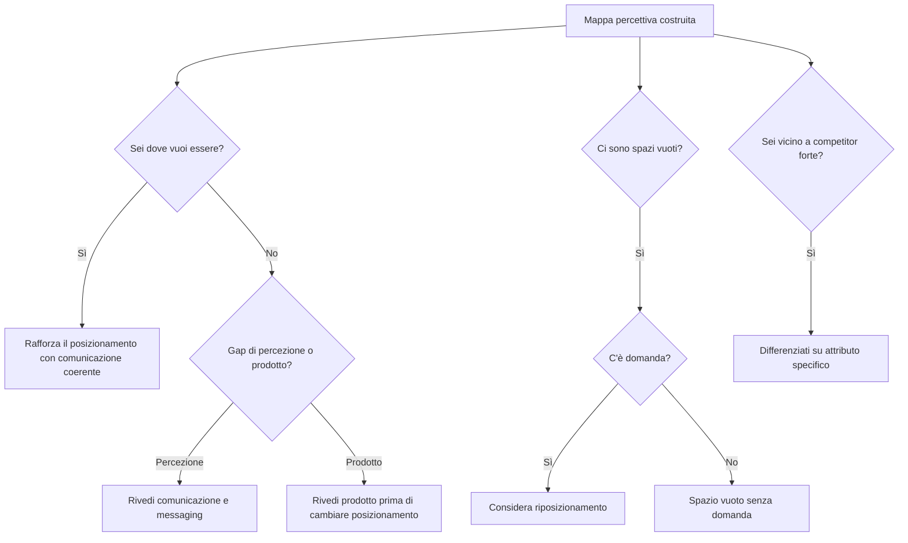

In 1983, Diet Coke arrived 30 years late compared to Tab, the first diet cole of Coca-Cola. Tab had a well-established brand and a loyal clientele, so there didn't seem to be a need for a second diet product. However, a perceptive map of drinks showed a precise empty space: in the placement "modern cole + low calorie + male brand" there was no one. Tab was perceived as feminine, traditional cole as high calorie content. That unattended mental space was huge.

Diet Coke was launched right there, becoming the fastest growing product in the history of Coca-Cola: 200 million cases sold in the first year and third most sold carbonated drink in the United States in 1984.

The perceptive map did not create Diet Coke, but identified the space in which it could exist without cannibalizing Tab and without competing directly with Pepsi or Traditional Coke. It was a map of the consumer's mental space, showing unexplored territories.

## What is a perceptive map and why is it important

A perceptive map is a two-dimensional graph in which each axis represents an attribute relevant to consumers, and brands are positioned according to how they are perceived on those attributes.

The basic difference is that the map shows consumer perception, not objective reality. A technically superior product can be perceived as medium-range if communication does not support premium positioning, and vice versa.

The strategic value of a perceptual map is:

- to understand where you are in the consumer's mind compared to competitors, to identify unattended empty spaces, to diagnose communication problems, to guide repositioning decisions

### Classic example: the european automotive market

The most well-known map uses two axes: economic-premium and sports-comfort.

|  | Sports | Comfort |
|----------------|--------------------|--------------------|
| Economic | Alfa Romeo, Fiat, Dacia | Dacia, Volvo |
| Premium | Ferrari, BMW | Mercedes |

Alfa Romeo is sporty and intermediate price, BMW sports and premium, Mercedes premium and comfort oriented. The sports-economic dial was an empty space, which Renault and Toyota tried to occupy.

## How to build a perceptual map: the 4 steps

### 1. choose the right attributes

The attributes must be relevant to the purchase decision, differentiation and bipolar (with two clear opposite extremes). The best source is qualitative research with consumers, not the marketing team.

| Sector | Typical Attributes |
|-------------------|---------------------------------------|
| Fashion | Price vs. Quality, Classic vs. Trendy |
| Food & Beverage | Greeting vs. Indulgent, Traditional vs. Innovative |
| SaaS | Simple vs. Profitable, Economic vs. Enterprise |

### 2. collection of perceptive data

** Option A: Structured survey** with Likert scale (1-7) on each brand and attribute, with a representative sample including customers and non-customers.

** Option B: Online review analysis** with NLP and sentiment analysis, useful for preliminary analysis or monitoring over time.

### 3. statistical analysis: MDS or PCA

With few attributes you can draw directly, with many you use dimensional reduction.

- MDS: project the perceptive distances in 2D, excellent with data of direct similarity, PCA: combines the attributes in two main components that explain the variance, more common with score data

A practical example in the Italian SaaS market shows how to use PCA to build the map and identify an empty space "simple + economical."

### 4. interpret the map and define the strategy

The main strategic readings are:

- confirm if you are where you want to be in the consumer's mind, identify empty spaces with potential demand, analyze competitive clusters to differentiate yourself, monitor evolution over time with regular updates

## Errori da evitare

- scegliere attributi non rilevanti per i consumatori
- confondere percezione con realtà tecnica
- campione distorto (solo clienti attuali)
- non aggiornare la mappa nel tempo

## Caso pratico: mercato del caffè specialty in italia

Uno studio su 250 consumatori ha mappato brand come Illy, Lavazza, Blue Bottle, Intelligentsia e un tostatore artigianale italiano.

La PCA ha evidenziato due dimensioni: "tradizione italiana vs modernità internazionale" e "accessibile vs premium".

Il tostatore si posiziona vicino ai brand americani nel quadrante "moderno + premium", molto competitivo. Lo spazio "moderno + accessibile" è quasi vuoto, rappresentando un'opportunità per offrire qualità e cool factor a prezzo accessibile.

La strategia suggerita è espandere la distribuzione online con abbonamenti competitivi, mantenendo la comunicazione su artigianalità moderna e sostenibilità.

## Applicazioni pratiche

Le mappe percettive guidano decisioni su naming, pricing, sviluppo prodotto e investimenti pubblicitari, assicurando coerenza tra percezione e strategia.

## Il punto
Come dice Jocelyn Wyatt di IDEO U, "design thinking starts with observation". Prima di decidere dove andare, devi sapere dove sei nella mente dei consumatori. Le mappe percettive sono strumenti decisionali concreti che mostrano non solo quanto vendi, ma perché e dove puoi crescere.
