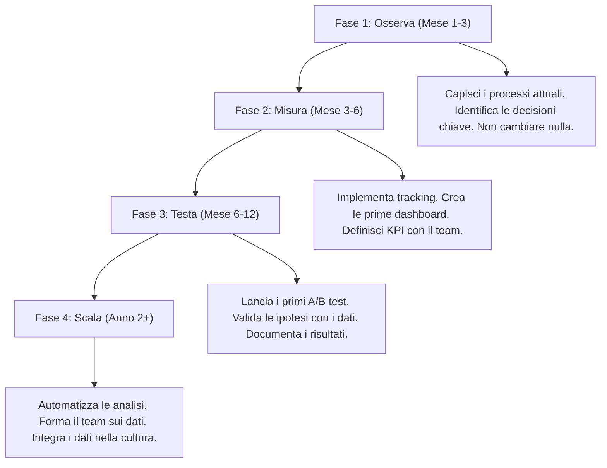

In the heart of Italian SMEs, a profound transformation is taking place, led by a new generation of millennial managers who face the discipline of making decisions in uncertainty with a data-driven approach. This change is not only technological, but epistemological: it is passed from a management based on experience and intuition to a based on measurable data and continuous experimentation.

## Real problem

Many Italian family companies, especially SMEs, are now facing a radical generational shift. The new managers, often the children of the founders, return with expertise in Business Analytics and international experiences, but clash with backward management realities, where decisions are still made "by nose" and data are relegated to obsolete annual reports or Excel sheets.

## Conceptual model

The millennial generation stands out for a collaborative and data-informed approach, which results in five fundamental changes in management:

1. From a defensive attitude towards change to a culture of continuous experimentation. 2. From the hierarchy of information to the democratization of data. 3. From monthly reporting to real-time monitoring. 4. From respect based on seniority to competence demonstrated with data. 5. From the physical office to hybrid work with output-based productivity metrics.

These changes are supported by concrete tools such as shared dashboards, self-service tools for data analysis and models of people analytics that transform human resource management into predictive science.

## Strict formalisation

The discipline of the decision under uncertainty is realized in the cycle HADI (Hypothesis, Action, Data, Insights), a framework that allows to reduce the cost of the error through rapid tests and real data. The process of transition data-driven is articulated in four phases:

- **Stage 1: Observe (Month 1-3)**, listening and mapping of existing processes without immediate changes., **Stage 2: Measurement (Month 3-6)**, implementation of essential tracking and shared definition of KPIs., **Stage 3: Head (Month 6-12)**, launch of structured experiments with rigorous documentation., **Stage 4: Scale (Year 2+)**, automation, training and cultural integration of data in daily decisions.

## Esempio o caso studio

Un distributore alimentare del Nord-Est ha trasformato il proprio sistema decisionale passando da report mensili a dashboard in tempo reale. Gli agenti, prima informati solo a fine mese, hanno potuto monitorare ogni sera le proprie performance rispetto ai target settimanali. In sei mesi, la varianza tra top e bottom performer si è ridotta del 40%, grazie alla possibilità di correggere tempestivamente le strategie.

Booking.com rappresenta un altro esempio estremo di sperimentazione continua, con oltre 25.000 A/B test annuali che riducono il rischio di decisioni errate basate sull'intuizione.

## Lab / esercizio

**Livello base:** Mappare i processi decisionali attuali della propria azienda senza modificarli, identificando le principali fonti di dati e le decisioni chiave.

**Livello intermedio:** Definire con il team 3-5 KPI rilevanti e implementare un sistema semplice di raccolta dati (es. Google Sheets condivisi).

**Livello research-grade:** Progettare e lanciare un esperimento A/B strutturato su una decisione commerciale, documentando ipotesi, gruppi di controllo e test, durata e metriche di successo.

**Dataset e materiali consigliati:** Dataset di vendite mensili, tool di dashboarding open source (Metabase, Apache Superset), risorse sul ciclo HADI e sperimentazione continua.

## Errore tipico da evitare

Confondere la quantità di dati con la qualità delle decisioni. Implementare troppi strumenti simultaneamente senza un piano chiaro genera caos e resistenza. Trasformare ogni attività in una metrica porta a un sistema di controllo che distrugge fiducia e creatività. È di base definire pochi KPI significativi e costruire una cultura condivisa.

## Quiz o checkpoint

- Qual è il principale vantaggio del ciclo HADI nella gestione dell'incertezza?
- Perché la democratizzazione dei dati migliora le decisioni a tutti i livelli aziendali?
- Quali sono i rischi di introdurre troppi tool tecnologici contemporaneamente?
- Come si può valorizzare l'esperienza tradizionale in un contesto data-driven?

## Il punto
Il futuro del management nelle PMI italiane passa per un equilibrio tra esperienza e dati, tra artigianalità e sperimentazione. I manager millennial non stanno solo portando nuove tecnologie, ma stanno disciplinando un modo nuovo di prendere decisioni sotto incertezza, basato su dati reali, test continui e trasparenza. Chi saprà guidare questa transizione con rispetto e metodo costruirà un vantaggio competitivo duraturo e inarrestabile.
