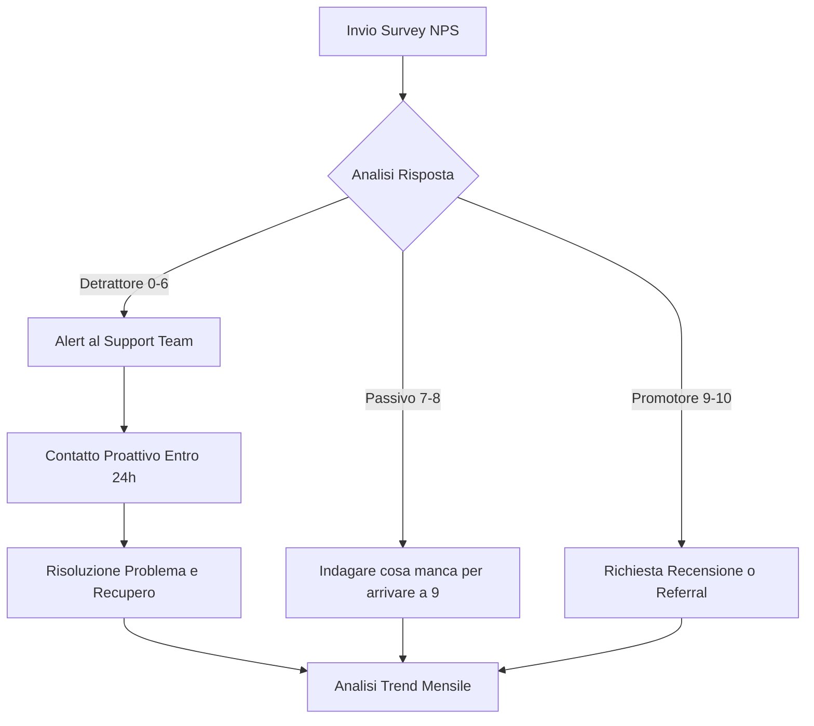

In 2003, Fred Reichheld proposed the Net Promoter Score (NPS) as the only metric capable of predicting the growth of a company, based on a simple question: "What are the chances of advising our company to a friend or colleague?" Since then, the NPS has become a widespread standard, adopted by giants like Apple, Tesla and Amazon. But more than twenty years after the introduction, it is time for a critical budget: the NPS is useful, but it is not the magic wand that many believe.

## How to calculate the NPS (Mathematics behind the myth)

The NPS is based on a segmentation of customers into promoters (9-10), passive (7-8) and detractors (0-6). The formula is simple: NPS = % Promoters, % Detractors. However, simplicity hides methodological complexity: the passives are included in the denominator, but not in the numerator, a specific choice that can confuse.

A practical example with real answers shows how an NPS of 20 can derive from a mix of enthusiastic, satisfied and dissatisfied customers, highlighting the aggregate and synthetic nature of metrics.

## The scientific problems of the NPS

### 1. intention vs behaviour

The NPS measures the stated intention to recommend, not the actual behavior. Academic studies, such as Timothy Keiningham's, show that the correlation between NPS and growth is weaker than you think, and other metrics can be just as predictive or more predictive.

### 2. cultural bias

Responses to the NPS vary by cultural standards: a 7 in Italy can mean satisfaction, while in other countries it does not. Comparing NPS between different cultures is equivalent to comparing apples with pears, making decisions based on these data potentially misleading.

### 3. lack of causality

A high or low NPS score does not indicate what to correct. Without qualitative follow-up questions, the NPS is a thermometer without diagnosis: it indicates a problem but not the cause.

### 4. timing and context

The NPS is influenced by the time it is collected. The same person can give very different scores depending on the immediate experience, making the metric volatile and sensitive to timing.

### 5. statistical stability

With small samples, the NPS is highly volatile. For startups or companies with few customers, a single change can drastically alter the score, making it difficult to interpret data.

## The best alternative metrics

The NPS should not be abandoned, but integrated with more precise and operable metrics:

- **CSAT (Customer Satisfaction Score):** measures satisfaction on specific touchpoints, useful for targeted interventions., **CES (Customer Effort Score):** evaluates the ease with which the customer solves a problem, often more predictive than loyalty., **Product-Market Fit Survey:** measures how much a product is indispensable for the customer., **Behavioural materials:** churn rate, retention rate, expansion rate, measuring real customer actions.

| Metrica | Measure | Predictability Churn | Activation | Easy Implementation | Cultural bias |
|---|---|---|---|---|---|
| NPS | Recommendation | Low-medium | Low | High | High |
| CSAT | Satisfaction by Event | Medium | High | Average | Average |
| CES | Ease of problem solving | High | High | Average | Low |
| Churn Rate | Royal Abandonment | Very High | High | High | No. |
| Expansion Rate | Increase in expenditure | Very High | Very High | High | No. |
| PMF Survey | Indispensability perceived | Very High | Very High | Average | Low |

## Close the circle

The value of the NPS lies in the process of responding to customers, not in the number itself. For example, contacting a deductor within 24 hours can turn it into a loyal customer, while ignoring it can amplify the damage.

## Caso reale: apple e l'NPS

Apple non punta a un NPS alto in senso assoluto, ma monitora i trend settimanali per negozio e per dipendente. Un calo improvviso genera un alert e un'indagine, trasformando l'NPS in un sistema di allerta e miglioramento continuo.

## Rendere l'NPS azionabile con driver analysis

Attraverso la regressione multipla, è possibile decomporre l'NPS nei suoi fattori determinanti (qualità, prezzo, servizio, spedizione, packaging), ottenendo una mappa strategica per interventi mirati.

## NPS Transazionale vs relazionale

Distinguere tra NPS raccolto subito dopo una transazione e NPS sul brand permette di capire se il problema è nel prodotto o nell'immagine complessiva dell'azienda.

## Caso studio: SaaS italiano

Un'azienda SaaS ha sostituito l'NPS come metrica primaria con un sistema ibrido che integra CSAT, CES, churn e NPS relazionale con driver analysis, ottenendo una riduzione del churn del 37% e un aumento dell'upsell del 50% in 18 mesi.

| Metrica | Prima | Dopo | Impatto |
|---|---|---|---|
| Churn rate | 8.2% mensile | 5.1% mensile | -37% |
| CSAT medio | Non misurato | 4.2/5 | Benchmark >4.0 |
| Expansion rate | 12% | 18% | +50% |
| NPS | 38 (non azionabile) | N/A | Miglior predizione via churn |

## Il punto
L'NPS è uno strumento utile ma incompleto. È un termometro che indica la presenza di un problema, non la sua causa. Per prendere decisioni efficaci sotto incertezza, serve integrare l'NPS con metriche comportamentali, analisi dei driver e processi di risposta rapida ai clienti insoddisfatti. Solo così si trasforma un numero in un vantaggio competitivo reale.

Per approfondire, consulta il nostro [modulo su metriche fondamentali e significatività statistica](/course/metriche-fondamenti/).

La vera domanda non è "Qual è il nostro NPS?" ma "Quali decisioni vogliamo prendere con questa metrica?" Il numero è uno strumento, non il fine.
