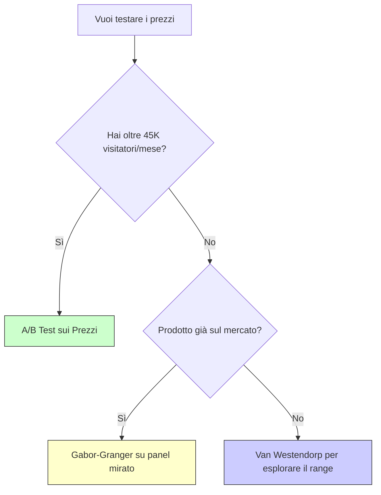

In 2006 Amazon made a decision that seemed agAInst any logic: zeROIng the shipping cost for those who spent over a certain threshold. Internally they called it "the stupid move." Three years later, Prime had become the most profitable product of the company, not because they had guessed the right price, but because they had measured it with data.

The price is the most useful lever in the business. An increase of 1% of the price generates on aveRAGe an increase of 10% of the profit (McKinsey, 2021). Yet many Italian companies still rely on the "cost charging" or on the simple comparison with the competitors, approaches that ignore the market or copy strategies without understanding them.

I have often seen founder show lists with vague answers on why of those numbers: "it seemed reasonable." But reasonable for whom? Based on what?

There are three scientific methods to test prices, accessible and more effective than intuition. I use them in sequence in pricing projects.

## Method 1: van westdorp (Price sensitivity meter)

Peter van Westendorp, in the 1970s, proposed a method to identify the psychological limits of the price, not the simple desire to buy. Four questions explore where the market perceives the price as too low, a deal, too expensive or definitely unacceptable.

### The 4 applications

1. At what price would the product seem too cheap, from which would you doubt the quality? 2. At what price would you consider it a bargAIn, cheap but of quality? 3. At what price do you start to think it costs too much, but would you purchase it anyway? 4. At what price would you consider it too expensive not to buy?

### Analysis of results

By tracing the cumulative curves of the responses, they identify:

| Intersection | Meaning |
|---|---|
| "Too cheap" "Too expensive" | Optimal Price Point (OPP): price with minimal psychological friction |
| "Custom' means any of the following: | Inifference Price Point (IPP): price perceived as normal |
| Range between intersections | Acceptable Price Range: maneuvering zone |

### Case study: SaaS startup of tax compliance

An Italian startup entered the market at 89€/month without testing, copying an American competitor. After interviewing 230 decision-makers, the Van Westendorp showed an OPP at 67€/month and an IPP at 95€/month, with an acceptable range between 45€ and 130€. The initial price was perceived as "economic," communicating little value. By rAIsing the price to 110€ and improving positioning, the conversion increased by 23% because the product seemed more "serious."

### Pros and cons

| Pros | AgAInst |
|---|---|
| Quick and easy (200 answers are enough) | Based on opinions, not real purchases |
| Provides a range, not a single point | Not segment by type of customer |
| Economic to be conducted | Does not measure the real willingness to pay |
| Great for new products | Sensitive to the formulation of the questions |

## Method 2: gabor-granger (Direct price testing)

Clive Granger and Andre Gabor developed a method to understand the question according to the price. It presents a price and wonders if the customer would buy. The question fits according to the answer to find the maximum acceptable price.

### Procedure

1. Choose 5-7 prices in the range of interest. 2. Show a random price. 3. If the responder says "yes," propose a higher price; if "no," a lower price. 4. Continue until you find the maximum acceptable price. 5. Add the answers to build the question curve.

### Example

A project management tool with prices from 9€ to 29€ shows that the maximum Revenue Index can be reached at 15€, balancing volume and margin.

| Price | % Buying | Revenue Index |
|---|---|---|
| 9€ | 85% | 765 |
| 12€ | 72% | 864 |
| 15€ | 58% | 870 |
| 19€ | 41% | 779 |
| 25€ | 22% | 550 |
| 29€ | 8% | 232 |

### Basecamp case

Basecamp eliminated the \$24 tier after finding that the question was concentrated between \$49 and \$99. Moving to a flat price of \$99, it reduced the churn by 15% because customers didn't feel "nicked" anymore.

### Pros and cons

| Pros | AgAInst |
|---|---|
| More realistic than Van Westendorp | Still based on declared intentions |
| Builds a real demand curve | Requires 300+ reliable answers |
| Find optimal prices for different goals | Sensitive to the question framing |
| Quantification of demand elasticity | Do not capture time dynamics |

## Method 3: A/B price test (The gold standard)

Netflix testified in 2014 a price increase on a subset of users, discovering that the churn did not change. This allowed a general increase the following year.

### Ethical implementation

1. Test only on new customers. 2. Low price variations (±15%). 3. Minimum duration two weeks. 4. Segmentation by channel. 5. Post-test transparency.

### Technical setup

An example of code assigns users to price groups in a deterministic way using hash MD5, ensuring consistency.

### Results of a SaaS test

| Group | Price | CR (%) | Revenue for Visitor (RPV) | Margin for Visitor |
|---|---|---|---|---|
| price_low | 14.90€ | 2.80 | 0.42€ | 0.22€ |
| price_mid | 17.90€ | 2.33 | 0.42€ | 0.15€ |
| price_high | 19.90€ | 1.87 | 0.37€ | 0.09€ |

The higher price does not guarantee the greater RPV or margin.

### Necessary traffic

To detect conversion variations of 0.5% with 95% significance and 80% power, it takes about 22,000 visitors per variant, explAIning why only large companies can do many tests.

### Pros and cons

| Pros | AgAInst |
|---|---|
| Real, non-declarative data | Requires a lot of traffic |
| Real elasticity measurement | Reputational risk if poorly managed |
| Capture effects not visible in surveys | Requires weeks |
| Gold pricing standard | Hard for products with long cycles |

## Elasticity of demand formula

Elasticity is calculated as the ratio between the percentage change in the quantity sold and the percentage change in the price. Elasticity is defined as elastic demand,

## Which method do you choose?

It depends on the traffic, the stage of the product and the required certainty:

Il percorso ideale è Van Westendorp per esplorare, Gabor-Granger per affinare, A/B test per validare.

## Caso che ha cambiato il mio approccio

Un'azienda HR italiana fissò il prezzo a 199€ perché "facevano così i competitor". Van Westendorp indicò un OPP a 280€, Gabor-Granger un massimo revenue a 249€. Alzarono il prezzo, ma le conversioni crollarono del 40%. Il problema era il posizionamento: clienti diversi si aspettavano servizi diversi. Cambiare prezzo cambia il tipo di clientela.

## Il punto
Non esiste un prezzo "giusto" assoluto, ma un prezzo ottimale per il tuo obiettivo. Van Westendorp esplora, Gabor-Granger stima la domanda, A/B test convalida con dati reali. Così il pricing diventa scienza, non solo arte.

Per approfondire, consulta il modulo [Matematica per l'Analisi dei Dati](/course/matematica-analisi-dati/) su GinnyTech.
