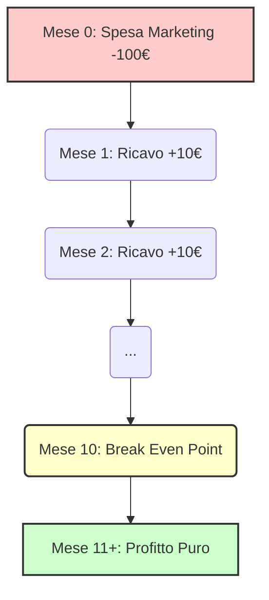

In 2015, Oliver Samwer, CEO of Rocket Internet, was known as the most effective "startup cloner" in the world. His model consisted of replicating American business models in Europe and emerging markets, AIming to grow at any cost and to quote themselves on the stock market. The problem? No one controlled the unit economics.

Zalando, for example, spent 40 euros to acquire customers who bought 50 euro shoes, returned them to 70% and then disappeared. The acquisition cost was real, but the net revenue almost zero. When the financial markets began to question the fundamentals, the valuations collapsed. The lesson is clear: optimizing the numbers at the top of the funnel doesn't need if the basic mathematics for each customer doesn't return.

The economics units are not accounting. They are the most honest question you can ask your business: do I earn money on every sale or do I lose them?

## Because most people miscalculate

Many marketing teams make common mistakes:

- Confuse revenue with margin. Selling a product at 100 euros that costs 70 euros does not mean earning 100 euros, but 30 euros., Use a "blended" CAC that mixes organically acquired customers (zero cost) with those from pAId ads, obtAIning an optimistic but not useful figure., Ignore the time factor: a high but diluted LTV over years can be unsustAInable if you need liquidity immediately.

## LTV (lifetime value): the correct formula

The commonly used formula is:

LTV = Middle Order Value x Annual Purchase Frequency x Years of AveRAGe Life

But it's incomplete. The correct version is:

LTV = Contribution Margin by Transactions x Annual Purchase Frequency x Years of AveRAGe Life

The contribution margin is the income net of all variable costs (production, logistics, returns, payment fees), not the fixed costs.

### Concrete example

An e-commerce of clothing with:, AOV: 90 euros, Cost of goods: 30 euros, Logistic: 8 euros, Returns to 25% with cost management returned of 12 euros, Payment fees 2% (1,80 euros)

Contribution margin = 90, 30, 8, (0.25 x 12), 1,80 = € 47,20

If the customer buys 3 times a year and stays for 2 years:

LTV = 47,20 x 3 x 2 = 283,20 euros

Not 540 euros as calculated without margins. Planning campAIgns with 540 euros leads to unsustAInable target CAC.

## CAC: Blended vs pAId

- **CAC Blended**: total marketing spending divided by new customers, includes all channels and costs., **CAC PAId**: expenditure only in pAId advertising divided customers acquired by pAId.

The gap between the two indicates the dependence on the organic. If the CAC PAId is much higher, climbing with pAId becomes risky.

## The golden rule: ltv:cac > 3:1

- Below 1:1: you lose money on every client., Between 1:1 and 2:1: zero margin for fixed costs, fragile business., 3:1: healthy and scalable business., Above 5:1: possible underinvestment, you are losing growth opportunities.

### Benchmark by sector (2025-2026)

| Sector | LTV:CAC Ideal | Payback Period | Gross Margin |
|---------------|----------------|----------------|---------------|
| SaaS B2B | 5:1 - 7:1 | 12-18 months | 75%+ |
| SaaS B2C | 3:1 - 4:1 | 6-12 months | 70%+ |
| E-commerce | 2:1 - 3:1 | 4-8 months | 40-50% |
| Marketplace | 2:1 - 3:1 | 6-12 months | 20-30% (take rate) |
| Fintech | 4:1 - 6:1 | 18-24 months | 60%+ |

## Payback period: how long to recover the CAC

The Payback Period measures how many months it takes to recover the CAC by monthly margin:

Payback Period = CAC / Monthly Contribution Margin

If CAC is 120 euros and monthly margin 20 euros, the payback is 6 months. During this period the cAPItal is committed without return.

### Benchmark payback

- 6-12 months: acceptable, 12-18 months: risky, >18 months: typical SaaS enterprise, serves significant cAPItal

Many startups fAIl not for wrong pattern, but for too long payback and lack of cash.

## View the cash flow

Il payback si moltiplica per ogni cliente acquisito, creando un buco di cassa che cresce rapidamente.

## Come calcolare le tue unit economics in pratica

1. Calcola il margine di contribuzione per transazione sottraendo tutti i costi variabili.
2. Misura la frequenza di acquisto reale per coorti e canali.
3. Calcola la vita media cliente usando il churn rate storico.
4. Separa il CAC per canale.
5. Calcola il rapporto LTV:CAC per canale per decidere dove investire.

## Il caso dropbox: le unit economics guidano la strategia

Nel 2008 Dropbox spendeva 388 dollari per acquisire un cliente che pagava 99 dollari all'anno, un rapporto disastroso. Invece di ottimizzare le campagne, costruirono un programma referral con costi marginali bassissimi. LTV:CAC esplose e gli utenti crebbero da 100.000 a 4 milioni in 15 mesi.

La lezione: le unit economics ti costringono a soluzioni creative oltre l'ottimizzazione incrementale.

## SQL Per calcolare CAC e LTV

La query mostra come calcolare CAC blended, CAC paid e LTV per coorti mensili, utile per monitorare l'efficienza dei canali.

## Domande da fare ogni mese

- Il mio LTV:CAC per canale paid è sopra 3:1?
- Il Payback Period si sta allungando o accorciando?
- La coorte più recente ha un LTV superiore a quella di 12 mesi fa?
- Qual è il canale con il miglior LTV:CAC?
- Sto investendo di più nei canali con LTV:CAC > 3:1?

## Benchmark aggiornati 2026

| Settore          | Minimo Sostenibile | Business Sano | Target Aggressivi |
|------------------|--------------------|---------------|-------------------|
| SaaS B2B         | 2.5:1              | 5:1           | 8:1+              |
| SaaS B2C         | 2:1                | 3.5:1         | 5:1+              |
| E-commerce Moda  | 1.5:1              | 2.5:1         | 3.5:1             |
| E-commerce Grocery| 1.2:1              | 2:1           | 2.5:1             |
| Marketplace      | 1.5:1              | 2.5:1         | 3.5:1             |
| Fintech          | 3:1                | 5:1           | 7:1+              |
| Creator Economy  | 2:1                | 3.5:1         | 5:1+              |

## Il punto
Le unit economics sono il termometro reale del tuo business. Se i numeri non tornano, nessuna narrazione o campagna può salvarti. Se tornano, hai la certezza matematica che ogni euro investito genera ritorno positivo. Sono brutalmente oneste e ti costringono a decisioni basate su dati, non su speranze. Monitorale con rigore e usa queste metriche per guidare la tua strategia di crescita.
