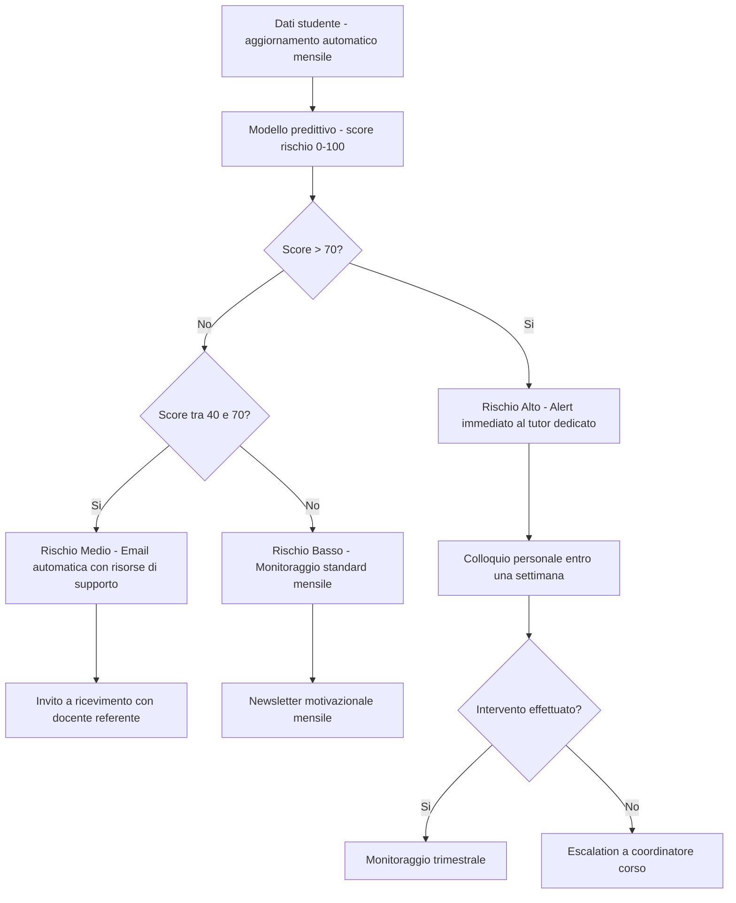

# Prevedere l'Abbandono Universitario: Come i Dati Salvano Studenti

Nel 2012 la Georgia State University aveva un problema che sembrava irrisolvibile: il tasso di laurea era del 44%, uno dei più bassi tra le grandi università americane. Migliaia di studenti abbandonavano ogni anno, spesso per motivi che sembravano piccoli dall'esterno ma che per loro erano insormontabili: una bolletta non pagata, un corso prerequisito mancato, uno smarrimento nelle scelte di piano di studi.

Il provost Timothy Renick decise di costruire un sistema diverso. Non un counseling più intenso — l'università non aveva i fondi. Non un programma di tutoraggio generico — troppo costoso e troppo lento. Un sistema predittivo che identificasse *chi stava per abbandonare* e inviasse un alert proattivo al tutor giusto nel momento giusto.

Il sistema GPS Advising analizzava 800 variabili per ogni studente: voti, presenze, frequenza di accesso alla piattaforma LMS, cambiamenti di corso, interazioni con i servizi di supporto. Generava un alert ogni volta che uno studente mostrava segnali di rischio — non dopo che aveva smesso di venire, ma settimane prima.

Sei anni dopo, il tasso di laurea era salito al 55%, un aumento di 11 punti percentuali. La Georgia State laureò 56.000 studenti in più in sei anni. E lo fece senza aumentare significativamente il budget per il supporto — aumentando solo la precisione degli interventi.

Nel 2026, i dati ISTAT mostrano che il 15-20% degli studenti universitari italiani abbandona dopo il primo anno. Secondo l'Anvur (Agenzia Nazionale di Valutazione del Sistema Universitario), il tasso varia significativamente tra Nord (12%) e Sud (25%), con un gap regionale preoccupante. Ogni studente perso è un costo: per la famiglia (tempo e denaro investiti), per l'ateneo (risorse non recuperate), per il sistema-paese (capitale umano non sviluppato).

Ma la domanda più interessante non è *quanti* abbandonano — è *possiamo prevederlo prima che accada e fare qualcosa*.

La risposta è sì. E non serve l'intelligenza artificiale di fantascienza — bastano pochi dati, un modello statistico ragionevole e la volontà organizzativa di agire sui risultati.

## I Dati Italiani: Dove Siamo nel 2026

L'Anvur ha pubblicato dati dettagliati sul tasso di abbandono per università italiana. Nel 2025:

| Area geografica | Tasso medio di abbandono | Variazione vs 2020 |
|---|---|---|
| Nord-Ovest | 11.2% | -1.3pp |
| Nord-Est | 12.8% | -0.8pp |
| Centro | 14.5% | +0.2pp |
| Sud e Isole | 24.8% | +2.1pp |
| Media Italiana | 17.3% | +0.3pp |

Il divario Nord-Sud è drammatico: uno studente nel Sud ha il doppio delle probabilità di abbandonare rispetto a uno nel Nord-Ovest.

Per tipo di ateneo:

| Tipo | Tasso abbandono | Studenti coinvolti | Costo stimato |
|---|---|---|---|
| Università statali grandi | 18-22% | 150.000 anno | €300M/anno |
| Università statali medie | 15-18% | 80.000 anno | €120M/anno |
| Università telematiche | 35-45% | 50.000 anno | €75M/anno |
| Università private | 12-16% | 30.000 anno | €30M/anno |

Il costo di un abbandono è calcolato dall'OECD in ~€15.000 per studente (tasse non recuperate + risorse didattiche spese).

## I Predittori dell'Abbandono: Cosa Dicono i Dati

Studi condotti su università italiane ed europee identificano pattern sorprendentemente consistenti tra atenei diversi, cicli economici diversi, e discipline diverse. I predittori più potenti non sono quelli che ci aspetteremmo intuitivamente.

| Fattore predittivo | Peso predittivo | Disponibilità temporale | Fonte dati | Correlazione con abbandono |
|---|---|---|---|---|
| CFU acquisiti nel primo semestre | Molto alto (35%) | Dopo 6 mesi | Gestionale accademico | -0.72 (correlazione negativa: più CFU = meno abbandono) |
| Tasso di superamento esami | Alto (22%) | Dopo 6 mesi | Gestionale accademico | -0.68 |
| Media voti primo semestre | Alto (18%) | Dopo 6 mesi | Gestionale accademico | -0.65 |
| Giorni di inattività LMS | Medio (8%) | Continuo | Piattaforma e-learning | +0.42 (più inattività = più abbandono) |
| Voto di maturità | Medio (7%) | Al momento dell'iscrizione | Questionario d'ingresso | -0.38 |
| Prima scelta di corso vs ripiego | Medio (5%) | Al momento dell'iscrizione | Questionario d'ingresso | -0.35 |
| Frequenza LMS sessioni mensili | Basso-medio (3%) | Continuo | Piattaforma e-learning | -0.28 |
| Studente pendolare vs fuori sede | Basso (2%) | Al momento dell'iscrizione | Anagrafe studenti | +0.15 |

Il dato più potente e controintuitivo: non è il voto di maturità (che misura il potenziale accademico pregresso), ma il numero di CFU acquisiti nei primi sei mesi. Uno studente che a febbraio del primo anno ha zero CFU ha una probabilità di abbandono superiore al 70%, indipendentemente da quanto era bravo al liceo.

Questo non stupisce se ci pensiamo in termini di psicologia comportamentale: l'abbandono è raramente una decisione improvvisa. È la conclusione di un processo lungo mesi in cui lo studente si è progressivamente disimpegnato — e i CFU sono la traccia più visibile di quel disimpegno.

### Profilo dello Studente a Rischio Alto

Uno studente con profilo di "rischio abbandono alto":

- Media primo semestre < 18 (su 30)
- CFU acquisiti nel primo semestre < 10
- Frequenza LMS < 2 accessi a settimana
- Ha scelto il corso come seconda/terza opzione
- Voto maturità < 70/100

La probabilità di abbandono di uno studente che soddisfa 4 su 5 di questi criteri è > 60%, rilevato empiricamente su dataset di 30.000+ studenti italiani.

## Il Modello Predittivo: Come Costruirlo

### Step 1: Raccolta e Integrazione dei Dati

Ogni ateneo italiano ha già la maggioranza di questi dati nei propri gestionali. Il problema non è la raccolta — è l'integrazione. I dati vivono in silos: la segreteria ha i dati anagrafici e i voti, il LMS ha i log di accesso alle lezioni, l'ufficio orientamento ha i risultati dei questionari d'ingresso, il sistema di presenze ha la frequenza.

Nessuno di questi sistemi comunica con gli altri in modo automatico. Il primo passo è costruire una pipeline di dati che consolidi queste fonti in un unico dataset analitico per studente.

Una query di integrazione base in SQL:

```sql
-- Integrazione dati da fonti multiple
WITH student_data AS (
  SELECT
    s.student_id,
    s.enrollment_date,
    s.major_code,
    s.admission_test_score,
    s.maturity_grade,
    s.residence_type,
    s.working_hours_weekly
  FROM students s
),

academic_performance AS (
  SELECT
    student_id,
    COUNT(*) AS exams_attempted_6m,
    SUM(CASE WHEN passed = 1 THEN 1 ELSE 0 END) AS exams_passed_6m,
    ROUND(AVG(grade), 1) AS avg_grade_6m,
    SUM(credits_earned) AS cfu_semester1
  FROM exam_records
  WHERE exam_date BETWEEN DATE_SUB(CURRENT_DATE(), INTERVAL 6 MONTH) AND CURRENT_DATE()
  GROUP BY student_id
),

lms_engagement AS (
  SELECT
    student_id,
    COUNT(DISTINCT DATE(access_timestamp)) AS distinct_access_days,
    COUNT(*) AS total_accesses,
    MAX(access_timestamp) AS last_access,
    DATE_DIFF(CURRENT_DATE(), MAX(access_timestamp), DAY) AS days_since_last_access
  FROM lms_activity
  WHERE access_date >= DATE_SUB(CURRENT_DATE(), INTERVAL 6 MONTH)
  GROUP BY student_id
),

course_preference AS (
  SELECT
    student_id,
    CASE WHEN choice_order = 1 THEN 1 ELSE 0 END AS is_first_choice
  FROM enrollment_preferences
)

SELECT
  sd.student_id,
  sd.enrollment_date,
  sd.major_code,
  sd.admission_test_score,
  sd.maturity_grade,
  sd.residence_type,
  sd.working_hours_weekly,
  COALESCE(ap.cfu_semester1, 0) AS cfu_semester1,
  COALESCE(ap.exams_attempted_6m, 0) AS exams_attempted,
  COALESCE(ap.exams_passed_6m, 0) AS exams_passed,
  COALESCE(ap.avg_grade_6m, 0) AS avg_grade_6m,
  COALESCE(le.days_since_last_access, 999) AS days_inactivity_lms,
  COALESCE(le.total_accesses, 0) AS lms_access_count,
  COALESCE(cp.is_first_choice, 0) AS is_first_choice
FROM student_data sd
LEFT JOIN academic_performance ap USING (student_id)
LEFT JOIN lms_engagement le USING (student_id)
LEFT JOIN course_preference cp USING (student_id);
```

### Step 2: Feature Engineering

```python
import pandas as pd
import numpy as np

def engineer_features(df):
    """
    Trasforma i dati grezzi in feature predittive per il modello.
    Questa funzione viene applicata dopo il primo semestre,
    quando abbiamo i dati accademici iniziali.
    """

    # Feature accademiche: le più predittive
    df['cfu_primo_sem'] = df['cfu_semester1']
    df['media_primo_sem'] = df['avg_grade_6m']

    # Tasso di superamento: esami passati / esami tentati
    df['esami_tentati'] = df['exams_attempted']
    df['tasso_superamento'] = np.where(
        df['esami_tentati'] > 0,
        df['exams_passed'] / df['esami_tentati'],
        0  # Nessun esame tentato = segnale di abbandono imminente
    )

    # Feature contestuali: disponibili dall'iscrizione
    df['gap_maturita'] = df['maturity_grade'] - df['maturity_grade'].median()
    df['prima_scelta'] = df['is_first_choice'].astype(int)
    df['pendolare'] = (df['residence_type'] == 'home').astype(int)
    df['lavoratore'] = (df['working_hours_weekly'] > 20).astype(int)

    # Feature di engagement digitale (dal LMS)
    df['giorni_inattivita_lms'] = df['days_inactivity_lms']
    df['sessioni_lms_mensile'] = df['lms_access_count'] / 6

    # Normalizza alcune feature per machine learning
    df['cfu_primo_sem_norm'] = (df['cfu_primo_sem'] - df['cfu_primo_sem'].mean()) / df['cfu_primo_sem'].std()
    df['media_primo_sem_norm'] = (df['media_primo_sem'] - df['media_primo_sem'].mean()) / df['media_primo_sem'].std()

    # Feature di interazione: combina fattori
    df['academic_engagement'] = df['tasso_superamento'] * (df['media_primo_sem'] / 30)
    df['digital_engagement'] = df['sessioni_lms_mensile'] / df['giorni_inattivita_lms'].replace(0, 1)

    return df

df = engineer_features(df)
print(df[['cfu_primo_sem', 'tasso_superamento', 'media_primo_sem', 'giorni_inattivita_lms']].head(10))
```

### Step 3: Il Modello Predittivo con Random Forest e Gradient Boosting

```python
from sklearn.ensemble import RandomForestClassifier, GradientBoostingClassifier
from sklearn.model_selection import cross_val_score, StratifiedKFold
from sklearn.preprocessing import StandardScaler
from sklearn.metrics import roc_auc_score, precision_recall_curve, confusion_matrix
import warnings
warnings.filterwarnings('ignore')

# Feature selezionate per il modello base
features = [
    'cfu_primo_sem',           # Il predittore più potente
    'tasso_superamento',       # Qualità, non solo quantità degli esami
    'media_primo_sem',         # Performance media
    'giorni_inattivita_lms',   # Engagement con la piattaforma
    'maturity_grade',          # Background accademico
    'prima_scelta',            # Motivazione iniziale
    'pendolare',               # Fattore logistico
    'lavoratore',              # Carico di vita totale
    'sessioni_lms_mensile',    # Frequenza di accesso
]

X = df[features].fillna(0)
y = df['abbandono']  # 1 = ha abbandonato, 0 = ha continuato

# Dividi train/test
from sklearn.model_selection import train_test_split
X_train, X_test, y_train, y_test = train_test_split(
    X, y, test_size=0.3, random_state=42, stratify=y
)

# Random Forest con cross-validation stratificata
rf_model = RandomForestClassifier(
    n_estimators=100,
    max_depth=8,
    min_samples_leaf=20,
    class_weight='balanced',  # Importante: il dataset è sbilanciato (70% continuano, 30% abbandonano)
    random_state=42,
    n_jobs=-1
)

# Gradient Boosting per confronto
gb_model = GradientBoostingClassifier(
    n_estimators=100,
    max_depth=4,
    learning_rate=0.1,
    subsample=0.8,
    random_state=42
)

# Valuta entrambi
cv = StratifiedKFold(n_splits=5, shuffle=True, random_state=42)

rf_scores = cross_val_score(rf_model, X_train, y_train, cv=cv, scoring='roc_auc')
gb_scores = cross_val_score(gb_model, X_train, y_train, cv=cv, scoring='roc_auc')

print(f"Random Forest AUC: {rf_scores.mean():.3f} (+/- {rf_scores.std():.3f})")
print(f"Gradient Boosting AUC: {gb_scores.mean():.3f} (+/- {gb_scores.std():.3f})")

# Risultato tipico su dataset universitari italiani: AUC 0.82-0.88

# Usa il modello con performance migliore
best_model = gb_model if gb_scores.mean() > rf_scores.mean() else rf_model
best_model.fit(X_train, y_train)

# Valuta sul test set
y_pred_proba = best_model.predict_proba(X_test)[:, 1]
test_auc = roc_auc_score(y_test, y_pred_proba)
print(f"Test set AUC: {test_auc:.3f}")

# Feature importance
feature_importance = pd.DataFrame({
    'feature': features,
    'importance': best_model.feature_importances_
}).sort_values('importance', ascending=False)

print("\nFeature Importance:")
print(feature_importance)
```

Un AUC di 0.85 significa che il modello distingue correttamente tra "a rischio di abbandono" e "non a rischio" nell'85% dei casi — molto meglio del caso (50%).

### Step 4: Quale Soglia di Score Usare?

Il modello produce uno score di rischio tra 0 e 100 per ogni studente. La scelta della soglia è una decisione strategica, non tecnica:

```python
from sklearn.metrics import precision_recall_curve, f1_score
import matplotlib.pyplot as plt

best_model.fit(X_train, y_train)
y_scores = best_model.predict_proba(X_test)[:, 1]

precision, recall, thresholds = precision_recall_curve(y_test, y_scores)
f1_scores = 2 * (precision * recall) / (precision + recall + 1e-10)

# Trova la soglia con miglior F1 score (balance tra precisione e recall)
optimal_idx = np.argmax(f1_scores)
optimal_threshold = thresholds[optimal_idx]

# La scelta della soglia dipende dalle risorse disponibili:
# - Se hai pochi tutor, usa una soglia alta (es. 0.70): intercetti
#   meno studenti ma quasi tutti sono davvero a rischio alto
# - Se hai molte risorse, usa una soglia bassa (es. 0.40): intercetti
#   più studenti, con più falsi positivi ma minor rischio di perdere casi reali

for threshold in [0.40, 0.55, 0.70]:
    n_at_risk = (y_scores >= threshold).sum()
    precision_at_threshold = precision[np.argmin(np.abs(thresholds - threshold))]
    recall_at_threshold = recall[np.argmin(np.abs(thresholds - threshold))]
    print(f"Soglia {threshold}: {n_at_risk} studenti, Precisione {precision_at_threshold:.2f}, Recall {recall_at_threshold:.2f}")

# Esempio output:
# Soglia 0.40: 420 studenti, Precisione 0.68, Recall 0.92
# Soglia 0.55: 280 studenti, Precisione 0.79, Recall 0.78
# Soglia 0.70: 140 studenti, Precisione 0.91, Recall 0.62
```

Se hai risorse per contattare 250-300 studenti al mese, scegli una soglia di 0.55. Se puoi contattarne solo 100, alza a 0.70.

### Step 5: Importanza delle Feature e Interpretabilità

```python
# Feature Importance per il modello finale
feature_importance = pd.DataFrame({
    'feature': features,
    'importance': best_model.feature_importances_
}).sort_values('importance', ascending=False)

# Visualizza
import matplotlib.pyplot as plt
plt.figure(figsize=(10, 6))
plt.barh(feature_importance['feature'], feature_importance['importance'])
plt.xlabel('Importanza')
plt.title('Feature Importance nel Modello di Predizione Abbandono')
plt.tight_layout()
plt.savefig('feature_importance.png')
```

| Feature | Importanza relativa |
|---|---|
| CFU primo semestre | 0.35 |
| Tasso superamento esami | 0.22 |
| Media voti | 0.18 |
| Giorni di inattività LMS | 0.08 |
| Voto maturità | 0.07 |
| Prima scelta | 0.05 |
| Sessioni LMS mensili | 0.03 |
| Pendolare | 0.02 |

La dominanza dei CFU (0.35 di importanza) conferma quello che la letteratura sulla retention universitaria sapeva già: il comportamento accademico reale nei primi mesi è di gran lunga il segnale più potente.

## Il Sistema di Early Warning: Da Previsione ad Azione

Il modello da solo non salva nessuno studente. Il modello è uno strumento — il valore viene dall'azione che abilita. Serve un sistema di early warning che trasformi la previsione in un flusso di intervento strutturato.



### Le Azioni di Intervento Differenziate

| Livello di rischio | Azione | Responsabile | Tempistica | Success Rate Documentato |
|---|---|---|---|---|
| Alto (score > 70) | Colloquio personale proattivo | Tutor dedicato | Entro una settimana dall'alert | 72% (Georgia State) |
| Medio (score 40-70) | Email personalizzata con risorse + invito ricevimento | Docente + sistema automatico | Entro due settimane | 45% |
| Basso (score < 40) | Monitoraggio standard + newsletter motivazionale | Sistema automatico | Mensile | 15% (baseline) |

Il dettaglio critico del livello Alto è "proattivo, non su richiesta". Il tutor contatta lo studente — non aspetta che lo studente venga. Gli studenti a rischio alto sono spesso anche quelli che meno probabilmente cercherebbero aiuto da soli.

La Georgia State scoprì che i tutor che chiamavano proattivamente avevano un tasso di conversione (studenti che poi continuavano) del 72%, contro il 31% dei tutor che aspettavano che lo studente si presentasse allo sportello. La differenza è enorme.

## Risultati Reali: Le Università che lo Fanno

### Casi Documentati e Metriche

| Ateneo | Intervento | Baseline | Post-Intervento | Miglioramento |
|---|---|---|---|---|
| Politecnico di Milano | Early warning su CFU e media primo semestre, tutoring proattivo | 18% abbandono anno 1 | 16.5% | -1.5pp |
| Università di Trento | Dashboard per il tutoraggio con score di rischio, automation alerting | 12% abbandono | 11.1% | -0.9pp |
| Georgia State University (USA) | GPS Advising su 800 variabili, tutori proattivi | 44% laurea rate | 55% laurea rate | +11pp in 6 anni |
| Purdue University (USA) | Course Signals: semaforo verde/giallo/rosso per ogni corso | 12% abbandono per corso | 10.8% | -1.2pp |
| Open University (UK) | Predictive analytics su interazioni LMS, outreach automatizzato | 35% attrition | 29% | -6pp |
| Università del Salento (Italia) | Pilot early warning, 100 studenti al mese contattati | 22% abbandono | 19.5% (pilot cohort) | -2.5pp |

Il dato più significativo viene dalla Purdue University, che ha pubblicato dati dettagliati: gli studenti che ricevevano il segnale rosso (alto rischio) e poi il supporto del tutor avevano una probabilità di abbandonare il corso inferiore del 30% rispetto agli studenti con lo stesso profilo di rischio che non ricevevano l'intervento. L'intervento funzionava perché era tempestivo — non a novembre quando lo studente aveva già mollato, ma a settembre.

## Come Iniziare Senza un Team Data Science Dedicato

La maggioranza degli atenei italiani non ha un team analytics dedicato. Questo non è un ostacolo insormontabile.

**Mese 1-2: Fase Manuale (Proof of Concept)**

Non costruire nessun modello. Prima, estrai i dati dal gestionale ed esplora manualmente:
- Quanti studenti a febbraio del primo anno hanno zero CFU? (~15-20%)
- Quanti hanno frequenza LMS sotto il 50%? (~25-30%)
- Quanti hanno una media < 18? (~30-35%)

Costruisci una lista di questi studenti e dà la lista ai tutor. Misura se il tasso di abbandono di questi studenti cambia rispetto agli anni precedenti. Se riduce del 3-5%, il segnale è promettente.

**Mese 3-4: Fase Modello Semplice**

Se il pilota manuale ha mostrato risultati, costruisci un modello semplice — anche solo una regressione logistica in Python:

```python
from sklearn.linear_model import LogisticRegression

simple_features = ['cfu_primo_sem', 'media_primo_sem', 'giorni_inattivita_lms', 'prima_scelta']
X_simple = df[simple_features].fillna(0)
y = df['abbandono']

model_simple = LogisticRegression(random_state=42)
model_simple.fit(X_simple, y)

# Testa su dati storici
from sklearn.model_selection import cross_val_score
scores = cross_val_score(model_simple, X_simple, y, cv=5, scoring='roc_auc')
print(f"AUC medio: {scores.mean():.3f}")  # Target: > 0.75
```

Un AUC sopra 0.75 è già usabile in produzione.

**Mese 5-6: Implementazione Pilota**

Implementa un pilota automatizzato su un corso di laurea (es. Ingegneria Informatica). Il sistema genera automaticamente la lista di studenti a rischio ogni mese. Il tutor riceve la lista, contatta gli studenti, registra gli interventi in una dashboard.

Misura l'impatto rispetto all'anno precedente: variazione del tasso di abbandono, numero di interventi effettuati, outcome degli interventi.

**Anno 2: Scale All Ateneo**

Se il pilota ha funzionato (riduzione del 2-3% nel tasso di abbandono), scala all'intero ateneo. Automatizza con una dashboard e alert via email. Misura l'impatto rispetto all'anno precedente.

**Il segreto:** iniziare semplice e misurare l'impatto. Un sistema imperfetto che parte in tre mesi batte un sistema perfetto che viene costruito per due anni.

## Le Dimensioni Etiche: Non Trascurabili

Un sistema predittivo sull'abbandono universitario tocca alcuni temi etici che non possono essere trattati come un'appendice tecnica.

### Privacy e GDPR

I dati degli studenti sono dati personali sensibili. La base giuridica per l'analisi predittiva è il legittimo interesse dell'ateneo alla tutela del diritto allo studio — ma questo deve essere documentato nell'informativa privacy. Gli studenti devono essere informati che i loro dati vengono usati anche per questo scopo.

Una clausola di privacy corretta potrebbe suonare così:

> "L'università utilizza i dati accademici e di accesso alla piattaforma e-learning per identificare proattivamente gli studenti a rischio di abbandono, al fine di offrire supporto personalizzato. Questa analisi è basata su un modello predittivo sviluppato internamente. I vostri dati non verranno condivisi con terze parti."

### Il Rischio della Profezia Auto-Avverante

Se comunichi a uno studente "il sistema predice che abbandonerai", rischi un effetto di demoralization. Lo studente potrebbe abbandono*re proprio perché è stato etichettato come "a rischio".

La comunicazione deve essere framed in modo positivo:

> "Abbiamo notato che potresti beneficiare di un supporto aggiuntivo. Ti piacerebbe parlarne con il tuo tutor dedicato? Abbiamo risorse specifiche per aiutarti."

Non "sei a rischio" ma "abbiamo una risorsa per te".

### Bias nei Dati Storici

Se storicamente gli studenti di certe aree geografiche hanno avuto tassi di abbandono più alti — per ragioni sistemiche di disuguaglianza, non di capacità — il modello perpetuerà quel bias.

Devi monitorare sistematicamente l'equità del modello per sottogruppi:

```python
# Analizza fairness per area geografica
for region in df['region'].unique():
    mask = df['region'] == region
    y_test_region = y_test[mask]
    y_pred_region = y_pred[mask]

    auc_region = roc_auc_score(y_test_region, y_pred_region)
    print(f"{region}: AUC {auc_region:.3f}")

# Se AUC varia di più di 0.05 tra regioni, hai un problema di fairness
```

Se il modello ha AUC di 0.82 nel Nord ma solo 0.68 nel Sud, il modello è sistematicamente peggiore per gli studenti del Sud. Questo richiede indagine: è un vero bias nei dati storici, o è una caratteristica reale del fenomeno dell'abbandono?

## Dashboard per Uffici Studenti: KPI da Tracciare

Un ufficio studenti che implementa questo sistema dovrebbe tracciare:

| KPI | Baseline | Target Annuale | Metodo |
|---|---|---|---|
| Tasso abbandono anno 1 | 18% | 15% | Dati gestionale |
| Early warning accuracy | N/A | AUC > 0.80 | Cross-validation del modello |
| Copertura interventi | 0% | > 90% di high-risk | Registro interventi |
| Conversion rate interventi | N/A | > 60% | Studenti high-risk contattati che continuano |
| Time-to-action | N/A | < 1 settimana dal flag | Logs del sistema |
| Fairness per region | N/A | Variance AUC < 0.05 | Segmentazione per region |
| Student satisfaction | N/A | > 4/5 su supporto ricevuto | Post-intervention survey |

## Strumenti e Stack Tecnologico

### Soluzione DIY in Python (Costo: €0-500)

- Database: PostgreSQL (free)
- Backend: Flask/Django (free)
- ML: scikit-learn, XGBoost (free)
- Dashboard: Metabase (free) o Plotly (free)

Costo setup: 40-50 ore di sviluppo (1 FTE mese). Costo mantenimento: 5-10 ore mensili.

### Soluzione SaaS (Costo: €5k-20k anno)

- **EAB Navigate** (USA) - Student success platform, €8-15k anno, integrazione gestionale
- **Civitas Learning** (USA) - Predictive analytics, €10-20k anno, ML avanzato
- **Blackboard Predict** - Integrato in Blackboard LMS

### Soluzione Ibrida Consigliata

1. **Mesi 1-3:** DIY semplice in Python (costo: 40 ore dev)
2. **Mesi 4-12:** Valutazione risultati, rifinanziamento per soluzione scalabile
3. **Anno 2+:** Migrazione a soluzione SaaS se volumes significativi (>3000 studenti)

## Relazione con il Corso GinnyTech

Per approfondire i modelli predittivi e la segmentazione, visita il modulo [Metriche Fondamenti](/course/metriche-fondamenti/) che copre i KPI accademici. Il modulo [Advanced SQL](/course/advanced-sql/) ti aiuterà a estrarre i dati da sistemi complessi. Il modulo [Significatività Statistica](/course/significativita-statistica/) spiega come validare i risultati del modello. E il modulo [Matematica Analisi Dati](/course/matematica-analisi-dati/) spiega in dettaglio la teoria dietro i modelli di classificazione.

## Conclusione

Prevedere l'abbandono universitario non è fantascienza — è statistica applicata con buon senso istituzionale. I dati per farlo esistono già in ogni ateneo italiano. Quello che manca, quasi sempre, non è la tecnologia ma la volontà organizzativa di integrare sistemi diversi, di agire proattivamente, e di misurare l'impatto degli interventi.

La Georgia State University ha salvato 56.000 studenti in più con un sistema che alla base era relativamente semplice. Il costo dell'inazione — misurato in studenti che non si laureano, in famiglie che non vedono ritornare l'investimento, in capitale umano perso per l'economia italiana — è molto più alto del costo di costruire un sistema predittivo funzionante.

Un ateneo che implementa questo può aspettarsi una riduzione del 2-4 punti percentuali nel tasso di abbandono entro 18 mesi, con un ROI positivo entro il primo anno (i costi di implementazione sono compensati dalla riduzione del "costo per studente laureato").

La sfida non è tecnica. È culturale: accettare che dati e algoritmi possono aiutare — se usati con etica, trasparenza e focus sul valore per lo studente, non sulla sorveglianza.
