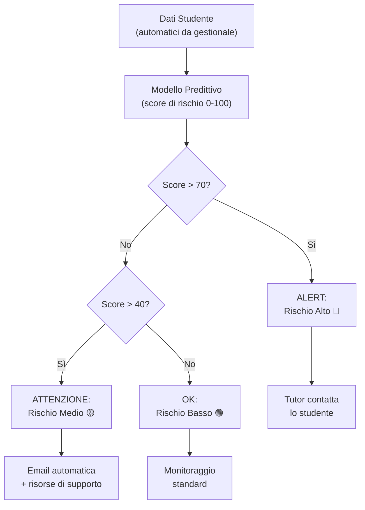

# Prevenire l'Abbandono Universitario con i Dati

In Italia, il 15-20% degli studenti universitari abbandona dopo il primo anno. Ogni studente perso è un costo: per la famiglia (tempo e denaro sprecati), per l'ateneo (risorse investite), per il sistema-paese (capitale umano non sviluppato). Ma c'è una domanda più interessante: **possiamo prevederlo prima che accada?**

La risposta è sì. E non serve l'intelligenza artificiale di fantascienza — bastano pochi dati, un modello statistico e la volontà di agire.

## I Predittori dell'Abbandono: Cosa Dicono i Dati

Studi condotti su università italiane ed europee identificano pattern ricorrenti:

| Fattore Predittivo | Peso | Disponibilità |
|---|---|---|
| Voto di maturità | Alto | Dato al momento dell'iscrizione |
| CFU acquisiti nel primo semestre | Molto alto | Dopo 6 mesi |
| Media voti primo semestre | Alto | Dopo 6 mesi |
| Frequenza alle lezioni | Medio-alto | Se tracciata |
| Studente pendolare vs fuori sede | Medio | Dato all'iscrizione |
| Studente lavoratore | Medio | Dato all'iscrizione |
| Prima scelta vs ripiego | Alto | Questionario d'ingresso |
| Interazione con la piattaforma LMS | Medio | Log automatici |

**Il dato più potente:** il numero di CFU acquisiti nei primi 6 mesi. Uno studente che a febbraio ha 0 CFU ha una probabilità di abbandono superiore al 70%.

## Il Modello Predittivo: Come Costruirlo

### Step 1: Raccolta Dati

Ogni ateneo ha già questi dati nei propri gestionali. Il problema non è la raccolta, è l'**integrazione**: i dati sono spesso in sistemi diversi (segreteria, LMS, questionari) che non comunicano tra loro.

### Step 2: Feature Engineering

```python
import pandas as pd

# Esempio di feature engineering
df['cfu_primo_sem'] = df['cfu_totali_6mesi']
df['media_primo_sem'] = df['media_voti_6mesi']
df['esami_tentati'] = df['n_esami_sostenuti_6mesi']
df['tasso_superamento'] = df['esami_passati'] / df['esami_tentati']
df['gap_maturita'] = df['voto_maturita'] - df['voto_maturita'].median()
df['prima_scelta'] = (df['scelta_corso'] == 'prima').astype(int)
df['pendolare'] = (df['residenza'] != df['citta_ateneo']).astype(int)
```

### Step 3: Modello (Logistic Regression o Random Forest)

```python
from sklearn.ensemble import RandomForestClassifier
from sklearn.model_selection import cross_val_score

# Target: 1 = abbandono, 0 = continua
features = ['cfu_primo_sem', 'media_primo_sem', 'tasso_superamento',
            'voto_maturita', 'prima_scelta', 'pendolare']

X = df[features]
y = df['abbandono']

# Random Forest con cross-validation
model = RandomForestClassifier(n_estimators=100, random_state=42)
scores = cross_val_score(model, X, y, cv=5, scoring='roc_auc')
print(f"AUC medio: {scores.mean():.3f} (+/- {scores.std():.3f})")
# Risultato tipico: AUC 0.82-0.88
```

Un AUC di 0.85 significa che il modello distingue correttamente tra "a rischio" e "non a rischio" nell'85% dei casi.

### Step 4: Interpretazione — Quali Fattori Pesano di Più?

```python
model.fit(X, y)
importances = pd.Series(model.feature_importances_, index=features)
print(importances.sort_values(ascending=False))
```

| Feature | Importanza |
|---|---|
| CFU primo semestre | 0.35 |
| Tasso superamento esami | 0.22 |
| Media voti | 0.18 |
| Voto maturità | 0.12 |
| Prima scelta | 0.08 |
| Pendolare | 0.05 |

## Il Sistema di Early Warning

Il modello da solo non salva nessuno. Serve un **sistema di early warning** che trasforma la previsione in azione.



### Le Azioni di Intervento

| Livello Rischio | Azione | Chi | Quando |
|---|---|---|---|
| 🔴 Alto (score > 70) | Colloquio personale con tutor | Tutor dedicato | Entro 1 settimana |
| 🟡 Medio (score 40-70) | Email con risorse + invito a ricevimento | Sistema automatico + docente | Entro 2 settimane |
| 🟢 Basso (score < 40) | Newsletter motivazionale | Sistema automatico | Mensile |

## Considerazioni Etiche

Un sistema predittivo sull'abbandono tocca temi sensibili:

### 1. Privacy e GDPR
I dati degli studenti sono dati personali. Serve una base giuridica (legittimo interesse dell'ateneo per la tutela del diritto allo studio) e trasparenza (informativa privacy aggiornata).

### 2. Auto-Avveranti?
Se dici a uno studente "il modello prevede che abbandonerai", rischi la profezia auto-avverante. La comunicazione deve essere **positiva**: "Abbiamo notato che potresti beneficiare di un supporto aggiuntivo. Ti piacerebbe parlarne?"

### 3. Bias nei Dati
Se storicamente gli studenti di certe aree geografiche o scuole hanno tassi di abbandono più alti, il modello perpetuerà il bias. Soluzione: monitorare l'equità del modello per sottogruppi.

## Risultati Reali: Cosa Dicono le Università che lo Fanno

| Ateneo | Metodo | Risultato |
|---|---|---|
| Georgia State University (USA) | GPS Advising con 800 alert | Tasso laurea +22% in 6 anni |
| Politecnico di Milano | Early warning su CFU | Abbandono primo anno -8% |
| Open University (UK) | Predictive analytics su LMS | Intervento su 1.200 studenti/anno |
| Università di Trento | Dashboard tutoraggio | Riduzione ritardo negli studi |

## Come Iniziare (Senza un Team di Data Science)

1.  **Mese 1-2:** Estrai i dati dal gestionale. Crea un foglio Excel con: voto maturità, CFU a 6 mesi, media, tipo di iscrizione. Identifica i pattern manualmente.
2.  **Mese 3-4:** Costruisci un modello semplice (regressione logistica in Python o R). Testa su dati storici.
3.  **Mese 5-6:** Implementa un pilota su un corso di laurea. Il tutor riceve una lista di studenti "a rischio" e li contatta.
4.  **Anno 2:** Scala all'intero ateneo. Automatizza con dashboard e alert.

## Conclusione

Prevedere l'abbandono non è fantascienza — è statistica applicata con buon senso. I dati per farlo esistono già in ogni ateneo. Quello che manca è la volontà di integrarli, analizzarli e agire in base ai risultati. Ogni studente salvato dall'abbandono è un professionista in più nel mercato del lavoro, un contribuente in più e una storia di successo in più. I dati possono fare la differenza — se qualcuno decide di usarli.
