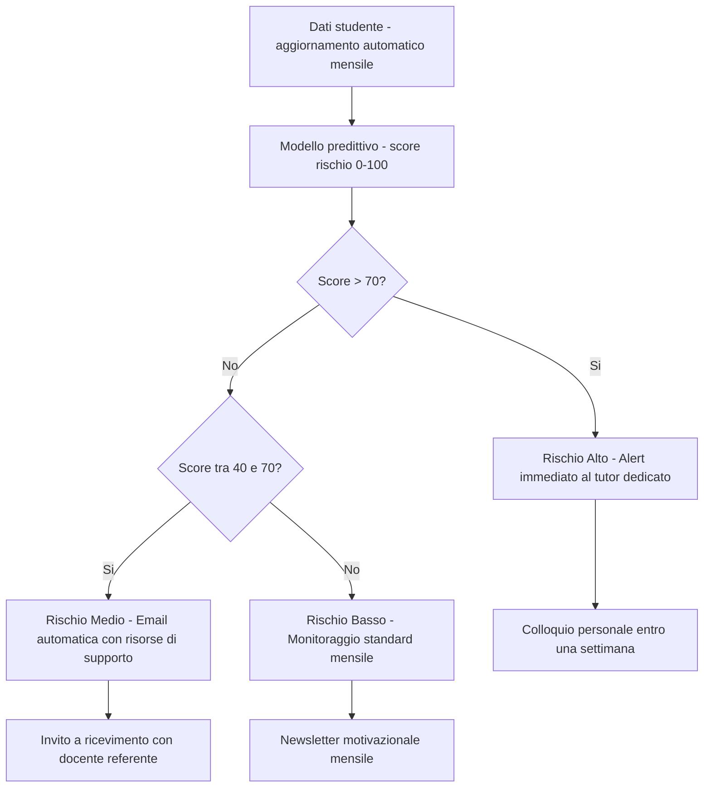

# Prevenire l'Abbandono Universitario con i Dati

Nel 2012 la Georgia State University aveva un problema che sembrava irrisolvibile: il tasso di laurea era del 44%, uno dei piu bassi tra le grandi universita americane. Migliaia di studenti abbandonavano ogni anno, spesso per motivi che sembravano piccoli dall'esterno ma che per loro erano insormontabili: una bolletta non pagata, un corso prerequisito mancato, uno smarrimento nelle scelte di piano di studi.

Il provost Timothy Renick decise di costruire un sistema diverso. Non un counseling piu intenso — l'universita non aveva i fondi per assumere abbastanza counselor. Non un programma di tutoraggio generico — troppo costoso e troppo lento. Un sistema predittivo che identificasse *chi stava per abbandonare* e inviasse un alert proattivo al tutor giusto nel momento giusto.

Il sistema GPS Advising analizzava 800 variabili per ogni studente: voti, presenze, frequenza di accesso alla piattaforma LMS, cambiamenti di corso, interazioni con i servizi di supporto. Generava un alert ogni volta che uno studente mostrava segnali di rischio — non dopo che aveva smesso di venire, ma settimane prima.

Sei anni dopo, il tasso di laurea era salito al 55%, un aumento di 11 punti percentuali. La Georgia State laureo 56.000 studenti in piu in sei anni rispetto a quanto avrebbe fatto con i trend precedenti. E lo fece senza aumentare significativamente il budget per il supporto agli studenti — aumentando solo la precisione degli interventi.

In Italia, il 15-20% degli studenti universitari abbandona dopo il primo anno. Ogni studente perso e un costo: per la famiglia (tempo e denaro investiti), per l'ateneo (risorse non recuperate), per il sistema-paese (capitale umano non sviluppato). Ma la domanda piu interessante non e *quanti* abbandonano — e *possiamo prevederlo prima che accada e fare qualcosa*?

La risposta e si. E non serve l'intelligenza artificiale di fantascienza — bastano pochi dati, un modello statistico ragionevole e la volonta organizzativa di agire sui risultati.

## I Predittori dell'Abbandono: Cosa Dicono i Dati

Studi condotti su universita italiane ed europee identificano pattern sorprendentemente consistenti tra atenei diversi, cicli economici diversi, e discipline diverse. I predittori piu potenti non sono quelli che ci aspetteremmo intuitivamente.

| Fattore predittivo | Peso predittivo | Disponibilita temporale |
|---|---|---|
| CFU acquisiti nel primo semestre | Molto alto | Dopo 6 mesi |
| Tasso di superamento esami (passati/tentati) | Alto | Dopo 6 mesi |
| Media voti primo semestre | Alto | Dopo 6 mesi |
| Voto di maturita | Alto | Al momento dell'iscrizione |
| Prima scelta di corso vs ripiego | Alto | Questionario d'ingresso |
| Studente lavoratore (ore settimanali) | Medio | Al momento dell'iscrizione |
| Studente pendolare vs fuori sede | Medio | Al momento dell'iscrizione |
| Frequenza di accesso alla piattaforma LMS | Medio | Continuo |
| Interazione con servizi di supporto | Basso-medio | Continuo |

Il dato piu potente e controintuitivo: non e il voto di maturita (che misura il potenziale accademico pregresso), ma il numero di CFU acquisiti nei primi sei mesi. Uno studente che a febbraio del primo anno ha zero CFU ha una probabilita di abbandono superiore al 70%, indipendentemente da quanto era bravo al liceo.

Questo non stupisce se ci pensiamo in termini di psicologia comportamentale: l'abbandono e raramente una decisione improvvisa. E la conclusione di un processo lungo mesi in cui lo studente si e progressivamente disimpegnato — e i CFU sono la traccia piu visibile di quel disimpegno.

Il secondo dato importante: gli studenti che dichiarano all'iscrizione che il corso era la loro seconda o terza scelta abbandonano a tassi quasi doppi rispetto a chi lo aveva scelto come prima opzione. Il disallineamento tra aspettative e realta del corso e uno dei meccanismi principali dell'abbandono, e si manifesta nelle prime settimane di lezione.

## Il Modello Predittivo: Come Costruirlo

### Step 1: Raccolta e Integrazione dei Dati

Ogni ateneo italiano ha gia la maggioranza di questi dati nei propri gestionali. Il problema non e la raccolta — e l'integrazione. I dati vivono in silos: la segreteria ha i dati anagrafici e i voti, il LMS ha i log di accesso alle lezioni, l'ufficio orientamento ha i risultati dei questionari d'ingresso, il sistema di presenze (dove esiste) ha la frequenza.

Nessuno di questi sistemi comunica con gli altri in modo automatico. Il primo passo e costruire una pipeline di dati che consolidi queste fonti in un unico dataset analitico per studente.

### Step 2: Feature Engineering

```python
import pandas as pd
import numpy as np

# Il dataset consolidato ha una riga per studente
# con variabili provenienti da sistemi diversi

def engineer_features(df):
    """
    Trasforma i dati grezzi in feature predittive per il modello.
    Questa funzione viene applicata dopo il primo semestre,
    quando abbiamo i dati accademici iniziali.
    """

    # Feature accademiche: le piu predittive
    df['cfu_primo_sem'] = df['cfu_totali_6mesi']
    df['media_primo_sem'] = df['media_voti_6mesi']

    # Tasso di superamento: esami passati / esami tentati
    # Un tasso basso indica difficolta ma anche tenacia (ha provato)
    # Zero esami tentati e il segnale piu allarmante
    df['esami_tentati'] = df['n_esami_sostenuti_6mesi']
    df['tasso_superamento'] = np.where(
        df['esami_tentati'] > 0,
        df['esami_passati'] / df['esami_tentati'],
        0  # Nessun esame tentato = tasso zero
    )

    # Feature contestuali: disponibili dall'iscrizione
    df['gap_maturita'] = df['voto_maturita'] - df['voto_maturita'].median()
    df['prima_scelta'] = (df['scelta_corso'] == 'prima').astype(int)
    df['pendolare'] = (df['residenza'] != df['citta_ateneo']).astype(int)
    df['lavoratore'] = (df['ore_lavoro_settimanali'] > 20).astype(int)

    # Feature di engagement digitale (dal LMS)
    # Giorni dall'ultimo accesso alla piattaforma al 31 gennaio
    df['giorni_inattivita_lms'] = df['giorni_dall_ultimo_accesso']
    df['sessioni_lms_mensile'] = df['sessioni_lms_6mesi'] / 6

    return df

df = engineer_features(df)
```

### Step 3: Il Modello Predittivo

```python
from sklearn.ensemble import RandomForestClassifier
from sklearn.model_selection import cross_val_score, StratifiedKFold
from sklearn.preprocessing import StandardScaler
import warnings
warnings.filterwarnings('ignore')

# Feature selezionate per il modello base
# Ordinate per importanza predittiva attesa
features = [
    'cfu_primo_sem',           # Il predittore piu potente
    'tasso_superamento',       # Qualita, non solo quantita degli esami
    'media_primo_sem',         # Performance media
    'giorni_inattivita_lms',   # Engagement con la piattaforma
    'voto_maturita',           # Background accademico
    'prima_scelta',            # Motivazione iniziale
    'pendolare',               # Fattore logistico
    'lavoratore',              # Carico di vita totale
    'sessioni_lms_mensile',    # Frequenza di accesso
]

X = df[features].fillna(0)  # Gestione valori mancanti con zero
y = df['abbandono']          # 1 = ha abbandonato, 0 = ha continuato

# Random Forest con cross-validation stratificata
# StratifiedKFold garantisce che ogni fold abbia la stessa
# proporzione di abbandoni, importante con classi sbilanciate
model = RandomForestClassifier(
    n_estimators=100,
    max_depth=8,          # Limita la complessita per evitare overfitting
    min_samples_leaf=20,  # Ogni foglia deve avere almeno 20 studenti
    class_weight='balanced',  # Compensazione per la classe minoritaria
    random_state=42
)

cv = StratifiedKFold(n_splits=5, shuffle=True, random_state=42)
scores = cross_val_score(model, X, y, cv=cv, scoring='roc_auc')

print(f"AUC medio: {scores.mean():.3f} (+/- {scores.std():.3f})")
# Risultato tipico su dataset universitari italiani: AUC 0.82-0.88
```

Un AUC di 0.85 significa che il modello distingue correttamente tra "a rischio di abbandono" e "non a rischio" nell'85% dei casi — molto meglio del caso (50%) e meglio dell'intuito umano non supportato da dati.

### Step 4: Quale Soglia di Score Usare?

Il modello produce uno score di rischio tra 0 e 100 per ogni studente. La scelta della soglia e una decisione strategica, non tecnica:

```python
from sklearn.metrics import precision_recall_curve
import matplotlib.pyplot as plt

# Dopo aver addestrato il modello sui dati storici,
# calcola la curva precision-recall per scegliere la soglia

model.fit(X_train, y_train)
y_scores = model.predict_proba(X_test)[:, 1]

precision, recall, thresholds = precision_recall_curve(y_test, y_scores)

# La scelta della soglia dipende dalle risorse disponibili:
# - Se hai pochi tutor, usa una soglia alta (es. 0.70): intercetti
#   meno studenti ma quasi tutti sono davvero a rischio alto
# - Se hai molte risorse, usa una soglia bassa (es. 0.40): intercetti
#   piu studenti, con piu falsi positivi ma minor rischio di perdere casi reali

# Calcola quanti studenti a rischio per ogni soglia
for threshold in [0.40, 0.55, 0.70]:
    n_at_risk = (y_scores >= threshold).sum()
    precision_at_threshold = precision[np.argmin(np.abs(thresholds - threshold))]
    print(f"Soglia {threshold}: {n_at_risk} studenti flaggati, "
          f"precisione {precision_at_threshold:.0%}")
```

### Step 5: Importanza delle Feature

```python
model.fit(X, y)
importances = pd.Series(model.feature_importances_, index=features)
print(importances.sort_values(ascending=False).to_string())
```

| Feature | Importanza relativa |
|---|---|
| CFU primo semestre | 0.35 |
| Tasso superamento esami | 0.22 |
| Media voti | 0.18 |
| Giorni di inattivita LMS | 0.08 |
| Voto maturita | 0.07 |
| Prima scelta | 0.05 |
| Sessioni LMS mensili | 0.03 |
| Pendolare | 0.02 |

La dominanza dei CFU (0.35 di importanza) conferma quello che la letteratura sulla retention universitaria sapeva gia: il comportamento accademico reale nei primi mesi e di gran lunga il segnale piu potente. Tutto il resto e informazione complementare.

## Il Sistema di Early Warning

Il modello da solo non salva nessuno studente. Il modello e uno strumento — il valore viene dall'azione che abilita. Serve un sistema di early warning che trasformi la previsione in un flusso di intervento strutturato.



### Le Azioni di Intervento Differenziate

| Livello di rischio | Azione | Responsabile | Tempistica |
|---|---|---|---|
| Alto (score > 70) | Colloquio personale proattivo, non su richiesta | Tutor dedicato, raggiunge lo studente | Entro una settimana dall'alert |
| Medio (score 40-70) | Email personalizzata con risorse specifiche + invito a ricevimento | Sistema automatico + docente | Entro due settimane |
| Basso (score < 40) | Monitoraggio standard, newsletter motivazionale | Sistema automatico | Mensile |

Il dettaglio critico del livello Alto e "proattivo, non su richiesta". Il tutor contatta lo studente — non aspetta che lo studente venga. Gli studenti a rischio alto sono spesso anche quelli che meno probabilmente cercherebbero aiuto da soli, per vergogna, per disorganizzazione, o perche non sanno a chi rivolgersi.

La Georgia State scopri che i tutor che chiamavano proattivamente avevano un tasso di conversione (studenti che poi continuavano) di circa il 72%, contro il 31% dei tutor che aspettavano che lo studente si presentasse allo sportello.

## Le Dimensioni Etiche: Non Trascurabili

Un sistema predittivo sull'abbandono universitario tocca alcuni temi etici che non possono essere trattati come un'appendice tecnica — devono essere disegnati dentro il sistema fin dall'inizio.

### Privacy e GDPR

I dati degli studenti sono dati personali sensibili. La base giuridica per l'analisi predittiva e il legittimo interesse dell'ateneo alla tutela del diritto allo studio — ma questo deve essere documentato nell'informativa privacy, e gli studenti devono essere informati che i loro dati vengono usati anche per questo scopo. Non basta la clausola generica "i dati saranno usati per fini amministrativi".

### Il Rischio della Profezia Auto-Avverante

Se comunichi a uno studente "il sistema predice che abbandonerai", rischi un effetto di demoralization che puo accelerare esattamente cio che stavi cercando di prevenire. La comunicazione deve essere sistematicamente framed in modo positivo e propositivo: "Abbiamo notato che potresti beneficiare di un supporto aggiuntivo. Ti piacerebbe parlarne con il tuo tutor?" L'esistenza del modello predittivo non deve mai essere esplicitata nella comunicazione allo studente.

### Bias nei Dati Storici

Se storicamente gli studenti di certe aree geografiche, certi istituti di provenienza, o certi gruppi demografici hanno avuto tassi di abbandono piu alti — per ragioni sistemiche di disuguaglianza, non di capacita — il modello perpetuera quel bias attribuendo score di rischio piu alti a studenti che condividono quelle caratteristiche. Questo puo portare a un sistema che discrimina gli studenti piu vulnerabili invece di supportarli.

La soluzione e monitorare sistematicamente l'equita del modello per sottogruppi: il modello e ugualmente accurato per studenti di nord e sud Italia? Per studenti da famiglie a basso reddito e famiglie benestanti? Se ci sono disparita nell'accuratezza, il modello va ri-calibrato.

## Risultati Reali: Le Universita che lo Fanno

| Ateneo | Intervento | Risultato documentato |
|---|---|---|
| Georgia State University (USA) | GPS Advising su 800 variabili, 56.000 alert annui | Tasso di laurea +11 punti percentuali in 6 anni |
| Purdue University (USA) | Course Signals: semaforo verde/giallo/rosso per ogni corso | Abbandono corso -10%, performance media +0.4 punti GPA |
| Open University (UK) | Predictive analytics su interazioni LMS | Intervento su 1.200 studenti a rischio per anno |
| Politecnico di Milano | Early warning su CFU e media primo semestre | Abbandono primo anno ridotto dell'8% nel programma pilota |
| Universita di Trento | Dashboard per il tutoraggio con score di rischio | Riduzione del ritardo negli studi tra gli studenti seguiti |

Il dato piu significativo viene dalla Purdue University, che ha pubblicato dati dettagliati sull'impatto di Course Signals tra il 2007 e il 2012: gli studenti che ricevevano il segnale rosso (alto rischio) e poi il supporto del tutor avevano una probabilita di abbandonare il corso inferiore del 30% rispetto agli studenti con lo stesso profilo di rischio che non ricevevano l'intervento. L'intervento funzionava perche era tempestivo — non a novembre quando lo studente aveva gia mollato, ma a settembre quando stava iniziando a disimpegnarsi.

## Come Iniziare Senza un Team di Data Science

La maggioranza degli atenei italiani non ha un team analytics dedicato. Questo non e un ostacolo insormontabile — e un motivo per iniziare in modo incrementale.

**Mese 1-2:** Non costruire nessun modello. Prima, estrai i dati dal gestionale ed esplora manualmente: quanti studenti a febbraio del primo anno hanno zero CFU? Quanti hanno frequenza sotto il 50%? Costruisci una lista di questi studenti e da' la lista ai tutor. Misura se il tasso di abbandono di questi studenti cambia rispetto agli anni precedenti.

**Mese 3-4:** Se il pilota manuale ha mostrato risultati, costruisci un modello semplice — anche solo una regressione logistica in Python o R. Testa il modello su tre anni di dati storici per capire quanto e accurato. Un AUC sopra 0.75 e gia usabile.

**Mese 5-6:** Implementa un pilota automatizzato su un corso di laurea. Il sistema genera automaticamente la lista di studenti a rischio ogni mese. Il tutor riceve la lista, contatta gli studenti, registra gli interventi.

**Anno 2:** Scala all'intero ateneo. Automatizza con una dashboard e alert via email. Misura l'impatto rispetto all'anno precedente e ai corsi che non hanno partecipato al pilota.

Il segreto e iniziare semplice e misurare l'impatto. Un sistema imperfetto che parte in tre mesi batte un sistema perfetto che viene costruito per due anni e poi abbandonato perche nel frattempo sono cambiate le priorita.

## Conclusione

Prevedere l'abbandono universitario non e fantascienza — e statistica applicata con buon senso istituzionale. I dati per farlo esistono gia in ogni ateneo italiano. Quello che manca, quasi sempre, non e la tecnologia ma la volonta organizzativa di integrare sistemi diversi, di agire proattivamente invece di aspettare che i problemi diventino visibili, e di misurare l'impatto degli interventi invece di dare per scontato che "il tutoraggio funzioni".

La Georgia State University ha salvato 56.000 studenti in piu con un sistema che alla base era relativamente semplice. Il costo dell'inazione — misurato in studenti che non si laureano, in famiglie che non vedono ritornare l'investimento nell'istruzione, in capitale umano non sviluppato — e molto piu alto del costo di costruire un sistema predittivo funzionante.
