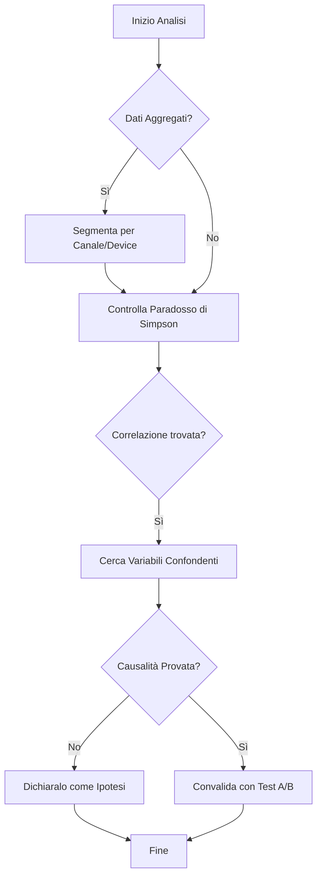

# Le Trappole Analitiche: Guida Completa per Evitare Disastri nei Dati

Nel mondo del marketing data-driven, l'accesso ai dati non è più il problema. Il problema è l'interpretazione. Anche i migliori analisti possono cadere in errore se non sono consapevoli dei bias cognitivi e statistici che si nascondono dietro i numeri.

Questo articolo esplora le trappole analitiche più comuni, fornendo esempi pratici e strumenti per evitare errori costosi.

## 1. Correlazione vs Causalità (Cum Hoc Ergo Propter Hoc)

Questa è la madre di tutte le trappole. Solo perché due eventi accadono insieme o mostrano un trend simile, non significa che uno causi l'altro.

### L'Esempio Classico: Gelati e Squali
Il consumo di gelati e gli attacchi di squali aumentano entrambi durante l'estate.
*   **Correlazione:** Alta e positiva.
*   **Causalità:** Nessuna. Mangiare gelato non attira gli squali.
*   **Variabile Nascosta (Confounder):** La temperatura. Quando fa caldo, la gente mangia più gelati E va a nuotare di più.

### Nel Marketing
Lanci una campagna di Brand Awareness su YouTube e, contemporaneamente, le tue vendite organiche aumentano. È stata la campagna? Forse. O forse è Black Friday. O forse un influencer ha parlato di te spontaneamente.

**Come evitarlo:**
*   Esegui sempre **Test A/B (Randomized Controlled Trials)**.
*   Cerca variabili confondenti.
*   Usa la logica: esiste un meccanismo plausibile che lega A a B?

```python
# Esempio Python: Correlazione Spuria
import numpy as np

# Generiamo dati casuali
np.random.seed(42)
days = np.arange(100)
# Vendite gelato (influenzate dal tempo)
ice_cream_sales = 50 + days * 0.5 + np.random.normal(0, 5, 100)
# Attacchi squali (influenzati dal tempo)
shark_attacks = 2 + days * 0.05 + np.random.normal(0, 1, 100)

correlation = np.corrcoef(ice_cream_sales, shark_attacks)[0, 1]
print(f"Correlazione calcolata: {correlation:.2f}")
# Output probabile: > 0.9, ma nessuna causalità!
```

## 2. Survivorship Bias (Bias di Sopravvivenza)

Questo bias si verifica quando ci concentriamo solo sulle persone o sulle cose che hanno "superato" un processo di selezione, ignorando quelle che non ce l'hanno fatta.

### La Storia degli Aerei della Seconda Guerra Mondiale
L'esercito voleva rinforzare gli aerei che tornavano dalle missioni con molti fori di proiettile sulle ali e sulla coda. Il matematico Abraham Wald fece notare l'errore: gli aerei che erano stati colpiti al motore o alla cabina di pilotaggio *non erano tornati*. Bisognava rinforzare le parti *intatte* degli aerei sopravvissuti, perché quelle erano le parti fatali.

### Nel Business: Analisi del Churn
Se analizzi solo i feedback dei tuoi attuali clienti fedeli per decidere le nuove feature, stai commettendo un errore. Loro sono i "sopravvissuti". Devi intervistare chi ha *abbandonato* il servizio (Churned Users) per capire cosa non va nel tuo prodotto.

## 3. Simpson's Paradox (Il Paradosso di Simpson)

Un trend appare in diversi gruppi di dati, ma scompare o si inverte quando i gruppi vengono combinati. Questo è pericolosissimo per chi analizza dati aggregati senza segmentare.

**Esempio:**
Immagina di testare due landing page, A e B.

| Dispositivo | Conv. A | Conv. B | Vincitore |
| :--- | :--- | :--- | :--- |
| Desktop | 10% (100/1000) | **12%** (12/100) | B |
| Mobile | 2% (2/100) | **3%** (30/1000) | B |
| **Totale** | **9.2%** (102/1100) | 3.8% (42/1100) | **A** |

Se guardi il totale, A sembra migliore (9.2% vs 3.8%). Ma se segmenti per dispositivo, B vince sia su Desktop che su Mobile! Il paradosso nasce perché i volumi di traffico sono sbilanciati (A ha più traffico Desktop che converte meglio in generale, mentre B ha più traffico Mobile che converte peggio).

**Lezione:** Mai fermarsi ai dati aggregati. Segmenta sempre per dispositivo, canale, e demografica.

## 4. Sampling Bias (Bias di Campionamento)

Succede quando il campione analizzato non è rappresentativo della popolazione totale.

*   **Esempio:** Lanciare un sondaggio su Twitter per chiedere "Usate i social media?". Risultato: 100% Sì. Ovviamente, chi risponde è già su un social media.
*   **Nel Prodotto:** Analizzare il comportamento solo dei "Power Users" (il top 1%) e ottimizzare l'interfaccia per loro, rendendola incomprensibile per i nuovi utenti che costituiscono il 90% del traffico.

## Processo Decisionale Anti-Bias

Per evitare queste trappole, segui questo flowchart decisionale prima di presentare qualsiasi report ai tuoi stakeholder.



## Checklist per l'Analista Consapevole

1.  **Campione:** Il mio dataset rappresenta davvero tutti gli utenti o solo una nicchia specifica?
2.  **Contesto:** Ci sono fattori esterni (stagionalità, eventi, bug tecnici) che influenzano i dati in modo anomalo?
3.  **Segmentazione:** Se divido i dati per coorti temporali, il risultato cambia drasticamente?
4.  **Confronto:** Sto confrontando mele con mele? (es. LTV di utenti acquisiti nel 2020 vs 2024).
5.  **Incentivi:** La fonte dei dati ha un motivo per mentire o alterare la risposta? (es. sondaggi incentivati).

## Conclusione

I dati non mentono, ma le persone che li interpretano spesso sì (anche involontariamente). Riconoscere queste trappole è il primo passo per costruire una cultura del dato sana e profittevole. Sii scettico, segmenta sempre e non smettere mai di chiedere "Perché?".
