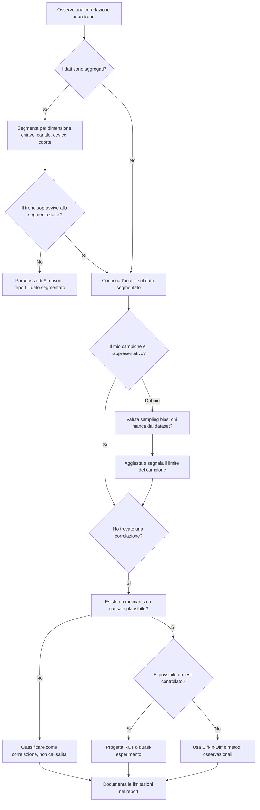

# Le Trappole Analitiche: Come i Numeri ti Mentono anche quando Dicono la Verità

Nel 2012, il team di Facebook ha pubblicato uno studio interno che mostrava come gli utenti che interagivano con i pulsanti "Like" avessero tassi di ritenzione significativamente più alti degli altri. Conclusione ovvia: bisognava spingere sull'engagement con i Like. Il problema? La causalità era invertita. Non era il Like a creare utenti fedeli — erano gli utenti fedeli a usare di più il Like. Ottimizzare il Like non avrebbe aumentato la retention di un millimetro.

Ho visto la stessa trappola ripetersi decine di volte nel corso della mia carriera: un'analisi tecnicamente impeccabile che porta a una conclusione completamente sbagliata, non per errore nei calcoli, ma per un errore nel ragionamento. I dati non mentono, ma la nostra interpretazione dei dati è piena di buche.

Questo articolo non è un elenco astratto di bias cognitivi. E' una mappa delle trappole reali che costano milioni alle aziende ogni anno, con gli strumenti concreti per evitarle.

## 1. Correlazione vs Causalità: il Crimine analitico per Eccellenza

Questa non e' semplicemente la trappola piu' comune. E' quella che ha affossato il maggior numero di decisioni strategiche in aziende che avrebbero dovuto sapere meglio.

In 2003, uno studio epidemiologico molto citato mostrava una correlazione quasi perfetta tra il consumo di cioccolato pro capite nei paesi e il numero di premi Nobel vinti dai loro cittadini. Correlazione: 0.791. La Svizzera, con il consumo piu' alto di cioccolato al mondo, guidava la classifica. Lo studio era vero. La correlazione era reale. La conclusione — mangiare piu' cioccolato per produrre piu' Nobel — era assurda. Il confounder era il PIL pro capite: i paesi ricchi mangiano piu' cioccolato di qualita' e investono di piu' in ricerca.

Nel marketing questa trappola assume forme sofisticate. Nel 2009, Google ha lanciato Google Flu Trends, uno strumento che pretendeva di predire le epidemie di influenza analizzando le query di ricerca. Per i primi anni sembrava funzionare alla perfezione. Poi nel 2013 ha sovrastimato l'epidemia del 50% rispetto ai dati CDC reali. Il problema era che le persone cercano "influenza" per mille ragioni che non sono avere l'influenza — leggono notizie, si preoccupano preventivamente, cercano sintomi di altre malattie simili. La correlazione storica era stata forte per pura fortuna temporale, non per causalita'.

### Il Caso Amazon e la Latenza

Amazon ha una regola interna molto citata: ogni 100 millisecondi di aumento della latenza del sito costa l'1% delle vendite. Questo numero viene da una misurazione causale reale, non da una correlazione. Il team di Jeff Bezos ha eseguito esperimenti controllati in cui artificialmente rallentavano il sito per subset di utenti e misuravano l'impatto sulle conversioni. La causalita' era provata sperimentalmente.

Troppi marketing manager vedono che le loro campagne Brand Awareness su YouTube coincidono con un aumento delle vendite organiche e concludono che la campagna ha funzionato. Forse si'. O forse era il Black Friday. O forse un creator ha parlato spontaneamente del prodotto. O forse era semplicemente la stagione. Senza un gruppo di controllo, non sai niente.

**Come evitarlo:**

Il gold standard e' il Randomized Controlled Trial: dividi gli utenti casualmente in due gruppi, esponi solo uno al trattamento, misura la differenza. Nei casi in cui l'RCT non e' fattibile (non puoi impedire a meta' della tua citta' di vedere un billboard), usa le Difference-in-Differences: confronta il tuo mercato con un mercato di controllo simile prima e dopo la campagna.

```python
import numpy as np
import pandas as pd
from scipy import stats

# Simulazione: test A/B pulito per misurare l'effetto causale di una campagna email
# ERRORE COMUNE: confrontare le medie grezze senza verificare la randomizzazione

np.random.seed(42)
n = 10000  # Utenti per gruppo

# Gruppo controllo: nessuna email
# Caratteristica nascosta: gli utenti piu' attivi convertono di piu'
user_activity_control = np.random.exponential(scale=1.0, size=n)
conversions_control = (user_activity_control > 1.5).astype(int)

# Gruppo trattamento: ricevono l'email
user_activity_treatment = np.random.exponential(scale=1.0, size=n)
# L'email aggiunge un effetto causale reale del 3%
email_effect = np.random.binomial(1, 0.03, n)
conversions_treatment = (
    (user_activity_treatment > 1.5).astype(int) | email_effect
).astype(int)

# Verifica che la randomizzazione sia riuscita: i gruppi devono essere comparabili
print("=== Sanity check randomizzazione ===")
print(f"Attivita' media controllo: {user_activity_control.mean():.3f}")
print(f"Attivita' media trattamento: {user_activity_treatment.mean():.3f}")
# Se questi numeri fossero molto diversi, la randomizzazione sarebbe fallita

# Misura l'effetto causale
baseline_conversion = conversions_control.mean()
treatment_conversion = conversions_treatment.mean()
lift = treatment_conversion - baseline_conversion

# Test statistico di significativita'
t_stat, p_value = stats.ttest_ind(conversions_control, conversions_treatment)

print(f"\n=== Risultati campagna email ===")
print(f"Conversione baseline: {baseline_conversion:.1%}")
print(f"Conversione trattamento: {treatment_conversion:.1%}")
print(f"Lift causale: +{lift:.1%}")
print(f"P-value: {p_value:.4f}")
print(f"Statistica significativa: {p_value < 0.05}")
```

## 2. Survivorship Bias: Stai Analizzando i Fantasmi

Nel 1943 il matematico ungherese Abraham Wald ricevette un incarico dall'esercito americano: dove rinforzare le armature degli aerei da guerra? Il team militare aveva analizzato gli aerei tornati dalle missioni e aveva mappato la distribuzione dei fori di proiettile. La concentrazione era sulle ali e sulla coda. Conclusione ovvia: rinforzare ali e coda.

Wald fece notare l'errore con un'eleganza disarmante: gli aerei analizzati erano quelli che erano tornati. I fori che vedevano erano nelle zone che si potevano permettere di avere fori. Gli aerei colpiti al motore e alla cabina di pilotaggio non erano tornati — erano in fondo al mare. Bisognava rinforzare esattamente le parti che non mostravano danni, perche' erano quelle la cui perforazione era letale.

### Nel Marketing: il Problema dei Clienti Soddisfatti

Se vuoi capire perche' i clienti abbandonano il tuo prodotto, non puoi farlo analizzando solo i clienti che sono rimasti. Loro sono i sopravvissuti. Hanno filtrato se stessi attraverso la selezione naturale del churn.

Questa e' una trappola classica nell'analisi del churn per i prodotti SaaS. Il team di prodotto intervista i clienti attivi, scopre che sono soddisfatti delle feature avanzate, e investe ulteriormente nelle feature avanzate. Il risultato e' un prodotto sempre piu' complesso che allontana i nuovi utenti — che sono, ovviamente, quelli che abbandonano piu' in fretta e che per definizione non vengono mai intervistati perche' sono gia' andati.

Intercom ha risolto questo problema sistematizzando le exit interview: ogni utente che cancella il piano viene contattato entro 24 ore con tre domande aperte sulla ragione dell'abbandono. I dati raccolti in anni di exit interview hanno rivelato pattern completamente invisibili nell'analisi dei clienti attivi: la maggior parte degli abbandoni non avveniva per mancanza di feature, ma per un onboarding iniziale troppo confuso.

### Nelle Startup: il Mito del Fondatore Dropout

Si sente spesso che "i migliori fondatori hanno abbandonato l'universita'". Bill Gates. Steve Jobs. Mark Zuckerberg. Il bias di sopravvivenza e' massiccio: per ogni fondatore dropout che ha avuto successo, ci sono migliaia che hanno abbandonato l'universita' e non hanno fondato niente di notevole. Non li vedi perche' non sono diventati famosi. Il campione disponibile e' distorto verso i sopravvissuti illustri.

**Come evitarlo:**

Prima di qualsiasi analisi, chiediti: "Cosa e' successo a chi non e' nel mio dataset?" Mappa attivamente i dati mancanti. Se stai analizzando i clienti attuali, pianifica una campagna separata per raccogliere dati sugli ex-clienti. Se stai valutando strategie di crescita, non guardare solo le aziende che hanno avuto successo con quella strategia — cerca anche quelle che ci hanno provato e sono fallite.

## 3. Il Paradosso di Simpson: Quando la Segmentazione Ribalta Tutto

Nel 1973, l'Universita' di Berkeley fu accusata di discriminazione di genere nelle ammissioni al dottorato: le donne venivano ammesse al 35% contro il 44% degli uomini. I numeri erano reali. La discriminazione era un'illusione statistica. Quando i ricercatori Bickel, Hammel e O'Connell segmentarono i dati per facolta', scoprirono che in quasi ogni singola facolta' le donne venivano ammesse a tassi uguali o superiori agli uomini. Il paradosso nasceva perche' le donne tendevano a fare domanda alle facolta' piu' competitive (medicina, legge) che avevano tassi di ammissione bassi per tutti, mentre gli uomini si concentravano su facolta' con alta accettazione.

Questo e' il Paradosso di Simpson: un trend osservato nei dati aggregati scompare o si inverte quando si segmenta per sottogruppi.

**Nel Marketing A/B Testing:**

Immagina di testare due versioni della tua landing page.

| Dispositivo | Conv. Versione A | Conv. Versione B | Vincitore Segmento |
| :--- | :--- | :--- | :--- |
| Desktop | 10.0% (100/1000) | 12.0% (12/100) | B |
| Mobile | 2.0% (2/100) | 3.0% (30/1000) | B |
| **Totale** | **9.2%** (102/1100) | 3.8% (42/1100) | **A** |

Se guardi il totale, A sembra vincere con il 9.2% contro il 3.8%. Ma B vince sia su Desktop che su Mobile. Il paradosso nasce perche' il traffico e' distribuito asimmetricamente: la versione A ha ricevuto quasi tutto il traffico Desktop (che converte al 10%), mentre B ha ricevuto quasi tutto il traffico Mobile (che converte al 3%). Il "vincitore" aggregato dipende dal mix di traffico, non dalla qualita' delle pagine.

Questo accade piu' spesso di quanto si pensi nei test A/B di marketing, specialmente quando il traffico viene distribuito su canali diversi simultaneamente. Il gruppo A prende piu' traffico dal brand search (alta intenzione d'acquisto), il gruppo B prende piu' traffico da display (bassa intenzione). I risultati aggregati sono incomparabili.

**Lezione pratica:** Prima di dichiarare un vincitore in un A/B test, controlla sempre la distribuzione del traffico per segmento chiave: dispositivo, canale, area geografica, nuovo vs. ritornante. Se la distribuzione e' asimmetrica, i dati aggregati ti mentono.

## 4. Sampling Bias: il Tuo Dataset Non e' il Mondo Reale

Nel 1936, il Literary Digest condusse il sondaggio pre-elettorale piu' grande della storia americana: 10 milioni di questionari spediti, 2.4 milioni di risposte. Risultato: una vittoria schiacciante di Alf Landon su Franklin Roosevelt. Alle elezioni vere, Roosevelt vinse con uno dei margini piu' ampi della storia. Il sondaggio era catastroficamente sbagliato perche' il campione era distorto: i questionari erano stati spediti agli abbonati del magazine, agli intestatari di automobili e ai titolari di telefono fisso — tutti campioni che nel 1936 sovrarappresentavano massivamente la fascia ricca della popolazione, tendenzialmente repubblicana.

Nel marketing digitale, il sampling bias e' ovunque ed e' sottovalutato.

**Il problema dei Power Users:** Se ottimizzi la tua app analizzando principalmente il comportamento del top 5% degli utenti per engagement, stai ottimizzando per una nicchia che non rappresenta il 95% della base. Amazon Prime Video ha scoperto che gli utenti analiticamente "migliori" — quelli che guardavano piu' ore, esploravano piu' catalogo, davano piu' rating — erano sistematicamente diversi dall'utente medio nei gusti e nelle preferenze. Costruire algoritmi di recommendation ottimizzati su di loro avrebbe peggiorato l'esperienza per tutti gli altri.

**Il problema dei sondaggi online:** Chi risponde ai sondaggi e' sistematicamente diverso da chi non risponde. I piu' soddisfatti e i piu' insoddisfatti sono sovrarappresentati. L'utente medio silenzioso — che e' la massa del tuo business — e' quasi invisibile attraverso lo strumento del sondaggio volontario.

**Il problema della data survivorship nei dataset storici:** Se vuoi costruire un modello predittivo usando dati storici delle aziende quotate in borsa, stai usando solo i dati di aziende che esistono ancora oggi. Tutte le aziende che sono fallite nel periodo sono state rimosse dagli indici e quindi dal tuo dataset di training. Il modello risultante sovrastimera' sistematicamente le probabilita' di successo perche' non ha mai visto un fallimento.

```python
import pandas as pd
import numpy as np

# Simulazione del sampling bias nei sondaggi di soddisfazione
np.random.seed(42)

# Popolazione reale: distribuzione della soddisfazione (da 1 a 10)
# La maggioranza degli utenti e' nella fascia media (6-7)
soddisfazione_reale = np.random.choice(
    range(1, 11),
    size=10000,
    p=[0.02, 0.03, 0.05, 0.08, 0.12, 0.20, 0.20, 0.15, 0.10, 0.05]
)
print(f"Soddisfazione media REALE della popolazione: {soddisfazione_reale.mean():.2f}")

# Probabilita' di rispondere al sondaggio:
# - Utenti molto insoddisfatti (1-3): alta probabilita' (vogliono lamentarsi)
# - Utenti nella media (4-7): bassa probabilita' (non sentono urgenza)
# - Utenti molto soddisfatti (8-10): alta probabilita' (vogliono esprimere apprezzamento)

def prob_risposta(score):
    """Modella la propensione a rispondere ai sondaggi in base alla soddisfazione."""
    if score <= 3:
        return 0.40   # Insoddisfatti: 40% risponde
    elif score <= 7:
        return 0.08   # Utenti medi: solo 8% risponde
    else:
        return 0.35   # Molto soddisfatti: 35% risponde

# Simula chi risponde effettivamente
risposte = []
for score in soddisfazione_reale:
    if np.random.random() < prob_risposta(score):
        risposte.append(score)

soddisfazione_sondaggio = np.array(risposte)
print(f"Soddisfazione media dal SONDAGGIO: {soddisfazione_sondaggio.mean():.2f}")
print(f"Numero di risposte: {len(soddisfazione_sondaggio)} su 10000 (tasso: {len(soddisfazione_sondaggio)/100:.1f}%)")
print(f"\nDifferenza: {soddisfazione_sondaggio.mean() - soddisfazione_reale.mean():+.2f} punti")
print("Questo e' il bias del non-responder: il sondaggio sovrastima la polarizzazione")
```

## Il Processo Anti-Trappola: un Flowchart per Analisi Rigorose

Prima di presentare qualsiasi analisi agli stakeholder, passa attraverso questo checklist mentale.



## La Checklist dell'Analista Rigoroso

Prima di ogni presentazione agli stakeholder, rispondi a queste domande in modo esplicito — non solo mentalmente, ma scrivile nel tuo documento di analisi.

**Sulla rappresentativita' del campione:**
- Chi manca dal mio dataset che sarebbe rilevante per la decisione?
- C'e' un bias di sopravvivenza: sto analizzando solo chi ha "passato il filtro"?
- La finestra temporale che analizzo e' rappresentativa o e' un periodo anomalo?

**Sulla causalita':**
- La correlazione che vedo ha un meccanismo causale plausibile?
- Ci sono variabili confondenti ovvie che non sto controllando?
- Ho un gruppo di controllo con cui confrontare, o sto confrontando con me stesso nel tempo?

**Sulla segmentazione:**
- Il risultato aggregato sopravvive quando segmento per le dimensioni chiave?
- La distribuzione del campione tra i gruppi e' bilanciata o asimmetrica?

**Sul contesto:**
- Ci sono eventi esterni (stagionalita', concorrenti, bug tecnici) che spiegano il trend senza la mia ipotesi?
- I dati sono stati raccolti con lo stesso metodo nel periodo di confronto?

## Conclusione: il Valore dell'Umilta' Analitica

Il matematico George Box ha scritto nel 1978 una delle frasi piu' citate della statistica: "All models are wrong, but some are useful." L'equivalente per l'analisi di marketing potrebbe essere: "Tutte le analisi hanno bias, ma alcune sono abbastanza rigorose da guidare buone decisioni."

Il problema non e' l'imperfezione — e' l'inconsapevolezza dell'imperfezione. Un analista che conosce i limiti del suo dataset e li comunica chiaramente agli stakeholder e' infinitamente piu' utile di uno che presenta numeri con falsa certezza.

La prossima volta che vedi una correlazione interessante nei tuoi dati, la prima domanda non e' "Come la presento?" — e' "Cosa potrebbe spiegare questa correlazione senza la mia ipotesi preferita?" Se non riesci a rispondere a questa domanda, non sei ancora pronto a presentarla.
