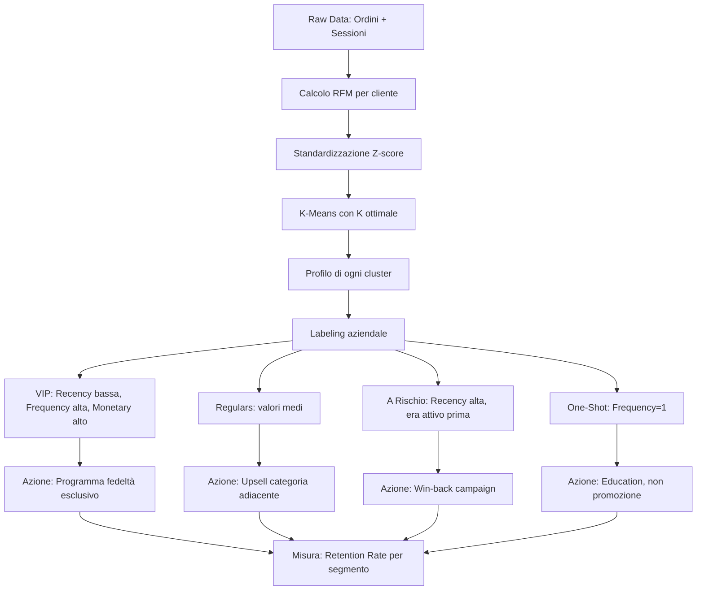

# Cluster Analysis per Segmentazione Clienti: Guida Pratica Completa

Nel 2011, Netflix aveva un problema interessante. Avevano 23 milioni di abbonati, ognuno con pattern di visione completamente diversi. Mandare la stessa raccomandazione a tutti era ovviamente inefficace, ma creare 23 milioni di esperienze personalizzate singolarmente era impossibile. La soluzione era trovare un numero gestibile di "profili" di spettatore — abbastanza distinti da permettere raccomandazioni significativamente diverse, abbastanza pochi da poter costruire strategie specifiche per ciascuno.

Il risultato fu una serie di cluster comportamentali: il "completionist" che termina ogni serie che inizia, lo "hopper" che guarda tre episodi di dieci serie diverse, il "re-watcher" che rivede gli stessi contenuti. Netflix stima che il suo algoritmo di personalizzazione valga oltre 1 miliardo di dollari annui in retention evitata — e la cluster analysis e alla base di quella personalizzazione.

Questo e il potere del clustering applicato al marketing: trasformare una massa indistinta di clienti in gruppi con caratteristiche, comportamenti e valori sufficientemente omogenei da permettere strategie differenziate e misurabili.

## Perche la Segmentazione Demografica Tradizionale Non Funziona Piu

Per decenni il marketing ha segmentato i clienti per eta, genere e reddito. E un approccio che ha senso quando l'unico canale e la televisione. Ma nel marketing digitale, dove puoi misurare ogni click e ogni secondo di attenzione, segmentare per "donna, 35-45 anni, reddito medio-alto" e come navigare una nave con una mappa del 1850.

Airbnb ha scoperto questa limitazione quando hanno eseguito una cluster analysis comportamentale. La segmentazione demografica suggeriva che gli host piu attivi e redditizi fossero uomini tra 30 e 50 anni. Ma analizzando il comportamento effettivo (listing frequency, messaggi, prezzi), hanno trovato un cluster completamente inatteso: donne sopra i 60 anni in citta costiere con immobili piccoli. Questo segmento aveva il Net Promoter Score piu alto, il tasso di 5 stelle piu elevato, e il churn piu basso. Nessun demografico tradizionale lo avrebbe mai identificato.

Il clustering comportamentale trova strutture nei dati senza presupporre quali variabili contino. Lasci che siano i dati stessi a dirti dove sono i confini naturali tra i gruppi.

## Il Framework RFM: Il Punto di Partenza Migliore

Per applicare il clustering alla segmentazione clienti, il punto di partenza piu robusto e il framework **RFM**, ancora oggi tra gli approcci piu efficaci per e-commerce e SaaS.

RFM sta per:
- **Recency**: quanti giorni fa ha fatto l'ultimo acquisto. Piu recente, piu attivo nel suo ciclo.
- **Frequency**: quante volte ha acquistato in un dato periodo. Misura l'abitudine.
- **Monetary**: quanto ha speso in totale. Misura il valore economico.

La logica e semplice: un cliente che ha comprato ieri, compra spesso, e ha speso tanto e completamente diverso da uno che ha comprato sei mesi fa, una volta sola, per un importo minimo. La distanza tra questi due profili nello spazio RFM e enorme — e il clustering la quantifica matematicamente.

## K-Means Clustering: Il Cavallo da Lavoro della Segmentazione

L'algoritmo piu diffuso per la segmentazione di marketing e **K-Means**. Non e il piu sofisticato, ma e interpretabile, veloce su dataset grandi, e produce risultati stabili.

### Come Funziona K-Means: Spiegazione Passo-Passo

Il funzionamento e iterativo:

1. **Inizializzazione**: Scegli K (il numero di cluster). Posiziona casualmente K centroidi nello spazio multidimensionale.
2. **Assegnazione**: Calcola la distanza euclidea di ogni punto da ogni centroide. Assegna ogni punto al centroide piu vicino.
3. **Aggiornamento**: Ricalcola la posizione di ogni centroide come media dei punti assegnati a quel cluster.
4. **Iterazione**: Ripeti i passi 2-3 finche i centroidi non si stabilizzano (o fino a un numero massimo di iterazioni).

La distanza euclidea e calcolata come:

$$d = \sqrt&#123;(x_1 - x_2)^2 + (y_1 - y_2)^2 + ... + (z_1 - z_2)^2&#125;$$

Per RFM tridimensionale, la distanza misura quanto sono "diversi" due clienti nello spazio Recency-Frequency-Monetary.

### Il Problema della Scala: Standardizzazione

Il K-Means misura le distanze tra i punti. Se una variabile va da 0 a 10.000 (fatturato) e un'altra va da 1 a 50 (numero di acquisti), il fatturato domina completamente — un punto e "vicino" principalmente in base al fatturato.

La soluzione e la standardizzazione: trasformare ogni variabile in modo che abbia media 0 e deviazione standard 1 (Z-score). La formula e:

$$Z = \frac&#123;x - \mu&#125;&#123;\sigma&#125;$$

Dove μ e la media e σ e la deviazione standard della variabile. Dopo standardizzazione, tutte le variabili hanno uguale peso nella distanza euclidea.

### Codice Python Completo

```python
import pandas as pd
import numpy as np
from sklearn.cluster import KMeans
from sklearn.preprocessing import StandardScaler
from sklearn.metrics import silhouette_score
import matplotlib.pyplot as plt

# ---- Preparazione dei dati RFM ----
np.random.seed(42)
n_customers = 5000

# Generiamo 4 segmenti naturali nascosti
def genera_segmento(n, r_mean, r_std, f_mean, f_std, m_mean, m_std):
    return pd.DataFrame({
        'Recency': np.clip(np.random.normal(r_mean, r_std, n), 1, 365).astype(int),
        'Frequency': np.clip(np.random.normal(f_mean, f_std, n), 1, 100).astype(int),
        'Monetary': np.clip(np.random.normal(m_mean, m_std, n), 10, 10000)
    })

df = pd.concat([
    genera_segmento(500,  30,  15, 20, 5,  1500, 400),   # VIP
    genera_segmento(1500, 90,  30, 8,  3,  300,  100),   # Regulars
    genera_segmento(1500, 250, 50, 3,  2,  150,  80),    # A rischio
    genera_segmento(1500, 180, 60, 1,  0.3, 80,  40),    # One-shot
], ignore_index=True)

print("=== Dataset RFM ===")
print(df.describe().round(1))

# ---- Standardizzazione (CRITICA) ----
scaler = StandardScaler()
dati_scalati = scaler.fit_transform(df[['Recency', 'Frequency', 'Monetary']])

# ---- Elbow Method e Silhouette Score ----
inerzie = []
silhouette_scores = []
K_range = range(2, 9)

for k in K_range:
    km = KMeans(n_clusters=k, random_state=42, n_init=10)
    km.fit(dati_scalati)
    inerzie.append(km.inertia_)
    sil = silhouette_score(dati_scalati, km.labels_, sample_size=2000)
    silhouette_scores.append(sil)

k_ottimale_silhouette = K_range[silhouette_scores.index(max(silhouette_scores))]
print(f"\nK ottimale secondo Silhouette Score: {k_ottimale_silhouette}")

# Plot Elbow
fig, (ax1, ax2) = plt.subplots(1, 2, figsize=(14, 5))

ax1.plot(K_range, inerzie, 'bo-', linewidth=2, markersize=8)
ax1.set_xlabel('Number of Clusters (K)')
ax1.set_ylabel('Inertia')
ax1.set_title('Elbow Method')
ax1.grid(True, alpha=0.3)

ax2.plot(K_range, silhouette_scores, 'go-', linewidth=2, markersize=8)
ax2.set_xlabel('Number of Clusters (K)')
ax2.set_ylabel('Silhouette Score')
ax2.set_title('Silhouette Score per K')
ax2.axvline(x=k_ottimale_silhouette, color='r', linestyle='--', label=f'Optimal K: {k_ottimale_silhouette}')
ax2.legend()
ax2.grid(True, alpha=0.3)

plt.tight_layout()
plt.show()

# ---- Clustering Finale ----
K_FINALE = 4
kmeans = KMeans(n_clusters=K_FINALE, random_state=42, n_init=10)
df['Cluster'] = kmeans.fit_predict(dati_scalati)

# ---- Analisi e Labeling dei Cluster ----
profilo_cluster = df.groupby('Cluster').agg(
    Recency_media=('Recency', 'mean'),
    Frequency_media=('Frequency', 'mean'),
    Monetary_medio=('Monetary', 'mean'),
    Numero_clienti=('Recency', 'count')
).round(1)

print("\n=== Profilo dei Cluster ===")
print(profilo_cluster)

# Labeling manuale basato sul profilo
labels = {
    profilo_cluster['Monetary_medio'].idxmax(): 'VIP',
    profilo_cluster['Recency_media'].idxmax(): 'A Rischio Churn',
    profilo_cluster['Frequency_media'].idxmin(): 'One-Shot',
}
for i in range(K_FINALE):
    if i not in labels:
        labels[i] = 'Regulars'

df['Segmento'] = df['Cluster'].map(labels)

print("\n=== Distribuzione Segmenti ===")
print(df['Segmento'].value_counts())

# Visualizzazione con scatter 3D
from mpl_toolkits.mplot3d import Axes3D

fig = plt.figure(figsize=(12, 8))
ax = fig.add_subplot(111, projection='3d')

colors = {'VIP': 'red', 'Regulars': 'blue', 'A Rischio Churn': 'orange', 'One-Shot': 'green'}
for segmento in df['Segmento'].unique():
    mask = df['Segmento'] == segmento
    ax.scatter(df[mask]['Recency'], df[mask]['Frequency'], df[mask]['Monetary'],
              c=colors[segmento], label=segmento, s=30, alpha=0.6)

ax.set_xlabel('Recency (giorni)')
ax.set_ylabel('Frequency (acquisti)')
ax.set_zlabel('Monetary (€)')
ax.set_title('RFM Clustering - Visualizzazione 3D')
ax.legend()
plt.show()
```

## Scegliere K: Elbow Method e Silhouette Score

Il problema piu comune con K-Means e la scelta di K. Scegliere K in modo arbitrario ("facciamo 5 segmenti") e sbagliato.

Ci sono due strumenti statistici complementari:

**Elbow Method:** Plotta l'inerzia (somma delle distanze al quadrato di ogni punto dal suo centroide) al variare di K. Al crescere di K, l'inerzia cala sempre — con K=N cluster, ogni punto e il suo cluster. Cerchi il punto in cui la curva "piega", come un gomito: l'aggiunta di altri cluster non riduce significativamente l'inerzia. Questo punto di "piega" suggerisce il numero ottimale di cluster.

**Silhouette Score:** Per ogni punto, misura quanto e simile agli altri punti nel suo cluster rispetto ai punti nei cluster vicini. Il valore varia da -1 (il punto e piu simile ai cluster adiacenti) a +1 (il punto e molto piu simile al suo cluster). Il K con il Silhouette Score piu alto crea i cluster piu "ben separati". Un score di 0.5+ indica clustering di buona qualita, mentre 0.3 o meno indica cluster poco separati.

Il buon pratica e usarli entrambi: se concordano sullo stesso K, hai una buona evidenza. Se discordano, considera anche la interpretabilita di business — a volte 5 segmenti sono piu actionabili che 6, anche se statisticamente il sesto cluster migliora il silhouette score.

## Dal Cluster all'Azione: Il Flusso Operativo

Trovare i cluster e solo la meta del lavoro. Il valore reale sta nelle azioni che i cluster abilitano.



Prendiamo un caso concreto. Stitch Fix, il servizio di abbigliamento personalizzato, ha costruito la sua strategia di comunicazione interamente attorno alla segmentazione comportamentale. Invece di mandare la stessa newsletter a tutti i 3.5 milioni di abbonati, segmenta in base al comportamento di feedback sui capi ricevuti. Chi ha sempre rifiutato jeans skinny riceve stili diversi da chi li ha sempre accettati. Il risultato: un tasso di retention sistematicamente superiore alla media del settore.

## Oltre il K-Means: Quando Usare Altri Algoritmi

Il K-Means ha limiti strutturali.

**Limite 1: Assume cluster sferici.** Se i tuoi dati hanno strutture piu complesse (cluster elongati, a forma di luna, annidati), K-Means fallira. Troverai cluster che non rispecchiano la vera struttura nei dati.

### DBSCAN (Density-Based Spatial Clustering): Quando i Cluster Non Sono Sferici

**DBSCAN** (Density-Based Spatial Clustering of Applications with Noise) trova cluster basandosi sulla densita dei punti. Non richiede K a priori, trova cluster di forma arbitraria, e identifica automaticamente gli outlier (assegnandoli all'etichetta -1).

Quando usare DBSCAN:
- I tuoi cluster non sono sferici — hanno forme irregolari
- Hai outlier significativi che vuoi identificare esplicitamente
- Non sai quanti cluster ti aspetti

```python
from sklearn.cluster import DBSCAN

# DBSCAN: epsilon = massima distanza tra punti nello stesso cluster
#         min_samples = numero minimo di punti per formare un cluster

dbscan = DBSCAN(eps=0.5, min_samples=10)
df['Cluster_DBSCAN'] = dbscan.fit_predict(dati_scalati)

# -1 significa outlier
outliers = (df['Cluster_DBSCAN'] == -1).sum()
print(f"Numero outlier: {outliers}")
print(f"Numero cluster trovati: {len(set(df['Cluster_DBSCAN'])) - (1 if -1 in df['Cluster_DBSCAN'] else 0)}")

# Analisi degli outlier: chi sono i "clienti strani"?
outlier_profile = df[df['Cluster_DBSCAN'] == -1][['Recency', 'Frequency', 'Monetary']].describe()
print("\n=== Profilo dei Clienti Outlier ===")
print(outlier_profile)
```

Il parametro `eps` (epsilon) determina il raggio di ricerca — punti a distanza inferiore a eps sono considerati vicini. Il parametro `min_samples` determina il numero minimo di vicini per considerare un punto un "core point" che forma un cluster.

Trovare i parametri giusti richiede sperimentazione, ma DBSCAN ha il vantaggio di non richiedere la decisione anticipata di K.

### Hierarchical Clustering: Vedere sia i Macro-Cluster che i Micro-Cluster

```python
from scipy.cluster.hierarchy import dendrogram, linkage
from scipy.spatial.distance import pdist

# Calcola la matrice di linkage
Z = linkage(dati_scalati, method='ward')  # Ward minimizza la varianza entro-cluster

# Crea il dendrogramma
plt.figure(figsize=(14, 7))
dendrogram(Z, truncate_mode='lastp', p=30,
           leaf_font_size=10, show_contracted=True)
plt.title('Hierarchical Clustering Dendrogramma (ultimi 30 merge)')
plt.xlabel('Cluster')
plt.ylabel('Distance')
plt.show()

# Taglia l'albero a livello di 4 cluster
from scipy.cluster.hierarchy import fcluster
max_distance = 100  # Adatta in base al dendrogramma
clusters_hier = fcluster(Z, max_distance, criterion='distance')
```

Hierarchical clustering costruisce un dendrogramma — un albero gerarchico. Puoi vedere sia i 3 macro-segmenti ad alto livello sia i 12 sotto-segmenti nel dettaglio. Utile quando vuoi flessibilita nel numero di segmenti.

### Gaussian Mixture Models: Probabilita Invece di Assegnazione Dura

```python
from sklearn.mixture import GaussianMixture

# GMM assegna probabilita di appartenza invece di clustering hard
gmm = GaussianMixture(n_components=4, random_state=42)
df['Probabilita_Cluster_0'] = gmm.fit_predict_proba(dati_scalati)[:, 0]
df['Probabilita_Cluster_1'] = gmm.fit_predict_proba(dati_scalati)[:, 1]
# ... e cosi via per ogni cluster

# Un cliente puo essere "60% VIP, 30% Regular, 10% A rischio"
print(df[['Probabilita_Cluster_0', 'Probabilita_Cluster_1']].head(10))
```

A differenza del K-Means che assegna ogni punto a un solo cluster deterministicamente, il GMM assegna probabilita. Un cliente puo essere "60% VIP, 30% Regular, 10% A rischio". Molto piu realistico statisticamente — le realta aziendali sono raramente binarie.

## Tabella Comparativa: K-Means vs DBSCAN vs Hierarchical

| Caratteristica | K-Means | DBSCAN | Hierarchical | GMM |
|---|---|---|---|---|
| **Forma cluster** | Sferica | Arbitraria | Arbitraria | Sferica (in generale) |
| **Richiede K a priori** | Sì | No | No (ma scegli il cut del dendrogramma) | Sì |
| **Outlier handling** | Inclusi in cluster | Identificati (-1) | Inclusi in cluster | Inclusi in cluster |
| **Interpretabilita** | Alta | Media | Alta (dendrogramma visuale) | Media |
| **Velocita su dati grandi** | Veloce | Lenta | Lenta | Media |
| **Quando usarlo** | Default, dati sferici | Dati complessi, cluster non sferici | Esplorazione, voglio vedere gerarchie | Voglio probabilita di appartenza |

## L'Errore Piu Frequente: Usare i Cluster Come Fine, Non Come Mezzo

Ho visto aziende costruire modelli di clustering sofisticatissimi, presentarli ai board, e poi non cambiare nulla nel modo in cui comunicavano con i clienti. Il clustering senza action plan e un esercizio accademico.

La domanda da porsi prima di costruire un modello di clustering non e "Come posso segmentare?" ma "Se avessi segmenti distinti, cosa farei diversamente per ciascuno?" Se la risposta e "sostanzialmente la stessa cosa", allora il clustering non e lo strumento giusto in questo momento.

I segmenti utili sono quelli **azionabili** (puoi fare qualcosa di diverso), **significativi** (la dimensione giustifica l'investimento), e **stabili** (non cambiano completamente ogni mese).

## Validazione dei Cluster: Metriche di Business

Oltre al Silhouette Score, devi validare i cluster da una prospettiva di business:

### 1. Separabilita: I Cluster Sono Distinti?

```python
# Calcola la distanza media entro-cluster vs tra-cluster
intra_cluster_dist = []
inter_cluster_distances = []

for i in range(K_FINALE):
    cluster_i = dati_scalati[df['Cluster'] == i]
    centroide_i = kmeans.cluster_centers_[i]

    # Distanza media dal centroide (intra-cluster)
    intra = np.mean([np.linalg.norm(punto - centroide_i) for punto in cluster_i])
    intra_cluster_dist.append(intra)

    # Distanza dal centroide piu vicino (inter-cluster)
    for j in range(K_FINALE):
        if i != j:
            inter = np.linalg.norm(centroide_i - kmeans.cluster_centers_[j])
            inter_cluster_distances.append(inter)

avg_intra = np.mean(intra_cluster_dist)
avg_inter = np.mean(inter_cluster_distances)

print(f"Distanza media entro-cluster: {avg_intra:.3f}")
print(f"Distanza media tra-cluster: {avg_inter:.3f}")
print(f"Ratio (minore e meglio): {avg_intra / avg_inter:.3f}")
```

Se intra e molto minore di inter, i cluster sono ben separati.

### 2. Stabilita: I Cluster Rimangono Consistenti?

Ogni mese, ricalcola i cluster. Il 80%+ dei clienti rimane nello stesso cluster? Se cambiano continuamente, il clustering e instabile e inaffidabile per decisioni strategiche.

### 3. Actionability: Puoi Agire su Ogni Cluster?

Per ogni cluster, definisci:
- Chi sono (profilo)
- Cosa fanno (comportamento)
- Cosa farai per loro (azione)
- Come misurerai il successo (metrica)

Se non riesci a riempire questa matrice, il cluster non e utile.

## Caso Studio Completo: E-Commerce Multi-Category RFM + K-Means

Un e-commerce con 5 categorie principali (Sneakers, Skincare, Libri, Tech, Cucina) ha segmentato i clienti con RFM + K-Means, ottenendo 4 segmenti principali.

| Segmento | % clienti | Recency medio | Frequency media | Monetary medio | Categoria principale | Comportamento caratteristico | Azione Primaria | Metrica di Successo |
|---|---|---|---|---|---|---|---|---|
| **VIP** | 8% | 15 gg | 24 ordini | 2.800€ | Tech + Skincare | Acquisti frequenti, alto valore, recenti | Programma fedeltà esclusivo, accesso beta a nuove collezioni, customer success dedicated | Retention rate, repeat purchase rate |
| **Regulars** | 45% | 60 gg | 6 ordini | 450€ | Sneakers + Libri | Ciclo di acquisto regolare, buon valore | Upsell categoria adiacente, email settimanale con consigli, seasonal promotions | AOV growth, frequency increase |
| **A Rischio** | 30% | 180 gg | 2 ordini | 120€ | Libri (categoria monotematica) | Acquisti sporadici, basso valore, inattivi da mesi | Win-back promo mirata, email di re-engagement con discount, feedback survey | Reactivation rate |
| **One-Shot** | 17% | 240 gg | 1 ordine | 85€ | Sneakers | Acquisto singolo, non tornati mai piu | Education on product value, nurture email sequence, no heavy promotion (brand building) | Second purchase rate, NPS |

**Risultati Misurabili:**
- Le azioni specifiche per segmento hanno aumentato il revenue totale del 23% in sei mesi
- Retention rate VIP: da 72% a 89%
- Reactivation rate "A Rischio": 18% tornati a fare un acquisto
- Second purchase rate "One-Shot": da 8% a 23%

Tutto questo senza aumentare significativamente il customer acquisition cost, perche il marketing era diventato piu efficiente per via della personalizzazione.

## Relazione con il Corso GinnyTech

Per approfondire la teoria dietro il clustering e la segmentazione avanzata, visita il modulo [Marketing Data Science](/course/marketing-data-science/) che copre machine learning per marketing analytics. Il modulo [Advanced SQL](/course/advanced-sql/) ti aiutera con l'estrazione dei dati per l'analisi RFM su dataset molto grandi. Il modulo [Metriche Fondamenti](/course/metriche-fondamenti/) spiega come misurare l'impatto dei segmenti sulle metriche di business.

## Conclusione: Il Clustering È Un Processo, Non Un Progetto

Il clustering non e qualcosa che fai una volta e poi hai finito. I comportamenti dei clienti evolvono, i prodotti cambiano, i canali di acquisizione portano profili diversi. Il modello va riaddestrato periodicamente — mensilmente o trimestralmente, a seconda della velocita di evoluzione.

L'approccio piu maturo e trattare il clustering come un sistema operativo del marketing: i segmenti informano la comunicazione, la comunicazione produce dati comportamentali, i dati comportamentali affinano i segmenti. E un ciclo, non un progetto con una data di fine.

Netflix lo ridefinisce continuamente. Amazon lo ridefinisce. Airbnb lo ridefinisce. Non perche i loro clienti cambino completamente ogni trimestre, ma perche ogni affinamento del modello porta miglioramenti misurabili nella rilevanza delle comunicazioni e nella retention.

Il tuo cluster analysis e valido solo se porta a decisioni aziendali migliori e misurabili. Costruiscilo, usalo, miglioralo continuamente. Questo e il ciclo della data-driven segmentation che multiplica il valore del tuo marketing anno su anno.
