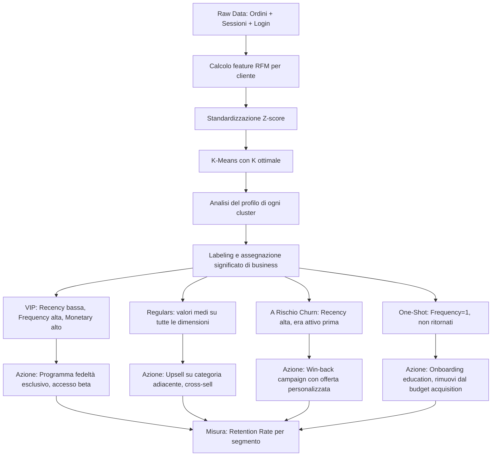

# Analisi dei Cluster: Come Personalizzare Davvero il Tuo Marketing

Nel 2011, Netflix aveva un problema interessante. Avevano 23 milioni di abbonati, ognuno con pattern di visione completamente diversi. Mandare la stessa raccomandazione a tutti era ovviamente inefficace, ma creare 23 milioni di esperienze personalizzate singolarmente era impossibile. La soluzione era trovare un numero gestibile di "profili" di spettatore — abbastanza distinti da permettere raccomandazioni significativamente diverse, abbastanza pochi da poter costruire strategie specifiche per ciascuno.

Il risultato fu una serie di cluster comportamentali: il "completionist" che termina ogni serie che inizia, lo "hopper" che guarda tre episodi di dieci serie diverse, il "re-watcher" che rivede gli stessi contenuti. Netflix stima che il suo algoritmo di personalizzazione valga oltre 1 miliardo di dollari annui in retention evitata — e la cluster analysis e' alla base di quella personalizzazione.

Questo e' il potere del clustering applicato al marketing: trasformare una massa indistinta di clienti in gruppi con caratteristiche, comportamenti e valori sufficientemente omogenei da permettere strategie differenziate e misurabili.

## Perche' la Segmentazione Demografica Tradizionale non Funziona Piu'

Per decenni il marketing ha segmentato i clienti per eta', genere e reddito. E' un approccio che ha senso quando l'unico canale e' la televisione e devi scegliere quale slot comprare. Ma nel marketing digitale, dove puoi misurare ogni click e ogni secondo di attenzione, segmentare per "donna, 35-45 anni, reddito medio-alto" e' come navigare una nave con una mappa del 1850.

Airbnb ha scoperto questa limitazione nel modo piu' diretto. La segmentazione demografica dei loro host suggeriva che gli host piu' attivi e redditizi fossero uomini tra 30 e 50 anni in citta' universitarie. Ma quando hanno eseguito una cluster analysis comportamentale sui dati effettivi di listing, messaggi, e prezzi, hanno trovato un cluster completamente inatteso: donne sopra i 60 anni in citta' costiere con immobili di piccole dimensioni. Questo segmento aveva il Net Promoter Score piu' alto di tutti, il tasso di recensioni a 5 stelle piu' elevato, e il churn piu' basso. Nessun demografico tradizionale lo avrebbe mai identificato.

Il clustering comportamentale trova strutture nei dati senza presupporre quali variabili contino. Lasci che siano i dati stessi a dirti dove sono i confini naturali tra i gruppi.

## Cos'e' il Clustering: Apprendimento Non Supervisionato

Il clustering e' una tecnica di **apprendimento non supervisionato**. La distinzione e' importante: nella classificazione supervisionata, fornisci all'algoritmo dati gia' etichettati ("questo cliente ha fatto churn", "questo non ha fatto churn") e lui impara a classificare nuovi casi. Nel clustering non supervisionato, dai all'algoritmo solo i dati grezzi e gli chiedi di trovare strutture naturali — senza dirti tu in anticipo cosa cercare.

E' la differenza tra insegnare a qualcuno dove sono le citta' su una mappa e chiedere a qualcuno di raggruppar punti su una mappa senza dirti cosa sono. Il clustering puo' scoprire pattern che tu non avresti mai ipotizzato.

### Il Framework RFM: Trasformare i Dati Transazionali in Variabili Significative

Per applicare il clustering alla segmentazione clienti, il punto di partenza piu' robusto e' il framework **RFM**, formalizzato dal database marketer Arthur Hughes negli anni '90 e ancora oggi tra gli approcci piu' efficaci per l'e-commerce e il SaaS.

RFM sta per:
- **Recency**: quanti giorni fa ha fatto l'ultimo acquisto (o l'ultimo login). Piu' recente e', piu' l'utente e' attivo nel suo ciclo.
- **Frequency**: quante volte ha acquistato (o interagito) in un dato periodo. Misura l'abitudine.
- **Monetary**: quanto ha speso in totale. Misura il valore economico.

La logica e' semplice: un cliente che ha comprato ieri, compra spesso, e ha speso tanto e' completamente diverso da uno che ha comprato sei mesi fa, una volta sola, per un importo minimo. La distanza tra questi due profili nello spazio RFM e' enorme — e il clustering la quantifica matematicamente.

Amazon usa una variante sofisticata di RFM che include anche la categoria di prodotto, il canale di acquisizione originale e il comportamento di navigazione. Ma anche con le tre dimensioni base, la segmentazione che ottieni e' gia' molto piu' utile di qualsiasi demografico.

## K-Means Clustering: il Cavallo da Lavoro della Segmentazione

L'algoritmo piu' diffuso per la segmentazione di marketing e' **K-Means**. Non e' il piu' sofisticato, ma e' interpretabile, veloce su dataset grandi, e produce risultati stabili quando il dataset e' pulito.

Il funzionamento e' iterativo:
1. Scegli K (il numero di cluster che vuoi trovare).
2. Posiziona casualmente K centroidi nello spazio dei dati.
3. Assegna ogni punto al centroide piu' vicino (distanza euclidea).
4. Ricalcola la posizione di ogni centroide come media dei punti che gli sono stati assegnati.
5. Ripeti i passi 3 e 4 fino a convergenza (quando i centroidi smettono di spostarsi significativamente).

Il risultato e' K gruppi, ognuno con un centroide che rappresenta il "cliente tipico" di quel segmento.

### Il Problema della Scala: Perche' la Standardizzazione non e' Opzionale

Il K-Means misura le distanze tra i punti. Se una variabile va da 0 a 10.000 (fatturato in euro) e un'altra va da 1 a 50 (numero di acquisti), il fatturato domina completamente il calcolo della distanza — un punto e' "vicino" a un altro principalmente in base al fatturato, indipendentemente dalla frequenza.

Questo e' matematicamente sbagliato: stai implicitamente dicendo che 1000 euro di differenza nel fatturato e' piu' importante di 10 acquisti di differenza nella frequenza, senza avere alcuna base per questa affermazione.

La soluzione e' la standardizzazione: trasformare ogni variabile in modo che abbia media 0 e deviazione standard 1 (Z-score). Dopo la standardizzazione, una differenza di 1 unita' in qualsiasi variabile ha lo stesso peso nel calcolo della distanza.

```python
import pandas as pd
import numpy as np
from sklearn.cluster import KMeans
from sklearn.preprocessing import StandardScaler
from sklearn.metrics import silhouette_score
import matplotlib.pyplot as plt

# ---- Preparazione dei dati RFM ----
# Simuliamo un dataset di clienti e-commerce con acquisti degli ultimi 12 mesi

np.random.seed(42)
n_customers = 5000

# Generiamo dati con 4 segmenti naturali nascosti
# Segmento 1: VIP — comprano spesso, tanto, di recente
# Segmento 2: Regulars — frequenza media, valore medio
# Segmento 3: A rischio — non comprano da tanto
# Segmento 4: One-shot — hanno comprato una volta sola

def genera_segmento(n, r_mean, r_std, f_mean, f_std, m_mean, m_std):
    return pd.DataFrame({
        'Recency': np.clip(np.random.normal(r_mean, r_std, n), 1, 365).astype(int),
        'Frequency': np.clip(np.random.normal(f_mean, f_std, n), 1, 100).astype(int),
        'Monetary': np.clip(np.random.normal(m_mean, m_std, n), 10, 10000)
    })

df = pd.concat([
    genera_segmento(500,  30,  15, 20, 5,  1500, 400),   # VIP
    genera_segmento(1500, 90,  30, 8,  3,  300,  100),   # Regulars
    genera_segmento(1500, 250, 50, 3,  2,  150,  80),    # A rischio
    genera_segmento(1500, 180, 60, 1,  0.3, 80,  40),    # One-shot
], ignore_index=True)

print("=== Dataset RFM ===")
print(df.describe().round(1))

# ---- Standardizzazione ----
# CRITICA: senza questo step, il Monetary (scala 10-10000)
# dominerebbe completamente Frequency (scala 1-100)
scaler = StandardScaler()
dati_scalati = scaler.fit_transform(df[['Recency', 'Frequency', 'Monetary']])

print("\n=== Dopo standardizzazione: ogni variabile ha media ~0 e std ~1 ===")
print(pd.DataFrame(dati_scalati, columns=['Recency_z', 'Frequency_z', 'Monetary_z']).describe().round(2))

# ---- Elbow Method per scegliere K ----
# Calcoliamo l'inerzia (somma delle distanze quadratiche dal centroide)
# per diversi valori di K e cerchiamo il "gomito" della curva
inerzie = []
silhouette_scores = []
K_range = range(2, 9)

for k in K_range:
    km = KMeans(n_clusters=k, random_state=42, n_init=10)
    km.fit(dati_scalati)
    inerzie.append(km.inertia_)
    # Silhouette score: misura quanto ogni punto e' simile al suo cluster
    # rispetto agli altri cluster. Piu' alto e' meglio (range: -1 a 1)
    sil = silhouette_score(dati_scalati, km.labels_, sample_size=2000)
    silhouette_scores.append(sil)

# Il K ottimale bilancia bassa inerzia e alto silhouette score
k_ottimale_silhouette = K_range[silhouette_scores.index(max(silhouette_scores))]
print(f"\nK ottimale secondo Silhouette Score: {k_ottimale_silhouette}")
print(f"Silhouette Score massimo: {max(silhouette_scores):.3f}")

# ---- Clustering finale ----
K_FINALE = 4  # Scegliamo 4 in linea con la nostra conoscenza del business
kmeans = KMeans(n_clusters=K_FINALE, random_state=42, n_init=10)
df['Cluster'] = kmeans.fit_predict(dati_scalati)

# ---- Analisi e labeling dei cluster ----
profilo_cluster = df.groupby('Cluster').agg(
    Recency_media=('Recency', 'mean'),
    Frequency_media=('Frequency', 'mean'),
    Monetary_medio=('Monetary', 'mean'),
    Numero_clienti=('Recency', 'count')
).round(1)

print("\n=== Profilo dei Cluster ===")
print(profilo_cluster)

# Labeling basato sul profilo
# Il labeling e' sempre manuale: l'algoritmo trova i gruppi,
# noi diamo loro un significato di business
labels = {
    profilo_cluster['Monetary_medio'].idxmax(): 'VIP',
    profilo_cluster['Recency_media'].idxmax(): 'A Rischio Churn',
    profilo_cluster['Frequency_media'].idxmin(): 'One-Shot',
}
# Il cluster rimanente e' "Regulars"
labels[set(range(K_FINALE)) - set(labels.keys()).pop()] = 'Regulars'
df['Segmento'] = df['Cluster'].map(labels)
```

## Il Metodo del Gomito e il Silhouette Score: Scegliere K con Rigore

Il problema piu' comune con K-Means e' la scelta di K. Molti analisti scelgono K in modo arbitrario ("facciamo 5 segmenti") o in base alle aspettative di business ("vogliamo 3 tier: bronze, silver, gold"). Entrambi gli approcci sono sbagliati.

Ci sono due strumenti statistici complementari per scegliere K:

**Elbow Method (Metodo del Gomito):** Plotta l'inerzia (somma delle distanze al quadrato di ogni punto dal suo centroide) al variare di K. Al crescere di K, l'inerzia cala sempre — con K=N cluster, ogni punto e' il suo cluster e l'inerzia e' zero. Cerchi il punto in cui la curva "piega", come un gomito: l'aggiunta di altri cluster non riduce significativamente l'inerzia.

**Silhouette Score:** Per ogni punto, misura quanto e' simile agli altri punti nel suo cluster rispetto ai punti nei cluster vicini. Il valore varia da -1 (il punto e' piu' simile ai cluster adiacenti che al suo) a +1 (il punto e' molto piu' simile al suo cluster). Il K con il Silhouette Score piu' alto e' quello che crea i cluster piu' "ben separati".

Il buon pratica e' usarli entrambi: se concordano sullo stesso K, hai una buona evidenza. Se discordano, considera anche la interpretabilita' di business — un modello con K=4 che ha senso per il tuo team di marketing puo' essere piu' utile di un modello con K=7 statisticamente ottimale ma difficile da interpretare e azionare.

## Dal Cluster all'Azione: il Flusso Operativo

Trovare i cluster e' solo la meta' del lavoro. Il valore reale sta nelle azioni che i cluster abilitano.



Prendiamo un caso concreto. Stitch Fix, il servizio americano di abbigliamento personalizzato, ha costruito la sua strategia di comunicazione interamente attorno alla segmentazione comportamentale. Invece di mandare la stessa newsletter a tutti i 3.5 milioni di abbonati, segmenta in base al comportamento di feedback sui capi ricevuti. Chi ha sempre rifiutato jeans skinny riceve stili diversi da chi li ha sempre accettati. Il risultato: un tasso di retention che e' sistematicamente superiore alla media del settore.

## Oltre il K-Means: Quando Usare Altri Algoritmi

Il K-Means ha limiti strutturali che e' importante conoscere.

**Limite 1: Assume cluster sferici.** Il K-Means tende a trovare cluster circolari nello spazio multidimensionale. Se i tuoi dati hanno strutture piu' complesse (cluster elongati, a forma di luna, annidati), K-Means fallira' nell'identificarli correttamente.

**Limite 2: Richiede di specificare K a priori.** Se non sai quanti segmenti naturali esistono nei tuoi dati, dover specificare K e' un problema.

**Limite 3: Sensibile agli outlier.** Un cliente con un Monetary estremamente alto (un "whale") puo' attirare un centroide verso di lui, distorcendo l'intero cluster.

**DBSCAN (Density-Based Spatial Clustering):** Trova cluster basandosi sulla densita' dei punti. Non richiede K a priori, trova cluster di forma arbitraria, e identifica automaticamente gli outlier (punti in zone a bassa densita'). E' ideale quando hai dati con strutture non sferiche o quando vuoi identificare automaticamente i clienti anomali.

**Hierarchical Clustering:** Costruisce un dendrogramma — un albero gerarchico che mostra come i cluster si uniscono o si dividono. Il vantaggio e' la visualizzazione della struttura a tutti i livelli: puoi vedere sia i 3 macro-segmenti ad alto livello sia i 12 sotto-segmenti nel dettaglio, e scegliere il livello di granularita' che serve al tuo obiettivo di business.

**Gaussian Mixture Models (GMM):** A differenza del K-Means che assegna ogni punto a un solo cluster in modo deterministico, il GMM assegna probabilita'. Un cliente puo' essere "60% VIP, 30% Regular, 10% A rischio". Questo e' molto piu' realistico dal punto di vista statistico — le persone reali sono raramente perfettamente descrivibili da un unico archetipo.

## L'Errore piu' Frequente: Usare i Cluster come Fine, non come Mezzo

Ho visto aziende costruire modelli di clustering sofisticatissimi, presentarli ai board, e poi non cambiare nulla nel modo in cui comunicavano con i clienti. Il clustering senza action plan e' un esercizio accademico.

La domanda da porsi prima di costruire un modello di clustering non e' "Come posso segmentare i miei clienti?" ma "Se avessi segmenti distinti, cosa farei diversamente per ciascuno?" Se la risposta e' "sostanzialmente la stessa cosa", allora il clustering non e' lo strumento giusto in questo momento.

I segmenti utili sono quelli **azionabili** (puoi fare qualcosa di diverso per ciascuno), **significativi** (la dimensione e' abbastanza grande da giustificare l'investimento), e **stabili** (non cambiano completamente ogni mese, il che renderebbe impossibile costruire strategie).

## Conclusione: il Clustering e' un Processo, non un Progetto

Il clustering non e' qualcosa che fai una volta e poi hai finito. I comportamenti dei clienti evolvono, i prodotti cambiano, i canali di acquisizione portano profili diversi. Il modello va riaddestraro periodicamente — mensilmente o trimestralmente, a seconda della velocita' di evoluzione del tuo business.

L'approccio piu' maturo e' trattare il clustering come un sistema operativo del marketing: i segmenti informano la comunicazione, la comunicazione produce dati comportamentali, i dati comportamentali affinano i segmenti. E' un ciclo, non un progetto con una data di fine.

Netflix lo ridefinisce continuamente. Amazon lo ridefinisce. Airbnb lo ridefinisce. Non perche' i loro clienti cambino completamente ogni trimestre, ma perche' ogni affinamento del modello porta miglioramenti misurabili nella rilevanza delle comunicazioni e nella retention.
