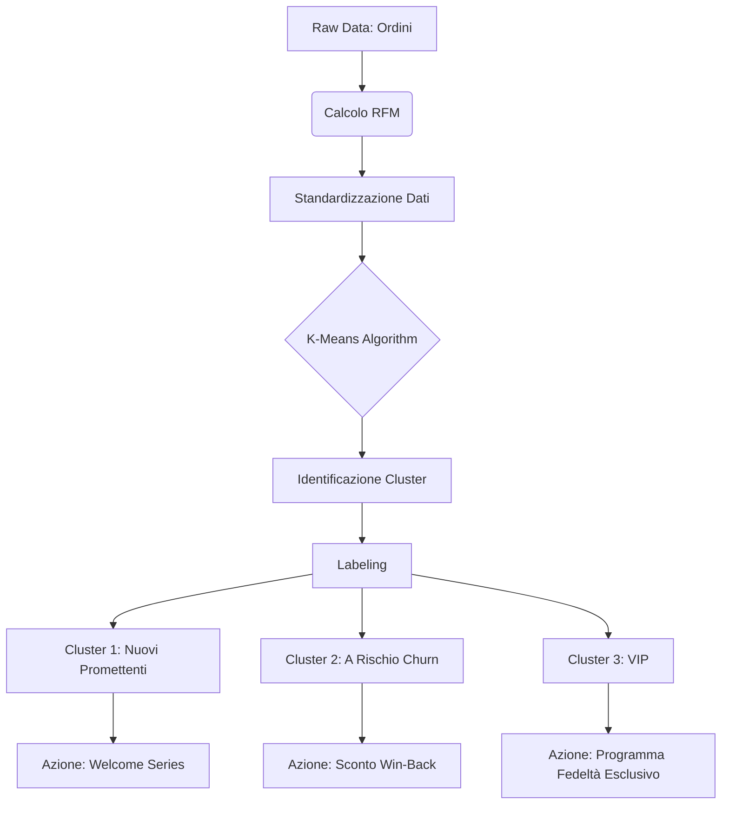

# Analisi dei Cluster: Come Personalizzare Davvero il Tuo Marketing

Trattare tutti i clienti allo stesso modo è il modo più veloce per sprecare budget marketing. L'era del "spray and pray" è finita. Oggi, l'analisi dei cluster (Clustering) ci permette di raggruppare gli utenti in base a comportamenti simili senza dover definire le regole a priori, scoprendo pattern invisibili all'occhio umano.

## Cos'è il Clustering?

Il clustering è una tecnica di **apprendimento non supervisionato** (unsupervised learning). A differenza della classificazione, dove insegniamo all'algoritmo cosa cercare (es. "questo è uno spam"), nel clustering diamo i dati all'algoritmo e chiediamo: "Trova delle strutture naturali qui dentro".

### Perché è fondamentale?
Immagina di avere 100.000 clienti. Non puoi analizzarli uno a uno.
*   Alcuni comprano solo con gli sconti (Price Sensitive).
*   Altri comprano spesso ma spendono poco (Loyal Low Spenders).
*   Altri comprano raramente ma spendono tantissimo (Whales).

Identificare questi gruppi ti permette di inviare l'offerta giusta, al momento giusto, alla persona giusta.

## K-Means Clustering: L'Algoritmo Re

Uno degli algoritmi più diffusi ed efficaci per la segmentazione di marketing è il **K-Means**.
Funziona in modo iterativo:
1.  Scegli il numero di cluster (K).
2.  Posiziona casualmente K "centroidi" nello spazio dei dati.
3.  Assegna ogni punto dati al centroide più vicino.
4.  Ricalcola la posizione del centroide come media dei punti assegnati.
5.  Ripeti finché i centroidi non smettono di muoversi.

### La Preparazione dei Dati: RFM Analysis

Per far funzionare il clustering sui clienti, usiamo spesso il framework **RFM**:
*   **Recency:** Giorni dall'ultimo acquisto. (Più basso è meglio)
*   **Frequency:** Numero totale di acquisti. (Più alto è meglio)
*   **Monetary:** Totale speso (LTV). (Più alto è meglio)

### Attenzione alla Scala! (Standardization)
Il K-Means calcola le distanze (spesso Euclidee). Se hai il "Fatturato" che va da 0 a 10.000€ e la "Frequenza" che va da 1 a 50, il fatturato dominerà il calcolo della distanza. È cruciale **standardizzare** i dati (es. Z-score) prima di dare tutto in pasto all'algoritmo.

```python
# Esempio Python: Segmentazione RFM con K-Means
import pandas as pd
from sklearn.cluster import KMeans
from sklearn.preprocessing import StandardScaler

# Immaginiamo un DataFrame 'df' con colonne: ['Recency', 'Frequency', 'Monetary']
data = df[['Recency', 'Frequency', 'Monetary']]

# 1. Standardizzazione (Cruciale!)
scaler = StandardScaler()
data_scaled = scaler.fit_transform(data)

# 2. Scelta di K (es. 4 cluster)
kmeans = KMeans(n_clusters=4, random_state=42)
df['Cluster'] = kmeans.fit_predict(data_scaled)

# 3. Analisi dei Risultati
print(df.groupby('Cluster').mean())
```

## Il Metodo del Gomito (Elbow Method)

Come scegliamo il numero giusto di cluster (K)? Non tiriamo a indovinare.
Calcoliamo la somma degli errori quadrati (Inertia) per K=2, K=3, K=4... e tracciamo un grafico. Quando l'errore smette di scendere rapidamente e la curva si appiattisce (creando un "gomito"), quello è il numero ottimale di cluster.

## Flusso di Lavoro per la Segmentazione

Ecco come integrare il clustering nella tua strategia operativa:



## Oltre il K-Means: DBSCAN e Gerarchico

Il K-Means ha un difetto: assume che i cluster siano sferici. Se i tuoi dati hanno forme strane (es. "a mezzaluna"), fallisce.
*   **DBSCAN:** Ottimo per trovare outlier e cluster di forma arbitraria. Non richiede di specificare K a priori.
*   **Hierarchical Clustering:** Crea un "dendrogramma" (albero) che mostra come i gruppi si uniscono. Utile per visualizzare la tassonomia dei clienti.

## Conclusione

L'analisi dei cluster trasforma il caos dei dati grezzi in insight azionabili. Non serve un dottorato in matematica per iniziare: bastano i dati giusti (RFM) e un po' di Python. Inizia semplice, segmenta in 3-4 gruppi, e guarda il tuo ROI decollare.
