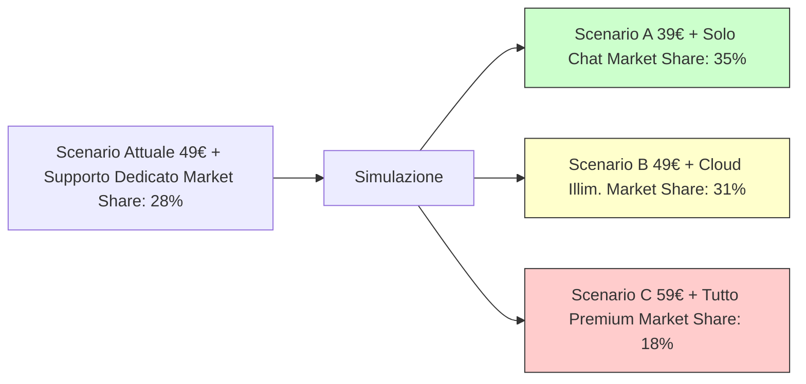

# Conjoint Analysis: Il Simulatore di Mercato nel Tuo Laptop

Se potessi costruire 100 versioni diverse del tuo prodotto e testarle tutte sul mercato, scopriresti rapidamente quale combinazione di caratteristiche vince. Ma non puoi — costa troppo tempo e denaro. La **Conjoint Analysis** simula esattamente questo processo.

## Cos'è la Conjoint Analysis?

È una tecnica statistica che misura il **valore relativo** che i consumatori attribuiscono a ogni singola caratteristica (attributo) di un prodotto, analizzando le loro preferenze tra configurazioni alternative.

Invece di chiedere "Quanto è importante il prezzo da 1 a 10?" (domanda inutile: tutti dicono 10), mostri combinazioni realistiche e chiedi di scegliere.

### L'Intuizione

Immagina di comprare uno smartphone. Quale sceglieresti?

| Opzione | Marca | Batteria | Fotocamera | Prezzo |
|---|---|---|---|---|
| A | Samsung | 24 ore | 108 MP | 899€ |
| B | Apple | 18 ore | 48 MP | 1.199€ |
| C | Xiaomi | 36 ore | 200 MP | 499€ |

La tua scelta rivela **quanto valore** dai a ogni attributo. Se scegli A, stai implicitamente dicendo che il bilanciamento marca-batteria-camera vale più del prezzo basso (C) o della marca premium (B).

La Conjoint Analysis analizza migliaia di queste scelte per calcolare il peso relativo di ogni attributo nel processo decisionale.

## I Tipi di Conjoint Analysis

### 1. Choice-Based Conjoint (CBC) — Il Più Usato

Il rispondente sceglie tra 2-4 opzioni (profili) in ogni schermata. Ogni profilo è una combinazione diversa di attributi. Si ripete per 8-12 schermate.

**Perché è il migliore:** Simula la decisione d'acquisto reale (scegliere tra alternative), non una valutazione astratta.

### 2. Rating-Based Conjoint (Traditional)

Il rispondente valuta ogni profilo singolarmente (es. "quanto ti piace da 1 a 10?"). Meno realistico del CBC perché nella vita reale non valutiamo i prodotti in isolamento — li confrontiamo.

### 3. MaxDiff (Best-Worst Scaling)

Versione semplificata: il rispondente sceglie il "migliore" e il "peggiore" tra 4-5 opzioni. Utile quando hai molti attributi da testare.

## Come Progettare uno Studio Conjoint

### Step 1: Definisci gli Attributi e i Livelli

| Attributo | Livello 1 | Livello 2 | Livello 3 |
|---|---|---|---|
| Prezzo | 29€/mese | 49€/mese | 79€/mese |
| Spazio cloud | 100 GB | 500 GB | Illimitato |
| Supporto | Solo email | Email + chat | Dedicato 24/7 |
| Integrazioni | 5 app | 20 app | Illimitate |

**Regole d'oro:**
*   Max 5-6 attributi (troppi = noise).
*   2-4 livelli per attributo.
*   I livelli devono essere realistici e comprensibili.
*   Includi sempre il prezzo come attributo.

### Step 2: Genera i Profili (Design Sperimentale)

Con 4 attributi × 3 livelli = 81 combinazioni possibili. Non puoi testarle tutte. Usi un **design ortogonale** (o D-efficient) per selezionare un sottoinsieme rappresentativo di ~12-15 profili.

```python
# Generare un design sperimentale con pyDOE2
from pyDOE2 import fullfact

# 4 attributi con 3 livelli ciascuno
levels = [3, 3, 3, 3]
design = fullfact(levels)
print(f"Combinazioni totali: {len(design)}")
# Output: 81 combinazioni totali
# Un design frazionato ne seleziona ~15-20
```

### Step 3: Raccogli le Risposte

Ogni rispondente vede 8-12 schermate con 3-4 opzioni ciascuna. Serve un campione di almeno **200 rispondenti** per risultati affidabili (300+ per segmentazione).

### Step 4: Analizza con un Modello di Scelta (Logit)

```python
# Analisi semplificata con statsmodels
import statsmodels.api as sm
import pandas as pd
import numpy as np

# Supponiamo di avere un DataFrame 'df' con:
# - scelta: 1 se l'opzione è stata scelta, 0 altrimenti
# - prezzo_29, prezzo_49, prezzo_79: dummy per il prezzo
# - cloud_100, cloud_500, cloud_illim: dummy per lo spazio
# - supporto_email, supporto_chat, supporto_dedicato: dummy

# Multinomial Logit Model
from sklearn.linear_model import LogisticRegression

# X = matrice delle dummy degli attributi
# y = vettore delle scelte (1/0)
model = LogisticRegression()
model.fit(X, y)

# I coefficienti indicano l'importanza relativa di ogni livello
print("Coefficienti (Part-Worth Utilities):")
for name, coef in zip(feature_names, model.coef_[0]):
    print(f"  {name}: {coef:.3f}")
```

## Interpretare i Risultati: Part-Worth Utilities

Il risultato chiave sono le **part-worth utilities**: il "valore" che i consumatori assegnano a ogni livello di ogni attributo.

### Esempio di Output

| Attributo | Livello | Part-Worth Utility |
|---|---|---|
| **Prezzo** | 29€/mese | +1.82 |
| | 49€/mese | +0.45 |
| | 79€/mese | -2.27 |
| **Cloud** | 100 GB | -0.95 |
| | 500 GB | +0.35 |
| | Illimitato | +0.60 |
| **Supporto** | Solo email | -0.40 |
| | Email + chat | +0.15 |
| | Dedicato 24/7 | +0.25 |
| **Integrazioni** | 5 app | -0.30 |
| | 20 app | +0.10 |
| | Illimitate | +0.20 |

### Calcolo dell'Importanza Relativa

L'importanza di ogni attributo si calcola come il range delle sue part-worth diviso la somma di tutti i range:

```
Importanza Prezzo = (1.82 - (-2.27)) / Σ range = 4.09 / 5.94 = 68.9%
Importanza Cloud = (0.60 - (-0.95)) / 5.94 = 26.1%
...
```

| Attributo | Importanza Relativa |
|---|---|
| **Prezzo** | **68.9%** |
| Cloud | 26.1% |
| Supporto | 10.9% |
| Integrazioni | 8.4% |

**Insight devastante:** Il prezzo pesa quasi il 69% nella decisione. Il supporto dedicato 24/7 e le integrazioni illimitate, su cui l'azienda voleva investire pesantemente, contano meno del 20% combinato. Il denaro va investito nel rendere il prezzo competitivo, non nel supporto premium.

## Il Simulatore di Mercato

La vera potenza della Conjoint Analysis è la **simulazione**. Una volta calcolate le utilities, puoi simulare scenari di mercato.

**Domanda:** "Se abbassiamo il prezzo da 49€ a 39€ e togliamo il supporto dedicato, guadagniamo o perdiamo market share?"



## Errori Comuni nella Conjoint Analysis

1.  **Troppi attributi:** Se alla domanda hai più di 6 attributi, il rispondente va in sovraccarico cognitivo e risponde a caso.
2.  **Livelli irrealistici:** Non mettere "Prezzo: 1€/mese" come livello — nessuno ci crederà.
3.  **Ignorare l'interazione tra attributi:** A volte un attributo cambia importanza in base a un altro (es. il supporto 24/7 conta di più se il prezzo è alto).
4.  **Campione sbagliato:** Se intervisti solo i tuoi clienti, stai ottimizzando per chi già compra da te, non per chi non compra ancora.

## Quando Usare la Conjoint Analysis

| Situazione | Adatta? | Perché |
|---|---|---|
| Lancio nuovo prodotto | ✅ Sì | Trova la configurazione ottimale prima di investire |
| Redesign del pricing | ✅ Sì | Misura l'elasticità per ogni feature |
| Confronto con competitor | ✅ Sì | Simula scenari competitivi |
| Ottimizzazione UI/UX | ❌ No | Meglio A/B test con dati comportamentali |
| Branding / posizionamento | ❌ No | Meglio mappe percettive |

## Conclusione

La Conjoint Analysis è come avere un focus group di 10.000 persone in un foglio Excel. Ti dice esattamente cosa conta per il consumatore, quanto conta, e come reagirebbe a scenari ipotetici. Non è perfetta (nessuna tecnica lo è), ma è lo strumento più potente per le decisioni di prodotto basate sui dati. Se lanci un prodotto senza averla fatta, stai giocando alla roulette. Con la Conjoint, almeno conosci le probabilità.
