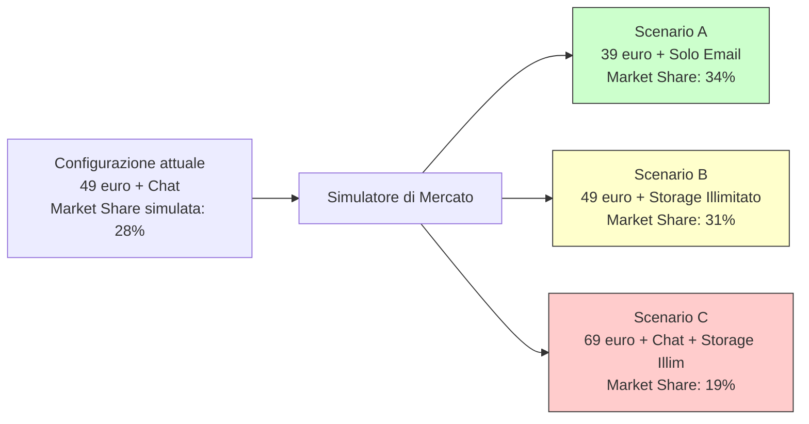

Nel 1985, Green e Srinivasan — i due ricercatori di Wharton che hanno praticamente inventato la conjoint analysis moderna — hanno pubblicato un caso che avrebbe cambiato il modo in cui le aziende di beni di consumo prendono decisioni di prodotto. Procter & Gamble aveva investito milioni di dollari nello sviluppo di un detersivo con formula antimacchia avanzata. Tutti i focus group interni dicevano che era ottimo. Il test di mercato fu un disastro. Perché? Perché i consumatori nelle sessioni di focus group dicevano di voler pagare di più per una formula migliore — ma quando si trovavano davanti allo scaffale del supermercato, prendevano il più economico.

La conjoint analysis risolve esattamente questo problema: invece di chiedere alle persone cosa vogliono (le risposte sono quasi sempre distorte verso ciò che suona bene o ciò che l'intervistatore sembra aspettarsi), le metti nella situazione di dover scegliere tra opzioni realistiche con trade-off espliciti. Le scelte rivelano le preferenze reali, non quelle dichiarate.

È un metodo robusto, usato da Apple per testare varianti di iPhone prima del lancio, da Airbnb per ottimizzare la struttura dei prezzi degli host, da Spotify per decidere quali feature includere nei piani premium. È anche un metodo accessibile: con un foglio di calcolo e Python, puoi eseguire uno studio conjoint serio con un budget di ricerca ragionevole. In questo articolo, scoprirai i tipi di conjoint analysis, come implementarli e come usarli per decisioni concrete di pricing e feature.

## L'Intuizione Fondamentale: Trade-Off, non Valutazioni Astratte

Il problema con le domande di ricerca di mercato classiche è che non costringono le persone a fare trade-off. Se chiedi "quanto è importante per te avere un'ottima fotocamera sullo smartphone?" risponderanno "molto importante". Se chiedi anche "quanto è importante il prezzo?" risponderanno "molto importante". Se chiedi "quanto è importante la batteria?" risponderanno "molto importante". Tutto è importante. La risposta è inutile perché non riflette nessuna scelta reale.

Nella vita reale, ogni scelta d'acquisto è un trade-off: accetti un prezzo più alto in cambio di una feature migliore, o preferisci risparmiare e accontentarti. La conjoint analysis mima questo processo. Mostri ai rispondenti serie di opzioni con combinazioni diverse di attributi e chiedi di scegliere. Le scelte aggregate rivelano quanta importanza le persone danno realmente a ciascun attributo — implicitamente, attraverso le loro preferenze, non esplicitamente attraverso le loro dichiarazioni.

Immagina di dover scegliere un nuovo smartphone tra queste tre opzioni:

| Opzione | Marca | Batteria | Fotocamera | Prezzo |
|---|---|---|---|---|
| A | Samsung | 24 ore | 108 MP | 899 euro |
| B | Apple | 18 ore | 48 MP | 1.199 euro |
| C | Xiaomi | 36 ore | 200 MP | 499 euro |

Se scegli C, stai implicitamente dicendo che la batteria da 36 ore e il risparmio di 400-700 euro valgono più del brand Apple o dell'ecosistema Samsung. Se scegli B, stai dicendo che il brand e l'ecosistema Apple valgono un premium significativo rispetto a specifiche tecniche superiori. La tua scelta è informativa — comunica le tue vere preferenze ordinali senza che tu debba articolarle verbalmente.

## I Tipi di Conjoint Analysis: quale Scegliere

### Choice-Based Conjoint (CBC): lo Standard de Facto

Il CBC è la metodologia più diffusa e la più vicina alla realtà. Ogni schermata mostra 2-4 "profili" (configurazioni di prodotto) e il rispondente sceglie quella preferita. Si ripete per 8-12 schermate con combinazioni diverse. A volte si include un'opzione "nessuna delle precedenti" per simulare la possibilità di non acquistare.

Il CBC è lo standard de facto per due ragioni. Prima: simula la decisione d'acquisto reale, dove confronti alternative e scegli — non valuti ogni opzione in isolamento. Seconda: i dati prodotti si prestano a modelli di scelta discreta (Multinomial Logit, Mixed Logit) che permettono di stimare le preferenze a livello individuale e costruire simulatori di mercato.

Apple usa una variante del CBC per testare configurazioni di prodotto. Prima di lanciare l'iPhone 15, hanno condotto studi su migliaia di consumatori in diversi paesi per capire il valore attribuito a ogni combinazione di storage, colore, specifiche camera, e prezzo. Non per sapere cosa "piace" ai consumatori — ma per simulare il mix di modelli che massimizzerebbe il revenue totale del lancio.

### MaxDiff (Best-Worst Scaling): Ideale per Tanti Attributi

Quando devi testare molti attributi (10-20 feature di un prodotto), il CBC diventa impraticabile — troppe combinazioni, troppo sovraccarico cognitivo. Il MaxDiff semplifica: ad ogni schermata, il rispondente vede 4-5 item e sceglie solo "il più importante" e "il meno importante". Si genera una scala ordinale molto più affidabile del classico rating 1-10.

Qualtrics ha usato il MaxDiff per prioritizzare le feature della sua roadmap di prodotto. Con oltre 30 potenziali funzionalità da testare, un CBC tradizionale sarebbe stato ingestibile. Il MaxDiff su un campione di 400 clienti ha prodotto una graduatoria di importanza delle feature che ha guidato la pianificazione del prodotto per due anni.

### Adaptive Conjoint (ACA): Personalizzato per Ogni Rispondente

L'ACA si adatta alle risposte di ogni individuo. Inizia con domande "grossolane" e poi si affina progressivamente basandosi sulle risposte precedenti. Produce utility stimate a livello individuale, molto utile quando hai segmenti di clienti con preferenze molto diverse. Il trade-off: servono meno task (10-15 invece di 15-20) ma la logica è più complessa da spiegare.

### Rating-Based Conjoint (Traditional): Meno Realistico, più Semplice

Il metodo più vecchio: il rispondente valuta ogni profilo singolarmente su una scala numerica. È meno realistico (nella realtà confrontiamo, non valutiamo in isolamento) ma più facile da spiegare e da implementare. Utile per studi esplorativi preliminari.

## Come Progettare uno Studio Conjoint: dal Brief al Questionario

### Step 1: Definisci gli Attributi e i Livelli

La scelta degli attributi è la decisione più critica. Includi attributi troppo simili tra loro e il modello non li distinguerà. Includi troppi attributi e il rispondente andrà in sovraccarico cognitivo e risponderà a caso.

Regole pratiche consolidate dalla letteratura (Green e Rao, 1971; Louviere e Woodworth, 1983):
- Massimo 5-6 attributi per study CBC standard
- 2-4 livelli per attributo (l'algoritmo di design sperimentale ne ha bisogno)
- I livelli devono essere credibili: non mettere "prezzo: 0 euro" — nessuno ci crederà
- Includi sempre il prezzo come attributo — è la variabile che produce le utility monetarie che servono per la willingness-to-pay

Esempio per un servizio SaaS di project management:

| Attributo | Livello 1 | Livello 2 | Livello 3 |
|---|---|---|---|
| Prezzo | 19 euro/mese | 49 euro/mese | 89 euro/mese |
| Numero utenti | 1-5 utenti | 6-25 utenti | Illimitati |
| Integrazioni | 5 app | 25 app | Illimitate |
| Supporto | Solo documentazione | Email entro 24h | Chat dedicata |
| Storage | 10 GB | 100 GB | Illimitato |

### Step 2: il Design Sperimentale

Con 5 attributi x 3 livelli = 243 combinazioni possibili. Non puoi testarle tutte — sarebbe un questionario di ore. Usi un **design ortogonale** (o D-optimal) per selezionare un sottoinsieme di 12-20 profili che siano statisticamente rappresentativi dello spazio totale delle combinazioni.

Il principio dell'orthogonalità: i livelli di ogni attributo sono distribuiti in modo che non ci siano correlazioni sistematiche tra attributi nel set di profili. Se prezzo e storage fossero sempre correlati (prezzo alto = storage alto), non potresti distinguere il contributo di ciascuno alle scelte.

```python
from pyDOE2 import fullfact, fracfact
import pandas as pd
import numpy as np

# ---- Design sperimentale per studio CBC ----
# 5 attributi, ognuno con 3 livelli (codificati 0, 1, 2)

# Design fattoriale completo: 3^5 = 243 combinazioni
design_completo = fullfact([3, 3, 3, 3, 3])
print(f"Design completo: {len(design_completo)} profili")

# Per uno studio realistico, usiamo un sottoinsieme D-optimal
# pyDOE2 non ha D-optimal nativamente, usiamo un approccio alternativo:
# selezioniamo una frazione ortogonale

# Mappa dei livelli reali per ogni attributo
attributi = {
    'Prezzo': ['19 euro/mese', '49 euro/mese', '89 euro/mese'],
    'Utenti': ['1-5', '6-25', 'Illimitati'],
    'Integrazioni': ['5 app', '25 app', 'Illimitate'],
    'Supporto': ['Docs', 'Email', 'Chat dedicata'],
    'Storage': ['10 GB', '100 GB', 'Illimitato']
}

# Selezione manuale di 18 profili ortogonali (esempio semplificato)
# In produzione si usa software specializzato (Sawtooth, Lighthouse Studio)
# o algoritmi D-optimal come in R (AlgDesign) o Python (pyOptimalDesign)
indici_selezionati = np.random.choice(len(design_completo), size=18, replace=False)
design_ridotto = design_completo[indici_selezionati]

# Converte indici numerici in livelli leggibili
nomi_attributi = list(attributi.keys())
df_profili = pd.DataFrame(design_ridotto, columns=nomi_attributi, dtype=int)

for attr, livelli in attributi.items():
    df_profili[attr] = df_profili[attr].map({i: v for i, v in enumerate(livelli)})

print(f"\nDesign ridotto: {len(df_profili)} profili")
print("\nPrimi 5 profili del questionario:")
print(df_profili.head())
```

### Step 3: Raccolta delle Risposte

Ogni rispondente vede 8-12 "task" (schermate), ognuna con 3-4 profili da confrontare. Il campione minimo per un CBC affidabile è 200 rispondenti per risultati aggregati, 400+ se vuoi segmentare per sottogruppi. La qualità del campione importa più della dimensione — devi intervistare le persone che effettivamente comprano nella tua categoria, non un campione random della popolazione.

Una cosa che molti trascurano: la selezione del campione è critica quanto il design dello studio. Se stai sviluppando un nuovo piano premium, non ha senso intervistare solo i clienti attuali del piano base — stai ottimizzando per chi già compra da te, non per chi potresti acquisire. Includi nel campione anche i non-clienti che comprano da competitor.

### Step 4: Analisi con Modello di Scelta

Il modello standard per il CBC è il **Multinomial Logit (MNL)**, o la sua versione più sofisticata, il **Mixed Logit** (che considera l'eterogeneità delle preferenze tra individui).

```python
import pandas as pd
import numpy as np
from sklearn.linear_model import LogisticRegression
from scipy.special import softmax

# ---- Simulazione dati CBC e stima delle part-worth utilities ----
# In un dataset CBC reale, ogni riga e' un'osservazione:
# - respondent_id: chi ha risposto
# - task_id: quale schermata (task) del questionario
# - profile_id: quale opzione nella schermata
# - scelto: 1 se e' l'opzione scelta dal rispondente, 0 altrimenti
# - dummy per ogni livello di ogni attributo

np.random.seed(42)

# Simuliamo le "vere" utilità' di ogni livello
# (quello che vogliamo stimare con il modello)
true_utilities = {
    'prezzo_19': 2.1,    # prezzo basso = alta utilità'
    'prezzo_49': 0.4,
    'prezzo_89': -2.5,   # prezzo alto = bassa utilità'
    'utenti_5': -0.8,
    'utenti_25': 0.3,
    'utenti_illim': 0.5,
    'integr_5': -0.5,
    'integr_25': 0.2,
    'integr_illim': 0.3,
    'supporto_docs': -0.3,
    'supporto_email': 0.1,
    'supporto_chat': 0.2,
    'storage_10': -0.6,
    'storage_100': 0.2,
    'storage_illim': 0.4,
}

feature_names = list(true_utilities.keys())
true_coef = np.array(list(true_utilities.values()))

# Generiamo 300 rispondenti x 10 task x 3 opzioni = 9000 osservazioni
n_respondents = 300
n_tasks = 10
n_alternatives = 3

rows = []
for r in range(n_respondents):
    for t in range(n_tasks):
        # Genera 3 profili casuali per questo task
        profili = []
        for a in range(n_alternatives):
            # Ogni profilo e' una combinazione casuale di livelli
            prezzo_idx = np.random.choice(3)
            utenti_idx = np.random.choice(3)
            integr_idx = np.random.choice(3)
            supporto_idx = np.random.choice(3)
            storage_idx = np.random.choice(3)

            # Vettore dummy (1-of-K encoding per ogni attributo)
            dummy = np.zeros(15)
            dummy[prezzo_idx] = 1         # prezzo: posizioni 0-2
            dummy[3 + utenti_idx] = 1    # utenti: posizioni 3-5
            dummy[6 + integr_idx] = 1    # integr: posizioni 6-8
            dummy[9 + supporto_idx] = 1  # supporto: posizioni 9-11
            dummy[12 + storage_idx] = 1  # storage: posizioni 12-14

            # Utilità' vera + rumore individuale
            utilità = np.dot(dummy, true_coef) + np.random.gumbel(0, 0.5)
            profili.append((dummy, utilità))

        # Il rispondente sceglie il profilo con utilità più alta
        utilità_values = [p[1] for p in profili]
        scelta = np.argmax(utilità_values)

        for a, (dummy, _) in enumerate(profili):
            rows.append({
                'respondent': r,
                'task': t,
                'alternative': a,
                'scelto': int(a == scelta),
                **{feature_names[i]: dummy[i] for i in range(len(feature_names))}
            })

df_cbc = pd.DataFrame(rows)

# Stima del modello Logit
X = df_cbc[feature_names].values
y = df_cbc['scelto'].values

model = LogisticRegression(C=1e5, max_iter=500, random_state=42)
model.fit(X, y)

# ---- Risultati: Part-Worth Utilities ----
part_worths = pd.DataFrame({
    'Attributo_Livello': feature_names,
    'Utility_Stimata': model.coef_[0],
    'Utility_Vera': true_coef
}).sort_values('Utility_Stimata', ascending=False)

print("=== Part-Worth Utilities (prime 5 per valore) ===")
print(part_worths.head(8).to_string(index=False))

# ---- Importanza Relativa degli Attributi ----
# Range della utility per ogni attributo (max - min dei livelli)
attributi_gruppi = {
    'Prezzo': ['prezzo_19', 'prezzo_49', 'prezzo_89'],
    'Utenti': ['utenti_5', 'utenti_25', 'utenti_illim'],
    'Integrazioni': ['integr_5', 'integr_25', 'integr_illim'],
    'Supporto': ['supporto_docs', 'supporto_email', 'supporto_chat'],
    'Storage': ['storage_10', 'storage_100', 'storage_illim'],
}

ranges = {}
coef_dict = dict(zip(feature_names, model.coef_[0]))
for attr, livelli in attributi_gruppi.items():
    utilities = [coef_dict[l] for l in livelli]
    ranges[attr] = max(utilities) - min(utilities)

totale_range = sum(ranges.values())
importanza = {attr: r / totale_range * 100 for attr, r in ranges.items()}

print("\n=== Importanza Relativa degli Attributi ===")
for attr, imp in sorted(importanza.items(), key=lambda x: -x[1]):
    print(f"  {attr}: {imp:.1f}%")
```

## Interpretare i Risultati: Part-Worth Utilities e Importanza Relativa

Il risultato principale della conjoint analysis sono le **part-worth utilities**: un numero che rappresenta il contributo di ogni livello di ogni attributo all'utilità totale percepita del prodotto. Numeri più alti significano che quel livello è preferito; numeri più bassi significano che riduce l'attrattività.

Esempio di output interpretato per il nostro SaaS:

| Attributo | Livello | Utility | Importanza attributo |
|---|---|---|---|
| **Prezzo** | 19 euro/mese | +2.1 | **68%** |
| | 49 euro/mese | +0.4 | |
| | 89 euro/mese | -2.5 | |
| **Storage** | 10 GB | -0.6 | **15%** |
| | 100 GB | +0.2 | |
| | Illimitato | +0.4 | |
| **Utenti** | 1-5 | -0.8 | **9%** |
| | 6-25 | +0.3 | |
| | Illimitati | +0.5 | |
| **Integrazioni** | 5 app | -0.5 | **5%** |
| | 25 app | +0.2 | |
| | Illimitate | +0.3 | |
| **Supporto** | Solo docs | -0.3 | **3%** |
| | Email | +0.1 | |
| | Chat dedicata | +0.2 | |

L'importanza relativa si calcola come il range (max - min) delle utilities di ogni attributo, diviso la somma di tutti i range. In questo caso, il prezzo pesa il 68% della decisione d'acquisto. Il supporto dedicato — su cui magari stavi pensando di investire come differenziatore — pesa il 3%.

Questa è l'informazione devastante che solo la conjoint analysis può darti con questa precisione: non solo "il prezzo è importante", ma "il prezzo è 23 volte più importante del supporto nella decisione d'acquisto del tuo segmento target".

## il Simulatore di Mercato: la Vera Potenza

Una volta calcolate le utilities, puoi costruire un simulatore di mercato: un modello che prevede la quota di preferenza (proxy della market share) per qualsiasi configurazione di prodotto.

Il meccanismo è semplice. Per ogni configurazione ipotetica, sommi le utilities dei livelli che la compongono. La quota di preferenza si calcola con la formula softmax sulle utilities di tutte le opzioni disponibili (inclusi i competitor simulati).

**Scenario reale:** "Abbiamo 28% di quota nel nostro segmento target. Se portiamo il prezzo da 49 a 39 euro (interpolando tra i livelli testati) e passiamo da chat dedicata a solo email, guadagniamo o perdiamo?"

Il simulatore può rispondere in secondi, dopo aver assorbito mesi di ricerca in fase di campo.



Il risultato in questo caso è controintuitivo: abbassare il prezzo di 10 euro e togliere il supporto chat produce un guadagno netto di 6 punti di quota. La feature del supporto chat "costa" in termini di pricing power molto di più di quanto "compra" in preferenza degli utenti.

## Conjoint vs Metodi Alternativi: quando Usare Cosa

La conjoint analysis non è l'unico modo per misurare la willingness-to-pay o le preferenze dei consumatori. Ecco un confronto con altri metodi:

| Metodo | Miglior caso d'uso | Vantaggi | Svantaggi |
|---|---|---|---|
| **Conjoint Analysis (CBC)** | Pricing, feature prioritization, product mix | Realistica, fornisce utility discrete | Richiede 200+ rispondenti, complessa da analizzare |
| **Van Westendorp Price Sensitivity** | Analisi rapida del prezzo | Semplicissima, veloce | Non misura preferenze di feature, solo prezzo |
| **Gabor-Granger** | Stima elasticità prezzo | Dati realistici sequenziali | Sensibile all'ordine delle domande, effetto ancora |
| **Discrete Choice Modeling** | Simulazione comportamentale | Molto flessibile | Richiede competenza statistica avanzata |
| **Focus Group** | Esplorazione iniziale | Insight qualitativo ricco | Non quantificabile, non rappresentativo |

## Errori Comuni che Invalidano lo Studio

**Troppi attributi:** Con più di 6-7 attributi nel CBC, i rispondenti entrano in sovraccarico cognitivo e iniziano a rispondere alla cieca, guardando solo uno o due attributi (tipicamente il prezzo). Le utility stimate diventano inaffidabili. Se hai molti attributi, usa il MaxDiff per una prioritizzazione preliminare, poi approfondisci con un CBC su un sottoinsieme ristretto.

**Livelli irrealistici o non confrontabili:** Se metti "prezzo: 0 euro" o "supporto: risposta in 30 secondi", i rispondenti non ci credono e distorcono le risposte. I livelli devono cadere all'interno del range di mercato credibile per il target.

**Campione sbagliato:** Se stai lanciando un prodotto per le PMI e intervisti solo le grandi aziende (perché sono più facili da contattare attraverso la tua rete), le utilities che stimi non saranno applicabili al tuo vero target.

**Ignorare la segmentazione:** Le utilities aggregate nascondono eterogeneità importanti. I clienti "price-sensitive" e i clienti "feature-driven" hanno profili di utilità completamente diversi. Analizzare solo i dati aggregati potrebbe portarti a una configurazione di prodotto che non è ottimale per nessun segmento. Usa il Mixed Logit o la Latent Class Analysis per identificare segmenti con preferenze distinte.

**Design sperimentale scarso:** Se i profili non sono stati creati con un design ortogonale, le correlazioni tra attributi non saranno indipendenti e le utility stimate porteranno confondimento. Non affidarti agli istinti — usa software di design statistico o librerie Python dedicate.

## Quando Usare la Conjoint e Quando no

| Situazione | Adatta? | Perché |
|---|---|---|
| Lancio nuovo prodotto: quale configurazione? | Si | Trova la combinazione ottimale prima di investire nel MVP |
| Redesign del pricing: quale piano? | Sì | Misura l'elasticità di ogni feature e il willingness-to-pay |
| Confronto con competitor: dove siamo vulnerabili? | Si | Simula scenari in cui il competitor lancia features nuove |
| Ottimizzazione UI/UX: quale flusso? | No | Meglio A/B test su dati comportamentali reali |
| Posizionamento del brand | No | Meglio mappe percettive e brand equity research |
| Feature prioritization in backlog | Parzialmente | MaxDiff è più efficiente del CBC per lunghi elenchi |

## Caso Studio: Pricing di un Piano SaaS

Un'azienda SaaS di analytics aveva tre piani (Basic, Pro, Enterprise) e voleva capire se il pricing era ottimale. Con una conjoint analysis su 300 decision maker di target, hanno scoperto che:

- Il piano Pro era posizionato malissimo: i clienti erano disposti a pagare il 40% di più per feature che l'azienda stava offrendo nel piano Enterprise. Il gap di prezzo tra Pro e Enterprise era insufficiente.
- Il numero di utenti era più importante del supporto: i clienti era disposti a pagare premium sostanziali per aumentare i limiti di utenti, ma quasi niente per support dedicato.
- La segmentazione per settore era fondamentale: le aziende tech avevano una willingness-to-pay per integrazioni API che le aziende non-tech non aveva.

Resultado: hanno riprezzo i piani passando da 3 a 5 tiers (aggiungendo uno intermedio), aumentato significativamente il prezzo del Pro, e creato varianti dedicate per il settore tech. L'ARR (Annual Recurring Revenue) è aumentato del 34% senza perdere clienti — è aumentato il numero di upgrade da Basic a Pro.

## Conclusione: Smettila di Chiedere, Osserva le Scelte

Il contributo fondamentale della conjoint analysis è epistemologico prima che metodologico: ci insegna che le preferenze dichiarate e le preferenze rivelate sono spesso molto diverse, e che le seconde sono quelle che contano. Per approfondire i concetti di misurazione delle preferenze nei dati, vedi il nostro [modulo su metriche fondamentali](/course/metriche-fondamenti/).

Paul Green, il padre della conjoint moderna, amava dire che "le persone non sanno cosa vogliono finché non si trovano a dover scegliere". La conjoint forza quella scelta in un contesto controllato e misurabile. Il risultato è una mappa delle priorità del consumatore che ha la precisione quantitativa necessaria per guidare decisioni di prodotto e pricing basate su dati, non su intuizioni.

Se stai lanciando un prodotto senza averla fatta, stai essenzialmente chiedendo ai consumatori "cosa volete?" e fidandoti della risposta. La conjoint ti dice cosa scelgono davvero quando devono scegliere — che è l'unica informazione che conta. Approfondisci le tecniche di miglioramento del modello nel nostro modulo [analisi marketing](/course/analisi-marketing/).
