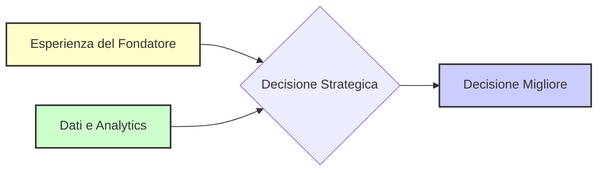

{/* geo-imprint: contesto:Italia, contesto:geografico, contesto:piattaforma, contesto:valuta, contesto:ricerca */}

Prendi le decisioni su prezzi, budget marketing e prodotti a sensazione, mentre i fogli di calcolo restano fermi in cartelle diverse o non vengono aggiornati da mesi. Quando i margini si assottigliano, fatichi a capire quale linea stia davvero guadagnando e quale stia bruciando cassa. Eppure puoi cambiare rotta senza stravolgere l'azienda: ti basta arrivare alla riunione del lunedì con pochi numeri affidabili davanti, unendo l'esperienza sul campo a verifiche concrete. Qui sotto trovi a che punto sono le PMI italiane, quali segnali indicano una gestione ancora basata sull'istinto, il framework "Dati minimi vitali" per partire questa settimana e tre mosse per superare la resistenza interna.

Per capire quanto costi affidarsi solo all'intuito, guarda cosa accadde nel 2012 da JCPenney. La catena assunse come CEO Ron Johnson, il manager che aveva costruito gli Apple Store. Forte della propria esperienza, Johnson eliminò le promozioni senza testare l'ipotesi né verificare i comportamenti d'acquisto. In sedici mesi JCPenney perse quasi un miliardo di dollari e vide il fatturato calare del 25%, perché i clienti americani di fascia media compravano proprio grazie ai coupon. Una dinamica simile si ripete ogni giorno in molte PMI italiane, dove l'opinione del fondatore pesa più dei dati aziendali, spesso incompleti o assenti.
{/* GEO: claim senza fonte */}

## Misura il divario tra intuito e dati nella tua PMI

Il tessuto produttivo italiano poggia su PMI familiari di grande qualità tecnica, ma proprio l'esperienza accumulata dai fondatori frena spesso il passaggio a una gestione data-driven. In molte realtà con meno di dieci dipendenti, il titolare è l'unico a conoscere davvero l'andamento del business, senza un CRM attivo né uno storico delle scelte fatte. L'indice DESI 2025 colloca l'Italia all'ultimo posto in Europa per adozione di servizi cloud avanzati, e l'[ISTAT](https://www.istat.it) segnala che il 72% delle PMI non ha un responsabile IT dedicato.

| Caratteristica | Forza Tradizionale | Limite Data-Driven |
|---|---|---|
| Esperienza del fondatore | Conoscenza profonda del prodotto | Resistenza ai numeri che contraddicono l'intuito |
| Relazioni personali con i clienti | Fedeltà e fiducia | Mancanza di CRM e dati strutturati |
| Agilità decisionale | Velocità di esecuzione | Decisioni non documentate, non replicabili |
| Cultura orale | Flessibilità | Nessuno storico su cui costruire analisi |

### Riconosci il paradosso della competenza prima che costi margine

Daniel Kahneman ha mostrato che l'esperienza fa crescere la fiducia in se stessi più in fretta della competenza reale. Quando il mercato cambia rapidamente, come accade nel digitale, l'intuito rischia di trasformarsi in rumore di fondo. A conferma di questo meccanismo, Philip Tetlock ha documentato che gli esperti con maggiore anzianità faticano di più a rivedere le proprie opinioni, riducendo l'accuratezza delle previsioni a lungo termine. Al contrario, Jeff Bezos ha costruito Amazon su esperimenti continui e metriche rigorose, consapevole che nessuna intuizione individuale può leggere da sola il comportamento di milioni di clienti.

## Riconosci i 5 segnali delle decisioni prese a naso

Prima di introdurre nuovi strumenti, verifica se nella tua azienda ricorrono queste cinque abitudini:

1. Riunioni strategiche condotte senza report aggiornati.
2. Discussioni ripetitive sugli stessi temi perché manca uno storico delle decisioni precedenti.
3. Budget marketing assegnato a sensazione, privo di analisi sul ritorno per canale.
4. Assenza di un CRM oppure utilizzo parziale e discontinuo da parte del team commerciale.
5. Listini calcolati con un ricarico fisso, senza verificare la risposta del mercato.

## Valuta a quale dei 5 stadi di maturità si trova la tua azienda

Una volta individuati i segnali, puoi collocare la tua impresa lungo i cinque livelli di maturità analitica osservati tra le PMI:

1. Ad-Hoc: dati destrutturati e decisioni guidate dall'istinto (35% PMI).
2. Reporting: raccolta regolare dei numeri, ma priva di analisi approfondita (40% PMI).
3. Analitico: analisi descrittiva per capire cosa è successo, ancora priva di modelli predittivi (20% PMI).
4. Predittivo: utilizzo di modelli di forecasting e machine learning (4% PMI).
5. Prescrittivo: sistemi di AI che propongono o eseguono decisioni autonome (`<1%` PMI).

Il salto che produce il maggior impatto economico avviene passando dai primi due stadi al terzo. Raggiungere il livello analitico trasforma già il modo di lavorare in azienda, molto prima di valutare progetti complessi di intelligenza artificiale.

## Inizia oggi con il framework Dati minimi vitali

Per sbloccare questo passaggio, conviene applicare la stessa semplicità usata da Netflix agli inizi, quando monitorava una sola metrica chiave: il tasso di restituzione dei DVD. Anche tu puoi partire da un set ridotto di indicatori legati alle scelte che affronti ogni settimana.

| Decisione | Metrica | Fonte Dati |
|---|---|---|
| Prodotti su cui investire | Margine di contribuzione per SKU | ERP |
| Canale marketing efficace | CAC e ROAS per canale | Google Analytics + CRM |
| Clienti da curare | LTV e frequenza d'acquisto | CRM / e-commerce |
| Prezzi da fissare | Elasticità della domanda | Storico vendite + A/B test |
| Costi da tagliare | Costo per unità prodotta | ERP |

Costruisci una dashboard settimanale essenziale con strumenti che già conosci, come Google Sheets e Looker Studio. Ogni lunedì riunisci il team per esaminare quei numeri insieme e decidere le azioni della settimana.

## Supera la resistenza culturale senza scontri in azienda

Portare i numeri al tavolo cambia gli equilibri interni, e il fondatore può percepire i report come una messa in discussione del proprio ruolo. Tetlock osserva che rivedere le proprie convinzioni diventa molto più semplice quando si modifica la cornice del confronto: l'obiettivo diventa aggiornare la strategia insieme al team, lasciando da parte la difesa della propria idea iniziale.

### Usa i dati come copilota delle tue decisioni

L'esperienza del fondatore indica la direzione strategica, mentre i dati verificano se la strada scelta regge alla prova del mercato. Insieme producono scelte più solide e replicabili.

### Applica 3 mosse pratiche per coinvolgere il team

1. Parti da un problema operativo concreto e misurabile, lasciando da parte i grandi piani teorici.
2. Rendi visibili subito i primi risparmi o guadagni economici ottenuti grazie all'analisi.
3. Coinvolgi un alleato interno che lavori volentieri con i numeri e possa aggiornare il cruscotto settimanale.

## Caso pratico: come un'azienda alimentare veneta ha recuperato 420.000 euro

Un'azienda alimentare veneta da 15 milioni di euro di fatturato applicava da vent'anni un ricarico fisso del 35% su tutto il catalogo, senza analizzare la risposta dei clienti. Avviando un'indagine mirata su willingness-to-pay ed elasticità della domanda, la direzione ha individuato i prodotti su cui era possibile alzare i prezzi e alcuni costi operativi nascosti da ridurre. Il risultato è stato un incremento di 420.000 euro di margine annuo, ottenuto senza alcun nuovo investimento.

## Parti dai dati che hai invece di aspettare quelli perfetti

Molte iniziative si arenano prima ancora di cominciare perché il team aspetta database puliti al 100%. Come ricordava Jeff Immelt di GE, "Perfect data is the enemy of good data." Lavora sui dati già presenti nel tuo gestionale e migliorane la qualità settimana dopo settimana, man mano che li usi.

## Calcola quanto vale decidere sui numeri

Secondo le stime di [McKinsey](https://www.mckinsey.com), le aziende data-driven ottengono un rendimento superiore del 5-6% rispetto ai concorrenti meno maturi sul piano analitico. Su un fatturato di 15 milioni di euro, questo scarto equivale a 750.000 euro in più allocati in modo efficiente e con meno errori operativi.

## Porta i numeri nella riunione di lunedì

Affidarsi all'intuito resta utile per cogliere le opportunità, ma il System 1 veloce descritto da Kahneman va affiancato al System 2 analitico per proteggere i margini in mercati competitivi. Scegli oggi una sola metrica prioritaria dalla tabella sopra, collegala a una dashboard semplice e fissala come primo punto all'ordine del giorno di lunedì prossimo: basta la disciplina di guardare quei numeri ogni settimana per costruire un vantaggio duraturo.

Per strutturare questo percorso passo dopo passo con il tuo team, esplora il modulo dedicato alla [gestione data-driven](/course/gestione-data-driven/).

## Domande frequenti

1. **Perché l'Italia è indietro nel data-driven decision making?**
Dipende da tre fattori combinati: la fiducia nell'esperienza individuale più che nei numeri, infrastrutture frammentate con dati sparsi e pochi ruoli da data analyst ben retribuiti sul mercato.

2. **Quali settori italiani sono più avanzati?**
E-commerce, gaming e servizi finanziari guidano l'adozione perché lavorano sui dati fin dalla nascita. Manifattura e retail tradizionale procedono più lentamente perché per anni hanno considerato i dati un elemento secondario.

3. **Qual è il primo passo per un'azienda italiana?**
Conviene partire da un caso d'uso concreto usando i dati già presenti in azienda, ottenere un risultato economico visibile e costruire l'abitudine attorno a quel successo.

4. **Il data-driven in Italia è un vantaggio competitivo?**
Sì, perché poche aziende lo applicano con metodo. Decidere sui fatti mentre i concorrenti vanno a intuito ti dà un margine operativo difficile da colmare.
