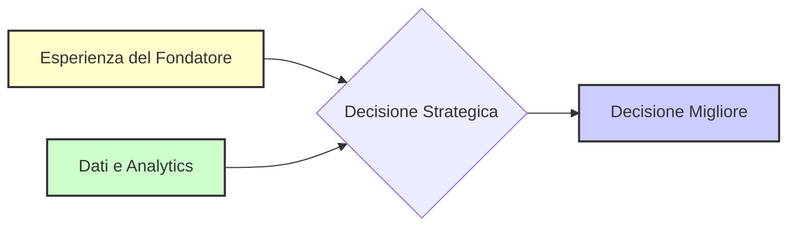

Nel 2012 JCPenney assunse come CEO Ron Johnson, l'uomo che aveva costruito gli Apple Store. Johnson aveva esperienza e intuizione, e decise di eliminare le promozioni senza prima testare l'ipotesi o guardare i dati. In sedici mesi JCPenney perse quasi un miliardo di dollari e vide il fatturato calare del 25%. I clienti americani di fascia media amavano i coupon, e senza coupon smettevano di comprare. La stessa scena si ripete ogni giorno in molte PMI italiane, dove l'intuito del fondatore conta più dei dati, che sono spesso vecchi o non esistono affatto.

## Il gap italiano: dati vs istinto

L'Italia ha un tessuto di PMI familiari spesso eccellenti, ma proprio l'esperienza accumulata dai fondatori frena l'adozione di una cultura data-driven. In molte aziende con meno di dieci dipendenti il fondatore è l'unico a sapere come stanno le cose, senza un CRM né uno storico delle decisioni. L'indice DESI 2025 colloca l'Italia all'ultimo posto in Europa per adozione di servizi cloud avanzati, e l'ISTAT segnala che il 72% delle PMI non ha un responsabile IT dedicato.

| Caratteristica | Forza Tradizionale | Limite Data-Driven |
|---|---|---|
| Esperienza del fondatore | Conoscenza profonda del prodotto | Resistenza ai numeri che contraddicono l'intuito |
| Relazioni personali con i clienti | Fedeltà e fiducia | Mancanza di CRM e dati strutturati |
| Agilità decisionale | Velocità di esecuzione | Decisioni non documentate, non replicabili |
| Cultura orale | Flessibilità | Nessuno storico su cui costruire analisi |

### Il paradosso della competenza

Daniel Kahneman ha mostrato che l'esperienza fa crescere la fiducia più in fretta della competenza vera. Quando il contesto cambia in fretta, come nel digitale, l'intuito diventa rumore. Philip Tetlock ha documentato che gli esperti più esperti faticano di più a rivedere le proprie opinioni, e questo abbassa l'accuratezza delle loro previsioni a lungo termine. Jeff Bezos ha costruito Amazon su dati e test continui, perché sapeva che l'intuito non regge il confronto con milioni di clienti.

## I 5 segnali che la tua azienda decide "a naso"

1. Riunioni strategiche senza dati o report.
2. Discussioni ripetitive senza storico decisionale.
3. Budget marketing deciso a sentimento senza analisi.
4. Assenza o cattivo uso del CRM.
5. Prezzi fissati con ricarico fisso senza analisi di mercato.

## I 5 stadi del data maturity model: dove è la tua azienda

1. Ad-Hoc: nessun dato strutturato, decisioni a istinto (35% PMI).
2. Reporting: raccolta dati senza analisi (40% PMI).
3. Analitico: analisi descrittiva, nessuna predittiva (20% PMI).
4. Predittivo: modelli di forecasting e machine learning (4% PMI).
5. Prescrittivo: AI che prende decisioni autonome (`<1%` PMI).

Il salto che conta davvero è quello dai primi due stadi in poi. Non c'è bisogno di buttarsi subito sull'AI.

## Come iniziare: il framework "Dati minimi vitali"

Netflix partì da una sola metrica chiave, il tasso di restituzione dei DVD. Vale anche per te: comincia da poche metriche essenziali, quelle legate alle decisioni che prendi ogni settimana.

| Decisione | Metrica | Fonte Dati |
|---|---|---|
| Prodotti su cui investire | Margine di contribuzione per SKU | ERP |
| Canale marketing efficace | CAC e ROAS per canale | Google Analytics + CRM |
| Clienti da curare | LTV e frequenza d'acquisto | CRM / e-commerce |
| Prezzi da fissare | Elasticità della domanda | Storico vendite + A/B test |
| Costi da tagliare | Costo per unità prodotta | ERP |

Costruisci una dashboard settimanale semplice, va bene anche con Google Sheets e Looker Studio, e ogni lunedì riunisci il team per discutere i numeri invece delle opinioni.

## La resistenza culturale: come gestirla

Il fondatore può vivere i dati come una minaccia. Tetlock mostra che cambiare opinione è difficile ma non impossibile, a patto di cambiare la cornice: non più "difendere la mia idea", ma "aggiornare la strategia".

### Strategia: "I dati come copilota, non come pilota"

I dati non sostituiscono l'esperienza, la potenziano. L'esperienza indica la direzione, i dati mostrano la strada.

### 3 tattiche per vincere la resistenza

1. Parti da un problema concreto, non da una visione astratta.
2. Mostra subito i risultati economici tangibili.
3. Trova un alleato interno che lavori con i numeri.

## Caso pratico: l'azienda alimentare del veneto

Un'azienda da 15 milioni di fatturato applicava da vent'anni un ricarico fisso del 35%, senza mai guardare il mercato. Dopo un'indagine sulla willingness-to-pay e sull'elasticità della domanda, ha trovato margini di aumento prezzi e costi nascosti da tagliare, e ha portato a casa 420.000 euro di margine annuo in più senza alcun nuovo investimento.

## Il mito della "Complessità dei dati"

Aspettare i dati perfetti è il modo più sicuro per non agire mai. Jeff Immelt di GE diceva: "Perfect data is the enemy of good data." Parti dai dati che hai e migliorali strada facendo.

## Quanto vale decidere meglio?

McKinsey ha calcolato che le aziende data-driven ottengono un rendimento superiore del 5-6%. Su 15 milioni di fatturato, sono 750.000 euro in più, allocati meglio e con meno errori.

## Il punto
Decidere a naso è naturale, ma non basta più. Il System 1 veloce e intuitivo va affiancato al System 2 analitico e data-driven. Nel 2026, con mercati globali e margini compressi, i dati sono la differenza tra una decisione buona e una sbagliata. Comincia con una metrica, una dashboard e una decisione alla settimana presa sui fatti. Non serve un Nobel, serve la disciplina di guardare i numeri ogni lunedì.

Approfondisci la gestione della cultura data-driven nel nostro modulo [gestione data-driven](/course/gestione-data-driven/).
