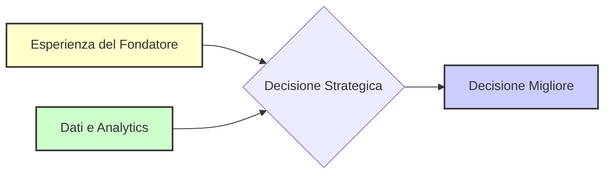

# Data-Driven Business in Italia: Basta Decisioni "a Naso"

In Italia, il 68% delle PMI prende decisioni strategiche basandosi sull'intuito del fondatore o del direttore commerciale. Non è un dato inventato: basta entrare in qualsiasi sala riunioni di una media impresa manifatturiera del Nord-Est per sentire frasi come "io il mercato lo conosco" o "ho 30 anni di esperienza, lo sento".

Il problema? L'intuito funziona — fino a quando il mercato cambia. E il mercato, oggi, cambia ogni sei mesi.

## Il Gap Italiano: Dati vs Istinto

L'Italia ha un tessuto imprenditoriale unico in Europa: PMI familiari, forte legame con il territorio, competenza artigianale di altissimo livello. Ma proprio questa forza è diventata un freno all'adozione dei dati.

| Caratteristica | Forza Tradizionale | Limite Data-Driven |
|---|---|---|
| Esperienza del fondatore | Conoscenza profonda del prodotto | Resistenza ai numeri che contraddicono l'intuito |
| Relazioni personali con i clienti | Fedeltà e fiducia | Mancanza di CRM e dati strutturati |
| Agilità decisionale | Velocità di esecuzione | Decisioni non documentate, non replicabili |
| Cultura orale | Flessibilità | Nessuno storico su cui costruire analisi |

### Il Paradosso della Competenza

Più un imprenditore ha esperienza, più è convinto di non aver bisogno dei dati. Ma il mondo che ha conosciuto nei primi 20 anni di carriera non esiste più. I clienti comprano online, i competitor sono globali, i margini si comprimono. L'esperienza resta preziosa, ma deve essere **integrata** dai dati, non sostituita.

## I 5 Segnali Che la Tua Azienda Decide "a Naso"

1.  **Le riunioni strategiche durano ore** senza che nessuno abbia aperto un foglio Excel, un report o una dashboard.
2.  **Le stesse discussioni si ripetono ogni trimestre** perché non c'è uno storico delle decisioni e dei risultati.
3.  **Il budget marketing viene deciso "a sentimento"**: "Quest'anno investiamo di più su Instagram perché mio figlio dice che funziona."
4.  **Non esiste un CRM** (o c'è ma nessuno lo compila) — i contatti dei clienti sono nella testa del commerciale.
5.  **I prezzi vengono fissati con il "ricarico"** senza analisi della willingness-to-pay o dei competitor.

## Come Iniziare: Il Framework "Dati Minimi Vitali"

Non devi diventare Google domani. Devi iniziare con i **Dati Minimi Vitali (DMV)**: le 5-10 metriche che, se monitorate ogni settimana, cambiano la qualità delle tue decisioni.

### Step 1: Identifica le Decisioni Ricorrenti

Quali decisioni prendi ogni mese? Scrivi le prime 5:

*   Su quali prodotti investire?
*   Quale canale marketing funziona meglio?
*   Quali clienti meritano più attenzione?
*   Come fissare i prezzi per il prossimo listino?
*   Dove tagliare i costi senza perdere qualità?

### Step 2: Collega Ogni Decisione a Una Metrica

| Decisione | Metrica | Fonte Dati |
|---|---|---|
| Su quali prodotti investire? | Margine di contribuzione per SKU | ERP / Gestionale |
| Quale canale marketing funziona? | CAC e ROAS per canale | Google Analytics + CRM |
| Quali clienti meritano attenzione? | LTV e frequenza d'acquisto | CRM / e-commerce |
| Come fissare i prezzi? | Elasticità della domanda | Storico vendite + A/B test |
| Dove tagliare i costi? | Costo per unità prodotta | ERP |

### Step 3: Costruisci una Dashboard Settimanale

Non serve Tableau. Bastano Google Sheets e Looker Studio (gratuito). L'importante è che **ogni lunedì** il team si riunisca davanti ai numeri, non alle opinioni.

## La Resistenza Culturale: Come Gestirla

Il problema più grande non è tecnico — è umano. Il fondatore che ha costruito l'azienda da zero percepisce i dati come una minaccia alla sua autorità.

### Strategia: "I Dati Come Copilota, Non Come Pilota"

Il messaggio chiave deve essere: i dati non sostituiscono l'esperienza. La potenziano. È come guidare di notte: puoi farlo a occhio, ma con i fari accesi è meglio.

### 3 Tattiche per Vincere la Resistenza

1.  **Parti da un problema concreto.** Non dire "dobbiamo diventare data-driven". Di' "voglio capire perché abbiamo perso 3 clienti chiave il mese scorso". Quando i dati risolvono un problema reale, la fiducia cresce.
2.  **Mostra i money.** Niente convince un imprenditore come dimostrare che i dati hanno fatto risparmiare (o guadagnare) soldi concreti. Un singolo test sui prezzi che genera +8% di margine vale più di 100 slide sulla "digital transformation".
3.  **Trovati un alleato interno.** Il direttore commerciale giovane, il responsabile e-commerce, il controller. Qualcuno che creda nei dati e possa diventare il "champion" interno del progetto.

## Caso Pratico: L'Azienda Alimentare del Veneto

Un'azienda alimentare con 15M€ di fatturato decideva i listini "a ricarico fisso" (+35% sul costo di produzione) da 20 anni. Dopo un'analisi della willingness-to-pay su 3 categorie merceologiche, hanno scoperto che:

*   **Categoria A** (biologico premium): potevano aumentare i prezzi del 12% senza perdere volumi.
*   **Categoria B** (convenzionale): dovevano abbassare i prezzi del 5% per non perdere quote di mercato.
*   **Categoria C** (private label): il margine era già al minimo, meglio abbandonare.

Risultato: **+420.000€ di margine annuo**, solo ottimizzando i prezzi con i dati.

## Conclusione

Decidere "a naso" non è stupido — è umano. Ma nel 2026, con mercati globalizzati e margini compressi, l'intuito da solo non basta più. I dati non sono la risposta a tutto, ma sono la domanda giusta. E le domande giuste portano a decisioni migliori.

Inizia piccolo. Una metrica. Una dashboard. Una decisione alla settimana basata sui fatti. Tra sei mesi, non vorrai più tornare indietro.
