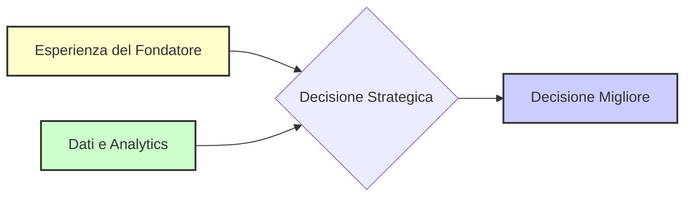

# Data-Driven Business in Italia: Basta Decisioni "a Naso"

Nel 2012, JCPenney assunse Ron Johnson — l'uomo che aveva costruito i negozi Apple Store — come CEO. Johnson era brillante. Aveva intuito, visione, 30 anni di esperienza nel retail. E decise di eliminare le promozioni: niente coupon, niente saldi, solo prezzi "equi" ogni giorno. La sua esperienza gli diceva che i clienti odiavano il gioco dei prezzi gonfiati e poi scontati.

Il problema? Non testò l'ipotesi. Non guardò i dati. In 16 mesi, JCPenney perse 985 milioni di dollari, il fatturato calò del 25% e Johnson fu licenziato. I clienti americani di fascia media, si scoprì poi, non odiavano i coupon — li adoravano. Senza la soddisfazione psicologica dello "sconto", non compravano.

In Italia, questa storia si ripete ogni giorno, su scala minore, in migliaia di PMI. L'imprenditore che conosce "il suo mercato" da 30 anni prende decisioni miliardarie basate su un'intuizione che il mercato ha già superato.

## Il Gap Italiano: Dati vs Istinto

L'Italia ha un tessuto imprenditoriale straordinario: PMI familiari che hanno costruito eccellenze mondiali nel manifatturiero, nel food, nella moda. Ma quella stessa forza — la profondità di esperienza del fondatore — è diventata il freno principale all'adozione di una cultura data-driven.

Il problema non e' ideologico. E' strutturale. Secondo l'Istat, il 95% delle imprese italiane ha meno di 10 dipendenti. In queste aziende, il fondatore e' spesso simultaneamente CEO, direttore commerciale, responsabile produzione e unico keeper della conoscenza aziendale. Non esiste un CRM perche' i rapporti con i clienti sono nella testa di una persona. Non esiste uno storico delle decisioni perche' le decisioni si prendono "a voce" in corridoio.

| Caratteristica | Forza Tradizionale | Limite Data-Driven |
|---|---|---|
| Esperienza del fondatore | Conoscenza profonda del prodotto | Resistenza ai numeri che contraddicono l'intuito |
| Relazioni personali con i clienti | Fedeltà e fiducia | Mancanza di CRM e dati strutturati |
| Agilità decisionale | Velocità di esecuzione | Decisioni non documentate, non replicabili |
| Cultura orale | Flessibilità | Nessuno storico su cui costruire analisi |

### Il Paradosso della Competenza

Daniel Kahneman, premio Nobel per l'economia nel 2002, ha dimostrato qualcosa di scomodo nel suo libro "Thinking, Fast and Slow": l'esperienza produce fiducia molto più rapidamente di quanto produca competenza. Un imprenditore con 20 anni di esperienza in un settore stabile ha costruito intuizioni accurate. Ma quando il contesto cambia — e il contesto digitale cambia ogni 18 mesi — quelle intuizioni diventano rumore.

Il CEO di Amazon Jeff Bezos lo sapeva. Ha costruito Amazon su un principio esplicito: "Non sei la tua opinione. Sei i dati." Ogni nuova feature di Amazon.com viene testata in A/B test prima di essere rilasciata. Ogni decisione di pricing ha un modello quantitativo. Non perche' Bezos non si fidasse dell'intuito, ma perche' capiva che l'intuito scala male quando gestisci 300 milioni di clienti.

## I 5 Segnali Che la Tua Azienda Decide "a Naso"

1. **Le riunioni strategiche durano ore** senza che nessuno abbia aperto un foglio Excel, un report o una dashboard. Si discute, si "sente", si vota. Ma nessuno porta i numeri perche' i numeri non esistono o non sono accessibili.

2. **Le stesse discussioni si ripetono ogni trimestre** perche' non c'e' uno storico delle decisioni e dei risultati. "Avevamo gia' discusso di questo l'anno scorso" — ma nessuno ricorda il perche' della scelta finale.

3. **Il budget marketing viene deciso "a sentimento"**: "Quest'anno investiamo di piu' su Instagram perche' mio figlio dice che funziona." Nessun dato su CAC per canale, nessun A/B test, nessuna analisi del ROAS storico.

4. **Non esiste un CRM** (o c'e' ma nessuno lo compila) — i contatti dei clienti sono nella testa del commerciale. Quando il commerciale se ne va, l'azienda perde anni di relazioni.

5. **I prezzi vengono fissati con il "ricarico"** senza analisi della willingness-to-pay o dei competitor. +35% sul costo di produzione da 20 anni, indipendentemente da cosa e' successo nel mercato.

## Come Iniziare: Il Framework "Dati Minimi Vitali"

Netflix non e' diventata Netflix in un giorno. Reed Hastings ha iniziato con una metrica: il tasso di restituzione dei DVD. Quando quella cifra era bassa, il business andava bene. Quando saliva, c'era un problema. Una metrica, monitorata ossessivamente, ha cambiato un'azienda.

Non devi diventare Google domani. Devi iniziare con i **Dati Minimi Vitali (DMV)**: le 5-10 metriche che, se monitorate ogni settimana, cambiano la qualita' delle tue decisioni.

### Step 1: Identifica le Decisioni Ricorrenti

Quali decisioni prendi ogni mese? Scrivi le prime 5:

- Su quali prodotti investire nella prossima stagione?
- Quale canale marketing porta clienti profittevoli?
- Quali clienti meritano piu' attenzione (e quali meno)?
- Come fissare i prezzi per il prossimo listino?
- Dove tagliare i costi senza perdere qualita'?

Queste sono le decisioni che valgono soldi. Ognuna merita una metrica.

### Step 2: Collega Ogni Decisione a Una Metrica

| Decisione | Metrica | Fonte Dati |
|---|---|---|
| Su quali prodotti investire? | Margine di contribuzione per SKU | ERP / Gestionale |
| Quale canale marketing funziona? | CAC e ROAS per canale | Google Analytics + CRM |
| Quali clienti meritano attenzione? | LTV e frequenza d'acquisto | CRM / e-commerce |
| Come fissare i prezzi? | Elasticita' della domanda | Storico vendite + A/B test |
| Dove tagliare i costi? | Costo per unita' prodotta | ERP |

### Step 3: Costruisci una Dashboard Settimanale

Non serve Tableau da 70.000 euro l'anno. Bastano Google Sheets e Looker Studio (gratuito). L'importante e' che **ogni lunedi'** il team si riunisca davanti ai numeri, non alle opinioni.

La riunione deve seguire un format preciso: 30 minuti, nessuna slide, solo dashboard. Per ogni metrica fuori range: qual e' la causa probabile? Qual e' l'azione? Chi e' responsabile? Entro quando?

Walmart ha fatto questo per decenni prima che esistesse il "data-driven" come termine di moda. Sam Walton aveva un sistema di reportistica settimanale su ogni negozio — vendite per metro quadro, rotazione dello stock, margine per categoria — quando i suoi competitor prendevano ancora decisioni "a naso". Nel 1987, Walmart era il retailer piu' profittevole d'America.

## La Resistenza Culturale: Come Gestirla

Il problema piu' grande non e' tecnico — e' umano. Il fondatore che ha costruito l'azienda da zero percepisce i dati come una minaccia alla sua autorita'. Se i dati dicono che il prodotto di punta vende poco, e' come dire che 20 anni di lavoro erano sbagliati.

Philip Tetlock, professore a Berkeley, ha studiato per 20 anni le previsioni di 284 esperti politici ed economici. Risultato pubblicato nel 2005 nel libro "Expert Political Judgment": gli esperti con piu' esperienza erano leggermente meno accurati degli esperti meno esperti nelle previsioni a lungo termine. Il motivo? I piu' esperti erano piu' sicuri di se', meno inclini a aggiornare le proprie view con nuovi dati.

### Strategia: "I Dati Come Copilota, Non Come Pilota"

Il messaggio chiave da usare con il fondatore resistente e': i dati non sostituiscono l'esperienza. La potenziano. E' come guidare di notte: puoi farlo a occhio, ma con i fari accesi e' meglio. L'esperienza ti dice dove vuoi andare. I dati ti mostrano la strada.

### 3 Tattiche per Vincere la Resistenza

**1. Parti da un problema concreto, non da una visione astratta.**

Non dire "dobbiamo diventare data-driven". Nessuno sa cosa significa. Di' invece: "Abbiamo perso 3 clienti chiave il trimestre scorso e non sappiamo perche'. Possiamo guardare i dati per capirlo?" Quando i dati risolvono un problema che il fondatore sente come suo, la fiducia cresce organicamente.

**2. Mostra i soldi — subito.**

Niente convince un imprenditore come dimostrare che i dati hanno fatto risparmiare (o guadagnare) soldi concreti in un caso specifico. Un singolo A/B test sul prezzo che genera +8% di margine vale piu' di 100 slide sulla "digital transformation". Inizia con un quick win misurabile in euro, non in "engagement" o "brand awareness".

**3. Trovati un alleato interno.**

Il direttore commerciale giovane, il responsabile e-commerce, il controller finanziario. Qualcuno che gia' lavori con i numeri e possa diventare il "champion" interno del progetto. Le rivoluzioni culturali nelle aziende non partono dall'alto — partono dai middle manager che vedono l'opportunita'.

## Caso Pratico: L'Azienda Alimentare del Veneto

Un'azienda alimentare con 15 milioni di euro di fatturato, zona Treviso, decideva i listini con un "ricarico fisso" del 35% sul costo di produzione da 20 anni. Il fondatore era convinto di conoscere il mercato. Il suo commerciale storico garantiva che i clienti erano "soddisfatti dei prezzi".

In realta', nessuno aveva mai misurato la willingness-to-pay per categoria merceologica. Nessuno aveva fatto un'analisi dell'elasticita' della domanda. Si usava il ricarico fisso perche' era sempre stato cosi'.

Dopo un'analisi della willingness-to-pay su 3 categorie — condotta con 180 interviste a buyer della GDO e un'analisi del paniere scanner su 6 mesi — hanno scoperto tre cose:

- **Categoria A** (biologico premium, DOP certificato): i buyer accettavano aumenti di prezzo fino al 12% senza ridurre gli ordini. Il mercato stava pagando un premium per la certificazione che l'azienda stava lasciando sul tavolo.
- **Categoria B** (convenzionale standard): i competitor avevano abbassato i prezzi negli ultimi 18 mesi mentre l'azienda manteneva il listino. Erano gia' fuori mercato del 5% senza saperlo.
- **Categoria C** (private label per GDO): il margine di contribuzione era 2,1%, sotto il break-even operativo. Ogni ordine generava una perdita operativa mascherata dai volumi.

Risultato: **+420.000 euro di margine annuo**, solo ottimizzando i prezzi con i dati. Senza nuovi prodotti, senza nuovi mercati, senza investimenti. Solo la differenza tra decidere "a naso" e decidere con i numeri.

## Il Mito della "Complessita' dei Dati"

Una delle obiezioni piu' comuni e': "I nostri dati sono un disastro. Prima dobbiamo sistemare i dati, poi possiamo analizzarli." Questo e' il modo piu' efficace per non fare mai nulla.

Jeff Immelt, ex CEO di GE, ha detto qualcosa di fondamentale nel 2015 quando GE stava costruendo la sua piattaforma Predix: "Perfect data is the enemy of good data." I dati perfetti non esistono. Esistono i dati che hai, e le decisioni che puoi migliorare con quelli.

La startup che aspetta di avere un data warehouse pulito prima di analizzare il churn e' come il ristorante che aspetta di avere la cucina perfetta prima di aprire. Inizia con i dati che hai — anche imperfetti, anche incompleti — e migliorali strada facendo.

## Quanto Vale Decidere Meglio?

McKinsey ha analizzato 1.048 decisioni strategiche in 78 aziende tra il 2010 e il 2018. Le aziende che usavano processi decisionali data-driven producevano il 5-6% di rendimento aggiuntivo rispetto ai competitor. Non per ogni decisione, ma in aggregato, nel lungo periodo.

Su un'azienda da 15 milioni di fatturato, il 5% e' 750.000 euro l'anno. Non di profitto aggiuntivo garantito — ma di migliore allocazione delle risorse, meno errori costosi, decisioni piu' veloci su basi piu' solide.

## Conclusione

Decidere "a naso" non e' stupido — e' umano. Kahneman direbbe che e' il System 1 al lavoro: veloce, automatico, efficiente per i problemi abituali. Il problema e' quando il System 1 viene usato per decisioni che richiedono il System 2 — lento, analitico, data-driven.

Nel 2026, con mercati globalizzati, competitor cinesi che entrano in ogni settore e margini compressi, l'intuito da solo non basta piu'. I dati non sono la risposta a tutto. Sono la domanda giusta. E le domande giuste portano a decisioni migliori.

Inizia piccolo. Una metrica. Una dashboard. Una decisione alla settimana basata sui fatti. JCPenney ha perso quasi un miliardo di dollari fidandosi dell'intuito di un esperto senza testare l'ipotesi. Quella storia non deve ripetersi nella tua azienda — e non serve un Nobel per evitarla. Serve un foglio Excel e la volonta' di guardarlo ogni lunedi'.
