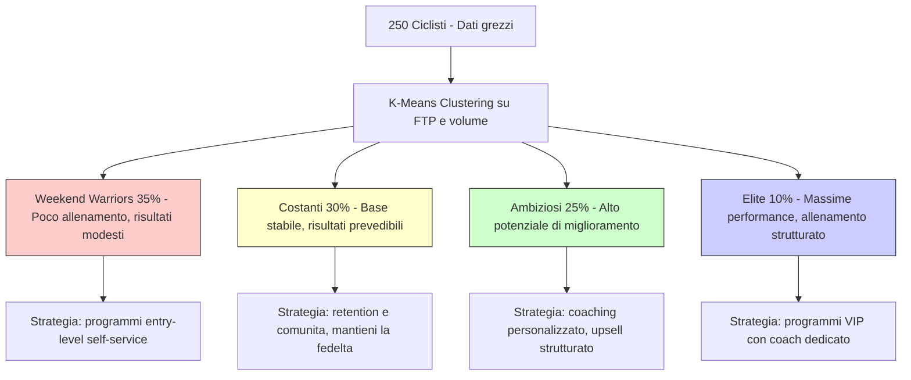
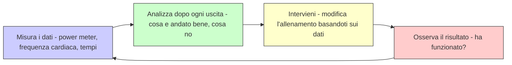

# Analisi Dati nello Sport: Le Lezioni dei 250 Ciclisti

Nel 2002 Billy Beane, general manager degli Oakland Athletics di baseball, aveva un problema brutale: un budget di 40 milioni di dollari per costruire una squadra competitiva, contro i 120 milioni degli Yankees di New York. Con quei soldi, non poteva comprare i giocatori che tutti volevano. Doveva trovare un modo diverso.

La soluzione di Beane, sviluppata con il giovane analista Paul DePodesta laureato ad Harvard, fu semplice nel principio e rivoluzionaria nella pratica: invece di valutare i giocatori con le metriche tradizionali (media battuta, abilita difensiva, aspetto atletico), usare i dati per trovare le metriche che correlano davvero con la vittoria delle partite — e acquistare giocatori che quelle metriche sottovalutavano ma il mercato non capiva.

L'Oakland Athletics del 2002 vince 103 partite su 162 — un record della franchigia. Con 40 milioni di dollari.

Michael Lewis raccontera questa storia nel libro "Moneyball". Ma quello che la storia di Beane illustra non e solo un'applicazione brillante dei dati nel baseball: e un modello di pensiero applicabile a qualsiasi dominio dove le performance sono misurabili e le risorse sono limitate. Incluso il business.

Lo sport e il laboratorio perfetto per l'analisi dati. Regole chiare, metriche oggettive, feedback immediato e inequivocabile. Quello che le squadre sportive piu avanzate fanno con i dati oggi precede spesso di cinque-dieci anni quello che le aziende faranno. Il ciclismo, in particolare, e diventato negli ultimi vent'anni uno degli sport piu quantitativi al mondo — i power meter hanno reso ogni watt misurabile, e i coach dei team professionistici come Sky/INEOS lavorano con dataset che molte aziende tech potrebbero invidiare.

Questo articolo usa un dataset simulato ma realistico di 250 ciclisti amatoriali per mostrare tecniche di analisi che hanno applicazioni dirette nel business analytics.

## Il Dataset: 250 Ciclisti, 15 Metriche

I partecipanti a una granfondo di 160km producono naturalmente un dataset ricco: ogni atleta arriva con le proprie caratteristiche fisiche, il proprio volume di allenamento, le proprie metriche di performance.

| Metrica ciclistica | Tipo | Equivalente nel business |
|---|---|---|
| FTP (Functional Threshold Power, watt) | Performance assoluta | Revenue o produttivita assoluta |
| Potenza/Peso (W/kg) | Efficienza | Margine o ROI |
| Km settimanali | Volume di input | Budget investito |
| Ore di allenamento settimanali | Risorse impegnate | Costo operativo |
| VO2max | Capacita massima | Potenziale di crescita |
| Tempo finale in gara | Output misurato | Risultato di business |
| Eta | Variabile contestuale | Segmento cliente |
| Peso corporeo | Fattore strutturale | Costo base |

La parallelismo non e solo estetico. Le stesse logiche analitiche — distribuzione, correlazione, segmentazione, outlier detection, legge dei rendimenti decrescenti — si applicano identicamente ai dati dei ciclisti e ai dati di business. Imparare a vederle nel contesto sportivo, dove l'interpretazione e piu intuitiva, aiuta a trasferire i concetti nel contesto aziendale.

## Lezione 1: La Distribuzione Conta Piu della Media

Il tempo medio in gara e 4 ore e 12 minuti. Questo numero, da solo, e quasi inutile per capire il gruppo.

```python
import numpy as np
import matplotlib.pyplot as plt

# I 250 ciclisti non sono un gruppo omogeneo:
# - 180 appartengono al "gruppo principale": amatori allenati, 3h40-4h40
# - 50 sono ciclisti piu lenti: poca forma, prima granfondo, sovrapeso
# - 20 sono ciclisti elite: allenamento strutturato, performance da semi-pro

np.random.seed(42)
tempi = np.concatenate([
    np.random.normal(240, 20, 180),   # Gruppo principale: media 4h, SD 20 min
    np.random.normal(300, 15, 50),    # Ciclisti lenti: media 5h
    np.random.normal(180, 10, 20),    # Elite: media 3h
])

print(f"Media: {np.mean(tempi):.0f} minuti ({np.mean(tempi)/60:.1f} ore)")
print(f"Mediana: {np.median(tempi):.0f} minuti ({np.median(tempi)/60:.1f} ore)")
print(f"Deviazione standard: {np.std(tempi):.0f} minuti")
print(f"Minimo: {np.min(tempi):.0f} min, Massimo: {np.max(tempi):.0f} min")

# Questo rivela una distribuzione trimodale — tre popolazioni distinte
# che la media comprime in un singolo numero senza senso
```

La media di 252 minuti non rappresenta bene nessuno dei tre gruppi. I ciclisti elite completano in 180 minuti, il gruppo principale in 240, i lenti in 300. Una strategia di allenamento "ottimizzata per il partecipante medio" sarebbe sbagliata per quasi tutti.

**Applicazione diretta:** Il revenue medio per cliente subisce esattamente lo stesso problema. Se hai il 60% di clienti free, il 30% da 50€/mese e il 10% da 500€/mese, la media potrebbe essere 70€ — un numero che non rappresenta nessun segmento reale. Le decisioni di pricing, marketing e retention prese sulla media saranno sbagliate per tutti e tre i gruppi.

## Lezione 2: Segmentazione Naturale con il Clustering

I 250 ciclisti non sono un gruppo omogeneo. Applicare K-Means clustering su potenza (FTP) e volume di allenamento settimanale rivela quattro segmenti naturali con caratteristiche molto diverse:

| Cluster | Nome del segmento | Caratteristiche principali | Percentuale |
|---|---|---|---|
| 1 | Weekend Warriors | Potenza bassa, meno di 6 ore a settimana, spesso sovrappeso | 35% |
| 2 | Costanti | Potenza media, allenamento regolare 8-12 ore, performance prevedibili | 30% |
| 3 | Ambiziosi | Buona potenza, 12-18 ore a settimana, miglioramento rapido | 25% |
| 4 | Elite | Potenza alta, allenamento strutturato con coach, top 10% | 10% |



La cosa interessante non e la segmentazione in se — e cosa fare con ciascun segmento. I Weekend Warriors non hanno bisogno di un coach esperto che li guidi ogni settimana: hanno bisogno di struttura minima e comunita. Gli Ambiziosi, al contrario, sono quelli con il massimo potenziale di upsell verso programmi piu intensivi — e sono anche quelli che beneficiano maggiormente dall'investimento in coaching personalizzato.

**Applicazione diretta:** I clienti di qualsiasi business si segmentano in modo simile. I clienti occasionali (Weekend Warriors) sono molti in numero ma costosi da servire e difficili da far crescere — una strategia di self-service riduce i costi senza perdere il valore. I clienti ad alto potenziale (Ambiziosi) meritano investimento proattivo — sono quelli che diventeranno i tuoi migliori clienti se ricevono il supporto giusto al momento giusto.

## Lezione 3: L'Input Non Predice l'Output Come Pensi

Uno degli insight piu controintuitivi dei dati sui ciclisti e la relazione — o la mancanza di essa — tra volume di allenamento e performance in gara.

| Variabile | Correlazione con il tempo in gara | Interpretazione |
|---|---|---|
| Potenza/Peso (W/kg) | -0.89 (fortissima, inversa) | Piu efficienza → tempo piu basso |
| FTP in watt assoluti | -0.72 (forte) | Piu potenza → tempo piu basso |
| Km settimanali | -0.45 (moderata) | Piu volume → qualche miglioramento |
| Ore di allenamento | -0.38 (moderata-debole) | Ore e meno predittivo del volume |
| Peso corporeo | +0.52 (moderata, positiva) | Piu peso → tempo piu alto |
| Eta | +0.31 (debole, positiva) | Piu eta → qualche rallentamento |

Il fattore predittivo piu potente non e *quanto* ti alleni, ma *l'efficienza*: i watt prodotti per kg di peso corporeo. Un ciclista di 70kg con 280 watt di FTP (4,0 W/kg) batte quasi sempre un ciclista di 90kg con 320 watt di FTP (3,6 W/kg), anche se quest'ultimo e oggettivamente piu potente in termini assoluti.

Questo perche il ciclismo e uno sport dove devi trasportare il tuo stesso peso. La stessa logica si applica a qualsiasi sistema dove l'efficienza conta piu della potenza bruta.

**Applicazione diretta:**

Piu spendi in marketing non equivale a piu fatturi. Il ROAS per canale (efficienza) e il predittore corretto, non il budget assoluto. Un'agenzia che porta 10.000 euro di fatturato su 2.000 euro di spesa batte strutturalmente un'altra che porta 30.000 euro su 12.000 di spesa — anche se il numero assoluto del secondo sembra piu impressionante.

Piu ore lavora il team non equivale a piu risultati. La produttivita per ora lavorata, per progetto, per decisione presa — e quella la metrica che separa i team eccellenti da quelli che sembrano sempre occupatissimi ma producono poco.

Piu feature ha il prodotto non equivale a piu clienti soddisfatti. Jobs to Be Done di Clayton Christensen lo dimostra empiricamente: i clienti acquistano prodotti per "assumere" come assistenti in compiti specifici. Ogni feature aggiuntiva che non serve al job principale e peso da trasportare, non potenza aggiuntiva.

## Lezione 4: Outlier Detection — I Campioni e i Problemi

Tra i 250 ciclisti, otto hanno valori anomali rispetto alla distribuzione del proprio segmento. Quattro positivi, quattro negativi. Ognuno racconta una storia.

**Outlier positivi — da studiare e replicare:**

Un ciclista di 52 anni ha un FTP di 340 watt — nel 95° percentile assoluto del gruppo, insolito per la sua eta. Intervistato, rivela che si allena con un coach strutturato da sei anni, usa la periodizzazione con blocchi di carico e recupero, e segue una dieta chetogenica ciclica. Nessuno di questi elementi e ovvio guardando solo i dati — ma i dati hanno identificato chi merita di essere intervistato.

Un altro ciclista si allena solo 6 ore a settimana — meno della meta del gruppo principale — ma finisce nel top 20 della classifica. La causa: allena esclusivamente con intervalli ad alta intensita (HIIT), senza ore di "ciclismo zombie" a bassa intensita. Il suo tasso di conversione input/output e radicalmente superiore alla media.

**Outlier negativi — da investigare:**

Un ciclista con 15 ore di allenamento settimanale e performance scadenti: classico caso di overtraining. Piu volume senza recupero adeguato porta al crollo della performance, non al miglioramento. Il suo power meter mostra FTP in calo nei tre mesi precedenti la gara.

Un ciclista con un calo improvviso del 15% nell'FTP nelle ultime sei settimane: potrebbe essere un infortunio non dichiarato, uno stato di burnout, o un cambiamento nella vita personale. I dati non possono dire il perche — ma possono identificare *quando* il problema e iniziato, il che aiuta enormemente nella diagnosi.

**Applicazione diretta:**

Gli outlier positivi nel tuo business sono le best practice che nessuno ha ancora formalizzato. Il venditore con un ROAS tre volte superiore alla media — cosa fa di diverso? Il team che consegna progetti in meta del tempo — quale processo usano? L'anlisi degli outlier positivi e uno dei modi piu efficaci per identificare miglioramenti replicabili.

Gli outlier negativi sono segnali di allarme precoce. Un cliente il cui engagement cala bruscamente nelle ultime quattro settimane — e il precursore del churn, non la conseguenza. Un canale marketing il cui ROAS crolla improvvisamente — c'e qualcosa che e cambiato (algoritmo, competitor, mercato) e che richiede attenzione immediata.

## Lezione 5: Il Feedback Loop — Misura, Analizza, Intervieni, Ripeti

L'analisi dei ciclisti che migliorano piu rapidamente in un anno rivela un pattern quasi universale. Non e il talento, non e il background atletico, non e l'eta. E il feedback loop.



I ciclisti che non migliorano? Si allenano "a sensazione", non misurano sistematicamente, e fanno lo stesso allenamento ogni settimana perche "ha sempre funzionato cosi". Il problema e che senza dati, il feedback e ritardato di mesi (i risultati in gara) e troppo aggregato per identificare le cause specifiche.

Dave Brailsford, il direttore tecnico del Team Sky che ha dominato il Tour de France per quasi un decennio, ha chiamato questo approccio "marginal gains": ogni elemento del sistema — nutrizione, sonno, postura in sella, protocolli di riscaldamento, persino i cuscini usati negli hotel — viene misurato, ottimizzato e monitorato. L'aggregato di miglioramenti dell'1% in decine di variabili produce vantaggi competitivi che nessun singolo intervento avrebbe prodotto.

**Applicazione diretta:** E il ciclo HADI (Hypothesis, Action, Data, Insight) o il Ciclo di Deming (Plan, Do, Check, Act). Le aziende che lo applicano sistematicamente crescono in modo composto. Quelle che non lo fanno prendono decisioni basate su intuizioni non verificate e ripetono gli stessi errori ogni anno.

## Lezione 6: La Legge dei Rendimenti Decrescenti

Uno dei pattern piu chiari nel dataset dei 250 ciclisti e la curva di miglioramento dell'FTP in funzione del volume di allenamento settimanale.

| Volume settimanale | Miglioramento FTP (annuo) | Rischio infortunio | ROI dell'allenamento |
|---|---|---|---|
| 0 ore → 5 ore | +15% | Basso | Altissimo |
| 5 ore → 10 ore | +8% | Basso | Alto |
| 10 ore → 15 ore | +3% | Medio-basso | Medio |
| 15 ore → 20 ore | +1% | Medio-alto | Basso |
| 20 ore+ | +0,5% o negativo | Alto | Negativo |

Il passaggio da zero a cinque ore di allenamento settimanale produce il miglioramento piu grande — perche il punto di partenza e basso e gli adattamenti fisiologici iniziali sono rapidi. Ogni incremento successivo produce rendimenti decrescenti, fino al punto in cui l'organismo non recupera abbastanza e la performance peggiora.

Questa curva e universale in quasi tutti i sistemi complessi. Ed e uno degli insight piu trascurati nel business analytics.

**Applicazione diretta:**

Budget marketing: i primi 10.000 euro su un canale nuovo hanno quasi sempre un ROI eccezionale — stai raccogliendo il frutto a portata di mano. I successivi 50.000 euro rendono progressivamente meno, perche hai gia raggiunto il pubblico piu ricettivo. Il punto di rendimento decrescente e diverso per ogni canale e ogni mercato, e si trova solo con i dati — non con la teoria.

Feature del prodotto: le prime cinque feature di qualsiasi SaaS coprono l'80% dei bisogni degli utenti core. Le successive venti feature coprono il restante 20% — ma con un costo di sviluppo e manutenzione che non scala in modo lineare con il valore aggiunto.

Team e risorse: il primo data analyst che assumi in un'azienda che non ne ha mai avuto uno produce un impatto trasformativo. Il quinto data analyst in un team di sei produce miglioramenti marginali — a meno che l'organizzazione non sia cresciuta proporzionalmente nella sua capacita di consumare insight analitici.

## Il Dataset Completo: Come Costruirlo in Python

```python
import numpy as np
import pandas as pd
from sklearn.cluster import KMeans
from sklearn.preprocessing import StandardScaler
from scipy.stats import pearsonr

np.random.seed(42)
n = 250

# Generazione dataset realistico con correlazioni tra variabili
# (un ciclista pesante tende ad avere un FTP assoluto piu alto
# ma un rapporto potenza/peso peggiore)

eta = np.random.normal(42, 10, n).clip(20, 65)
peso = np.random.normal(78, 12, n).clip(55, 115)
ore_settimana = np.random.exponential(10, n).clip(3, 25)

# FTP correlato positivamente con le ore e negativamente con il peso
ftp_base = 150 + ore_settimana * 8 - peso * 0.5 + np.random.normal(0, 30, n)
ftp = ftp_base.clip(100, 400)

# Rapporto potenza/peso: la metrica che predice meglio la performance
wkg = ftp / peso

# Tempo in gara: fortemente correlato con W/kg, meno con FTP assoluto
tempo_gara = 380 - wkg * 35 + np.random.normal(0, 15, n)
tempo_gara = tempo_gara.clip(150, 380)

df = pd.DataFrame({
    'eta': eta.round(0),
    'peso': peso.round(1),
    'ftp': ftp.round(0),
    'wkg': wkg.round(2),
    'ore_settimana': ore_settimana.round(1),
    'tempo_gara': tempo_gara.round(0)
})

# Correlazioni con il tempo in gara
print("Correlazioni con il tempo in gara:")
for col in ['wkg', 'ftp', 'ore_settimana', 'peso', 'eta']:
    corr, pval = pearsonr(df[col], df['tempo_gara'])
    print(f"  {col}: r={corr:.3f}, p={pval:.4f}")

# K-Means clustering su FTP e volume
scaler = StandardScaler()
X_cluster = scaler.fit_transform(df[['ftp', 'ore_settimana']])
kmeans = KMeans(n_clusters=4, random_state=42, n_init=10)
df['cluster'] = kmeans.fit_predict(X_cluster)

# Profilo di ciascun cluster
print("\nProfilo dei cluster:")
print(df.groupby('cluster')[['ftp', 'wkg', 'ore_settimana', 'tempo_gara']].mean().round(1))
```

## Conclusione

La storia di Billy Beane e degli Oakland Athletics non e solo una storia di baseball. E la dimostrazione che i dati, usati con intelligenza, permettono di competere con avversari che hanno risorse molto superiori — perche i dati aiutano a allocare le risorse disponibili nel modo piu efficiente possibile.

Lo sport ci insegna questo con chiarezza perche il feedback e immediato e oggettivo: la classifica non mente. Ma la stessa logica vale per qualsiasi sistema misurabile. I dati non sostituiscono il talento, l'esperienza o la motivazione — li amplificano. Un manager mediocre con dati buoni e un sistema di feedback loop diventa un manager buono. Un manager eccellente senza dati spreca potenziale che non vedra mai.

Inizia a misurare. Identifica le metriche di efficienza, non solo di volume. Studia i tuoi outlier positivi come best practice e i negativi come segnali di allarme. E costruisci il feedback loop — misura, analizza, intervieni, ripeti — come processo sistematico, non come attivita occasionale. Il resto viene da se.
