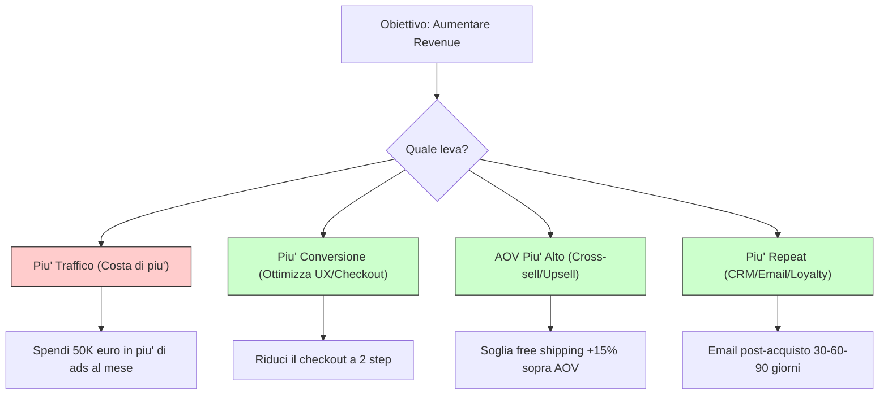

# E-commerce Analytics: Le Metriche Che Separano Chi Cresce da Chi Brucia Budget

Nel 2011, Zappos aveva un tasso di reso del 35%. Per qualsiasi retailer tradizionale sarebbe stato un disastro. Il fondatore Tony Hsieh, invece, era felice: sapeva dai dati che i clienti con il tasso di reso piu' alto erano anche quelli con il LTV piu' alto. Compravano di piu', ordinavano piu' frequentemente, erano meno sensibili al prezzo. Il reso non era un costo — era il segnale di un cliente di qualita' superiore.

Zappos fu venduta ad Amazon per 1,2 miliardi di dollari.

Questa storia illustra il problema fondamentale di chi gestisce un e-commerce: non e' che mancano le metriche, e' che si guardano le metriche sbagliate, o si interpretano nel modo sbagliato. Il return rate di Zappos sembrava un problema. Era un vantaggio competitivo.

## La Piramide delle Metriche E-commerce: Priorita' e Gerarchia

Non tutte le metriche sono uguali. Il tuo tempo e' limitato, e ottimizzare una metrica sbagliata puo' danneggiare le metriche giuste. Organizzale in una piramide di priorita':

```
           +-------------------+
           |  REVENUE & PROFIT |   <- Il CEO guarda qui
           +-------------------+
         +---------------------+
         |  CONVERSION & AOV   |   <- Il CMO guarda qui
         +---------------------+
       +-------------------------+
       |  TRAFFIC & ENGAGEMENT   |   <- L'analista guarda qui
       +-------------------------+
     +-----------------------------+
     |  CANALE & CAMPAGNA          |   <- Il media buyer guarda qui
     +-----------------------------+
```

La regola aurea: ottimizza dal basso solo quando le metriche in alto sono sane. Se il tuo Contribution Margin per ordine e' negativo, aumentare il traffico significa perdere soldi piu' velocemente.

## Le 10 Metriche Fondamentali: il Framework Acquisition → Conversion → Retention → Revenue

### 1. Conversion Rate (CR): la Lente d'Ingrandimento del Tuo Sito

```
CR = (Numero Ordini / Sessioni) x 100
```

La media globale dell'e-commerce e' intorno al 2-3%, ma il numero aggregato e' quasi inutile. Booking.com, che fa girare oltre 1.000 A/B test simultaneamente sul proprio sito, sa che il CR varia del 40-50% tra segmenti diversi — e che ottimizzare il CR "medio" senza segmentare significa ottimizzare il rumore.

| Settore | CR Medio Italia (2025) | Buono | Eccellente |
|---|---|---|---|
| Fashion | 1.5-2.5% | > 3% | > 5% |
| Electronics | 1.0-2.0% | > 2.5% | > 4% |
| Food & Grocery | 3.0-5.0% | > 5% | > 8% |
| Beauty | 2.0-3.5% | > 4% | > 6% |
| B2B / Industrial | 0.5-1.5% | > 2% | > 3% |

**La segmentazione obbligatoria.** Non confrontare mai il CR "overall". Segmenta sempre per:
- **Dispositivo**: il CR mobile e' tipicamente il 50% del desktop, ma il mobile genera il 60% del traffico. Se ottimizzi solo il desktop, lasci sul tavolo la maggioranza dei tuoi utenti.
- **Canale**: il CR organico e' spesso il doppio del paid perche' l'intento di acquisto e' piu' alto. Confrontare i due canali sullo stesso CR e' come confrontare mele e arance.
- **Nuovo vs ritorno**: un utente di ritorno converte 3-5 volte di piu'. Se il tuo CR "migliora" perche' stai acquisendo meno nuovi utenti e il mix si sposta sui ritorni, non stai migliorando — stai invecchiando.

### 2. Average Order Value (AOV): Fatturare di Piu' da Ogni Transazione

```
AOV = Revenue Totale / Numero Ordini
```

L'AOV e' spesso piu' facile da migliorare del CR, e ogni euro di AOV aggiuntivo ha un costo marginale quasi zero. Amazon ha capito questo nel 1999 con "Customers who bought this also bought" — un algoritmo di collaborative filtering che oggi genera, secondo alcune stime interne, il 35% del fatturato Amazon.

Strategie con dati reali:
- **Soglia di spedizione gratuita:** se il tuo AOV e' 42 euro, metti la soglia a 59 euro. Zalando ha misurato che ogni aumento della soglia di 10 euro genera un incremento dell'AOV di 4-6 euro nel segmento in prossimita' della soglia.
- **Bundle e cross-sell in PDP:** "Completa il look" nel fashion. ASOS stima che il suo sistema di outfit recommendation aumenti l'AOV del 15% sugli ordini che ci interagiscono.
- **Upsell in checkout:** "Aggiungi la garanzia estesa per 9,90 euro". Apple lo fa sistematicamente con AppleCare — il momento del checkout e' quando il cliente ha gia' preso la decisione d'acquisto e la resistenza psicologica e' minima.

### 3. Revenue Per Session (RPS): la Metrica Primaria per gli A/B Test

```
RPS = Revenue Totale / Sessioni Totali
```

L'RPS combina CR e AOV in un'unica metrica. E' la **metrica primaria** da usare negli A/B test perche' cattura sia la conversione che il valore dell'ordine. Se testi due varianti di una pagina prodotto, la variante B potrebbe aumentare il CR del 10% ma abbassare l'AOV del 15% (perche' porta utenti meno qualificati). Il CR "vince" ma il RPS "perde". Senza l'RPS, ottimizzeresti nella direzione sbagliata.

### 4. Cart Abandonment Rate (CAR): il Tasso di Resi Impliciti

```
CAR = (1 - Ordini Completati / Carrelli Creati) x 100
```

La media globale si aggira intorno al **70%**. Se il tuo CAR supera l'80%, hai un problema serio nel checkout. Ma attenzione alla trappola: un CAR del 90% non e' necessariamente peggiore di un CAR del 60% se il valore medio del carrello e' 10 volte piu' alto.

Nel 2023, il Baymard Institute ha analizzato 4.500 siti e-commerce e identificato le cause piu' comuni di abbandono:

1. Costi di spedizione rivelati troppo tardi nel processo (48% dei casi).
2. Obbligo di creare un account prima di completare l'ordine (24%).
3. Processo di checkout troppo lungo o complicato (22%).
4. Mancanza di metodi di pagamento preferiti (12%). In Italia, questo include spesso Satispay e pagamento in contrassegno per certi segmenti demografici.

La soluzione piu' impattante, documentata da Baymard, e' il checkout come guest. Un singolo campo "Continua come ospite" ha aumentato il CR del checkout del 45% su un sito da 300 milioni di fatturato nel loro studio di caso piu' citato.

### 5. Customer Acquisition Cost (CAC): Quanto Costa Acquisire un Cliente

```
CAC = Spesa Marketing Totale / Nuovi Clienti Acquisiti
```

Dollar Shave Club aveva un CAC di circa 8 dollari quando Gillette spendeva oltre 32 dollari per acquisire un nuovo cliente. Come era possibile? Il video virale del 2012 ("Our blades are f***ing great") costo' 4.500 dollari di produzione e genero' 12.000 iscrizioni nel primo giorno. Ma era un caso unico — il vero vantaggio strutturale di DSC era il modello ad abbonamento che rendeva ogni cliente acquisito molto piu' profittevole nel lungo periodo.

**Dividi sempre tra Blended e Paid CAC.** Il Blended include tutto (anche organico, referral, diretto). Il Paid e' solo la spesa advertising. Se il Blended e' 15 euro ma il Paid e' 80 euro, hai un problema di scalabilita': puoi crescere con il paid, ma a un costo che non regge.

### 6. Customer Lifetime Value (LTV): il Valore Totale di un Cliente

```
LTV = AOV x Frequenza Acquisto Annuale x Vita Media Cliente (anni)
```

L'LTV a 12 mesi e' la metrica piu' utile per il planning operativo perche' e' misurabile con dati reali, non proiezioni. L'LTV a 5 anni e' spesso una fantasia — i mercati cambiano, i comportamenti cambiano, l'azienda cambia.

Stitch Fix, il retailer americano di abbigliamento con stylist umani + algoritmo, aveva nel 2018 un LTV medio di 620 dollari su un CAC di 83 dollari. Ma quei numeri medi nascondevano una dispersione enorme: il 20% dei clienti piu' fedeli aveva un LTV superiore a 2.000 dollari. Identificare quei clienti prima che diventassero fedeli — e trattarli diversamente fin dall'inizio — era il vero vantaggio competitivo.

### 7. LTV:CAC Ratio: La Metrica di Sostenibilita'

La "regola d'oro" e' 3:1. Ma attenzione al **Payback Period**: se il tuo LTV e' 300 euro e il CAC e' 100 euro, il ratio e' perfetto. Ma se servono 24 mesi per recuperare il CAC, potresti avere problemi seri di cash flow durante la crescita. Un'azienda con LTV/CAC di 5:1 e payback di 36 mesi puo' fallire per mancanza di liquidita' prima di vedere i benefici.

La regola empirica per un e-commerce sano: **payback period inferiore a 12 mesi, LTV/CAC superiore a 3**.

### 8. Return Rate: Il Costo Nascosto dei Resi

```
Return Rate = (Ordini Resi / Ordini Totali) x 100
```

Nel fashion italiano, il return rate si aggira tra il 25% e il 40%. Ogni reso non e' solo un mancato ricavo — e' un **costo operativo** composto: logistica inversa (3-7 euro), ricondizionamento (1-5 euro), deprezzamento del prodotto se non puo' essere rivenduto come nuovo, costo del servizio clienti associato.

Su un e-commerce fashion da 5 milioni di fatturato con return rate al 35% e costo medio reso di 12 euro, il costo nascosto dei resi e' di 210.000 euro l'anno — spesso invisibile nel P&L perche' distribuito tra logistica, magazzino e customer care.

**La leva piu' impattante:** la descrizione del prodotto. Zalando ha dimostrato internamente che le schede prodotto con video del prodotto indossato riducono il return rate del 12-18% rispetto alle schede con solo foto statiche. Il cliente che sa esattamente cosa compra torna meno spesso il prodotto.

### 9. Repeat Purchase Rate: La Metrica della Fedeltà

```
Repeat Rate = (Clienti con 2+ ordini / Clienti Totali) x 100
```

| Settore | Repeat Rate Tipico | Target |
|---|---|---|
| Fashion | 25-35% | > 40% |
| Food / Consumabili | 40-60% | > 60% |
| Electronics | 10-20% | > 25% |
| Beauty (abbonamento) | 50-70% | > 70% |

Se il tuo repeat rate e' sotto la media del settore, stai costruendo un secchio bucato: continui a versare nuovi clienti dall'alto, ma loro escono velocemente dal basso. Aumentare il budget ads in questa situazione significa perdere piu' soldi piu' velocemente.

La regola di Bain & Company, quantificata nel classico studio di Frederick Reichheld del 1996: aumentare il tasso di retention del 5% aumenta i profitti del 25-95%, a seconda del settore. Numeri enormi — perche' i clienti di ritorno costano meno da servire, acquistano piu' spesso e hanno AOV piu' alto.

### 10. Contribution Margin per Order: La Metrica che Nessuno Calcola

```
CM = Revenue - COGS - Spedizione - Payment Processing - Return Costs
```

Questa e' la metrica che nessun e-commerce calcola sistematicamente, ma che dovrebbe essere sulla dashboard di chiunque. Un ordine da 50 euro con un margine di contribuzione di 5 euro e' radicalmente diverso da uno con un margine di 25 euro — ma entrambi appaiono identici nelle metriche di traffico e conversione.

Il caso estremo: un e-commerce di elettronica italiano aveva un CR del 3,2% (ottimo per il settore), AOV di 180 euro (sopra la media) e revenue in crescita del 20% anno su anno. Il problema? Ogni ordine aveva un CM medio di 4,50 euro dopo logistica, payment processing e resi. Stavano crescendo velocemente verso il fallimento — e nessuna metrica della loro dashboard lo stava segnalando.

## La Dashboard Settimanale dell'E-commerce Manager

| Metrica | Questa settimana | WoW | Target | Status |
|---|---|---|---|---|
| Revenue | 32.400 euro | +8% | 30.000 euro | OK |
| Ordini | 540 | +5% | 500 | OK |
| CR (overall) | 2.1% | -0.1% | 2.0% | OK |
| AOV | 60 euro | +3% | 58 euro | OK |
| CAC (paid) | 22 euro | +12% | < 20 euro | PROBLEMA |
| Cart Abandonment | 72% | +2% | < 70% | ATTENZIONE |
| Return Rate | 18% | -1% | < 20% | OK |
| Repeat Rate (30d) | 28% | = | 30% | ATTENZIONE |

La regola di questa dashboard: ogni metrica fuori target ha un'azione associata, un responsabile e una scadenza. Se non puoi rispondere a "cosa faremo per rientrare nel target entro X settimane?", la metrica non appartiene alla tua dashboard operativa.

## SQL Query Essenziali: Calcolare LTV e CAC da Zero

```sql
-- Calcola LTV a 12 mesi per ogni cliente
SELECT
    customer_id,
    ROUND(SUM(order_total), 2) AS ltv_12m,
    COUNT(DISTINCT DATE_TRUNC(order_date, MONTH)) AS mesi_attivi,
    ROUND(AVG(order_total), 2) AS aov
FROM orders
WHERE order_date >= DATE_SUB(CURRENT_DATE(), INTERVAL 12 MONTH)
    AND order_status = 'completed'
GROUP BY customer_id
ORDER BY ltv_12m DESC;

-- Calcola CAC per canale di acquisizione
SELECT
    acquisition_channel,
    COUNT(DISTINCT customer_id) AS nuovi_clienti,
    SUM(marketing_spend) AS spesa_totale,
    ROUND(SUM(marketing_spend) / COUNT(DISTINCT customer_id), 2) AS cac
FROM customer_acquisition
WHERE acquisition_date >= DATE_SUB(CURRENT_DATE(), INTERVAL 30 DAY)
GROUP BY acquisition_channel
ORDER BY cac ASC;

-- Analisi Cohort: repeat rate per mese di acquisizione
SELECT
    DATE_TRUNC(first_purchase_date, MONTH) AS acquisition_month,
    COUNT(DISTINCT customer_id) AS customers_acquired,
    ROUND(
        COUNT(DISTINCT CASE WHEN has_repeat_purchase THEN customer_id END)
        / COUNT(DISTINCT customer_id) * 100,
        2
    ) AS repeat_rate_pct,
    ROUND(
        AVG(CASE WHEN has_repeat_purchase THEN ltv_12m ELSE 0 END),
        2
    ) AS ltv_repeaters
FROM customer_cohorts
GROUP BY DATE_TRUNC(first_purchase_date, MONTH)
ORDER BY acquisition_month DESC;
```

## L'Errore Fatale: Ottimizzare la Metrica Sbagliata



Il grafico sopra riassume la verita' scomoda: nella maggior parte dei casi, investire in **conversione**, **AOV** e **repeat** ha un ROI molto piu' alto che pompare piu' traffico. Il traffico e' un moltiplicatore — ma se moltiplichi un numero piccolo, ottieni un numero piccolo piu' grande. Correggi prima il numeratore (CR, AOV, CM), poi scala il denominatore (traffico).

Booking.com ha costruito la sua supremazia esattamente in questo modo. Non ha mai avuto il brand piu' forte del settore — Expedia era piu' nota. Ma ha ottimizzato ossessivamente il CR della sua piattaforma con A/B test continui per 20 anni, fino a raggiungere un CR che era il doppio dei competitor. Poi ha scalato il traffico su una macchina di conversione calibrata al millimetro.

## Caso Studio: Riduzione del Cart Abandonment del 15%

Un e-commerce fashion italiano aveva un CAR del 72%. L'analisi dei dati di abbandono ha rivelato:
- 48% abbandona perche' scopre il costo di spedizione al checkout
- 24% abbandona perche' obbligato a registrarsi
- 18% perche' il processo e' lungo

Interventi implementati:
1. **Rivelare i costi di spedizione nella PDP** — prima di aggiungere al carrello
2. **Implementare guest checkout** — nessun obbligo di registrazione
3. **Simplificare il checkout a 3 step** — dai 6 step precedenti

Risultato: CAR ridotto dal 72% al 61% in 8 settimane. Su un volume di 500 ordini/settimana, questo equivaleva a 55 ordini salvati a settimana, ovvero 2.860 euro di revenue aggiuntiva settimanale (a un AOV medio di 52 euro). Annualizzato: 148.720 euro di revenue aggiuntiva, solo ottimizzando il checkout.

## Conclusione

Non servono 50 metriche. Ne servono 10, misurate bene, ogni settimana. La chiave e' collegare ogni metrica a un'**azione concreta**: se il numero peggiora, cosa fai? Se non hai una risposta chiara, la metrica non appartiene alla tua dashboard.

Tony Hsieh di Zappos non aveva piu' metriche dei suoi competitor. Ne aveva di piu' giuste. Sapeva che il return rate dei suoi migliori clienti era alto, e invece di ridurlo lo usava come segnale per identificare chi meritava il trattamento VIP.

Inizia dalla **Contribution Margin per ordine**. E' la metrica che nessuno guarda e che cambia tutto. Perche' puoi avere un CR perfetto, un AOV in crescita e un traffico record — ma se ogni ordine ti porta via 2 euro invece di portartene 20, stai costruendo una macchina per perdere denaro molto efficiente. E sorridendo mentre lo fai.

Approfondisci l'analisi del marketing e le metriche di canale nel nostro modulo [analisi marketing](/course/analisi-marketing/).
