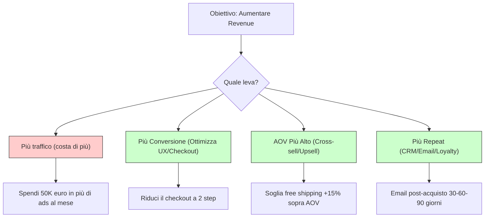

Nel 2011 Zappos registrava un tasso di reso del 35%. Per un retailer tradizionale sarebbe stato un disastro, ma il fondatore Tony Hsieh sapeva dai dati una cosa controintuitiva: i clienti con il tasso di reso più alto avevano anche il Customer Lifetime Value (LTV) più elevato. Compravano di più, ordinavano più spesso ed erano meno sensibili al prezzo. Il reso non era un costo, era il segnale di un cliente migliore.

Zappos fu venduta ad Amazon per 1,2 miliardi di dollari.

La storia mette il dito su un problema serio di chi gestisce un e-commerce: le metriche non mancano, ma spesso si guardano quelle sbagliate o le si legge male. Il return rate di Zappos sembrava un problema ed era un vantaggio competitivo.

## La piramide delle metriche e-commerce: priorità e gerarchia

Non tutte le metriche pesano allo stesso modo. Il tempo è poco e ottimizzare quella sbagliata danneggia le altre, più importanti. Conviene organizzarle in una piramide di priorità:

```text
           +-------------------+
           |  REVENUE & PROFIT |   <- Il CEO guarda qui
           +-------------------+
         +---------------------+
         |  CONVERSION & AOV   |   <- Il CMO guarda qui
         +---------------------+
       +-------------------------+
       |  TRAFFIC & ENGAGEMENT   |   <- L'analista guarda qui
       +-------------------------+
     +-----------------------------+
     |  CANALE & CAMPAGNA          |   <- Il media buyer guarda qui
     +-----------------------------+
```

La regola è semplice: ottimizza dal basso solo quando le metriche in alto sono sane. Se il Contribution Margin per ordine è negativo, aumentare il traffico vuol dire solo perdere soldi più in fretta.

## Le 10 metriche fondamentali: il framework acquisition → conversion → retention → revenue

### 1. conversion rate (CR): la lente d'ingrandimento del sito

Il CR misura la percentuale di sessioni che diventano ordini:

CR = (Numero Ordini / Sessioni) x 100

La media globale sta intorno al 2-3%, ma il dato aggregato dice poco. Booking.com, che gira oltre 1.000 A/B test in parallelo, sa che il CR cambia del 40-50% tra un segmento e l'altro. Ottimizzare il CR "medio" senza segmentare vuol dire ottimizzare il rumore.

| Settore | CR Medio Italia (2025) | Buono | Eccellente |
|---|---|---|---|
| Fashion | 1.5-2.5% | > 3% | > 5% |
| Electronics | 1.0-2.0% | > 2.5% | > 4% |
| Food & Grocery | 3.0-5.0% | > 5% | > 8% |
| Beauty | 2.0-3.5% | > 4% | > 6% |
| B2B / Industrial | 0.5-1.5% | > 2% | > 3% |

Segmenta sempre per dispositivo, canale e tipo di utente (nuovo o di ritorno). Il CR mobile è in genere la metà di quello desktop, eppure il mobile porta il 60% del traffico. Il CR organico è spesso il doppio del paid perché l'intento d'acquisto è più forte. Un utente di ritorno converte da 3 a 5 volte di più.

### 2. average order value (AOV): aumentare il valore medio degli ordini

AOV = Revenue Totale / Numero Ordini

Spesso è più facile alzare l'AOV che il CR, e ogni euro in più ha un costo marginale quasi nullo. Amazon lo ha mostrato con il collaborative filtering, che oggi vale circa il 35% del suo fatturato.

Tra le leve che funzionano: una soglia di spedizione gratuita posta appena sopra l'AOV medio, così da spingere a comprare di più; bundle e cross-sell nelle pagine prodotto, tipo "Completa il look"; upsell al checkout, per esempio le garanzie estese.

### 3. revenue per session (RPS): la metrica chiave per gli A/B test

RPS = Revenue Totale / Sessioni Totali

L'RPS unisce CR e AOV in un solo numero. È la metrica di riferimento negli A/B test perché tiene conto sia della conversione sia del valore dell'ordine. Ottimizzare il solo CR può ingannare, se nel frattempo l'AOV scende.

### 4. cart abandonment rate (CAR): il tasso di abbandono del carrello

CAR = (1 - Ordini Completati / Carrelli Creati) x 100

La media globale è intorno al 70%. Oltre l'80% il checkout ha problemi seri. Detto questo, un CAR alto non è sempre un male, se il valore medio del carrello è molto elevato.

Le cause principali di abbandono sono:
1. Costi di spedizione rivelati troppo tardi (48%).
2. Obbligo di creare un account (24%).
3. Processo di checkout lungo o complicato (22%).
4. Mancanza di metodi di pagamento preferiti (12%).

La leva più efficace è il checkout come guest, che può alzare la conversione del 45%.

### 5. customer acquisition cost (CAC): il costo per acquisire un cliente

CAC = Spesa Marketing Totale / Nuovi Clienti Acquisiti

Dollar Shave Club aveva un CAC di 8 dollari contro i 32 di Gillette, grazie a un video virale e a un modello in abbonamento che alzava la profittabilità sul lungo periodo.

Distingui sempre il Blended CAC (che comprende organico, referral e diretto) dal Paid CAC (solo advertising). Se il Paid CAC è molto più alto del Blended, scalare diventa rischioso.

### 6. customer lifetime value (LTV): il valore totale di un cliente

LTV = AOV x Frequenza Acquisto Annuale x Vita Media Cliente (anni)

L'LTV a 12 mesi è più affidabile per pianificare le operazioni. Stitch Fix aveva un LTV molto disperso: il 20% dei clienti più fedeli valeva enormemente di più. Riconoscere quel 20% e trattarlo in modo diverso è un vantaggio competitivo.

### 7. ltv:cac ratio: la metrica di sostenibilità

La regola di riferimento è un rapporto di 3:1. Attenzione però al payback period: se ci vuole troppo per recuperare il CAC, possono nascere problemi di liquidità anche con un buon rapporto.

Per un e-commerce sano il payback period dovrebbe stare sotto i 12 mesi e il rapporto LTV/CAC sopra il 3.

### 8. return rate: il costo nascosto dei resi

Return Rate = (Ordini Resi / Ordini Totali) x 100

Nel fashion italiano il return rate oscilla tra il 25% e il 40%. Ogni reso pesa: logistica inversa, ricondizionamento, deprezzamento, customer care.

La leva più efficace per abbassarlo è una scheda prodotto dettagliata, con video e immagini realistiche. Zalando ha mostrato che così il return rate cala del 12-18%.

### 9. repeat purchase rate: la metrica della fedeltà

Repeat Rate = (Clienti con 2+ ordini / Clienti Totali) x 100

| Settore | Repeat Rate Tipico | Target |
|---|---|---|
| Fashion | 25-35% | > 40% |
| Food / Consumabili | 40-60% | > 60% |
| Electronics | 10-20% | > 25% |
| Beauty (abbonamento) | 50-70% | > 70% |

Un repeat rate sotto la media segnala che stai perdendo clienti nel tempo. In quella situazione, alzare il budget pubblicitario vuol dire solo perdere soldi più in fretta.

Secondo Bain & Company, alzare la retention del 5% può far crescere i profitti dal 25% al 95%, a seconda del settore.

### 10. contribution margin per order: la metrica che nessuno calcola

CM = Revenue - COGS - Spedizione - Payment Processing - Return Costs

È una metrica fondamentale e quasi sempre ignorata. Un ordine da 50 euro con 5 euro di margine è una cosa molto diversa da uno con 25 euro di margine, eppure nelle metriche tradizionali sembrano identici.

Un caso estremo: un e-commerce di elettronica con CR del 3,2%, AOV di 180 euro e revenue in crescita del 20% aveva un CM medio di appena 4,50 euro per ordine. Crescevano verso il fallimento senza accorgersene.

## La dashboard settimanale dell'E-commerce manager

| Metrica | Questa settimana | WoW | Target | Status |
|---|---|---|---|---|
| Revenue | 32.400 euro | +8% | 30.000 euro | OK |
| Ordini | 540 | +5% | 500 | OK |
| CR (overall) | 2.1% | -0.1% | 2.0% | OK |
| AOV | 60 euro | +3% | 58 euro | OK |
| CAC (paid) | 22 euro | +12% | `< 20` euro | PROBLEMA |
| Cart Abandonment | 72% | +2% | `< 70%` | ATTENZIONE |
| Return Rate | 18% | -1% | `< 20%` | OK |
| Repeat Rate (30d) | 28% | = | 30% | ATTENZIONE |

Ogni metrica fuori target deve avere un'azione, un responsabile e una scadenza. Se non sai cosa fare per riportarla in linea, quella metrica non dovrebbe nemmeno stare nella tua dashboard operativa.

## SQL query essenziali: calcolare LTV e CAC da zero

Per l'LTV a 12 mesi per cliente, sommi gli ordini completati negli ultimi 12 mesi e ne ricavi frequenza e valore medio.

Per il CAC per canale di acquisizione, dividi la spesa marketing per i nuovi clienti acquisiti in un intervallo recente.

L'analisi cohort permette di seguire il repeat rate per mese di acquisizione, utile per valutare la fidelizzazione nel tempo.

## L'errore fatale: ottimizzare la metrica sbagliata



Il grafico dice una cosa sola: investire in conversione, AOV e repeat rende più che pompare solo il traffico. Il traffico è un moltiplicatore, ma se moltiplichi un numero piccolo ottieni un numero piccolo, appena più grande. Sistema prima il numeratore (CR, AOV, CM), poi scala il denominatore (traffico).

Booking.com ha costruito il suo dominio ottimizzando in modo ossessivo il CR per vent'anni con A/B test continui, e solo dopo ha scalato il traffico su una macchina di conversione ormai calibrata.

## Caso studio: riduzione del cart abandonment del 15%

Un e-commerce fashion italiano con un CAR del 72% ha analizzato le cause di abbandono:
- 48% per costi di spedizione rivelati tardi
- 24% per obbligo di registrazione
- 18% per processo lungo

Interventi:
1. Rivelare i costi di spedizione nella pagina prodotto
2. Implementare il guest checkout
3. Semplificare il checkout da 6 a 3 step

Risultato: CAR sceso dal 72% al 61% in 8 settimane. Con 500 ordini a settimana, sono 55 ordini in più ogni settimana, cioè 2.860 euro di revenue aggiuntiva a settimana e 148.720 euro l'anno, solo sistemando il checkout.

## Il punto
Non servono decine di metriche, ne bastano 10 misurate bene e ogni settimana. La chiave è legare ogni metrica a un'azione concreta: se peggiora, cosa fai? Se non hai una risposta chiara, quella metrica non deve stare nella tua dashboard.

Tony Hsieh di Zappos non aveva più metriche dei concorrenti, ne aveva di più giuste. Sapeva che il return rate dei suoi clienti migliori era alto e lo usava come segnale per riconoscerli e trattarli da VIP.

Comincia dalla Contribution Margin per ordine: è la metrica che nessuno guarda e che cambia tutto. Puoi avere un CR perfetto, l'AOV in crescita e traffico da record, ma se ogni ordine ti costa soldi stai costruendo una macchina per perderne, e per giunta sorridendo mentre lo fai.

Approfondisci l'analisi marketing e le metriche di canale nel nostro modulo [analisi marketing](/course/analisi-marketing/).
