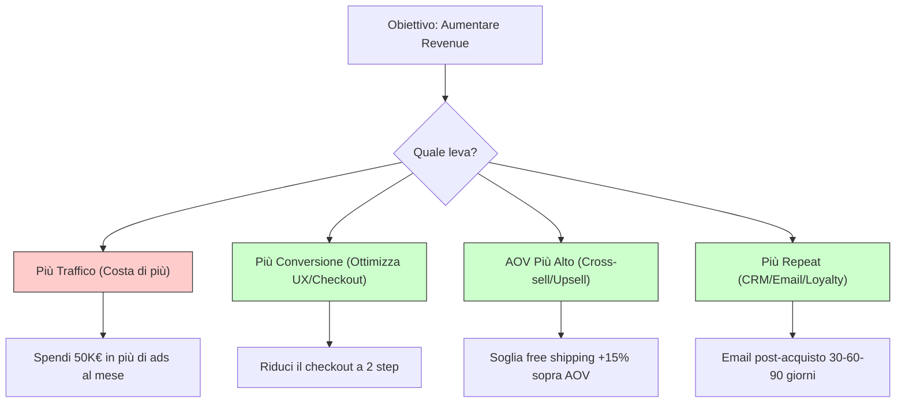

# E-commerce Analytics: Le Metriche Che Separano Chi Cresce da Chi Brucia Budget

Gestire un e-commerce senza analytics è come guidare di notte senza fari. Puoi procedere a tentoni, ma prima o poi sbatti contro un muro. Il problema? La maggior parte degli e-commerce manager monitora le metriche sbagliate — o troppe metriche contemporaneamente.

Questa guida ti dice **esattamente** quali metriche guardare, quando, e cosa fare quando i numeri non tornano.

## La Piramide delle Metriche E-commerce

Non tutte le metriche sono uguali. Organizzale in una piramide:

```
           ╔═══════════════════╗
           ║  REVENUE & PROFIT ║  ← Il CEO guarda qui
           ╠═══════════════════╣
         ║  CONVERSION & AOV  ║  ← Il CMO guarda qui
         ╠═════════════════════╣
       ║  TRAFFIC & ENGAGEMENT ║  ← L'analista guarda qui
       ╠═══════════════════════╣
     ║  CANALE & CAMPAGNA       ║  ← Il media buyer guarda qui
     ╚═════════════════════════════╝
```

## Le 10 Metriche Fondamentali

### 1. Conversion Rate (CR)

```
CR = (Numero Ordini / Sessioni) × 100
```

| Settore | CR Medio Italia (2025) | Buono | Eccellente |
|---|---|---|---|
| Fashion | 1.5-2.5% | > 3% | > 5% |
| Electronics | 1.0-2.0% | > 2.5% | > 4% |
| Food & Grocery | 3.0-5.0% | > 5% | > 8% |
| Beauty | 2.0-3.5% | > 4% | > 6% |
| B2B / Industrial | 0.5-1.5% | > 2% | > 3% |

**Attenzione:** Non confrontare il CR "overall". Segmenta sempre per:
*   Dispositivo (mobile vs desktop — il CR mobile è tipicamente il 50% del desktop).
*   Canale (organico vs paid — il CR organico è spesso 2x il paid).
*   Nuovo vs ritorno (un utente di ritorno converte 3-5x di più).

### 2. Average Order Value (AOV)

```
AOV = Revenue Totale / Numero Ordini
```

L'AOV è spesso più facile da migliorare del CR. Strategie:
*   **Soglia di spedizione gratuita:** "Spedizione gratis sopra 59€" (se il tuo AOV è 42€).
*   **Bundle / Cross-sell:** "Completa il look" nel fashion.
*   **Upsell in checkout:** "Aggiungi la garanzia estesa per 9,90€".

### 3. Revenue Per Session (RPS)

```
RPS = Revenue Totale / Sessioni Totali
```

L'RPS combina CR e AOV in un'unica metrica. È la **metrica primaria** da usare negli A/B test perché cattura sia conversione che valore.

### 4. Cart Abandonment Rate (CAR)

```
CAR = (1 - Ordini Completati / Carrelli Creati) × 100
```

La media globale è circa il **70%**. Se il tuo CAR è sopra l'80%, hai un problema serio nel checkout.

**Le cause più comuni:**
1.  Costi di spedizione troppo alti (o presentati troppo tardi).
2.  Checkout troppo lungo (> 3 step).
3.  Opzioni di pagamento insufficienti (mancano PayPal, Klarna, Satispay).
4.  Obbligo di registrazione prima dell'acquisto.

### 5. Customer Acquisition Cost (CAC)

```
CAC = Spesa Marketing Totale / Nuovi Clienti Acquisiti
```

**Dividi sempre tra Blended e Paid CAC.** Il Blended include tutto (anche organico e referral). Il Paid è solo la spesa ads. Se il Blended è 15€ ma il Paid è 80€, hai un problema di scalabilità.

### 6. Customer Lifetime Value (LTV)

```
LTV = AOV × Frequenza Acquisto Annuale × Vita Media Cliente (anni)
```

L'LTV a 12 mesi è la metrica più utile per il planning operativo.

### 7. LTV:CAC Ratio

La "regola d'oro" è 3:1. Ma attenzione al Payback Period: se il tuo LTV è 300€ e il CAC è 100€, ma servono 18 mesi per recuperare il CAC, potresti avere problemi di cash flow.

### 8. Return Rate

```
Return Rate = (Ordini Resi / Ordini Totali) × 100
```

Nel fashion italiano il return rate è spesso 25-40%. Ogni reso non è solo un mancato ricavo — è un **costo operativo** (logistica inversa, ricondizionamento, re-stocking).

### 9. Repeat Purchase Rate

```
Repeat Rate = (Clienti con 2+ ordini / Clienti Totali) × 100
```

| Settore | Repeat Rate Tipico | Target |
|---|---|---|
| Fashion | 25-35% | > 40% |
| Food / Consumabili | 40-60% | > 60% |
| Electronics | 10-20% | > 25% |
| Beauty (abbonamento) | 50-70% | > 70% |

Se il tuo repeat rate è basso, stai spendendo troppo per acquisire clienti che comprano una volta e spariscono. Investi in CRM e retention prima di aumentare il budget ads.

### 10. Contribution Margin per Order

```
CM = Revenue - COGS - Spedizione - Payment Processing - Return Costs
```

Questa è la metrica che pochi e-commerce calcolano ma che tutti dovrebbero avere sulla dashboard. Un ordine da 50€ con un margine di contribuzione di 5€ è molto diverso da uno con un margine di 25€.

## La Dashboard Settimanale dell'E-commerce Manager

| Metrica | Questa settimana | WoW | Target | Status |
|---|---|---|---|---|
| Revenue | 32.400€ | +8% | 30.000€ | 🟢 |
| Ordini | 540 | +5% | 500 | 🟢 |
| CR (overall) | 2.1% | -0.1% | 2.0% | 🟢 |
| AOV | 60€ | +3% | 58€ | 🟢 |
| CAC (paid) | 22€ | +12% | < 20€ | 🔴 |
| Cart Abandonment | 72% | +2% | < 70% | 🟡 |
| Return Rate | 18% | -1% | < 20% | 🟢 |
| Repeat Rate (30d) | 28% | = | 30% | 🟡 |

## L'Errore Fatale: Ottimizzare la Metrica Sbagliata



Nella maggior parte dei casi, investire in **conversione**, **AOV** e **repeat** ha un ROI molto più alto che pompare più traffico.

## Conclusione

Non servono 50 metriche. Ne servono 10, misurate bene, ogni settimana. La chiave è collegare ogni metrica a un'**azione**: se il numero peggiora, cosa fai? Se non hai una risposta, la metrica non appartiene alla tua dashboard.

Inizia dalla Contribution Margin per ordine. È la metrica che nessuno guarda e che cambia tutto. Perché puoi avere un CR perfetto e un AOV in crescita, ma se il margine per ordine è negativo, stai fallendo velocemente — e sorridendo.
