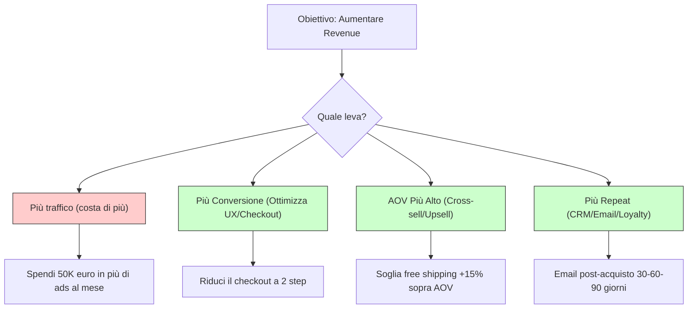

{/* geo-imprint: contesto:piattaforma, contesto:geografico, contesto:valuta, contesto:ricerca */}

Apri Google Analytics o il pannello del tuo shop, vedi decine di grafici colorati e a fine mese fai comunque fatica a capire dove stai guadagnando e dove stai perdendo cassa. Molti e-commerce si trovano bloccati esattamente qui: misurano tutto, ma prendono decisioni sul traffico o sugli sconti guardando indicatori scollegati dal margine reale.

Un esempio concreto viene dal 2011, quando Zappos registrava un tasso di reso del 35%. Per un retailer tradizionale un dato simile avrebbe fatto scattare tagli immediati, mentre il fondatore Tony Hsieh scoprì dai dati che i clienti con il reso più alto avevano anche il Customer Lifetime Value (LTV) più elevato. Compravano di più, ordinavano più spesso ed erano meno sensibili al prezzo, rendendo quel tasso di reso un indicatore utile per riconoscere i clienti migliori. Zappos fu poi venduta ad Amazon per 1,2 miliardi di dollari.
{/* GEO: claim senza fonte */}

Quando leggi i numeri nell'ordine giusto, smetti di inseguire metriche isolate e sai subito dove intervenire prima di spendere altro budget in pubblicità. In questa guida trovi una gerarchia di priorità, le 10 metriche fondamentali dall'acquisizione al margine per ordine, un modello di dashboard settimanale e un caso studio reale sul checkout.

## Scegliere le priorità con la piramide delle metriche

Il tempo in azienda è limitato e ottimizzare l'indicatore sbagliato danneggia quelli più importanti. Per questo conviene organizzare i KPI in una piramide decisionale a quattro livelli:

```text
           +-------------------+
           |  REVENUE & PROFIT |   <- Il CEO guarda qui
           +-------------------+
         +---------------------+
         |  CONVERSION & AOV   |   <- Il CMO guarda qui
         +---------------------+
       +-------------------------+
       |  TRAFFIC & ENGAGEMENT   |   <- L'analista guarda qui
       +-------------------------+
     +-----------------------------+
     |  CANALE & CAMPAGNA          |   <- Il media buyer guarda qui
     +-----------------------------+
```

La regola operativa è lineare: intervieni sui livelli inferiori solo quando i livelli superiori sono sani. Se il Contribution Margin per ordine è negativo, portare più traffico dai canali a pagamento accelera soltanto le perdite.

## Misurare i 10 KPI e-commerce da acquisizione a margine

### 1. Conversion Rate (CR): segmentare prima di ottimizzare

Il Conversion Rate misura la percentuale di sessioni che si chiudono con un ordine:

CR = (Numero Ordini / Sessioni) x 100

La media globale oscilla intorno al 2-3%, ma il valore aggregato da solo nasconde le cause dei cali. Booking.com, che esegue oltre 1.000 A/B test in parallelo, rileva variazioni del CR del 40-50% tra un segmento e l'altro. Lavorare sulla media generale ti porta quindi a ottimizzare il rumore statistico.

| Settore | CR Medio Italia (2025) | Buono | Eccellente |
|---|---|---|---|
| Fashion | 1.5-2.5% | > 3% | > 5% |
| Electronics | 1.0-2.0% | > 2.5% | > 4% |
| Food & Grocery | 3.0-5.0% | > 5% | > 8% |
| Beauty | 2.0-3.5% | > 4% | > 6% |
| B2B / Industrial | 0.5-1.5% | > 2% | > 3% |

Di conseguenza, segmenta sempre per dispositivo, canale e tipologia di utente (nuovo o di ritorno). Il CR su mobile è in genere la metà rispetto al desktop, anche se il mobile genera il 60% del traffico. Inoltre, il traffico organico converte spesso il doppio rispetto al paid grazie a un intento d'acquisto più maturo, e un utente di ritorno converte da 3 a 5 volte di più.

### 2. Average Order Value (AOV): alzare lo scontrino medio a costo marginale quasi nullo

L'Average Order Value indica quanto spende in media un cliente per singolo ordine:

AOV = Revenue Totale / Numero Ordini

Alzare l'AOV richiede spesso meno sforzo rispetto ad aumentare il CR, e ogni euro aggiunto al carrello porta un costo marginale quasi nullo. Amazon lo dimostra da anni con il collaborative filtering, che genera circa il 35% del suo fatturato.

Per ottenere risultati rapidi puoi agire su tre leve:
- Una soglia di spedizione gratuita posizionata appena sopra l'AOV attuale.
- Bundle e cross-sell in pagina prodotto, come la sezione "Completa il look".
- Upsell mirati al checkout, per esempio le garanzie estese.

### 3. Revenue per Session (RPS): valutare gli A/B test su un solo numero

La Revenue per Session unisce conversione e scontrino medio in un unico indicatore:

RPS = Revenue Totale / Sessioni Totali

Negli A/B test l'RPS è il riferimento più affidabile perché ti evita di festeggiare un aumento del CR ottenuto magari abbassando i prezzi e distruggendo l'AOV.

### 4. Cart Abandonment Rate (CAR): trovare gli attriti al checkout

Il CAR misura quanti carrelli avviati restano incompiuti:

CAR = (1 - Ordini Completati / Carrelli Creati) x 100

La media globale si attesta intorno al 70%, mentre superare l'80% segnala blocchi evidenti nel flusso di acquisto. Detto questo, un CAR alto va sempre letto insieme al valore medio del carrello, perché prodotti costosi richiedono tempi di riflessione più lunghi.

Le quattro cause principali di abbandono sono chiare:
1. Costi di spedizione mostrati troppo tardi (48%).
2. Obbligo di creare un account (24%).
3. Processo di checkout lungo o macchinoso (22%).
4. Assenza dei metodi di pagamento preferiti (12%).

Abilitare il checkout come guest resta l'intervento più diretto e può far salire la conversione fino al 45%.

### 5. Customer Acquisition Cost (CAC): separare organico e paid prima di scalare

Il CAC calcola quanto spendi per portare un nuovo cliente al primo acquisto:

CAC = Spesa Marketing Totale / Nuovi Clienti Acquisiti

Dollar Shave Club riuscì a mantenere un CAC di 8 dollari contro i 32 dollari di Gillette grazie a un video virale combinato con un modello in abbonamento che sosteneva la redditività nel tempo.

Quando analizzi questo dato, separa sempre il Blended CAC (che include traffico organico, referral e diretto) dal Paid CAC (che isola le campagne a pagamento). Se il Paid CAC supera di molto il Blended, aumentare il budget pubblicitario comprime subito i margini.

### 6. Customer Lifetime Value (LTV): stimare quanto vale un cliente in 12 mesi

L'LTV proietta il valore economico generato da un cliente lungo tutta la relazione con il brand:

LTV = AOV x Frequenza Acquisto Annuale x Vita Media Cliente (anni)

Per pianificare il budget operativo conviene però calcolare l'LTV a 12 mesi, perché è più concreto e verificabile. In aziende come Stitch Fix, per esempio, l'LTV mostrava una forte concentrazione: il 20% dei clienti più fedeli valeva enormemente più della media, rendendo decisivo riconoscerli e seguirli con attenzione dedicata.

### 7. Rapporto LTV:CAC e payback period: verificare se la crescita è sostenibile

Il rapporto ideale tra valore del cliente e costo di acquisizione è 3:1, con l'obiettivo di restare sopra quota 3 per mantenere un modello scalabile.

Tuttavia il rapporto da solo può ingannare se trascuri il payback period, cioè i mesi necessari per rientrare del CAC attraverso i margini. In un e-commerce sano il payback period resta sotto i 12 mesi; quando si allunga troppo, rischi crisi di liquidità anche con un buon LTV:CAC sulla carta.

### 8. Return Rate: ridurre il costo nascosto dei resi

Il tasso di reso misura la quota di ordini che tornano indietro:

Return Rate = (Ordini Resi / Ordini Totali) x 100

Nel fashion italiano questo valore varia tra il 25% e il 40%. Ogni pacco reso genera costi diretti di logistica inversa, ricondizionamento, deprezzamento e assistenza clienti.

Per abbassarlo in modo strutturale conviene migliorare le schede prodotto con video e immagini realistiche dei capi indossati. Zalando ha rilevato riduzioni del return rate tra il 12% e il 18% proprio grazie a questo tipo di intervento.

### 9. Repeat Purchase Rate: capire se stai trattenendo chi compra

Il Repeat Rate mostra quanti clienti tornano a comprare almeno una seconda volta:

Repeat Rate = (Clienti con 2+ ordini / Clienti Totali) x 100

| Settore | Repeat Rate Tipico | Target |
|---|---|---|
| Fashion | 25-35% | > 40% |
| Food / Consumabili | 40-60% | > 60% |
| Electronics | 10-20% | > 25% |
| Beauty (abbonamento) | 50-70% | > 70% |

Un valore sotto la media di settore indica che stai perdendo i clienti dopo il primo ordine, e pompare altro budget in ads in questa fase accelera solo la perdita di cassa. Secondo [Bain](https://www.bain.com) & Company, aumentare la retention del 5% può far crescere i profitti dal 25% al 95% a seconda del settore.

### 10. Contribution Margin per Order: calcolare il guadagno reale di ogni spedizione

Il Contribution Margin per ordine misura ciò che resta davvero in cassa dopo ogni vendita:

CM = Revenue - COGS - Spedizione - Payment Processing - Return Costs

Questo indicatore cambia radicalmente la lettura dei conti. Un ordine da 50 euro con 5 euro di margine ha un peso opposto rispetto a un ordine da 50 euro con 25 euro di margine, anche se nei report tradizionali appaiono identici.

Un esempio estremo chiarisce il rischio: un e-commerce di elettronica con CR del 3,2%, AOV di 180 euro e fatturato in crescita del 20% registrava un CM medio di appena 4,50 euro per ordine. Cresceva nei volumi avvicinandosi al dissesto finanziario.

## Leggere la dashboard settimanale e collegare ogni scostamento a un'azione

| Metrica | Questa settimana | WoW | Target | Status |
|---|---|---|---|---|
| Revenue | 32.400 euro | +8% | 30.000 euro | OK |
| Ordini | 540 | +5% | 500 | OK |
| CR (overall) | 2.1% | -0.1% | 2.0% | OK |
| AOV | 60 euro | +3% | 58 euro | OK |
| CAC (paid) | 22 euro | +12% | `< 20` euro | PROBLEMA |
| Cart Abandonment | 72% | +2% | `< 70%` | ATTENZIONE |
| Return Rate | 18% | -1% | `< 20%` | OK |
| Repeat Rate (30d) | 28% | = | 30% | ATTENZIONE |

Una tabella settimanale funziona solo se ogni riga fuori target attiva una risposta precisa, assegnata a un responsabile con una scadenza definita. Se un numero cambia e nessuno sa quale azione intraprendere, togli quella metrica dalla dashboard operativa.

## Calcolare LTV, CAC e cohort con tre query logiche

Quando estrai i dati dal database o dal gestionale, puoi costruire i tre indicatori principali partendo da aggregazioni semplici:

- **LTV a 12 mesi per cliente**: somma il valore degli ordini completati negli ultimi 12 mesi per singolo utente, ricavando frequenza media e scontrino medio.
- **CAC per canale di acquisizione**: dividi la spesa marketing del canale per il numero di nuovi clienti acquisiti nello stesso intervallo recente.
- **Analisi cohort**: raggruppa i clienti per mese del primo ordine e monitora il repeat rate nei mesi successivi per misurare la tenuta della fidelizzazione.

## Evitare l'errore di comprare traffico prima di sistemare conversione e margine



Il diagramma mostra un principio pratico: migliorare conversione, scontrino medio e riacquisto rende molto più dell'acquisto forzato di nuovo traffico. Il traffico agisce da moltiplicatore, ma se moltiplichi un rendimento debole ottieni solo un volume leggermente più alto pagato a caro prezzo.

Booking.com ha costruito il proprio vantaggio competitivo ottimizzando il CR per vent'anni tramite A/B test continui, scalando la spesa sul traffico solo dopo aver calibrato il motore di conversione.

## Caso studio: ridurre il cart abandonment dal 72% al 61% in 8 settimane

Un e-commerce fashion italiano con un CAR del 72% ha analizzato i motivi di uscita nel funnel:
- 48% per costi di spedizione mostrati troppo tardi
- 24% per obbligo di registrazione
- 18% per processo troppo lungo

Il team ha quindi applicato tre modifiche mirate:
1. Indicare i costi di spedizione direttamente nella pagina prodotto.
2. Abilitare il checkout come guest.
3. Ridurre i passaggi del checkout da 6 a 3 step.

In 8 settimane il CAR è sceso dal 72% al 61%. Su una base di 500 ordini settimanali, questo miglioramento ha generato 55 ordini in più ogni settimana, pari a 2.860 euro di revenue settimanale aggiuntiva e 148.720 euro l'anno, intervenendo soltanto sul checkout.

## Da dove iniziare questa settimana

Misurare 10 KPI ogni settimana basta per governare un e-commerce, a patto che ogni scostamento sia collegato a una scelta operativa. Così come Tony Hsieh usava il tasso di reso di Zappos per individuare i clienti ad alto valore, tu puoi usare questi numeri per capire dove si forma o si brucia cassa.

Inizia calcolando il Contribution Margin per ordine sulle vendite dell'ultimo mese: ti permette di verificare subito se le campagne attuali stanno generando profitto reale prima di aumentare qualsiasi budget. Per approfondire l'analisi dei canali e delle metriche di acquisizione, prosegui con il modulo [analisi marketing](/course/analisi-marketing/).

## Domande frequenti

1. **Cos'è il Cart Abandonment Rate (CAR)?**
Il CAR misura la percentuale di carrelli creati che non si trasformano in ordini completati. Si riduce mostrando subito i costi di spedizione, abilitando il checkout come guest e snellendo i passaggi.

2. **Come si calcola il LTV/CAC ratio?**
Si divide il Customer Lifetime Value (LTV) per il Customer Acquisition Cost (CAC). Un rapporto sano parte da 3:1: sotto questa soglia scalare diventa rischioso, mentre molto sopra indica che stai sotto-investendo nell'acquisizione.

3. **Cos'è il payback period?**
È il tempo necessario per recuperare il costo di acquisizione (CAC) grazie al margine generato dal cliente. In un e-commerce sano resta sotto i 12 mesi, così da evitare tensioni di cassa durante la crescita.

4. **Come si legge una dashboard di e-commerce analytics?**
Controlla tre livelli in sequenza: margine per ordine e profitto, conversione e valore medio, traffico e rischi operativi (resi, abbandono carrello). Ogni numero fuori target deve attivare una decisione precisa.
