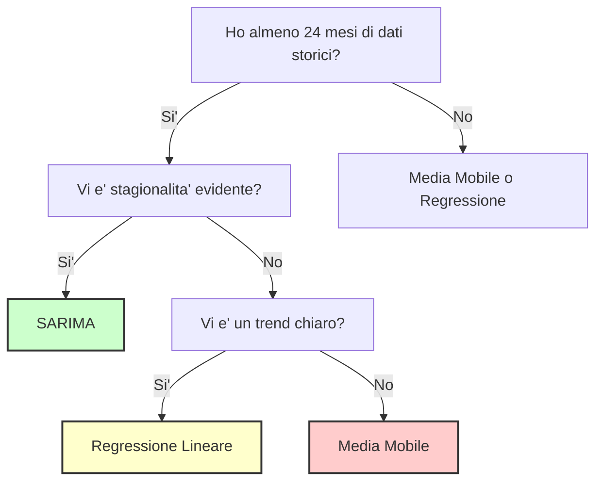

# Prevedere il Futuro delle Vendite: Guida Pratica al Forecasting

Nel 2000, Cisco aveva un sistema di forecast delle vendite che i dirigenti descrivevano come "il migliore del settore". Usava dati storici, modelli di regressione, input manuali dai sales manager. A marzo 2001 — quando la bolla dot-com esplose — Cisco dovette svalutare 2,2 miliardi di dollari di inventario in un singolo trimestre. Il forecast non aveva catturato il cambio di regime nel mercato.

Il problema non era tecnico. Era concettuale: il modello era stato costruito su dati di un ciclo espansivo e non aveva mai visto un contraction cycle. Extrapolava il passato in un futuro strutturalmente diverso.

Questa storia non deve scoraggiarti dal fare forecast — deve insegnarti cosa un forecast puo' fare e cosa non puo' fare. Un buon forecast non e' una profezia. E' una stima con margini di errore espliciti, costruita su assunzioni dichiarate, che migliora le decisioni rispetto al "boh, speriamo bene".

## Perche' il Forecast Conta: la Scienza Decisionale

"Quanto fattureremo il prossimo trimestre?" Se rispondi con un numero preciso basato su tre metodi statistici confrontati, puoi pianificare l'inventario, assumere o non assumere personale, decidere quanto budget investire in marketing. Se rispondi "Boh, speriamo bene", stai prendendo decisioni al buio.

Amazon Web Services usa modelli di forecast della domanda per decidere quanta capacita' server aggiungere ogni trimestre. Un errore del 10% in eccesso significa capex sprecato. Un errore del 10% in difetto significa clienti persi per mancanza di capacita'. Con milioni di server e miliardi di dollari in gioco, anche un miglioramento del 2% nell'accuratezza del forecast vale centinaia di milioni.

Nella tua scala — che sia un e-commerce da 500.000 euro o un'azienda manifatturiera da 20 milioni — il principio e' identico. Meglio prevedere male che non prevedere affatto. E prevedere meglio e' una skill che si impara.

## Approccio 1: Media Mobile (Moving Average) — Semplicita' Pura

Il metodo piu' semplice e intuitivo. Calcoli la media delle vendite degli ultimi N periodi e la usi come previsione per il periodo successivo. Ha 100 anni di storia nelle serie temporali ed e' ancora usato da Goldman Sachs nei modelli tecnici dei trader — non perche' sia il piu' preciso, ma perche' e' robusto e interpretabile.

### Come Funziona

```
Forecast(t+1) = Media(Vendite degli ultimi N periodi)
```

**Esempio concreto:** Vendite mensili di un negozio di accessori negli ultimi 6 mesi: 100.000, 120.000, 110.000, 130.000, 125.000, 135.000 euro. Media mobile a 3 mesi: (130.000 + 125.000 + 135.000) / 3 = **130.000 euro** di previsione per il mese prossimo.

La scelta di N e' cruciale e dipende dalla stabilita' del tuo business:
- **N piccolo (2-3)**: reagisce velocemente ai cambiamenti recenti, ma e' "nervoso" (molto influenzato dagli outlier)
- **N grande (6-12)**: stabile e "smooth", ma reagisce lentamente ai cambiamenti strutturali

### Codice Python

```python
import pandas as pd
import matplotlib.pyplot as plt

# Dati di esempio: vendite mensili in euro
vendite = pd.Series([
    100000, 120000, 110000, 130000, 125000, 135000,
    140000, 128000, 145000, 150000, 142000, 155000
])
mesi = pd.date_range('2025-01', periods=12, freq='MS')
df = pd.DataFrame({'mese': mesi, 'vendite': vendite})

# Media mobile a 3 mesi (breve termine, reattiva)
df['MA_3'] = df['vendite'].rolling(window=3).mean()

# Media mobile a 6 mesi (lungo termine, stabile)
df['MA_6'] = df['vendite'].rolling(window=6).mean()

# Forecast: prossimo mese = ultima media mobile calcolata
forecast_ma3 = df['MA_3'].iloc[-1]
forecast_ma6 = df['MA_6'].iloc[-1]
print(f"Forecast MA(3): {forecast_ma3:,.0f} euro")
print(f"Forecast MA(6): {forecast_ma6:,.0f} euro")

# Visualizzazione
fig, ax = plt.subplots(figsize=(12, 6))
ax.plot(df['mese'], df['vendite'], 'o-', label='Vendite reali', linewidth=2)
ax.plot(df['mese'], df['MA_3'], '--', label='MA(3)', alpha=0.8)
ax.plot(df['mese'], df['MA_6'], '--', label='MA(6)', alpha=0.8)
ax.set_title('Vendite mensili con medie mobili')
ax.legend()
plt.tight_layout()
plt.show()
```

### Quando Usarla

| Pro | Contro |
|---|---|
| Semplicissima da calcolare | Non cattura trend o stagionalita' |
| Si implementa in Excel in 10 minuti | Reagisce lentamente ai cambiamenti strutturali |
| Nessun prerequisito statistico | N va scelto con criterio |
| Robusta agli errori di dati | Tutte le osservazioni hanno lo stesso peso |

**Ideale per:** Business stabili con poca stagionalita' (forniture B2B con contratti ricorrenti, servizi con abbonamento annuale, prodotti con domanda stabile). Se le tue vendite hanno un trend chiaro o una stagionalita', passa al metodo successivo.

## Approccio 2: Regressione Lineare — Catturare il Trend

Se le vendite hanno un **trend** — crescono o calano nel tempo — la media mobile e' cieca perche' tratta tutti i periodi allo stesso modo. La regressione lineare trova la "retta migliore" che descrive il trend e la proietta nel futuro.

George Box, lo statistico britannico che ha co-sviluppato i modelli ARIMA, diceva: "Tutti i modelli sono sbagliati, ma alcuni sono utili." La regressione lineare e' spesso sbagliata (il trend raramente e' esattamente lineare) ma quasi sempre utile come punto di partenza.

### Come Funziona

```
Vendite = a + b x Tempo
```

Dove `a` e' l'intercetta (il livello base) e `b` e' il coefficiente di trend (quanto crescono le vendite per ogni periodo). Se `b = 5.000`, ogni mese le vendite crescono di 5.000 euro in media.

### Codice Python

```python
import numpy as np
from sklearn.linear_model import LinearRegression
import matplotlib.pyplot as plt

# Dati di esempio (stesso dataset di prima)
vendite = np.array([
    100000, 120000, 110000, 130000, 125000, 135000,
    140000, 128000, 145000, 150000, 142000, 155000
])

# Convertiamo il tempo in numeri (1, 2, 3, ... 12)
X = np.arange(1, len(vendite) + 1).reshape(-1, 1)
y = vendite

# Fit del modello di regressione lineare
model = LinearRegression()
model.fit(X, y)

# Interpretazione dei coefficienti
print(f"Vendite base (intercetta): {model.intercept_:,.0f} euro")
print(f"Crescita mensile media: {model.coef_[0]:,.0f} euro/mese")
print(f"R^2 (bonta' del fit): {model.score(X, y):.3f}")

# Forecast: mese 13, 14, 15 (prossimo trimestre)
mesi_futuri = np.array([[13], [14], [15]])
forecast = model.predict(mesi_futuri)
for i, m in enumerate(forecast):
    print(f"Mese {13+i}: {m:,.0f} euro")
```

### Arricchire con Variabili Esplicative (Regressione Multipla)

La regressione diventa potente quando aggiungi variabili che spiegano le vendite oltre al semplice passare del tempo. Walmart lo fa con le previsioni meteorologiche: sanno che quando arriva una nevicata prevista, le vendite di pala da neve, sale da disgelo e batterie aumentano nelle 48 ore precedenti. Il sistema di forecast include i dati meteo come variabile esplicativa.

```python
# Regressione multipla: vendite = f(tempo, budget_marketing, stagionalita')
import pandas as pd
from sklearn.linear_model import LinearRegression
from sklearn.preprocessing import StandardScaler

# Dataset con variabili multiple
df_multi = pd.DataFrame({
    'mese_num': range(1, 13),
    'vendite': vendite,
    'budget_mkt': [5000, 5000, 6000, 6000, 7000, 7000,
                   8000, 8000, 9000, 10000, 12000, 15000],
    'temperatura_media': [5, 6, 10, 14, 19, 24,
                          27, 26, 21, 15, 9, 4],
    'giorni_lavorativi': [21, 20, 21, 22, 21, 22,
                           23, 22, 21, 23, 21, 17]
})

X_multi = df_multi[['mese_num', 'budget_mkt', 'temperatura_media', 'giorni_lavorativi']]
y_multi = df_multi['vendite']

# Standardizzazione
scaler = StandardScaler()
X_scaled = scaler.fit_transform(X_multi)

model_multi = LinearRegression()
model_multi.fit(X_scaled, y_multi)

# Coefficienti: quale variabile spiega di piu' le vendite?
for feat, coef in zip(X_multi.columns, model_multi.coef_):
    print(f"{feat}: {coef:+,.0f}")
```

| Variabile | Impatto probabile | Fonte dati |
|---|---|---|
| Budget marketing | Positivo, non lineare | Report spesa ads |
| Prezzo medio di listino | Negativo (elasticita') | ERP / Gestionale |
| Temperatura (prodotti stagionali) | Dipende dal settore | Open-Meteo API (gratuita) |
| Giorni lavorativi nel mese | Positivo (B2B) | Calendario |
| Promozioni attive | Positivo nel breve | CRM / Piattaforma e-comm |

### Quando Usarla

| Pro | Contro |
|---|---|
| Cattura il trend di crescita o declino | Assume linearita' (spesso falsa) |
| Facile da interpretare e spiegare al CFO | Non gestisce stagionalita' |
| Si puo' arricchire con variabili causali | Sensibile agli outlier (Black Friday distorce) |
| Ottima baseline per confronto | Richiede almeno 12-18 mesi di dati |

**Ideale per:** Business con trend chiaro e poca stagionalita', o come baseline da confrontare con metodi piu' avanzati. Se il tuo R^2 e' sopra 0,80, la regressione e' gia' un ottimo strumento. Se e' sotto 0,60, c'e' troppa variabilita' non spiegata — servono piu' variabili o un modello diverso.

## Approccio 3: ARIMA e SARIMA — lo Standard Industriale

Se il tuo business ha **trend + stagionalita'** — e la maggior parte ce l'ha — ARIMA e' lo standard industriale. E' usato dalla Federal Reserve per le previsioni macroeconomiche, da Nielsen per le previsioni delle vendite al retail, da P&G per pianificare la produzione.

George Box e Gwilym Jenkins lo hanno formalizzato nel 1970. In 55 anni, ARIMA ha resistito all'arrivo di reti neurali, LSTM, e transformer non perche' sia il piu' accurato in assoluto, ma perche' e' trasparente, interpretabile e funziona bene con dati limitati.

### Come Funziona (Senza la Matematica Pesante)

ARIMA combina tre componenti:
- **AR (Auto-Regressivo):** Le vendite di questo mese dipendono dalle vendite dei mesi precedenti.
- **I (Integrato):** Rimuove il trend per rendere la serie "stazionaria".
- **MA (Media Mobile degli Errori):** Il modello si "corregge" basandosi sugli errori di previsione precedenti.

Il modello **SARIMA** aggiunge una componente stagionale.

### Codice Python

```python
from statsmodels.tsa.statespace.sarimax import SARIMAX
import pandas as pd
import numpy as np
import warnings
warnings.filterwarnings('ignore')

np.random.seed(42)
mesi = pd.date_range('2023-01', periods=36, freq='MS')
trend = np.linspace(100000, 160000, 36)
stagionalita = np.array([
    -10000, -8000, 5000, 8000, 12000, 15000,
     20000, 18000, 5000, 0, -5000, 25000
] * 3)
rumore = np.random.normal(0, 5000, 36)
vendite_ts = pd.Series(trend + stagionalita + rumore, index=mesi)

# SARIMA: order(p,d,q) + seasonal_order(P,D,Q,s)
model = SARIMAX(
    vendite_ts,
    order=(1, 1, 1),
    seasonal_order=(1, 1, 1, 12),
    enforce_stationarity=False,
    enforce_invertibility=False
)
results = model.fit(disp=False)

# Forecast dei prossimi 6 mesi con intervalli di confidenza
forecast = results.get_forecast(steps=6)
forecast_mean = forecast.predicted_mean
forecast_ci = forecast.conf_int()

print("Previsioni prossimi 6 mesi:")
for i in range(6):
    mese = forecast_mean.index[i].strftime('%B %Y')
    valore = forecast_mean.iloc[i]
    low = forecast_ci.iloc[i, 0]
    high = forecast_ci.iloc[i, 1]
    print(f"{mese}: {valore:,.0f} euro  (intervallo 95%: {low:,.0f} - {high:,.0f})")
```

### Auto-ARIMA: Trovare i Parametri Automaticamente

Non serve essere statistici. La libreria `pmdarima` fa il lavoro pesante:

```python
from pmdarima import auto_arima

best_model = auto_arima(
    vendite_ts,
    seasonal=True,
    m=12,              # Periodo stagionale: 12 mesi
    start_p=0, max_p=3,
    start_q=0, max_q=3,
    d=None,
    D=None,
    trace=True,
    error_action='ignore',
    suppress_warnings=True,
    stepwise=True
)

forecast_auto, conf_int = best_model.predict(n_periods=6, return_conf_int=True)
```

### Quando Usarla

| Pro | Contro |
|---|---|
| Gestisce trend + stagionalita' | Richiede 24+ mesi di dati |
| Fornisce intervalli di confidenza | Piu' complessa da configurare |
| Standard industriale, ben documentato | Assume che il futuro assomigli al passato |
| Interpretabile | Non cattura rotture strutturali |

**Ideale per:** Qualsiasi business con almeno 2 anni di dati storici e pattern stagionali evidenti.

## Confronto dei 3 Approcci



## Misurare l'Accuratezza: MAPE vs MAE

Quando hai piu' modelli, come scegli il migliore? Usi le metriche di errore su un **hold-out set**.

```python
from sklearn.metrics import mean_absolute_error, mean_absolute_percentage_error

# Usa i primi 30 mesi per il training, gli ultimi 6 per la valutazione
train = vendite_ts.iloc[:30]
test = vendite_ts.iloc[30:]

model_eval = SARIMAX(train, order=(1,1,1), seasonal_order=(1,1,1,12))
results_eval = model_eval.fit(disp=False)

forecast_eval = results_eval.get_forecast(steps=6)
y_pred = forecast_eval.predicted_mean
y_true = test

# Metriche di valutazione
mae = mean_absolute_error(y_true, y_pred)
mape = mean_absolute_percentage_error(y_true, y_pred) * 100
print(f"MAE: {mae:,.0f} euro (errore medio assoluto)")
print(f"MAPE: {mape:.1f}% (errore medio percentuale)")
# Un MAPE del 5-10% e' eccellente
# Un MAPE del 10-20% e' accettabile
# Sopra il 20%, il modello non e' affidabile
```

| Metrica | Cosa Misura | Quando Usarla |
|---|---|---|
| **MAE** | Errore medio assoluto in euro | Se i tuoi ordini di grandezza sono simili |
| **MAPE** | Errore percentuale medio | Se vuoi comparare accuracy tra periodi diversi |
| **RMSE** | Radice dell'errore quadratico medio | Se vuoi penalizzare errori grandi |

## L'Errore Concettuale: Confondere Precisione con Accuratezza

Un forecast non e' una profezia. E' una stima con un margine di errore. Il forecast migliore non e' quello con il numero piu' preciso — e' quello con l'**intervallo di confidenza** piu' utile per le decisioni.

| Forecast | Punto | Intervallo 95% | Utilita' per il planning |
|---|---|---|---|
| "Venderemo esattamente 150.000 euro" | 150.000 | Sconosciuto | Pericolosa falsa sicurezza |
| "Venderemo tra 130.000 e 170.000 euro" | 150.000 | ±20% | Ottimo per il budget planning |
| "Venderemo tra 75.000 e 225.000 euro" | 150.000 | ±50% | Troppo incerto per decidere |

La NASA usa questo approccio per calcolare le traiettorie delle sonde spaziali: non danno un punto esatto di arrivo, ma un "cono di incertezza" che si allarga nel tempo. Piu' lontano e' il target, piu' grande e' il cono. Non e' un fallimento della matematica — e' matematica onesta.

Cisco nel 2001 non aveva un cono di incertezza. Aveva un numero preciso, costruito su un modello che non aveva mai visto una recessione. La falsa precisione e' piu' pericolosa dell'incertezza esplicita.

## Conclusione: Non e' Magia, e' Iterazione

Prevedere il futuro e' impossibile. Prevedere il futuro *abbastanza bene da prendere decisioni migliori* e' assolutamente fattibile — e misurabile.

Inizia con la media mobile (un'ora di lavoro in Excel). Passa alla regressione quando hai un trend chiaro (mezza giornata con Python). Scala a SARIMA quando hai due anni di dati e stagionalita' evidente (una giornata con pmdarima).

La progressione non e' lineare nel tempo — e' lineare nella maturita' dei dati. Molte aziende mature usano ancora la media mobile per il forecast operativo settimanale e SARIMA solo per il budget annuale. Non c'e' una medaglia per usare il modello piu' complesso. C'e' un premio in denaro per usare il modello piu' accurato nella tua situazione specifica.

E ricorda la lezione di George Box: il modello e' sempre sbagliato. La domanda e' se e' abbastanza utile. Il tuo CFO ti ringraziera' — non per la precisione matematica, ma per l'onesta' sull'incertezza.

Approfondisci le tecniche avanzate di statistiche e modellazione nel nostro modulo [matematica per l'analisi dati](/course/matematica-analisi-dati/).
