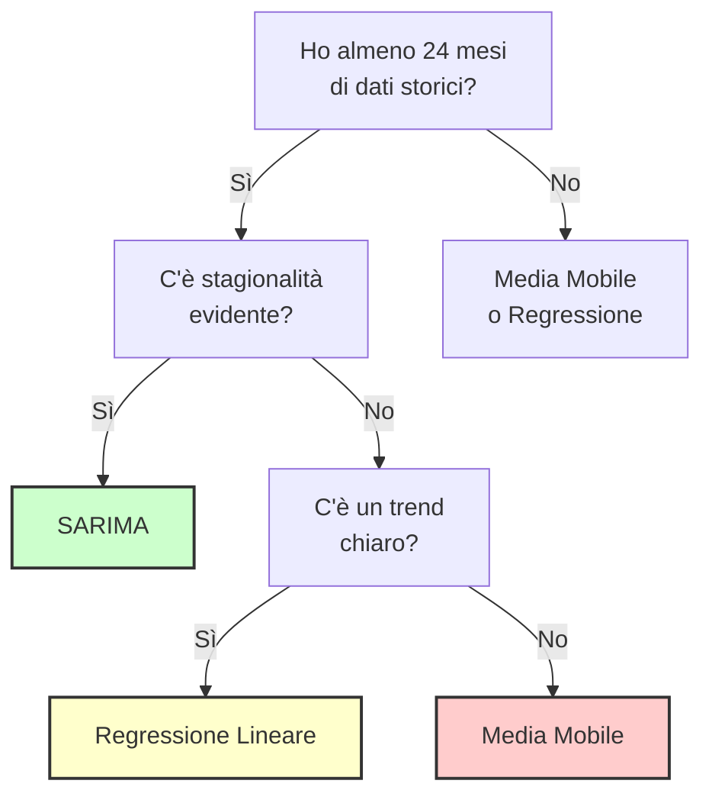

# Prevedere il Futuro delle Vendite: Guida Pratica

"Quanto fattureremo il prossimo trimestre?" Se rispondi "Boh, speriamo bene", hai un problema. Se rispondi con un numero preciso basato su tre metodi statistici confrontati, hai un **forecast**.

Il forecast delle vendite non è magia predittiva. È statistica applicata con buon senso. In questo articolo vedremo tre approcci — dal più semplice al più sofisticato — con codice Python pronto all'uso.

## Approccio 1: Media Mobile (Moving Average)

Il metodo più semplice e intuitivo. Calcoli la media delle vendite degli ultimi N periodi e la usi come previsione per il periodo successivo.

### Come Funziona

```
Forecast(t+1) = Media(Vendite degli ultimi N periodi)
```

**Esempio:** Vendite mensili degli ultimi 6 mesi: 100, 120, 110, 130, 125, 135.
Media mobile a 3 mesi: (130 + 125 + 135) / 3 = **130**

### Codice Python

```python
import pandas as pd
import matplotlib.pyplot as plt

# Dati di esempio: vendite mensili
vendite = pd.Series([100, 120, 110, 130, 125, 135, 140, 128, 145, 150, 142, 155])
mesi = pd.date_range('2025-01', periods=12, freq='MS')
df = pd.DataFrame({'mese': mesi, 'vendite': vendite})

# Media mobile a 3 mesi
df['MA_3'] = df['vendite'].rolling(window=3).mean()

# Forecast: prossimo mese = ultima media mobile
forecast_prossimo = df['MA_3'].iloc[-1]
print(f"Forecast prossimo mese: {forecast_prossimo:.0f}")
```

### Quando Usarla

| Pro | Contro |
|---|---|
| Semplicissima da calcolare | Non cattura trend o stagionalità |
| Si implementa in Excel | Reagisce lentamente ai cambiamenti |
| Nessun prerequisito tecnico | N va scelto "a occhio" |

**Ideale per:** Business stabili con poca stagionalità (es. forniture B2B con contratti ricorrenti).

## Approccio 2: Regressione Lineare (Trend Projection)

Se le vendite hanno un **trend** (crescono o calano nel tempo), la media mobile non basta. La regressione lineare trova la "retta migliore" che passa attraverso i dati storici e la proietta nel futuro.

### Come Funziona

```
Vendite = a + b × Tempo
```

Dove `a` è l'intercetta (il punto di partenza) e `b` è il coefficiente (quanto crescono le vendite per ogni periodo).

### Codice Python

```python
import numpy as np
from sklearn.linear_model import LinearRegression

# Convertiamo il tempo in numeri (1, 2, 3, ...)
X = np.arange(1, len(vendite) + 1).reshape(-1, 1)
y = vendite.values

# Fit del modello
model = LinearRegression()
model.fit(X, y)

# Coefficienti
print(f"Intercetta: {model.intercept_:.2f}")
print(f"Crescita mensile: {model.coef_[0]:.2f}€")

# Forecast: mese 13
mese_futuro = np.array([[13]])
forecast = model.predict(mese_futuro)[0]
print(f"Forecast mese 13: {forecast:.0f}")
```

### Aggiungere Variabili Esplicative

La regressione diventa potente quando aggiungi variabili che influenzano le vendite:

```python
# Regressione multipla: vendite = f(tempo, budget_marketing, temperatura)
X_multi = df[['mese_num', 'budget_mkt', 'temperatura']].values
model_multi = LinearRegression()
model_multi.fit(X_multi, y)
```

| Variabile | Impatto probabile | Fonte dati |
|---|---|---|
| Budget marketing | Positivo | Report spesa ads |
| Prezzo medio | Negativo (elasticità) | ERP |
| Temperatura (se stagionale) | Dipende dal settore | API meteo |
| Eventi/festività | Positivo (picchi) | Calendario |

### Quando Usarla

| Pro | Contro |
|---|---|
| Cattura il trend | Assume linearità (spesso falsa) |
| Facile da interpretare | Non gestisce stagionalità |
| Si può arricchire con variabili | Sensibile agli outlier |

**Ideale per:** Business con trend chiaro e poca stagionalità, o come baseline da confrontare con metodi più avanzati.

## Approccio 3: ARIMA (AutoRegressive Integrated Moving Average)

Se il tuo business ha **trend + stagionalità** (e la maggior parte ce l'ha), ARIMA è il metodo da usare. È lo standard de facto nella previsione delle serie temporali.

### Come Funziona (Senza la Matematica Pesante)

ARIMA combina tre componenti:
*   **AR (Auto-Regressivo):** Le vendite di oggi dipendono dalle vendite dei periodi precedenti.
*   **I (Integrato):** Rende la serie "stazionaria" (rimuove il trend).
*   **MA (Media Mobile):** Considera gli errori dei periodi precedenti per correggersi.

Il modello **SARIMA** (Seasonal ARIMA) aggiunge una componente stagionale.

### Codice Python

```python
from statsmodels.tsa.statespace.sarimax import SARIMAX
import warnings
warnings.filterwarnings('ignore')

# Dati con 24+ mesi (servono almeno 2 cicli per la stagionalità)
# Supponiamo df con colonna 'vendite' e indice mensile

# SARIMA: order(p,d,q) + seasonal_order(P,D,Q,s)
# s=12 per dati mensili (ciclo annuale)
model = SARIMAX(
    df['vendite'],
    order=(1, 1, 1),           # AR=1, differencing=1, MA=1
    seasonal_order=(1, 1, 1, 12)  # Stagionalità annuale
)
results = model.fit(disp=False)

# Forecast dei prossimi 6 mesi
forecast = results.get_forecast(steps=6)
print(forecast.predicted_mean)
print(f"Intervallo di confidenza al 95%:")
print(forecast.conf_int())
```

### Come Scegliere i Parametri (p, d, q)?

Non tirare a indovinare. Usa `auto_arima` dalla libreria `pmdarima`:

```python
from pmdarima import auto_arima

# auto_arima trova automaticamente i parametri ottimali
best_model = auto_arima(
    df['vendite'],
    seasonal=True,
    m=12,  # Periodo stagionale (12 per mensile)
    trace=True,
    error_action='ignore',
    suppress_warnings=True
)
print(best_model.summary())
```

### Quando Usarla

| Pro | Contro |
|---|---|
| Gestisce trend + stagionalità | Richiede 24+ punti dati (2 anni) |
| Fornisce intervalli di confidenza | Più complessa da configurare |
| Standard industriale | Assume che il futuro assomigli al passato |

**Ideale per:** Qualsiasi business con almeno 2 anni di dati storici e pattern stagionali evidenti.

## Confronto dei 3 Approcci



## Errore Comune: Confondere Precisione con Accuratezza

Un forecast non è una profezia. È una **stima con un margine di errore**. Il forecast migliore non è quello con il numero più preciso, ma quello con l'intervallo di confidenza più stretto.

| Forecast | Punto | Intervallo 95% | Utilità |
|---|---|---|---|
| "Venderemo 150" | 150 | Sconosciuto | ❌ Falsa sicurezza |
| "Venderemo tra 120 e 180" | 150 | ±30 (±20%) | ✅ Budget planning realistico |
| "Venderemo tra 50 e 250" | 150 | ±100 (±67%) | ⚠️ Troppo incerto per decidere |

## Conclusione

Prevedere il futuro è impossibile. Prevedere il futuro *abbastanza bene da prendere decisioni migliori* è assolutamente fattibile. Inizia con la media mobile (5 minuti di lavoro), passa alla regressione (1 ora) e scala a SARIMA quando hai dati sufficienti (mezza giornata). Il tuo CFO ti ringrazierà.
