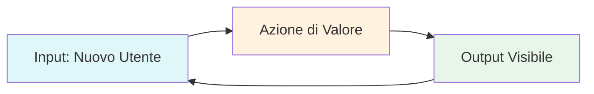

# Growth Loop vs Funnel: Perché il Funnel È Morto

Il funnel è il modello mentale più usato nel marketing. È anche il più vecchio: il concetto AIDA (Attention, Interest, Desire, Action) risale al **1898**. In 126 anni il mondo è cambiato leggermente.

Il problema fondamentale del funnel è strutturale: **è lineare e con perdite**. Entri dall'alto con 10.000 visitatori, ne perdi a ogni step, e alla fine hai 100 clienti. Domani tutto ricomincia da zero.

I growth loop invece sono **circolari e auto-alimentanti**: l'output di un ciclo diventa l'input del successivo.

## Il Problema del Funnel

### Il funnel perde sempre

```
10.000 visitatori
    ↓ (20% → landing page)
2.000 visualizzazioni landing
    ↓ (5% → signup)
100 signup
    ↓ (30% → trial attivo)
30 trial attivi
    ↓ (40% → pagamento)
12 clienti paganti

Costo acquisizione: se hai speso 5.000€ → CAC = 416€
Domani: ricomincia da 0.
```

Il funnel è un **sistema aperto**: l'energia (budget) entra da un lato e i clienti escono dall'altro. Per crescere, devi continuare a pompare budget.

### Il growth loop accumula

```
12 clienti paganti
    ↓ usano il prodotto e ottengono valore
    ↓ condividono il risultato (case study, social post)
    ↓ i loro colleghi/amici vedono il risultato
    ↓ visitano il sito (senza costo di acquisizione!)
    ↓ → 3 nuovi signup organici
    ↓ → 1 diventa cliente pagante
    ↓ → il ciclo si ripete

Costo marginale del 13° cliente: ~0€
```

Il growth loop è un **sistema chiuso**: l'output (clienti soddisfatti) alimenta l'input (nuovi visitatori).

## Anatomia di un Growth Loop

Ogni growth loop ha 3 componenti:



1. **Input**: un nuovo utente entra nel sistema
2. **Azione di valore**: l'utente usa il prodotto e crea qualcosa di visibile
3. **Output visibile**: il risultato attrae nuovi utenti → torna al punto 1

### I 4 Tipi di Growth Loop

| Tipo | Meccanismo | Esempio | Potenza |
|---|---|---|---|
| **Viral Loop** | Gli utenti invitano altri utenti | Dropbox (+500MB per ogni invito), WhatsApp | ⭐⭐⭐⭐⭐ |
| **Content Loop** | Gli utenti creano contenuti che attirano altri utenti via SEO/social | YouTube, Pinterest, Quora | ⭐⭐⭐⭐ |
| **Paid Loop** | Il revenue dei clienti paga l'acquisizione di nuovi clienti (ROAS > 1) | Qualsiasi e-commerce con margini sani | ⭐⭐⭐ |
| **Network Effect Loop** | Il prodotto diventa più utile con più utenti | LinkedIn, Uber, Airbnb | ⭐⭐⭐⭐⭐ |

## Viral Loop: Il Santo Graal

Il viral loop è il più potente perché il costo di acquisizione tende a zero. La metrica chiave è il **K-Factor**:

$$K = i \times c$$

Dove:
- $i$ = numero medio di inviti per utente
- $c$ = tasso di conversione degli inviti

| K-Factor | Significato |
|---|---|
| K < 0.5 | Loop debole, dipendi ancora dal paid |
| K = 0.5-0.9 | Loop contribuisce ma non sostiene da solo |
| K = 1.0 | Ogni utente porta esattamente 1 nuovo utente (crescita lineare) |
| K > 1.0 | **Crescita virale** — ogni utente porta più di 1 nuovo utente |

**K > 1 è raro e quasi impossibile da mantenere.** Ma anche K = 0.5 è prezioso: significa che il 50% della tua crescita è organica, riducendo il CAC blended della metà.

### Esempio: Il Loop di Calendly

1. **Input**: Marco si iscrive a Calendly
2. **Azione di valore**: Marco invia un link Calendly a 10 clienti per prenotare meeting
3. **Output visibile**: I 10 clienti vedono Calendly in azione, pensano "mi serve anche a me"
4. **Loop**: 2 dei 10 si iscrivono a Calendly → ciascuno lo invia ai propri contatti

K = 10 (inviti) × 0.2 (conversion rate) = **2.0**. Crescita virale esplosiva, con CAC ≈ 0€.

## Content Loop: SEO Come Motore di Crescita

Il content loop funziona quando gli utenti (o il team) creano contenuti che si posizionano su Google e attraggono nuovi utenti.

### Esempio: Il Loop di HubSpot

1. **Input**: Un marketing manager cerca "come calcolare il CAC" su Google
2. **Azione**: Trova l'articolo di HubSpot, scarica un template (diventa lead)
3. **Output**: HubSpot usa il caso studio del cliente nel blog → nuovi articoli → più traffico SEO
4. **Loop**: Il nuovo traffico SEO porta nuovi lead

**Perché funziona**: ogni articolo pubblicato è un asset permanente. Dopo 2 anni con 500 articoli, HubSpot genera milioni di visite organiche mensili con un costo marginale quasi zero.

### Come implementarlo

```sql
-- Misura il "content loop": quanto traffico organico porta i tuoi contenuti
-- e quanto di quel traffico converte

SELECT
  DATE_TRUNC(session_date, MONTH) AS mese,
  COUNT(DISTINCT session_id) AS sessioni_organiche,
  COUNT(DISTINCT CASE WHEN has_lead THEN session_id END) AS lead_da_org,
  COUNT(DISTINCT CASE WHEN has_purchase THEN session_id END) AS clienti_da_org,
  -- Costo equivalente: quanto avresti speso in ads per lo stesso traffico?
  ROUND(COUNT(DISTINCT session_id) * 1.20, 0) AS costo_equivalente_ads
  -- Assumendo CPC medio di 1.20€
FROM sessions
WHERE channel_grouping = 'Organic Search'
  AND session_date >= DATE_SUB(CURRENT_DATE(), INTERVAL 12 MONTH)
GROUP BY 1
ORDER BY 1;
```

## Paid Loop: Il Motore a Combustione

Il paid loop è il meno "sexy" ma il più comune. Funziona quando il revenue generato dai nuovi clienti è sufficiente a finanziare l'acquisizione di altri nuovi clienti.

### La matematica del Paid Loop

Il paid loop è sostenibile quando:

$$\text{LTV} \times \text{Margine lordo} > \text{CAC}$$

E diventa un **loop di crescita** quando:

$$\text{Revenue del mese} \times \text{Margine} > \text{Spesa marketing del mese successivo}$$

| Scenario | Revenue | Margine (55%) | Spesa mktg | Profitto netto | Reinvestimento |
|---|---|---|---|---|---|
| Mese 1 | 50.000€ | 27.500€ | 10.000€ | 17.500€ | +2.000€ budget mktg |
| Mese 2 | 58.000€ | 31.900€ | 12.000€ | 19.900€ | +2.500€ budget mktg |
| Mese 3 | 67.000€ | 36.850€ | 14.500€ | 22.350€ | +3.000€ budget mktg |

Ogni mese, il profitto finanzia un aumento del budget marketing → più clienti → più profitto → più budget. È un loop, lento ma affidabile.

## Come Passare dal Funnel ai Loop

### Step 1: Mappa i loop esistenti (probabilmente ne hai già)

La maggior parte dei business ha già dei growth loop — semplicemente non li riconosce come tali.

| Segnale | Loop probabile |
|---|---|
| Il 20%+ dei nuovi clienti arriva da referral | Viral loop nascosto |
| Il traffico organico cresce anche senza nuovi contenuti | Content loop (articoli vecchi che rankano) |
| I clienti condividono il prodotto sui social spontaneamente | UGC loop |
| Il ROAS è stabile da 6+ mesi | Paid loop sostenibile |

### Step 2: Amplifica il loop più forte

Non creare un nuovo loop da zero — amplifica quello che funziona già.

| Loop | Come amplificarlo |
|---|---|
| **Viral** | Aggiungi un incentivo al referral (sconto, crediti, feature premium) |
| **Content** | Raddoppia la produzione dei contenuti che già rankano |
| **UGC** | Crea un hashtag dedicato, repostare i contenuti degli utenti |
| **Paid** | Reinvesti il profitto in budget incrementale |

### Step 3: Misura il tempo di ciclo

La metrica più importante di un growth loop è il **cycle time** — quanto tempo impiega un ciclo completo.

| Loop | Cycle time tipico |
|---|---|
| Viral (Calendly, WhatsApp) | 1-7 giorni |
| Content/SEO | 3-6 mesi |
| Paid | 30-90 giorni (dipende dal payback period) |
| Network effect | Variabile, spesso anni |

**Più corto è il cycle time, più veloce è la crescita.** Un viral loop con cycle time di 2 giorni e K = 1.5 cresce più velocemente di uno con K = 3 ma cycle time di 30 giorni.

## Il Framework Completo: Loop + Funnel

Il funnel non è morto nel senso letterale. È morto come **modello unico**. La realtà è che hai bisogno di entrambi:

- **Il funnel** ottimizza la conversione all'interno di ogni step
- **Il growth loop** alimenta il funnel con nuovi utenti a costo decrescente

```
               ┌───────────────────────┐
               │     GROWTH LOOP       │
               │                       │
    ┌──────────┤  Output → Input       │
    │          │  (referral, SEO, UGC)  │
    │          └───────────┬───────────┘
    │                      │
    │                      ▼
    │          ┌───────────────────────┐
    │          │       FUNNEL          │
    │          │                       │
    │          │  Awareness            │
    │          │  → Consideration      │
    │          │  → Decision           │
    │          │  → Purchase           │
    │          │  → Loyalty ───────────┼──→ Loop
    │          └───────────────────────┘
    │                                     
    └─────────────────────────────────────
```

## Conclusione

Il funnel ti dice **dove** stai perdendo clienti. Il growth loop ti dice **come** farli arrivare senza spendere di più. Le aziende che crescono più velocemente usano entrambi: il loop alimenta il funnel, e il funnel massimizza il valore di ogni utente nel loop.

Se oggi il 100% dei tuoi nuovi clienti arriva da paid ads, non hai un growth loop — hai un tapis roulant. E quando smetti di correre (di spendere), ti fermi. Costruisci almeno un loop — virale, content, o network — e la crescita continuerà anche quando il budget pubblicitario si ferma.
