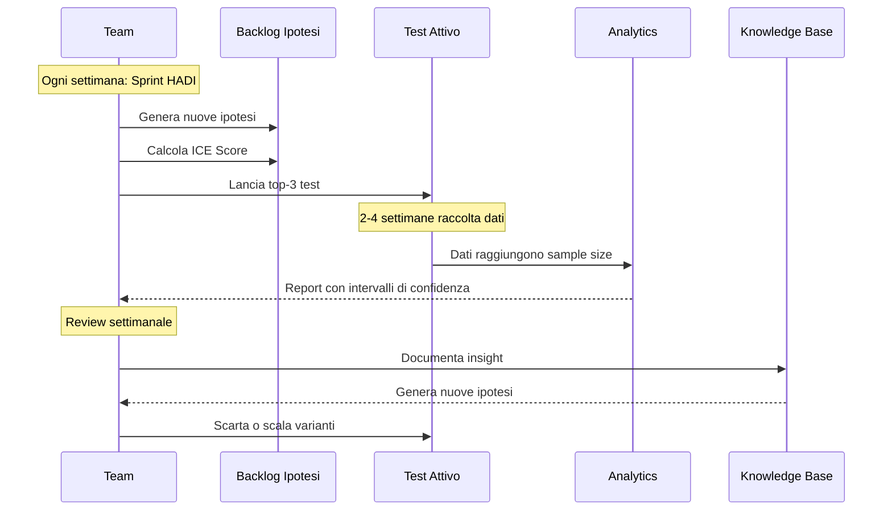

Nel 2012, il team di growth di Airbnb aveva un problema molto concreto. Le fotografie degli alloggi erano scadenti: scure, mal inquadrate, poco invitanti. L'ipotesi era che foto migliori avrebbero aumentato le prenotazioni. La soluzione più ovvia era costruire un sistema per guidare gli host verso scatti migliori, ma ci sarebbero voluti mesi. <!-- GEO: claim senza fonte -->

Il team scelse un'altra strada. Assunse fotografi professionisti a New York e offrì agli host di fotografare gratis i loro appartamenti. Il test costò qualche migliaio di dollari e in tre settimane portò dati reali. Gli alloggi fotografati in modo professionale ricevevano il doppio delle prenotazioni rispetto alla media. L'ipotesi era confermata sui numeri, non su una simulazione.

Quel programma diventò poi una delle iniziative più importanti di Airbnb. Ma quello che conta qui non è la strategia, è il metodo. Il team non aspettò il sistema perfetto. Costruì il minimo indispensabile per testare l'ipotesi, raccolse dati veri, imparò e solo dopo scalò.

Questo è il ciclo HADI in azione: Hypothesis, Action, Data, Insight.

## Perché la velocità di apprendimento è il vero vantaggio competitivo

Nella sua lettera agli azionisti del 2016, Jeff Bezos distingue due tipi di decisioni. Le "Type 1" sono irreversibili e ad alto impatto, e meritano analisi approfondite e tempi lunghi. Le "Type 2" sono reversibili e testabili, e vanno prese in fretta, perché servono a imparare.

Le aziende che crescono piano di solito non sono a corto di idee o di budget. Trattano le decisioni Type 2 come se fossero Type 1, e così passano mesi a pianificare iniziative che si potevano testare in poche settimane con una frazione dello sforzo.

Il ciclo HADI serve proprio ad accelerare le decisioni Type 2. Formuli un'ipotesi, la testi con il minimo sforzo, raccogli dati veri e li trasformi in apprendimento che resta. Il vantaggio non sta nel singolo esperimento, ma nel completarne molti più dei concorrenti.

Nel 2023 Amazon ha testato migliaia di varianti del proprio sito. Booking.com fa girare oltre 1.000 test A/B simultanei al giorno. Spotify prova continuamente versioni diverse della home e delle raccomandazioni. Non è una questione di risorse infinite, ma di cultura del test: ogni intuizione diventa un'ipotesi da verificare prima di trasformarsi in strategia.

## Le 4 fasi del ciclo HADI

### Fase 1: hypothesis, formulare ipotesi verificabili

L'errore più comune è la vaghezza. "Voglio migliorare la conversione" è un desiderio, non un'ipotesi. Un'ipotesi deve essere specifica, falsificabile e poggiare su un meccanismo causale plausibile.

Una struttura che funziona bene è questa:

> "Crediamo che [azione specifica] per [segmento o contesto] produrrà [risultato misurabile], perché [meccanismo causale]. Considereremo confermata l'ipotesi se [metrica] cambia di [entità] entro [periodo]."

Esempi:

| Ipotesi mal formata | Ipotesi ben formata |
|---|---|
| "Migliorare la pagina prodotto" | "Aggiungere 3 recensioni video sopra il fold aumenterà il CR del 8%+ perché la prova sociale riduce l'incertezza pre-acquisto" |
| "Testare un prezzo diverso" | "Il prezzo 97 euro convertirà meglio di 99 euro nel segmento nuovi visitatori desktop, con impatto su CR > 5%" |
| "Migliorare l'email" | "Cambiare il subject da domanda aperta a numero specifico aumenterà l'open rate di almeno 3 punti percentuali nel segmento utenti inattivi (>30 giorni)" |

La parte "perché" conta molto. Senza un meccanismo causale esplicito, il test è cieco. Con quel meccanismo, se il test fallisce capisci se a sbagliare era l'ipotesi o la tua comprensione di come funzionano le cose.

### Fase 2: action, il minimo necessario per imparare

La trappola è aspettare la soluzione perfetta prima di testare. Lo scopo del test non è lanciare un prodotto finito, ma raccogliere informazioni. La domanda giusta da farsi è: qual è il modo più rapido ed economico per ottenere dati che bastino a confermare o smentire l'ipotesi?

Tra gli strumenti più usati ci sono l'A/B test, lo standard per provare varianti di pagine, email, copy e prezzi, che richiede un volume adeguato calcolato prima di partire. C'è il fake door test, dove lanci un pulsante o una pagina che annuncia una funzione non ancora esistente per misurare l'interesse vero. C'è il concierge MVP, in cui fai a mano ciò che un giorno automatizzerai, così validi il valore prima di investire. E c'è il landing page test, una pagina che descrive il prodotto e conta quanti utenti si iscrivono per essere avvisati al lancio.

### Fase 3: data, raccogliere dati utili, non solo tanti dati

Il rischio non è raccogliere pochi dati. È raccogliere dati sbagliati, o leggerli male.

Sulla significatività statistica: con pochi visitatori, le differenze possono essere solo rumore, quindi calcola il sample size necessario prima di iniziare. Definisci anche una OMTM (One Metric That Matters), la metrica primaria di ogni esperimento, fissata prima del lancio per evitare di rincorrere il risultato che ti fa comodo. E tieni d'occhio il novelty effect: spesso i test mostrano un picco iniziale dovuto solo alla novità, che poi svanisce, perciò sui test ad alto traffico aspetta almeno due settimane.

### Fase 4: insight, trasformare i dati in apprendimento sistemico

Il valore vero non è il singolo esperimento, ma la conoscenza che si accumula nel tempo. Anche un esperimento fallito è informazione preziosa.

La documentazione conta parecchio. Senza, ogni team rischia di riscoprire da capo le stesse verità, sprecando tempo e risorse.

Un template minimo per documentare ogni esperimento:

ESPERIMENTO: [Nome]
DATA: [inizio] - [fine]
IPOTESI: [Formulazione completa]
VARIANTE: [Cosa è stato cambiato]
METRICA PRIMARIA: [Nome e definizione]
SAMPLE SIZE: [Per gruppo e calcolo]
RISULTATO: [Numeri con intervalli di confidenza]
DECISIONE: [Scala / Scarta / Replica]
INSIGHT: [Cosa abbiamo imparato]
IPOTESI SUCCESSIVE: [Cosa testare dopo]

## HADI vs PDCA vs OKR vs OODA: quando usare quale

I framework di miglioramento iterativo non sono intercambiabili: ognuno è tarato su un contesto diverso.

| Framework | Ottimizzato per | Forza | Limite |
|---|---|---|---|
| PDCA | Miglioramento continuo di processi noti | Sistematico, riduce variabilità | Presuppone conoscenza del processo |
| OKR | Allineamento su obiettivi a lungo termine | Chiarezza di direzione | Meno adatto per sperimentazione rapida |
| OODA | Reazione rapida in ambienti caotici | Velocità decisionale | Meno rigoroso sulla misurazione |
| HADI | Scoperta di nuovi driver di crescita | Rigoroso, accumula learning | Richiede dati sufficienti |

## Prioritizzazione degli esperimenti: ICE score e RICE score

Un team maturo gestisce un portfolio di esperimenti in parallelo, e a quel punto il problema è decidere a cosa dare la precedenza.

### ICE score (Impact, confidence, ease)

- Impact: quanto grande sarebbe l'impatto?
- Confidence: quanto sei sicuro dell'ipotesi?
- Ease: quanto è facile eseguire il test?

ICE Score = (Impact + Confidence + Ease) / 3

### RICE score (Reach, impact, confidence, effort)

- Reach: quante persone toccherà la feature?
- Impact: quanto cambierà il comportamento?
- Confidence: quanto sei sicuro?
- Effort: quanto lavoro richiede?

RICE Score = (Reach × Impact × Confidence) / Effort

Entrambi servono a tenere a bada il bias verso idee non ancora validate.

## Caso studio: tre cicli HADI per ottimizzare il checkout

**Ciclo 1: ridurre i campi del form**

Ipotesi: ridurre i campi obbligatori da 15 a 8 aumenterà il tasso di completamento del 12% perché abbassa il carico cognitivo.

Azione: A/B test tra form completo e form snellito.

Dati: 8.000 utenti per variante, 4 settimane.
- Completamento A: 62.4%
- Completamento B: 69.8%
- Differenza: +7.4 punti, p=0.002

Insight: ipotesi confermata, anche se l'effetto è più piccolo del previsto. Su mobile l'effetto è più marcato.

Decisione: scalare la variante B, che genera circa $45k/mese.

**Ciclo 2: aggiungere garanzia "Soddisfatti o rimborsati"**

Ipotesi: una garanzia visibile ridurrà l'ansia pre-acquisto su mobile, aumentando le conversioni e riducendo i resi.

Azione: A/B test con e senza banner garanzia.

Dati: 12.000 utenti per variante, 4 settimane.
- Completamento A: 69.8%
- Completamento B: 72.1%
- Differenza: +2.3 punti, p=0.08
- Rimborsi simili (17% vs 18%)

Insight: le conversioni salgono, ma i rimborsi non scendono. Il problema è post-acquisto.

Decisione: scalare la variante B, che genera $30k/mese. Da qui nasce una nuova ipotesi per il ciclo 3.

**Ciclo 3: migliorare il tono dell'email di conferma**

Ipotesi: un'email rassicurante dopo l'acquisto ridurrà i rimborsi aumentando la fiducia.

Azione: A/B test tra email standard ed email personalizzata.

Dati: 15.000 ordini per variante, 2 settimane.
- Rimborsi A: 17.8%
- Rimborsi B: 14.2%
- Differenza: -3.6 punti, p=0.001
- CTR "track order": 31%

Insight: ipotesi confermata, il tono dell'email incide sul buyer's remorse.

Decisione: scalare la variante B. Impatto netto dopo 3 cicli: più conversioni e meno rimborsi, per un valore stimato di $100k/mese.

## Gestire più cicli HADI contemporaneamente

Un team maturo tiene in piedi un portfolio di esperimenti in stadi diversi, dalla pianificazione all'analisi, per spingere al massimo la velocità di apprendimento.

## Conclusione: la velocità di apprendimento come asset strategico

Le aziende che vincono non partono quasi mai dall'idea migliore. Imparano più in fretta. Ogni ciclo HADI aggiunge conoscenza sul mercato, sugli utenti e sui driver di crescita, e questa conoscenza è difficile da copiare.

Amazon Web Services è leader perché per quasi vent'anni ha fatto più esperimenti e iterato più velocemente di chiunque altro.

La differenza tra un team che chiude 2 cicli HADI al mese e uno che ne chiude 8 diventa, nel tempo, centinaia di esperimenti e conoscenze accumulate. A parità di risorse, il secondo sa cose che il primo nemmeno immagina.

Smetti di pianificare per anni. Formula un'ipotesi, costruisci il minimo per testarla, misura con rigore, impara e ripeti. La velocità di apprendimento è l'unico vantaggio che nessuno ti può copiare, perché dipende da quello che sai, e quello che sai è il frutto di tutti i test che hai fatto prima.

Approfondisci il framework nel nostro [modulo su Growth e significatività statistica](/course/significativita-statistica/).
