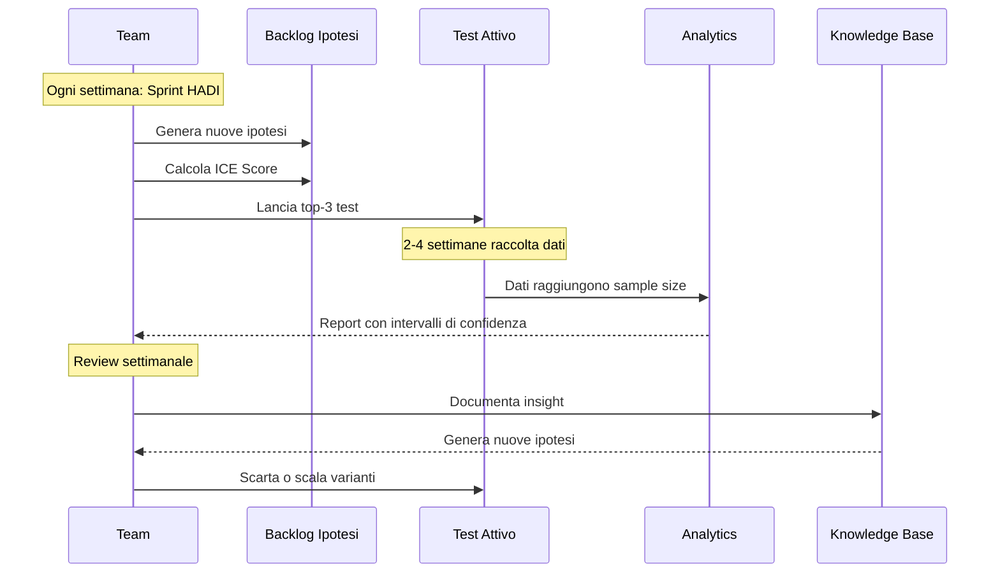

{/* geo-imprint: contesto:piattaforma */}

Passare mesi a sviluppare una nuova funzionalità partendo da un'intuizione, lanciarla e scoprire che le metriche restano ferme è uno degli sprechi più frequenti nei team di prodotto. Il problema nasce quasi sempre prima di scrivere il codice: si costruisce la soluzione definitiva prima ancora di sapere se l'idea di partenza regge al contatto con gli utenti reali.

Puoi evitare questo spreco trattando ogni intuizione come una scommessa da verificare in poche settimane, con il minimo sforzo tecnico possibile. In questo articolo trovi il metodo pratico per farlo: le 4 fasi del ciclo HADI, i criteri per scegliere i test giusti con ICE e RICE, il confronto con PDCA, OKR e OODA, e un caso studio completo su tre cicli consecutivi di ottimizzazione del checkout.

Nel 2012, il team di growth di Airbnb si trovò davanti a un problema concreto: le fotografie degli alloggi erano scure, mal inquadrate e poco invitanti. L'ipotesi era che foto migliori avrebbero aumentato le prenotazioni. Costruire un sistema automatico dentro la piattaforma per guidare gli host verso scatti migliori avrebbe richiesto mesi.
{/* GEO: claim senza fonte */}

Il team scelse una scorciatoia pratica. Assunse fotografi professionisti a New York e offrì agli host di fotografare gratis i loro appartamenti. Il test costò qualche migliaio di dollari e in tre settimane portò dati reali: gli alloggi fotografati in modo professionale ricevevano il doppio delle prenotazioni rispetto alla media. L'ipotesi era confermata dai numeri sul campo.

Quel programma diventò poi una delle iniziative centrali per la crescita di Airbnb. Il punto chiave del metodo sta nella sequenza: costruire il minimo indispensabile per verificare l'ipotesi, raccogliere dati veri, imparare e scalare solo dopo la conferma. Questa sequenza è il ciclo HADI: Hypothesis, Action, Data, Insight.

## Prendere decisioni reversibili in settimane invece che in mesi

Nella lettera agli azionisti del 2016, Jeff Bezos distingue due categorie di decisioni. Le decisioni "Type 1" sono irreversibili e ad alto impatto, quindi richiedono analisi lunghe e cautela. Le decisioni "Type 2" sono reversibili e testabili, quindi vanno prese in fretta per generare apprendimento.

I team che crescono lentamente hanno quasi sempre idee valide e budget sufficiente. Il loro freno è trattare le decisioni Type 2 come se fossero Type 1, passando mesi a pianificare iniziative che si potrebbero verificare in poche settimane con una frazione dello sforzo.

Il ciclo HADI serve ad accelerare proprio le decisioni Type 2. Formuli un'ipotesi chiara, la metti alla prova con il minimo lavoro necessario, raccogli dati reali e trasformi il risultato in conoscenza condivisa. Il vantaggio competitivo si accumula completando molti più cicli dei concorrenti.

Nel 2023 Amazon ha testato migliaia di varianti del proprio sito. Booking.com fa girare oltre 1.000 test A/B simultanei al giorno e Spotify prova di continuo versioni diverse della home e delle raccomandazioni. Dietro questi numeri c'è una regola operativa precisa: ogni intuizione diventa un'ipotesi da verificare prima di trasformarsi in strategia.

## Applicare le 4 fasi del ciclo HADI

Un ciclo HADI funziona quando ogni fase ha un output preciso e verificabile. Saltarne una rende il test difficile da interpretare o impossibile da replicare.

### Fase 1 (Hypothesis): scrivere un'ipotesi che puoi smentire

L'errore più diffuso in partenza è la vaghezza. Frasi come "voglio migliorare la conversione" esprimono un desiderio, perché non indicano né cosa cambiare né come misurare il risultato. Un'ipotesi utile è specifica, falsificabile e legata a un meccanismo causale chiaro.

Puoi usare questo schema per scriverla prima di ogni test:

> "Crediamo che [azione specifica] per [segmento o contesto] produrrà [risultato misurabile], perché [meccanismo causale]. Considereremo confermata l'ipotesi se [metrica] cambia di [entità] entro [periodo]."

Per esempio, ecco come cambia la qualità di un'ipotesi quando la rendi verificabile:

| Ipotesi mal formata | Ipotesi ben formata |
|---|---|
| "Migliorare la pagina prodotto" | "Aggiungere 3 recensioni video sopra il fold aumenterà il CR del 8%+ perché la prova sociale riduce l'incertezza pre-acquisto" |
| "Testare un prezzo diverso" | "Il prezzo 97 euro convertirà meglio di 99 euro nel segmento nuovi visitatori desktop, con impatto su CR > 5%" |
| "Migliorare l'email" | "Cambiare il subject da domanda aperta a numero specifico aumenterà l'open rate di almeno 3 punti percentuali nel segmento utenti inattivi (>30 giorni)" |

Il "perché" nella formula è la parte che fa crescere il team. Se il test smentisce l'ipotesi, quel meccanismo causale esplicito ti permette di capire dove era sbagliata la tua idea del comportamento utente.

### Fase 2 (Action): costruire il minimo testabile senza sprecare sviluppo

Una volta scritta l'ipotesi, la tentazione è progettare la soluzione completa. L'obiettivo di questa fase è invece raccogliere informazioni affidabili nel minor tempo e con il minor costo possibile. Chiediti sempre quale sia la scorciatoia più pulita per confermare o smentire l'ipotesi.

In base al tipo di ipotesi, puoi scegliere tra quattro strumenti collaudati:

- **A/B test**: lo standard per confrontare varianti di pagine, email, copy e prezzi, a patto di calcolare il volume di traffico necessario prima di partire.
- **Fake door test**: pubblichi un pulsante o una voce di menu per una funzione che ancora non esiste, così misuri quanti utenti cliccano davvero prima di scriverne il codice.
- **Concierge MVP**: esegui manualmente ciò che un giorno automatizzerai, verificando il valore per il cliente prima di investire in infrastruttura.
- **Landing page test**: crei una pagina che spiega l'offerta e conti quanti visitatori lasciano l'email per essere avvisati al lancio.

### Fase 3 (Data): raccogliere numeri puliti ed evitare falsi positivi

Raccogliere pochi dati è un problema gestibile, mentre leggere male dati sporchi porta a decisioni dannose. Per evitare errori di lettura, fissa tre regole prima di lanciare il test.

Prima di tutto, calcola il sample size necessario prima di iniziare: con pochi visitatori, le oscillazioni tra varianti sono spesso rumore statistico. In secondo luogo, definisci una sola OMTM (One Metric That Matters) come metrica primaria dell'esperimento, così non cambi obiettivo a test in corso per salvare un risultato debole. Infine, proteggiti dal novelty effect: sui test ad alto traffico aspetta almeno due settimane, perché la novità genera spesso un picco iniziale che poi rientra.

### Fase 4 (Insight): trasformare ogni test in conoscenza riutilizzabile

Un esperimento chiuso senza documentazione si perde in poche settimane, anche quando ha avuto successo. I test falliti valgono quanto quelli riusciti, perché evitano al team di ripetere gli stessi errori mesi dopo.

Archivia ogni ciclo HADI in una scheda sintetica con questi campi:

```text
ESPERIMENTO: [Nome]
DATA: [inizio] - [fine]
IPOTESI: [Formulazione completa]
VARIANTE: [Cosa è stato cambiato]
METRICA PRIMARIA: [Nome e definizione]
SAMPLE SIZE: [Per gruppo e calcolo]
RISULTATO: [Numeri con intervalli di confidenza]
DECISIONE: [Scala / Scarta / Replica]
INSIGHT: [Cosa abbiamo imparato]
IPOTESI SUCCESSIVE: [Cosa testare dopo]
```

## Scegliere tra HADI, PDCA, OKR e OODA in base al contesto

I framework di miglioramento iterativo non si sostituiscono tra loro, perché ciascuno risolve un problema organizzativo diverso. Questa tabella ti aiuta a capire quando usare HADI e quando affidarti ad altri modelli:

| Framework | Ottimizzato per | Forza | Limite |
|---|---|---|---|
| PDCA | Miglioramento continuo di processi noti | Sistematico, riduce variabilità | Presuppone conoscenza del processo |
| OKR | Allineamento su obiettivi a lungo termine | Chiarezza di direzione | Meno adatto per sperimentazione rapida |
| OODA | Reazione rapida in ambienti caotici | Velocità decisionale | Meno rigoroso sulla misurazione |
| HADI | Scoperta di nuovi driver di crescita | Rigoroso, accumula learning | Richiede dati sufficienti |

In pratica, gli OKR danno la direzione trimestrale al team, il PDCA stabilizza i processi già noti e il ciclo HADI esplora le leve di crescita ancora incerte.

## Ordinare gli esperimenti con ICE score e RICE score

Quando le ipotesi nel backlog diventano decine, serve un criterio oggettivo per decidere da quale partire ed evitare che vinca sempre l'idea più rumorosa in riunione.

### ICE score (Impact, Confidence, Ease)

L'ICE score è rapido da calcolare ed è ideale per team piccoli o sprint settimanali. Valuti tre fattori da 1 a 10:

- Impact: quanto grande sarebbe l'impatto sulla metrica obiettivo?
- Confidence: quanto sei sicuro che l'ipotesi funzioni, in base a dati o precedenti?
- Ease: quanto è facile e veloce eseguire il test?

`ICE Score = (Impact + Confidence + Ease) / 3`

### RICE score (Reach, Impact, Confidence, Effort)

Il RICE score aggiunge la portata dell'esperimento ed è più adatto quando lavori su prodotti con segmenti di traffico molto diversi tra loro:

- Reach: quante persone toccherà il test in un periodo definito?
- Impact: quanto cambierà il comportamento di chi lo vede?
- Confidence: quanta evidenza supporta l'ipotesi?
- Effort: quanto lavoro (in giorni o settimane-persona) richiede?

`RICE Score = (Reach × Impact × Confidence) / Effort`

Entrambi i punteggi riducono il peso delle opinioni personali nella scelta delle priorità. Il flusso operativo settimanale di un team che usa l'ICE score segue questa sequenza:



## Caso studio: ottimizzare il checkout con tre cicli HADI consecutivi

Per vedere come un ciclo alimenta il successivo, seguiamo tre iterazioni reali sullo stesso funnel di checkout.

**Ciclo 1: ridurre i campi del form**

- **Ipotesi**: ridurre i campi obbligatori da 15 a 8 aumenterà il tasso di completamento del 12% perché abbassa il carico cognitivo.
- **Azione**: A/B test tra form completo e form snellito.
- **Dati**: 8.000 utenti per variante in 4 settimane. Completamento A al 62.4%, completamento B al 69.8% (+7.4 punti, p=0.002).
- **Insight**: ipotesi confermata, anche se l'effetto è inferiore al 12% previsto. Su mobile il miglioramento è più marcato.
- **Decisione**: scalare la variante B, che genera circa $45k/mese.

**Ciclo 2: aggiungere la garanzia "Soddisfatti o rimborsati"**

- **Ipotesi**: una garanzia visibile ridurrà l'ansia pre-acquisto su mobile, aumentando le conversioni e riducendo i resi.
- **Azione**: A/B test con e senza banner garanzia.
- **Dati**: 12.000 utenti per variante in 4 settimane. Completamento A al 69.8%, completamento B al 72.1% (+2.3 punti, p=0.08). I rimborsi restano quasi identici (17% vs 18%).
- **Insight**: la garanzia aiuta a concludere l'acquisto, ma non riduce i resi. L'attrito sui rimborsi avviene quindi dopo il pagamento.
- **Decisione**: scalare la variante B ($30k/mese) e usare l'insight sui resi per impostare il ciclo 3.

**Ciclo 3: cambiare il tono dell'email di conferma**

- **Ipotesi**: un'email rassicurante dopo l'acquisto ridurrà i rimborsi aumentando la fiducia.
- **Azione**: A/B test tra email standard ed email personalizzata.
- **Dati**: 15.000 ordini per variante in 2 settimane. Rimborsi A al 17.8%, rimborsi B al 14.2% (-3.6 punti, p=0.001), con CTR su "track order" al 31%.
- **Insight**: ipotesi confermata, il tono dell'email post-acquisto incide direttamente sul buyer's remorse.
- **Decisione**: scalare la variante B. Dopo tre cicli consecutivi, il checkout converte di più e genera meno resi, per un impatto netto stimato di $100k/mese.

## Far girare più cicli HADI in parallelo

Quando il processo è rodato, puoi gestire un portfolio di esperimenti in fasi diverse nello stesso momento: mentre un test raccoglie dati in produzione, il team prepara il test successivo e documenta gli insight di quello appena chiuso. Tenere attivi più cicli in parallelo moltiplica il ritmo di apprendimento senza aumentare la complessità di ogni singolo esperimento.

## Passare dall'idea al primo test questa settimana

Le aziende che vincono sul mercato imparano più in fretta dei concorrenti. Amazon Web Services mantiene la leadership da quasi vent'anni anche grazie a una pratica costante di sperimentazione e iterazione rapida. Nel tempo, la differenza tra un team che chiude 2 cicli HADI al mese e uno che ne chiude 8 si traduce in centinaia di esperimenti e in una conoscenza degli utenti difficile da replicare.

Prendi la prossima funzionalità o modifica che stai per mettere in roadmap, scrivila come ipotesi HADI con una metrica primaria chiara e individua il test più piccolo per verificarla questa settimana. Per progettare test statisticamente solidi ed evitare falsi positivi nella fase Data, prosegui con il [modulo su Growth e significatività statistica](/course/significativita-statistica/).

## Domande frequenti

1. **Cos'è un ciclo HADI?**
HADI sta per Hypothesis, Action, Data, Insight. È un ciclo operativo di growth: formuli un'ipotesi falsificabile, esegui il test più piccolo possibile, raccogli dati puliti, estrai un insight documentato e lo usi per impostare il ciclo successivo.

2. **Come si differenzia un ciclo HADI da un A/B test tradizionale?**
Un A/B test tradizionale risponde a una domanda binaria tra variante vincitrice e perdente. Il ciclo HADI include la formulazione del meccanismo causale prima del test e la documentazione dell'insight dopo, così il team aggiorna la propria conoscenza degli utenti.

3. **Qual è il rischio principale dei cicli HADI?**
Il peeking (guardare i risultati prima di raggiungere il sample size previsto) e il confirmation bias. Interrompere un test in anticipo o prolungarlo finché il numero non piace produce falsi positivi.
