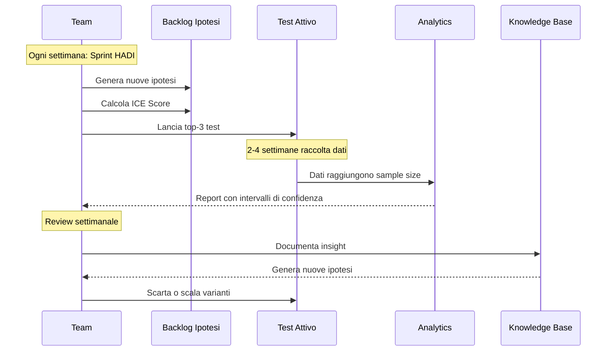

Nel 2012, il team di growth di Airbnb affrontò un problema concreto: le fotografie degli alloggi erano di scarsa qualità  -  foto scure, mal inquadrate, poco attraenti. L'ipotesi era che migliorare le foto avrebbe aumentato le prenotazioni. La soluzione più ovvia sarebbe stata costruire un sistema per guidare gli host verso foto migliori, ma avrebbe richiesto mesi.

Invece, il team agì diversamente: assunse fotografi professionisti a New York e offrì agli host di fotografare gratuitamente i loro appartamenti. Il costo totale del test fu di poche migliaia di dollari, e in tre settimane raccolsero dati reali. Il risultato mostrò che gli alloggi fotografati professionalmente avevano prenotazioni doppie rispetto alla media. L'ipotesi era validata con dati concreti, non con simulazioni.

Il programma dei fotografi professionisti divenne una delle iniziative strategiche più importanti di Airbnb. Ma il punto non è la strategia  -  è il metodo. Il team non attese un sistema perfetto, ma costruì il minimo necessario per testare l'ipotesi, raccolse dati reali, imparò e poi scalò.

Questo è il ciclo HADI in azione: Hypothesis, Action, Data, Insight.

## Perché la velocità di apprendimento è il vero vantaggio competitivo

Jeff Bezos ha distinto due tipi di decisioni nella sua lettera agli azionisti del 2016: le decisioni "Type 1", irreversibili e ad alto impatto, che richiedono analisi approfondite e tempi lunghi, e le decisioni "Type 2", reversibili e testabili, che vanno prese rapidamente per imparare.

Il problema delle aziende che crescono lentamente non è la mancanza di idee o budget, ma trattare le decisioni Type 2 come Type 1, dedicando mesi a pianificare iniziative che potrebbero essere testate in settimane con una frazione dello sforzo.

Il ciclo HADI è una struttura operativa per accelerare le decisioni Type 2: formula ipotesi, le testa con il minimo sforzo, raccoglie dati reali e converte i dati in apprendimento sistemico. Il vantaggio non è un singolo esperimento, ma la capacità di completarne molti più dei competitor.

Amazon ha testato migliaia di varianti del proprio sito nel 2023. Booking.com esegue oltre 1.000 test A/B simultanei ogni giorno. Spotify testa costantemente varianti della home page e delle raccomandazioni. Non è questione di risorse illimitate, ma di una cultura del test sistematico dove ogni intuizione diventa un'ipotesi verificabile prima di diventare strategia.

## Le 4 fasi del ciclo HADI

### Fase 1: hypothesis  -  formulare ipotesi verificabili

L'errore più comune è la vaghezza. "Voglio migliorare la conversione" è un desiderio, non un'ipotesi. Un'ipotesi deve essere specifica, falsificabile e basata su un meccanismo causale plausibile.

Una struttura efficace è:

> "Crediamo che [azione specifica] per [segmento o contesto] produrrà [risultato misurabile], perché [meccanismo causale]. Considereremo confermata l'ipotesi se [metrica] cambia di [entità] entro [periodo]."

Esempi:

| Ipotesi mal formata | Ipotesi ben formata |
|---|---|
| "Migliorare la pagina prodotto" | "Aggiungere 3 recensioni video sopra il fold aumenterà il CR del 8%+ perché la prova sociale riduce l'incertezza pre-acquisto" |
| "Testare un prezzo diverso" | "Il prezzo 97 euro convertirà meglio di 99 euro nel segmento nuovi visitatori desktop, con impatto su CR > 5%" |
| "Migliorare l'email" | "Cambiare il subject da domanda aperta a numero specifico aumenterà l'open rate di almeno 3 punti percentuali nel segmento utenti inattivi (>30 giorni)" |

La parte "perché" è serio. Senza un meccanismo causale esplicito, il test è cieco. Con esso, se il test fallisce si può capire se il problema è l'ipotesi o la comprensione del meccanismo.

### Fase 2: action  -  il minimo necessario per imparare

La trappola è aspettare una soluzione perfetta prima di testare. Lo scopo del test non è lanciare un prodotto finito, ma raccogliere informazioni. La domanda giusta è: qual è il modo più rapido ed economico per ottenere dati sufficienti a validare o invalidare l'ipotesi?

Strumenti comuni:

- **A/B Test:** standard per testare variazioni di pagine, email, copy, prezzi. Richiede un volume adeguato, calcolato prima del test.

- **Fake Door Test:** lanci un pulsante o pagina che annuncia una funzione non ancora esistente per misurare l'interesse reale.

- **Concierge MVP:** fai manualmente ciò che automatizzeresti, per validare il valore prima di investire.

- **Landing Page Test:** crea una pagina che descrive il prodotto e misura quanti utenti si iscrivono per essere avvisati al lancio.

### Fase 3: data  -  raccogliere dati utili, non solo tanti dati

Il rischio non è raccogliere pochi dati, ma dati sbagliati o interpretarli male.

- **Significatività statistica:** con pochi visitatori, le differenze possono essere rumore. Calcola il sample size necessario prima di iniziare.

- **OMTM (One Metric That Matters):** ogni esperimento deve avere una metrica primaria definita prima del lancio per evitare bias.

- **Novelty Effect:** i test mostrano spesso un aumento iniziale dovuto alla novità, che può svanire. Aspetta almeno due settimane per test ad alto traffico.

### Fase 4: insight  -  trasformare i dati in apprendimento sistemico

Il valore reale non è il singolo esperimento, ma l'accumulo di conoscenza nel tempo. Un esperimento fallito è informazione preziosa.

La documentazione è serio: senza di essa, ogni team rischia di riscoprire le stesse verità, sprecando tempo e risorse.

Un template minimo per documentare ogni esperimento:

ESPERIMENTO: [Nome]
DATA: [inizio] - [fine]
IPOTESI: [Formulazione completa]
VARIANTE: [Cosa è stato cambiato]
METRICA PRIMARIA: [Nome e definizione]
SAMPLE SIZE: [Per gruppo e calcolo]
RISULTATO: [Numeri con intervalli di confidenza]
DECISIONE: [Scala / Scarta / Replica]
INSIGHT: [Cosa abbiamo imparato]
IPOTESI SUCCESSIVE: [Cosa testare dopo]

## HADI vs PDCA vs OKR vs OODA: quando usare quale

Diversi framework di miglioramento iterativo sono ottimizzati per contesti diversi.

| Framework | Ottimizzato per | Forza | Limite |
|---|---|---|---|
| PDCA | Miglioramento continuo di processi noti | Sistematico, riduce variabilità | Presuppone conoscenza del processo |
| OKR | Allineamento su obiettivi a lungo termine | Chiarezza di direzione | Meno adatto per sperimentazione rapida |
| OODA | Reazione rapida in ambienti caotici | Velocità decisionale | Meno rigoroso sulla misurazione |
| HADI | Scoperta di nuovi driver di crescita | Rigoroso, accumula learning | Richiede dati sufficienti |

## Prioritizzazione degli esperimenti: ICE score e RICE score

Un team maturo gestisce un portfolio di esperimenti in parallelo, e la chiave è la prioritizzazione.

### ICE score (Impact, confidence, ease)

- Impact: quanto grande sarebbe l'impatto?
- Confidence: quanto sei sicuro dell'ipotesi?
- Ease: quanto è facile eseguire il test?

ICE Score = (Impact + Confidence + Ease) / 3

### RICE score (Reach, impact, confidence, effort)

- Reach: quante persone toccherà la feature?
- Impact: quanto cambierà il comportamento?
- Confidence: quanto sei sicuro?
- Effort: quanto lavoro richiede?

RICE Score = (Reach × Impact × Confidence) / Effort

Entrambi aiutano a evitare il bias verso idee non validate.

## Caso studio: tre cicli HADI per ottimizzare il checkout

**Ciclo 1: Ridurre i campi del form**

Ipotesi: ridurre i campi obbligatori da 15 a 8 aumenterà il tasso di completamento del 12% perché riduce il carico cognitivo.

Azione: A/B test con form completo vs form snellito.

Dati: 8.000 utenti per variante, 4 settimane.
- Completamento A: 62.4%
- Completamento B: 69.8%
- Differenza: +7.4 punti, p=0.002

Insight: ipotesi confermata, effetto minore del previsto. Mobile mostra effetto più marcato.

Decisione: scalare variante B, genera ~$45k/mese.

**Ciclo 2: Aggiungere garanzia "Soddisfatti o rimborsati"**

Ipotesi: garanzia visibile ridurrà ansia pre-acquisto su mobile, aumentando conversioni e riducendo resi.

Azione: A/B test con e senza banner garanzia.

Dati: 12.000 utenti per variante, 4 settimane.
- Completamento A: 69.8%
- Completamento B: 72.1%
- Differenza: +2.3 punti, p=0.08
- Rimborsi simili (17% vs 18%)

Insight: incremento conversioni, ma nessuna riduzione rimborsi. Problema post-acquisto.

Decisione: scalare variante B, genera $30k/mese. Nuova ipotesi per ciclo 3.

**Ciclo 3: Migliorare tono email di conferma**

Ipotesi: email rassicurante post-acquisto ridurrà rimborsi aumentando fiducia.

Azione: A/B test su email standard vs email personalizzata.

Dati: 15.000 ordini per variante, 2 settimane.
- Rimborsi A: 17.8%
- Rimborsi B: 14.2%
- Differenza: -3.6 punti, p=0.001
- CTR "track order": 31%

Insight: ipotesi confermata, tono email impatta buyer's remorse.

Decisione: scalare variante B. Impatto netto dopo 3 cicli: incremento conversioni e riduzione rimborsi, valore stimato $100k/mese.

## Gestire più cicli HADI contemporaneamente

Un team maturo gestisce un portfolio di esperimenti in diversi stadi, da pianificazione ad analisi, per massimizzare la velocità di apprendimento.

## Conclusione: la velocità di apprendimento come asset strategico

Le aziende vincenti non hanno sempre l'idea migliore all'inizio, ma imparano più velocemente. Ogni ciclo HADI aggiunge conoscenza sul mercato, sugli utenti e sui driver di crescita, creando un vantaggio competitivo difficile da replicare.

Amazon Web Services è leader perché ha eseguito più esperimenti e iterato più velocemente per quasi vent'anni.

La differenza tra un team che completa 2 cicli HADI al mese e uno che ne completa 8 si traduce in centinaia di esperimenti e conoscenze accumulate. A parità di risorse, il secondo team sa cose che il primo ignora.

Smetti di pianificare per anni. Formula un'ipotesi, costruisci il minimo per testarla, misura con rigore, impara e ripeti. La velocità di apprendimento è l'unico vantaggio competitivo che non si può copiare, perché dipende da ciò che sai, frutto di tutti i test precedenti.

Approfondisci il framework nel nostro [modulo su Growth e significatività statistica](/course/significativita-statistica/).
