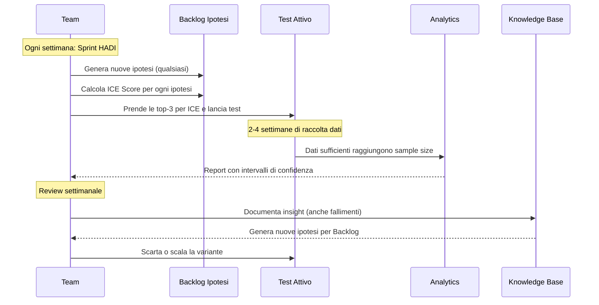

# HADI Cycles: Come Imparare Piu' Velocemente dei tuoi Competitor

Nel 2012, il team di growth di Airbnb si trovava davanti a un problema specifico: le fotografie degli alloggi erano scadenti — foto buie, mal inquadrate, poco appetibili. L'ipotesi era che foto migliori avrebbero aumentato le prenotazioni. La soluzione ovvia sarebbe stata costruire un sistema per guidare gli host verso foto migliori. Ma costruire quel sistema avrebbe richiesto mesi.

Invece il team fece una cosa diversa: assunse fotografi professionisti a New York e propose agli host di fotografare gratuitamente i loro appartamenti. Costo totale del test: poche migliaia di dollari. Tempo per raccogliere i dati: tre settimane. Risultato: gli alloggi fotografati professionalmente avevano prenotazioni doppie rispetto alla media. L'ipotesi era validata con dati reali, non con simulazioni.

Il programma fotografi professionisti divenne una delle iniziative strategiche piu' importanti di Airbnb. Ma il punto non e' la strategia — e' il metodo. Il team non ha atteso di avere un sistema perfetto. Ha costruito il minimo necessario per testare l'ipotesi, ha raccolto dati reali, ha imparato. E poi ha scalato.

Questo e' il ciclo HADI in azione: Hypothesis, Action, Data, Insight.

## Perche' la Velocita' di Apprendimento e' il Vero Vantaggio Competitivo

Jeff Bezos ha scritto nella sua celebre lettera agli azionisti del 2016 una distinzione che e' diventata uno dei principi piu' citati del management moderno: le decisioni "Type 1" (irreversibili, ad alto impatto, vanno prese lentamente con molta analisi) e le decisioni "Type 2" (reversibili, testabili, vanno prese rapidamente per imparare).

Il problema delle aziende che crescono lentamente non e' quasi mai la mancanza di idee o di budget. E' che trattano le decisioni Type 2 come se fossero Type 1. Dedicano mesi a pianificare, analizzare e costruire consenso per iniziative che potrebbero essere testate in settimane con il 10% dello sforzo.

Il ciclo HADI e' una struttura operativa per accelerare le decisioni Type 2: crea un processo deliberato per formulare ipotesi, testarle con il minimo sforzo, raccogliere dati reali, e convertire i dati in apprendimento sistemico. Il vantaggio non e' un singolo esperimento — e' la capacita' di completare 10 esperimenti mentre il competitor ne completa 2.

Amazon ha testato migliaia di varianti del proprio sito nel 2023. Booking.com esegue piu' di 1.000 test A/B simultaneamente ogni giorno. Spotify testa costantemente varianti della home page e delle raccomandazioni. Non si tratta di risorse illimitate — si tratta di una cultura del test sistematico dove ogni intuizione viene trasformata in ipotesi verificabile prima di diventare strategia.

## Le 4 Fasi del Ciclo HADI

### Fase 1: Hypothesis — l'Arte di Formulare Ipotesi Verificabili

L'errore piu' comune nella fase di ipotesi: essere vaghi. "Voglio migliorare la conversione" non e' un'ipotesi — e' un desiderio. Un'ipotesi e' una previsione specifica, falsificabile, con un meccanismo causale plausibile.

La struttura che uso sistematicamente:

> "Crediamo che [questa azione specifica] per [questo segmento o contesto] produrra' [questo risultato misurabile], perche' [questo e' il meccanismo causale]. Considerera' confermata l'ipotesi se [questa metrica] cambia di [questa entita'] entro [questo periodo]."

Esempi di ipotesi mal formate vs ben formate:

| Ipotesi mal formata | Ipotesi ben formata |
|---|---|
| "Migliorare la pagina prodotto" | "Aggiungere 3 recensioni video sopra il fold aumentera' il CR del 8%+ perche' la prova sociale riduce l'incertezza pre-acquisto" |
| "Testare un prezzo diverso" | "Il prezzo 97 euro convertira' meglio di 99 euro (perche' il 7 e' percepito come numero non-rotondo e piu' studiato) nel segmento nuovi visitatori desktop, con impatto su CR > 5%" |
| "Migliorare l'email" | "Cambiare il subject da domanda aperta a numero specifico aumentera' l'open rate di almeno 3 punti percentuali nel segmento utenti inattivi (>30 giorni)" |

La parte "perche'" e' la piu' importante e la piu' spesso omessa. Senza un meccanismo causale plausibile, stai testando alla cieca. Con un meccanismo esplicito, se il test fallisce puoi capire se il fallimento e' nell'ipotesi o nella comprensione del meccanismo.

### Fase 2: Action — il Minimo Necessario per Imparare

La trappola classica della Fase 2 e' la perfection trap: aspettare di avere una soluzione perfetta prima di testare. Ma lo scopo del test non e' lanciare un prodotto finito — e' raccogliere informazioni. La domanda giusta non e' "come facciamo la cosa meglio possibile?" ma "qual e' il modo piu' rapido ed economico per avere dati sufficienti a validare o invalidare questa ipotesi?"

Alcuni strumenti standard per la Fase 2:

**A/B Test:** Il gold standard per testare variazioni di pagine, email, copy, prezzi. Richiede volume sufficiente (calcola il sample size prima di iniziare — non dopo). Strumenti: Google Optimize (discontinuato nel 2023, ma VWO, Optimizely, o soluzioni custom con Statsig sono le alternative).

**Fake Door Test:** Lanci un pulsante o una pagina che annuncia una feature che non esiste ancora. Chi clicca segnala interesse reale. Dropbox ha usato una versione di questo per testare l'interesse verso una funzionalita' di sync prima di costruirla. Zappos ha validato l'idea del suo business model aprendo un sito e comprando le scarpe fisicamente dai negozi solo quando un cliente le ordinava — senza magazzino, senza logistica, solo per testare se la gente avrebbe comprato scarpe online.

**Concierge MVP:** Airbnb fotografo professionisti. Fai manualmente cio' che il sistema automatizzato farebbe, per validare che il risultato valga lo sforzo di automatizzarlo.

**Landing Page Test:** Crei una landing page che descrive il prodotto e misuri quante persone inseriscono l'email per "essere avvisati al lancio". E' cio' che Buffer ha fatto nel 2010 prima di costruire qualsiasi riga di codice: una semplice pagina con un form, e una copy che descriveva il prodotto. 120 signup in 48 ore hanno validato la domanda.

### Fase 3: Data — Raccogliere Dati Utili, non Solo Molti Dati

La fase piu' rischiosa non e' raccogliere troppo pochi dati — e' raccogliere i dati sbagliati o interpretarli in modo sbagliato.

**Il problema della significativita' statistica:** Se hai 50 visitatori per variante, qualsiasi differenza nei tassi di conversione e' probabilmente rumore statistico. Un conversion rate del 5% con 50 visitatori ha un intervallo di confidenza enorme — potresti osservare 2% o 8% per pura varianza casuale. Prima di lanciare un test, calcola il sample size necessario:

- Conversion rate baseline: 3%
- Minimum Detectable Effect: +20% (vuoi rilevare una differenza di almeno 0.6 punti percentuali)
- Confidenza statistica: 95%
- Potere del test: 80%

Con questi parametri, ti servono circa 9.000 visitatori per variante. Se il tuo sito ha 500 visite al giorno, il test richiede 36 giorni per variante. Se provi a leggerlo dopo 7 giorni, stai prendendo decisioni su rumore statistico.

**Il problema dell'OMTM (One Metric That Matters):** Ogni esperimento deve avere una e una sola metrica primaria definita prima del lancio. Non puoi scegliere la metrica dopo aver visto i dati — e' il modo piu' rapido per trovare conferme invece di verita'. Se il test migliora il CTR ma non il revenue, hai migliorato la metrica sbagliata. Se migliora l'open rate dell'email ma non le conversioni downstream, il risultato e' ambiguo.

**Il problema del Novelty Effect:** I test A/B mostrano spesso un "effetto novita'": gli utenti interagiscono di piu' con qualsiasi cosa nuova, indipendentemente dalla sua qualita'. Se misuri troppo presto, potresti vedere un miglioramento che scompare dopo 2 settimane. Per esperimenti ad alto traffico, aspetta almeno due cicli completi di comportamento (per la maggior parte dei siti, 2 settimane minimo).

### Fase 4: Insight — Trasformare i Dati in Apprendimento Sistemico

Il valore reale del ciclo HADI non e' l'esperimento singolo — e' l'accumulo di apprendimento nel tempo. Ogni esperimento completato, che sia un successo o un fallimento, aggiunge un mattone alla comprensione del tuo mercato e dei tuoi utenti.

La distinzione critica: un esperimento fallito non e' uno spreco — e' informazione. Se l'ipotesi era "aggiungere testimonianze video aumenta il CR", e il test mostra nessuna differenza, hai imparato qualcosa di importante: per il tuo specifico pubblico, in questo specifico contesto, le testimonianze video non sono il driver di conversione che immaginavi. Questa informazione vale piu' della conferma di un'ipotesi ovvia.

La documentazione degli insight e' dove la maggior parte dei team fallisce. L'insight del test di questo mese deve essere accessibile e consultabile dal team che lancia un test simile tra 18 mesi. Senza documentazione sistematica, ogni team riscopre le stesse verita' che gia' altri hanno scoperto — un costo enorme in tempo e budget.

Il template minimo per documentare ogni esperimento:

```
ESPERIMENTO: [Nome breve identificativo]
DATA: [inizio] - [fine]
IPOTESI: [Formulazione completa]
VARIANTE: [Cosa e' stato cambiato]
METRICA PRIMARIA: [Nome e definizione precisa]
SAMPLE SIZE: [Per gruppo, e come calcolato]
RISULTATO: [Numeri con intervalli di confidenza]
DECISIONE: [Scala / Scarta / Replica in altro contesto]
INSIGHT: [Cosa abbiamo imparato sul comportamento utente / mercato]
IPOTESI SUCCESSIVE: [Cosa testare di conseguenza]
```

## HADI vs PDCA vs OODA: Quando Usare Quale

Esistono diversi framework di miglioramento iterativo. Non sono equivalenti — sono ottimizzati per contesti diversi.

**PDCA (Plan, Do, Check, Act):** Formalizzato da W. Edwards Deming negli anni '50 per il controllo qualita' manifatturiero. Ottimo per processi ripetitivi dove l'obiettivo e' ridurre la variabilita' e migliorare in modo incrementale. E' il cuore del Toyota Production System. Meno adatto per contesti dove stai esplorando territori sconosciuti — il PDCA presuppone che tu sappia gia' abbastanza del processo per pianificarlo.

**OODA (Observe, Orient, Decide, Act):** Sviluppato dal colonnello John Boyd per i piloti da caccia negli anni '60. Eccelle in ambienti ad alta incertezza e alta velocita' dove devi reagire piu' velocemente dell'avversario. Utile per il crisis management e per rispondere a mosse competitive rapide. Meno strutturato del HADI per la scoperta metodica.

**HADI:** Ottimizzato per la scoperta di nuovi driver di crescita in contesti digitali. L'enfasi sulla formulazione esplicita dell'ipotesi (con meccanismo causale) e sulla raccolta di dati statisticamente significativi lo rende piu' rigoroso del semplice "prova e vedi".

| Framework | Ottimizzato per | Forza | Limite |
|---|---|---|---|
| PDCA | Miglioramento continuo di processi noti | Sistematico, riduce variabilita' | Presuppone conoscenza del processo |
| OODA | Reazione rapida in ambienti caotici | Velocita' di decisione | Meno rigoroso sulla misurazione |
| HADI | Scoperta di nuovi driver di crescita | Rigoroso, accumula learning | Richiede volume di dati sufficienti |
| Build-Measure-Learn | Validazione di prodotti nuovi | Ampio, flessibile | Meno specifico sulla statistica |

## Caso Studio: Come TransferWise ha Ridisegnato il suo Onboarding

TransferWise (oggi Wise) aveva un problema di attivazione: molti utenti si registravano ma non completavano il primo trasferimento. Il tasso di completamento dell'onboarding era intorno al 35%.

**Hypothesis:** "Mostrare al nuovo utente la simulazione del risparmio rispetto alla banca tradizionale nel primo step dell'onboarding aumentera' il tasso di completamento di almeno 10 punti percentuali, perche' esplicita il valore prima di chiedere qualsiasi dato personale."

**Action:** A/B test su landing post-registrazione. Variante A (controllo): flusso standard con form KYC immediato. Variante B: primo step mostra simulazione risparmio personalizzata, poi KYC.

**Data:** Dopo 4 settimane e 12.000 utenti per variante (sample size calcolato per rilevare +8% con 95% di confidenza):
- Tasso di completamento A: 36.2%
- Tasso di completamento B: 51.8%
- Differenza: +15.6 punti percentuali (+43%)
- P-value: < 0.001

**Insight:** L'ipotesi era confermata, ma la dimensione dell'effetto era molto piu' grande dell'atteso. Il meccanismo causale ipotizzato (esplicitare il valore prima di chiedere dati) era corretto. Insight aggiuntivo: il segmento "first time sender" mostrava un effetto ancora piu' pronunciato (+58%), mentre il segmento "returning user" mostrava un effetto molto piu' piccolo (+12%) — coerente con il fatto che i returning user conoscono gia' il valore del prodotto.

**Ipotesi successive generate dall'insight:**
- Testare personalizzazione della simulazione per paese di destinazione
- Testare la stessa logica "mostra valore prima" nel flusso di un secondo trasferimento per utenti con primo trasferimento completato ma nessun secondo in 30 giorni

Il ciclo non si chiude — l'insight del ciclo precedente genera le ipotesi del ciclo successivo.

## La Struttura Operativa: Come Gestire Piu' HADI Contemporaneamente

Un team maturo non esegue un ciclo HADI alla volta — gestisce un portfolio di esperimenti in diversi stadi simultaneamente. La chiave e' la disciplina nella prioritizzazione: non tutti gli esperimenti hanno la stessa probabilita' di impatto e la stessa facilita' di esecuzione.

Un framework semplice per prioritizzare gli esperimenti: ICE Score (Impact, Confidence, Ease), popularizzato da Sean Ellis di GrowthHackers.

- **Impact (1-10):** Quanto grande sarebbe l'impatto se l'ipotesi fosse confermata?
- **Confidence (1-10):** Quanto sei fiducioso che l'ipotesi sia vera, basandoti su dati esistenti o analogie?
- **Ease (1-10):** Quanto e' facile (veloce, economico) eseguire il test?

**ICE Score = (Impact + Confidence + Ease) / 3**



## Conclusione: la Velocita' di Apprendimento come Asset Strategico

Le aziende che vincono nei mercati competitivi non sono quelle con le idee migliori all'inizio — sono quelle che imparano piu' velocemente nel tempo. Ogni ciclo HADI completato aggiunge un pezzo alla comprensione del proprio mercato, dei propri utenti, e dei propri driver di crescita. Nel tempo, questo accumulo di conoscenza diventa un asset competitivo difficile da replicare.

Amazon Web Services non e' diventata il leader del cloud perche' aveva l'idea migliore nel 2006. E' diventata leader perche' ha eseguito piu' esperimenti, ha imparato piu' rapidamente, e ha iterato piu' velocemente di chiunque altro per quasi vent'anni.

La differenza tra un team che completa 2 cicli HADI al mese e uno che ne completa 8 non e' lineare nel breve periodo — ma su 2 anni, il primo team ha completato 48 esperimenti e il secondo 192. Con ogni esperimento si accumula apprendimento. A parita' di budget e talento, il secondo team sapra' cose sul proprio mercato che il primo non sa.

Smetti di pianificare per anni. Definisci un'ipotesi, costruisci il minimo per testarla, misura con rigore, impara, ripeti. La velocita' di apprendimento e' l'unico vantaggio competitivo che non si puo' copiare — perche' dipende da cio' che sai, e quello che sai e' il risultato di tutti i test che hai fatto prima.
