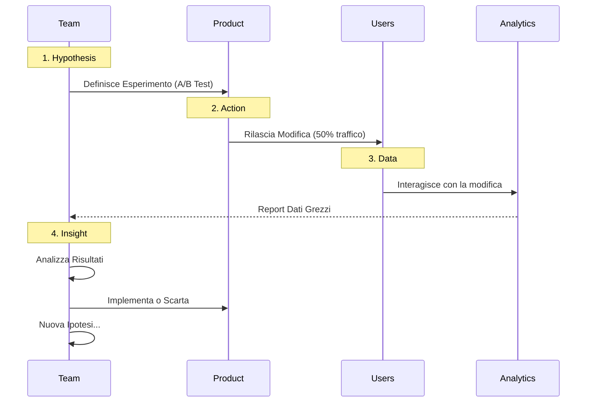

# HADI Cycles: L'Acceleratore della Tua Crescita

Per crescere velocemente, devi imparare velocemente. Il ciclo HADI (Hypothesis, Action, Data, Insight) è il motore di questo apprendimento. Non è solo un acronimo, è una filosofia operativa che trasforma le opinioni in fatti.

Se hai letto "The Lean Startup" di Eric Ries, il concetto ti sarà familiare (Build-Measure-Learn). Ma HADI è più specifico per il Growth Hacking e il marketing sperimentale.

## Cos'è il Ciclo HADI?

È un processo iterativo continuo composto da 4 fasi distinte:

1.  **Hypothesis (Ipotesi):** Formuliamo una previsione basata su dati o intuizioni.
2.  **Action (Azione):** Implementiamo il minimo necessario per testare l'ipotesi (MVP).
3.  **Data (Dati):** Misuriamo i risultati in modo oggettivo.
4.  **Insight (Apprendimento):** Analizziamo i dati per capire *perché* è successo e cosa fare dopo.

### Fase 1: Hypothesis (La Fondazione)
Un'ipotesi non è "Spero che funzioni". Deve seguire la struttura:
> "Crediamo che [facendo questa azione] per [questo pubblico], otterremo [questo risultato], perché [motivazione]."

Esempio: "Se cambiamo il colore del pulsante 'Acquista' da grigio a rosso, il tasso di click aumenterà del 10% perché il rosso crea urgenza."

### Fase 2: Action (La Velocità è Tutto)
L'errore più comune è costruire la soluzione perfetta. Nel HADI, l'obiettivo è imparare, non costruire.
*   Non rifare tutto il sito. Fai un A/B test su una sola pagina.
*   Non sviluppare una feature complessa. Fai un "Fake Door Test" (un pulsante che porta a una pagina "Coming Soon").

### Fase 3: Data (La Verità)
Raccogli i dati. Ma quali dati?
*   Definisci la tua **Omtm (One Metric That Matters)** prima di iniziare.
*   Assicurati di avere significatività statistica. Se hai 10 visite, il dato è rumore, non segnale.
*   Usa strumenti come Google Optimize, VWO, o script custom.

### Fase 4: Insight (Il Valore Reale)
Il vero valore del ciclo non è il successo dell'esperimento, ma l'apprendimento.
*   Se l'ipotesi è validata -> Scala l'azione.
*   Se l'ipotesi è rigettata -> Hai imparato cosa *non* funziona (risparmiando soldi futuri).
*   Se il risultato è inconcludente -> L'esperimento era progettato male o l'impatto è trascurabile.

## HADI vs OODA Loop vs PDCA

Esistono molti cicli simili, ma HADI è ottimizzato per il digitale:
*   **OODA (Observe, Orient, Decide, Act):** Nato nell'aviazione militare, è perfetto per reazioni rapide in ambienti caotici.
*   **PDCA (Plan, Do, Check, Act):** Nato nel manifatturiero (Toyota), è ottimo per il controllo qualità e il miglioramento incrementale.
*   **HADI:** È specifico per la *scoperta* di nuovi canali di crescita.

## Caso Studio: SaaS Pricing

Immagina una startup SaaS che vuole aumentare i ricavi.

1.  **Hypothesis:** "Rimuovendo il piano 'Free' e offrendo solo una prova di 14 giorni, aumenteremo i clienti paganti del 5% perché eliminiamo gli utenti 'scrocconi' che consumano risorse."
2.  **Action:** Nascondiamo il piano Free dalla pagina dei prezzi per il 50% del traffico.
3.  **Data:** Dopo 2 settimane, il gruppo di test ha generato il 20% *meno* signup, ma il 10% *più* ricavi totali.
4.  **Insight:** Abbiamo meno utenti, ma di qualità superiore. Il costo di supporto è crollato. La strategia è vincente per la profittabilità, anche se rallenta l'acquisizione utenti.

## Visualizzare il Processo

Il ciclo non finisce mai. L'Insight di oggi diventa l'Ipotesi di domani.

## Conclusione

La velocità di esecuzione è l'unico vantaggio competitivo durevole. Le aziende che completano un ciclo HADI in una settimana batteranno sempre quelle che ci mettono un mese. Smetti di pianificare per anni e inizia a testare oggi.
