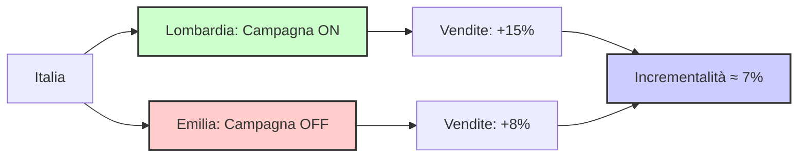

# Incrementality: La Domanda da Un Milione di Euro

Spendi 50.000€ al mese su Meta Ads. Le vendite aumentano. Ma la domanda scomoda è: quelle vendite sarebbero arrivate comunque? Stai pagando per clienti che ti avrebbero trovato da soli?

Questa è la domanda dell'**incrementalità** — e la maggior parte delle aziende italiane non sa rispondere.

## Cos'è l'Incrementalità?

L'incrementalità misura l'effetto **causale** di una campagna marketing sulle vendite. Non la correlazione (le vendite sono aumentate mentre la campagna era attiva), ma la causalità (le vendite sono aumentate *perché* la campagna era attiva).

La formula concettuale:
`Vendite Incrementali = Vendite Totali - Vendite che sarebbero avvenute comunque (Baseline)`

### Perché l'Attribuzione Tradizionale Mente

I modelli di attribuzione classici (last-click, first-click, linear) assegnano credito ai touchpoint. Ma attribuire credito non prova la causalità.

| Modello | Come funziona | Perché mente |
|---|---|---|
| **Last-click** | Tutto il credito all'ultimo canale | Ignora tutto il percorso precedente |
| **First-click** | Tutto il credito al primo canale | Ignora le interazioni successive |
| **Linear** | Credito distribuito equamente | Assume che ogni touchpoint abbia lo stesso peso |
| **Data-driven** | ML distribuisce il credito | Migliore, ma ancora correlazione non causalità |

## I 3 Metodi per Misurare l'Incrementalità

### 1. Geo-Lift Test (Holdout Geografico)

Dividi il mercato in due aree geografiche simili. In una fai la campagna, nell'altra no (gruppo di controllo). Confronti le vendite.

**Esempio pratico:** Vuoi testare se una campagna TV regionale funziona davvero.
*   **Test:** Campagna attiva in Lombardia.
*   **Controllo:** Nessuna campagna in Emilia-Romagna (regione simile per PIL e popolazione).
*   **Risultato:** Se le vendite in Lombardia crescono del 15% e in Emilia dell'8%, l'incrementalità stimata è circa il 7%.



### 2. Conversion Lift Study (Meta / Google)

Meta e Google offrono strumenti nativi di "Conversion Lift" che creano automaticamente un gruppo di test (vede l'ad) e un gruppo di controllo (non vede l'ad) all'interno della stessa audience.

**Pro:**
*   Randomizzazione a livello utente (gold standard statistico).
*   Facile da implementare (basta attivarla nella piattaforma).

**Contro:**
*   Controllata dalla stessa piattaforma che ti vende gli ads (conflitto di interessi).
*   Richiede budget elevati per raggiungere significatività statistica (~3-5x il budget normale).

### 3. Ghost Ads (Public Service Announcements)

Invece di non mostrare nulla al gruppo di controllo, gli mostri un annuncio generico (PSA, ad esempio un invito a donare il sangue). In questo modo, misuri l'effetto incrementale dell'annuncio specifico vs un annuncio irrilevante.

Vantaggi: elimina il bias del "l'utente era semplicemente in modalità acquisto" perché entrambi i gruppi vedono un annuncio.

## Come Calcolare il Valore dell'Incrementalità

Una volta misurata l'incrementalità, puoi calcolare il vero **iROAS** (incremental Return on Ad Spend):

```
iROAS = Revenue Incrementale / Spesa Pubblicitaria
```

**Esempio concreto:**

| Metrica | Valore |
|---|---|
| Spesa Meta Ads mensile | 30.000€ |
| Revenue attribuito (last-click) | 120.000€ |
| ROAS apparente | 4.0x |
| Revenue incrementale (dopo lift test) | 45.000€ |
| **iROAS reale** | **1.5x** |

In questo esempio, il 62% del revenue "attribuito" sarebbe arrivato comunque. Il ROAS reale è 1.5x, non 4.0x. Questo cambia completamente le decisioni di budget allocation.

## Il Framework dell'Incrementalità per Canale

Non tutti i canali hanno la stessa incrementalità. Come regola empirica:

| Canale | Incrementalità tipica | Perché |
|---|---|---|
| **Brand Search (Google)** | 🔴 Bassa (10-30%) | Chi cerca il tuo brand ti troverebbe comunque |
| **Retargeting** | 🟡 Media (20-50%) | Molti di questi utenti avrebbero convertito da soli |
| **Social Ads (prospecting)** | 🟢 Alta (50-80%) | Raggiungi utenti che non ti conoscono |
| **Influencer / Awareness** | 🟢 Alta (60-90%) | Crea domanda che non esisteva |
| **Email (clienti esistenti)** | 🟡 Media (30-60%) | Dipende: promo vs contenuto |

### La Sorpresa del Brand Search

"Ma il mio Brand Search ha un ROAS di 20x!" Sì, perché stai pagando per click di persone che avrebbero cercato il tuo sito comunque. Se spegni il Brand Search, il traffico migra al risultato organico. L'incrementalità reale è spesso sotto il 20%.

## Come Iniziare: 3 Test da Fare Subito

1.  **Spegni il retargeting per 2 settimane** in una regione e confronta le vendite.
2.  **Riduci il budget Brand Search del 50%** e monitora il traffico organico — assorbe la differenza?
3.  **Chiedi a Meta un Conversion Lift Study** sulla prossima campagna di prospecting.

## Conclusione

L'incrementalità è la metrica che separa i marketing manager bravi da quelli eccellenti. I bravi sanno quanti soldi spendono e quanto revenue generano. Gli eccellenti sanno quante vendite **non** sarebbero avvenute senza quella spesa. Inizia a chiederti: "Quanto di quello che attribuisco alle mie campagne sarebbe accaduto comunque?" La risposta potrebbe sorprenderti.
