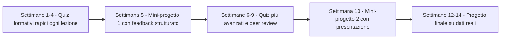

Nel 2011 Sebastian Thrun, professore di informatica a Stanford, pubblicò online gratuitamente il suo corso di Intelligenza Artificiale, aspettandosi qualche migliaio di iscritti. Invece, si iscrissero 160.000 persone da 190 paesi. Sorprendentemente, i migliori studenti non erano universitari americani, ma persone autodidatte da paesi senza accesso a università di alto livello. Thrun lasciò Stanford per fondare Udacity, affermando che tra cinquant'anni resteranno solo dieci istituzioni di istruzione superiore davvero rilevanti. Questa storia evidenzia un problema strutturale: l'università tradizionale è costruita su vincoli superati dalla tecnologia, come la necessità di presenza fisica e la scarsità di esperti.

L'università italiana, con la sua lunga storia e burocrazia, non è immune da questa tensione. I dati recenti mostrano un ritardo strutturale: tassi di abbandono al primo anno tra il 15 e il 20%, laureati tra i 25-34 anni al 29% contro una media UE del 42%, soddisfazione per la didattica più bassa, uso limitato di learning analytics, occupazione post-laurea inferiore, tempi di laurea più lunghi e spesa per studente inferiore. Questi numeri non indicano un'emergenza improvvisa, ma un problema radicato e persistente.

## I 5 pilastri del professore innovativo

### 1. flipped classroom: invertire la dinamica tradizionale

Nel modello tradizionale il docente trasmette conoscenza in aula e lo studente applica a casa, spesso senza supporto. La flipped classroom sposta la trasmissione a casa tramite video o letture e dedica il tempo in aula all'applicazione pratica e al confronto. Questo consente un feedback immediato e un supporto mirato. Per funzionare, i video devono essere brevi e integrati da domande di comprensione, e la lezione in aula deve presupporre la loro visione.

### 2. learning analytics: misurare ciò che conta

Le piattaforme moderne raccolgono dati dettagliati sulle interazioni degli studenti: frequenza, visualizzazioni, risultati dei quiz, tempi di completamento e engagement. Questi dati aiutano a identificare studenti a rischio e a migliorare materiali e metodi. Un esempio concreto mostra che la revisione multipla dei video è un segnale di impegno, non di difficoltà.

### 3. project-based learning: partire da problemi reali

Sostituire esercizi astratti con problemi concreti obbliga gli studenti a prendere decisioni reali, scegliere metriche, dati e modalità di comunicazione. Questo approccio sviluppa competenze richieste dal mercato del lavoro, rendendo la teoria immediatamente rilevante e memorabile.

### 4. gamification: motivare con incentivi reali

La gamification efficace modifica la struttura degli incentivi, non solo la superficie. Esempi efficaci includono leaderboard anonime su quiz brevi, sfide a squadre con valutazione tra pari e simulazioni di business con conseguenze misurabili. Questi strumenti aumentano il coinvolgimento e la responsabilità sociale.

### 5. feedback continuo: valutare prima dell'esame finale

L'esame finale arriva troppo tardi per correggere incomprensioni profonde. Quiz formativi settimanali, mini-progetti intermedi e peer review strutturata permettono di identificare e correggere problemi in tempo reale, riducendo ansia e migliorando i risultati.

## Casi di successo

All'Università di Bologna, il professor Carlo Moretti ha introdotto learning analytics in corsi di Gestione dei Processi, ottenendo una riduzione dell'abbandono dal 18% al 7% e un aumento del voto medio da 22.1 a 24.8. Al Politecnico di Milano, il programma Executive MBA ha sviluppato un modello predittivo per identificare studenti a rischio occupazionale, offrendo interventi mirati che hanno migliorato il placement al 92% entro sei mesi dalla laurea.

## Gestire la resistenza

L'innovazione incontra spesso resistenze: colleghi tradizionalisti, burocrazia accademica e studenti abituati a metodi passivi. La strategia è portare dati concreti, distinguere tra contenuti e metodi didattici e rinegoziare esplicitamente il patto formativo con gli studenti, spiegando il valore dell'apprendimento attivo.

## Contesto nazionale e risorse

Il PNRR ha stanziato oltre 3 miliardi di euro per innovazione universitaria, inclusi infrastrutture digitali, formazione docenti e sviluppo di corsi online. I fondi Erasmus+ offrono ulteriori risorse per scambi e innovazioni didattiche. Il principale ostacolo non è il denaro, ma la conoscenza e accesso a queste risorse.

## Strumenti gratuiti per iniziare

Non serve investire subito: strumenti come Google Colab, Moodle, Mentimeter, Kaggle, Slido e Notion sono gratuiti o open source e integrabili con gli LMS esistenti. La scelta degli strumenti deve partire dalla domanda pedagogica, non dal tool.

## Framework per la digital transformation

Un percorso strutturato prevede:

- Diagnosi iniziale (audit dati, identificazione docenti pionieri, setup strumenti)
- Pilot localizzato con 5-10 docenti e misurazione rigorosa
- Scaling selettivo a 30-50 docenti e formazione sistematica
- Culturalizzazione con integrazione di metodi innovativi come standard e creazione di centri di eccellenza

## Il punto
Essere un professore innovativo significa usare dati e metodi moderni per un obiettivo antico: far imparare davvero gli studenti. L'università ha un vantaggio unico nel contatto umano e nella comunità, che nessuna piattaforma online può replicare. La sfida è riconoscere che il cambiamento è possibile, strategico e conveniente, e agire con consapevolezza e metodo.
