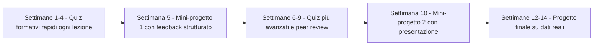

{/* geo-imprint: contesto:geografico, contesto:valuta */}

Tenere una lezione frontale davanti a un'aula silenziosa, scoprire solo all'appello d'esame che metà corso non ha capito i passaggi fondamentali e vedere studenti del primo anno sparire prima della sessione estiva è una frustrazione comune per chi insegna in università. In un corso gestito con metodi attivi e dati settimanali, invece, puoi capire chi sta restando indietro già alla terza settimana e usare le ore in presenza per lavorare sui problemi insieme agli studenti. Qui trovi cinque pratiche didattiche applicabili subito, i numeri ottenuti a Bologna e al Politecnico di Milano, gli strumenti gratuiti per partire e le quattro fasi per estendere il cambiamento al dipartimento.

Il divario tra aula tradizionale e possibilità tecnologiche è emerso chiaramente già nel 2011. Sebastian Thrun, professore di informatica a Stanford, mise online gratis il suo corso di Intelligenza Artificiale aspettandosi qualche migliaio di iscritti: ne arrivarono 160.000 da 190 paesi. I risultati migliori vennero da autodidatti di paesi privi di accesso ad atenei prestigiosi. Thrun lasciò poi Stanford per fondare Udacity, sostenendo che entro cinquant'anni resteranno solo dieci istituzioni di istruzione superiore davvero rilevanti. Quell'episodio mostra che la lezione basata sulla sola presenza fisica e sulla scarsità di accesso agli esperti poggia su vincoli che la rete ha già superato.
{/* GEO: claim senza fonte */}

Anche l'università italiana, tra storia lunga e burocrazia pesante, si confronta con questo ritardo. I dati recenti mostrano tassi di abbandono al primo anno compresi tra il 15% e il 20%, una quota di laureati nella fascia 25-34 anni ferma al 29% contro una media UE del 42%, una soddisfazione più bassa per la didattica, un uso limitato dei learning analytics, tempi di laurea più lunghi, una spesa per studente inferiore e un'occupazione post-laurea più debole. Si tratta quindi di una debolezza strutturale accumulata nel tempo, su cui però i singoli docenti e i dipartimenti possono intervenire con metodi misurabili.

## Cinque pratiche per portare i dati e la partecipazione in aula

Per cambiare l'esperienza di un corso servono interventi concreti sul modo in cui gli studenti preparano la lezione, ricevono riscontri e vengono valutati.

### 1. Usare la flipped classroom per liberare tempo pratico in aula

Nel modello classico il docente spiega la teoria in aula e lo studente prova ad applicarla a casa da solo. Con la flipped classroom, al contrario, l'ascolto della parte teorica avviene a casa tramite brevi video o letture mirate, mentre le ore in aula vengono dedicate ad esercizi, discussione e risoluzione di dubbi. Di conseguenza, chi insegna può dare un feedback immediato proprio nel momento in cui emerge l'errore. Perché il meccanismo regga, i video devono essere brevi e abbinati a domande rapide di comprensione, mentre la lezione in presenza deve partire dal presupposto che quel materiale sia già stato visto.

### 2. Leggere i segnali di abbandono con i learning analytics

Le piattaforme didattiche registrano già molte interazioni utili: accessi, visualizzazioni dei materiali, esiti dei quiz, tempi di completamento e livello di partecipazione. Analizzare questi dati permette di individuare gli studenti in difficoltà prima della sessione d'esame e di capire quali parti del programma creano più ostacoli. Per esempio, uno studente che riguarda più volte lo stesso video sta mostrando impegno e interesse verso un passaggio complesso, quindi ha senso offrirgli un chiarimento mirato prima che si scoraggi.

### 3. Sostituire gli esercizi astratti con il project-based learning

Lavorare su problemi reali costringe gli studenti a prendere decisioni operative, scegliere metriche adatte, gestire dati imperfetti e spiegare i propri risultati. Questo approccio allena competenze richieste direttamente dal mercato del lavoro e rende la teoria più facile da ricordare perché collegata a un utilizzo concreto.

### 4. Progettare incentivi misurabili con la gamification

La gamification funziona quando modifica le regole di partecipazione del corso. Tra gli strumenti più efficaci ci sono le classifiche anonime basate su quiz brevi, le sfide a squadre con valutazione tra pari e le simulazioni di business in cui ogni scelta produce conseguenze misurabili. Introdurre queste dinamiche aumenta la costanza nello studio e il senso di responsabilità verso il proprio gruppo.

### 5. Correggere le lacune prima dell'esame con il feedback continuo

Arrivare direttamente all'esame finale lascia troppo poco margine per correggere errori di impostazione accumulati per mesi. Inserire quiz formativi settimanali, mini-progetti intermedi e momenti strutturati di peer review consente di intervenire mentre il corso è ancora aperto, abbassando l'ansia da esame e migliorando i voti finali.

## Ridurre gli abbandoni e alzare il placement: i casi di Bologna e Milano

Due esperienze italiane mostrano cosa succede quando analisi dei dati e didattica attiva entrano stabilmente in un corso. All'Università di Bologna, il professor Carlo Moretti ha introdotto i learning analytics nei corsi di Gestione dei Processi: l'abbandono è sceso dal 18% al 7% e il voto medio è salito da 22.1 a 24.8. Al Politecnico di Milano, invece, il programma Executive MBA ha sviluppato un modello predittivo per individuare gli studenti più esposti al rischio occupazionale, portando il placement al 92% entro sei mesi dalla laurea grazie a interventi mirati.

## Superare le resistenze di colleghi, burocrazia e studenti

Portare questi metodi in ateneo comporta quasi sempre attriti con colleghi legati alla lezione frontale, procedure amministrative rigide e studenti abituati ad ascoltare in modo passivo. Il punto è che le discussioni astratte raramente convincono chi è scettico. Conviene quindi presentare dati raccolti sul campo, distinguere con chiarezza i contenuti disciplinari dal metodo con cui vengono insegnati e rinegoziare in modo esplicito il patto formativo con l'aula, spiegando fin dal primo giorno come la partecipazione attiva migliori la preparazione all'esame.

## Accedere ai fondi PNRR ed Erasmus+ per la didattica

Sul fronte economico le risorse esistono già. Il PNRR ha stanziato oltre 3 miliardi di euro per l'innovazione universitaria tra infrastrutture digitali, formazione dei docenti e sviluppo di corsi online, mentre i programmi Erasmus+ mettono a disposizione fondi aggiuntivi per scambi e sperimentazioni didattiche. Spesso il vero freno sta nella scarsa conoscenza dei bandi disponibili e nella capacità dei singoli dipartimenti di strutturare progetti pronti per accedervi.

## Iniziare a costo zero con strumenti già pronti

Per fare un primo test in aula basta partire dagli strumenti gratuiti o open source già disponibili. Google Colab, Moodle, Mentimeter, Kaggle, Slido e Notion si integrano facilmente con i sistemi di gestione didattica usati negli atenei. Prima di scegliere il software, conviene definire con precisione quale obiettivo didattico vuoi raggiungere, ad esempio verificare la comprensione a metà lezione o raccogliere consegne settimanali.

## Scalare il cambiamento in ateneo in quattro fasi

Quando un singolo esperimento funziona, estenderlo a un intero corso di laurea o dipartimento richiede una sequenza ordinata:

1. **Diagnosi iniziale**: esegui un audit dei dati già raccolti dalle piattaforme, individua i docenti disponibili a sperimentare e prepara gli strumenti di base.
2. **Pilot localizzato**: coinvolgi da 5 a 10 docenti su corsi selezionati e misura in modo rigoroso abbandono, partecipazione ed esiti.
3. **Scaling selettivo**: allarga la sperimentazione a 30-50 docenti affiancando un percorso sistematico di formazione interna.
4. **Culturalizzazione**: trasforma le pratiche validate nello standard di dipartimento e consolida centri di eccellenza dedicati alla didattica.

## Il primo passo da fare nel prossimo semestre

L'università conserva un vantaggio che nessuna piattaforma online replica da sola, cioè il contatto umano diretto e la vita di comunità in aula. Usare dati e metodi attivi serve proprio a far fruttare meglio quel tempo insieme. Per iniziare concretamente nel prossimo semestre, scegli un solo insegnamento, imposta un breve quiz settimanale su Moodle o Slido per monitorare chi resta indietro e confronta i tassi di superamento rispetto all'anno precedente.

## Domande frequenti

1. **Perché le università italiane fanno fatica a innovare?**
Gli incentivi accademici premiano la carriera di cattedra prima della ricerca applicata, i finanziamenti per l'impatto restano limitati e la collaborazione con le imprese è scarsa. Anche con i 3 miliardi di euro stanziati dal PNRR, la cultura organizzativa cambia lentamente.

2. **Cosa possono imparare le università dai data team aziendali?**
Possono adottare una cultura della misurazione basata su risultati chiari, metriche di successo e iterazioni rapide. Mentre gli atenei tendono a contare gli input come articoli e citazioni, i data team misurano il valore prodotto.

3. **Come si misura l'impatto della ricerca universitaria?**
Oltre al numero di pubblicazioni e citazioni, l'impatto si valuta sui problemi reali risolti, sulle tecnologie trasferite, sulle startup avviate e sulle politiche pubbliche influenzate. Il PNRR lega parte dei fondi proprio a questi obiettivi.
